# Release MVP

Generated by `node tools/req-check/index.mjs --traceability` (tools/req-check) from the link headers of the requirement slices. Do not edit by hand.

248 slices in MVP: 44 migrated, 204 not migrated.

## Migrated slices

| Slice | Module | Extends | Depends on | Design | Criteria |
| --- | --- | --- | --- | --- | ---: |
| [BUD-01@MVP](../../docs/requirements/bud/BUD-01.mvp.md) | categories, categorization | BUD-01@PoC v2 | FIN-03@MVP | S-047, S-049, S-121, S-196 | 17 |
| [BUD-02@MVP](../../docs/requirements/bud/BUD-02.mvp.md) | budget | BUD-02@PoC v2 | BUD-01@MVP, FIN-01@MVP, FIN-03@MVP | S-121, S-122, S-123, S-124, S-125, S-127, S-128, S-135, S-287, S-288, S-289 | 17 |
| [BUD-03@MVP](../../docs/requirements/bud/BUD-03.mvp.md) | budget | BUD-03@PoC | AST-11@MVP, BUD-01@MVP, BUD-02@MVP, BUD-05@MVP, BUD-07@MVP, BUD-18@MVP, FIN-01@MVP, FIN-03@MVP, INS-01@MVP, UX-02@MVP | S-040, S-121 | 14 |
| [BUD-04@MVP](../../docs/requirements/bud/BUD-04.mvp.md) | budget | BUD-04@PoC | BUD-03@MVP, BUD-05@MVP, BUD-06@MVP | S-142 | 8 |
| [BUD-05@MVP](../../docs/requirements/bud/BUD-05.mvp.md) | goals | BUD-05@PoC v2 | AST-01@MVP, FIN-01@MVP, FIN-03@MVP, NOT-01@MVP | S-136, S-137, S-138, S-140, S-139 | 23 |
| [BUD-06@MVP](../../docs/requirements/bud/BUD-06.mvp.md) | budget | BUD-06@PoC v2 | BUD-01@MVP, BUD-02@MVP, BUD-05@MVP, BUD-16@MVP | S-047, S-132, S-133, S-135, S-290 | 16 |
| [BUD-07@MVP](../../docs/requirements/bud/BUD-07.mvp.md) | recurring | BUD-07@PoC | AST-11@MVP, BUD-01@MVP, FIN-01@MVP, FIN-03@MVP, INS-01@MVP, NOT-01@MVP | S-121, S-141 | 17 |
| [BUD-08@MVP](../../docs/requirements/bud/BUD-08.mvp.md) | cashflow | BUD-08@PoC v2 | AST-11@MVP, BUD-01@MVP, BUD-05@MVP, BUD-13@MVP, FIN-01@MVP, FIN-03@MVP | S-134 | 9 |
| [BUD-09@MVP](../../docs/requirements/bud/BUD-09.mvp.md) | budget | — | BUD-02@MVP, BUD-05@MVP, FIN-01@MVP, FIN-12@PoC v2, NOT-01@MVP | S-121, S-128 | 14 |
| [BUD-10@MVP](../../docs/requirements/bud/BUD-10.mvp.md) | budget, notification-preferences | — | BUD-03@MVP, BUD-05@MVP, BUD-07@MVP, BUD-09@MVP, NOT-01@MVP | S-194, S-288 | 12 |
| [BUD-11@MVP](../../docs/requirements/bud/BUD-11.mvp.md) | transactions, duplicate-matching | BUD-11@PoC | BUD-01@MVP, BUD-12@MVP, BUD-14@MVP, FIN-01@MVP, FIN-03@MVP, FIN-12@PoC v2, IMP-08@MVP, NOT-01@MVP, UX-01@MVP | S-025, S-048, S-053, S-055a | 7 |
| [BUD-12@MVP](../../docs/requirements/bud/BUD-12.mvp.md) | transactions, categorization | BUD-12@PoC | BUD-01@MVP, BUD-14@MVP, DAT-03@MVP, FIN-03@MVP, NOT-01@MVP | S-046, S-047, S-058, S-199 | 12 |
| [BUD-13@MVP](../../docs/requirements/bud/BUD-13.mvp.md) | transactions, file-storage | BUD-13@PoC | BUD-01@MVP, DAT-02@MVP, DAT-03@MVP, FIN-03@MVP | S-046, S-047, S-049 | 9 |
| [BUD-14@MVP](../../docs/requirements/bud/BUD-14.mvp.md) | merchants, categorization | BUD-14@PoC | AST-01@MVP, BUD-01@MVP, FIN-03@MVP, NOT-01@MVP | S-047, S-069, S-197, S-198, S-285 | 17 |
| [BUD-15@MVP](../../docs/requirements/bud/BUD-15.mvp.md) | receipts | BUD-15@PoC v2 | BUD-13@MVP, FIN-03@MVP, IMP-08@MVP, NOT-01@MVP | S-065, S-066, S-067, S-068 | 15 |
| [BUD-16@MVP](../../docs/requirements/bud/BUD-16.mvp.md) | budget | BUD-16@PoC v2 | BUD-01@MVP, BUD-02@MVP, BUD-05@MVP, BUD-07@MVP, BUD-09@MVP, BUD-17@MVP, FIN-01@MVP, NOT-01@MVP | S-121, S-125, S-129, S-130, S-133 | 12 |
| [BUD-17@MVP](../../docs/requirements/bud/BUD-17.mvp.md) | budget | BUD-17@PoC v2 | AST-11@MVP, BUD-02@MVP, BUD-05@MVP, BUD-19@MVP, FIN-01@MVP | S-126, S-288, S-289 | 13 |
| [BUD-18@MVP](../../docs/requirements/bud/BUD-18.mvp.md) | budget | BUD-18@PoC v2 | BUD-01@MVP, BUD-02@MVP, BUD-05@MVP, BUD-09@MVP, BUD-16@MVP, BUD-17@MVP | S-121, S-129, S-130, S-131 | 12 |
| [BUD-19@MVP](../../docs/requirements/bud/BUD-19.mvp.md) | debt-payoff | BUD-19@PoC | AST-11@MVP, BUD-02@MVP, FIN-01@MVP, FIN-03@MVP | S-143, S-144, S-145, S-146 | 10 |
| [BUD-20@MVP](../../docs/requirements/bud/BUD-20.mvp.md) | reports | — | BUD-01@MVP, BUD-08@MVP, BUD-13@MVP, BUD-14@MVP, FIN-03@MVP | S-147, S-148 | 10 |
| [DAT-01@MVP](../../docs/requirements/dat/DAT-01.mvp.md) | transactions, saved-views, asset-registry | DAT-01@PoC v2 | ACC-10@MVP | S-046, S-070 | 12 |
| [DAT-02@MVP](../../docs/requirements/dat/DAT-02.mvp.md) | search | — | ACC-10@MVP, DAT-01@MVP | S-021, S-022 | 13 |
| [DAT-03@MVP](../../docs/requirements/dat/DAT-03.mvp.md) | bulk-actions, transactions, asset-registry | DAT-03@PoC | AST-01@MVP, AST-12@MVP, DAT-01@MVP, VAL-07@MVP | S-036, S-046, S-070 | 16 |
| [DAT-04@MVP](../../docs/requirements/dat/DAT-04.mvp.md) | import-sessions, import-recipes, transactions, asset-registry, parties, holdings, notification-delivery | DAT-04@PoC | AST-01@MVP, AST-11@MVP, DOC-01@MVP, FIN-01@MVP, FIN-03@MVP, FIN-05@MVP, IMP-04@MVP, NOT-01@MVP | S-162, S-166, S-175, S-176, S-177, S-179, S-163, S-164, S-165, S-167, S-168, S-169 | 16 |
| [DAT-05@MVP](../../docs/requirements/dat/DAT-05.mvp.md) | feature-flags, support, access-scope, onboarding, dashboard | DAT-05@PoC v2 | ACC-10@MVP, SUP-01@MVP, UX-01@MVP | S-028, S-029 | 10 |
| [FCS-01@MVP](../../docs/requirements/fcs/FCS-01.mvp.md) | cashflow | FCS-01@PoC | AST-11@MVP, BUD-01@MVP, BUD-02@MVP, BUD-04@MVP, BUD-07@MVP, BUD-10@MVP, BUD-18@MVP, FIN-01@MVP, FIN-03@MVP, INS-01@MVP | S-121 | 15 |
| [FCS-02@MVP](../../docs/requirements/fcs/FCS-02.mvp.md) | cashflow | FCS-02@PoC | AST-11@MVP, BUD-01@MVP, BUD-03@MVP, FCS-01@MVP, INS-01@MVP, UX-02@MVP | S-040, S-121 | 14 |
| [FCS-03@MVP](../../docs/requirements/fcs/FCS-03.mvp.md) | cashflow | FCS-03@PoC v2 | BUD-02@MVP, FCS-01@MVP, FCS-02@MVP, UX-02@MVP, WGT-14@MVP | S-040, S-121 | 17 |
| [IMP-01@MVP](../../docs/requirements/imp/IMP-01.mvp.md) | import-sessions, file-parsers, file-storage, transactions, ocr | IMP-01@PoC | AST-11@MVP, FIN-01@MVP, FIN-03@MVP, FIN-05@MVP | S-162, S-163, S-170 | 17 |
| [IMP-03@MVP](../../docs/requirements/imp/IMP-03.mvp.md) | transfer-matching, transactions, ledger | IMP-03@PoC | FIN-03@MVP, FIN-04@PoC, FIN-05@MVP, IMP-01@MVP, IMP-02@PoC | S-059, S-286 | 25 |
| [IMP-04@MVP](../../docs/requirements/imp/IMP-04.mvp.md) | duplicate-matching, import-sessions, ledger | IMP-04@PoC | FIN-03@MVP, FIN-04@PoC, IMP-01@MVP | S-163, S-171 | 12 |
| [IMP-05@MVP](../../docs/requirements/imp/IMP-05.mvp.md) | import-sessions, file-parsers | IMP-05@PoC | IMP-01@MVP, IMP-02@PoC | S-171 | 9 |
| [IMP-06@MVP](../../docs/requirements/imp/IMP-06.mvp.md) | import-recipes, file-parsers, ocr | IMP-06@PoC | IMP-01@MVP | S-171, S-172 | 16 |
| [IMP-07@MVP](../../docs/requirements/imp/IMP-07.mvp.md) | import-recipes, import-sessions | IMP-07@PoC | IMP-01@MVP, IMP-06@MVP | S-162, S-170, S-172, S-294 | 14 |
| [IMP-08@MVP](../../docs/requirements/imp/IMP-08.mvp.md) | import-sessions, ocr | IMP-08@PoC | IMP-01@MVP, IMP-03@MVP, IMP-04@MVP, IMP-05@MVP, IMP-06@MVP, IMP-07@MVP, UX-09@MVP | S-162, S-025, S-163, S-170, S-171, S-174 | 19 |
| [IMP-09@MVP](../../docs/requirements/imp/IMP-09.mvp.md) | import-recipes, file-parsers | IMP-09@PoC | IMP-06@MVP, IMP-07@MVP, IMP-08@MVP | S-172 | 16 |
| [IMP-10@MVP](../../docs/requirements/imp/IMP-10.mvp.md) | import-recipes, staff-admin | IMP-10@PoC | ADM-05@MVP, IMP-06@MVP, IMP-07@MVP, IMP-11@MVP | S-268, S-269, S-270 | 11 |
| [IMP-11@MVP](../../docs/requirements/imp/IMP-11.mvp.md) | import-recipes, legal-consents | — | IMP-06@MVP, LEG-01@MVP | S-191, S-270 | 8 |
| [IMP-12@MVP](../../docs/requirements/imp/IMP-12.mvp.md) | file-parsers, import-sessions | — | IMP-01@MVP, IMP-06@MVP | S-170 | 12 |
| [IMP-13@MVP](../../docs/requirements/imp/IMP-13.mvp.md) | ocr, import-sessions | — | IMP-01@MVP, IMP-12@MVP | S-170 | 12 |
| [IMP-14@MVP](../../docs/requirements/imp/IMP-14.mvp.md) | import-sessions, file-storage | IMP-14@PoC | IMP-01@MVP, IMP-04@MVP | S-163, S-174 | 4 |
| [IMP-15@MVP](../../docs/requirements/imp/IMP-15.mvp.md) | import-sessions, file-parsers | IMP-15@PoC | IMP-01@MVP, IMP-03@MVP, IMP-05@MVP | S-170, S-171 | 3 |
| [IMP-18@MVP](../../docs/requirements/imp/IMP-18.mvp.md) | duplicate-matching, import-sessions | IMP-18@PoC | IMP-01@MVP, IMP-04@MVP | S-171 | 4 |
| [IMP-19@MVP](../../docs/requirements/imp/IMP-19.mvp.md) | import-sessions, file-parsers, ocr, notification-delivery | IMP-19@PoC | IMP-01@MVP, NOT-01@MVP | S-163 | 4 |

## Dependency graph

Arrows point from a slice to what it needs. Dashed arrows: «Розширює» (the same requirement in the previous release). Grey: not migrated yet, own dependencies unknown.

```mermaid
flowchart LR
  ACC_10_MVP["ACC-10@MVP"]
  ADM_05_MVP["ADM-05@MVP"]
  AST_01_MVP["AST-01@MVP"]
  AST_11_MVP["AST-11@MVP"]
  AST_12_MVP["AST-12@MVP"]
  BUD_01_MVP["BUD-01@MVP"]
  BUD_02_MVP["BUD-02@MVP"]
  BUD_03_MVP["BUD-03@MVP"]
  BUD_04_MVP["BUD-04@MVP"]
  BUD_05_MVP["BUD-05@MVP"]
  BUD_06_MVP["BUD-06@MVP"]
  BUD_07_MVP["BUD-07@MVP"]
  BUD_08_MVP["BUD-08@MVP"]
  BUD_09_MVP["BUD-09@MVP"]
  BUD_10_MVP["BUD-10@MVP"]
  BUD_11_MVP["BUD-11@MVP"]
  BUD_12_MVP["BUD-12@MVP"]
  BUD_13_MVP["BUD-13@MVP"]
  BUD_14_MVP["BUD-14@MVP"]
  BUD_15_MVP["BUD-15@MVP"]
  BUD_16_MVP["BUD-16@MVP"]
  BUD_17_MVP["BUD-17@MVP"]
  BUD_18_MVP["BUD-18@MVP"]
  BUD_19_MVP["BUD-19@MVP"]
  BUD_20_MVP["BUD-20@MVP"]
  DAT_01_MVP["DAT-01@MVP"]
  DAT_02_MVP["DAT-02@MVP"]
  DAT_03_MVP["DAT-03@MVP"]
  DAT_04_MVP["DAT-04@MVP"]
  DAT_05_MVP["DAT-05@MVP"]
  DOC_01_MVP["DOC-01@MVP"]
  FCS_01_MVP["FCS-01@MVP"]
  FCS_02_MVP["FCS-02@MVP"]
  FCS_03_MVP["FCS-03@MVP"]
  FIN_01_MVP["FIN-01@MVP"]
  FIN_03_MVP["FIN-03@MVP"]
  FIN_05_MVP["FIN-05@MVP"]
  IMP_01_MVP["IMP-01@MVP"]
  IMP_03_MVP["IMP-03@MVP"]
  IMP_04_MVP["IMP-04@MVP"]
  IMP_05_MVP["IMP-05@MVP"]
  IMP_06_MVP["IMP-06@MVP"]
  IMP_07_MVP["IMP-07@MVP"]
  IMP_08_MVP["IMP-08@MVP"]
  IMP_09_MVP["IMP-09@MVP"]
  IMP_10_MVP["IMP-10@MVP"]
  IMP_11_MVP["IMP-11@MVP"]
  IMP_12_MVP["IMP-12@MVP"]
  IMP_13_MVP["IMP-13@MVP"]
  IMP_14_MVP["IMP-14@MVP"]
  IMP_15_MVP["IMP-15@MVP"]
  IMP_18_MVP["IMP-18@MVP"]
  IMP_19_MVP["IMP-19@MVP"]
  INS_01_MVP["INS-01@MVP"]
  LEG_01_MVP["LEG-01@MVP"]
  NOT_01_MVP["NOT-01@MVP"]
  SUP_01_MVP["SUP-01@MVP"]
  UX_01_MVP["UX-01@MVP"]
  UX_02_MVP["UX-02@MVP"]
  UX_09_MVP["UX-09@MVP"]
  VAL_07_MVP["VAL-07@MVP"]
  WGT_14_MVP["WGT-14@MVP"]
  subgraph earlier["Earlier releases"]
    BUD_01_PoC_v2["BUD-01@PoC v2"]
    BUD_02_PoC_v2["BUD-02@PoC v2"]
    BUD_03_PoC["BUD-03@PoC"]
    BUD_04_PoC["BUD-04@PoC"]
    BUD_05_PoC_v2["BUD-05@PoC v2"]
    BUD_06_PoC_v2["BUD-06@PoC v2"]
    BUD_07_PoC["BUD-07@PoC"]
    BUD_08_PoC_v2["BUD-08@PoC v2"]
    BUD_11_PoC["BUD-11@PoC"]
    BUD_12_PoC["BUD-12@PoC"]
    BUD_13_PoC["BUD-13@PoC"]
    BUD_14_PoC["BUD-14@PoC"]
    BUD_15_PoC_v2["BUD-15@PoC v2"]
    BUD_16_PoC_v2["BUD-16@PoC v2"]
    BUD_17_PoC_v2["BUD-17@PoC v2"]
    BUD_18_PoC_v2["BUD-18@PoC v2"]
    BUD_19_PoC["BUD-19@PoC"]
    DAT_01_PoC_v2["DAT-01@PoC v2"]
    DAT_03_PoC["DAT-03@PoC"]
    DAT_04_PoC["DAT-04@PoC"]
    DAT_05_PoC_v2["DAT-05@PoC v2"]
    FCS_01_PoC["FCS-01@PoC"]
    FCS_02_PoC["FCS-02@PoC"]
    FCS_03_PoC_v2["FCS-03@PoC v2"]
    FIN_04_PoC["FIN-04@PoC"]
    FIN_12_PoC_v2["FIN-12@PoC v2"]
    IMP_01_PoC["IMP-01@PoC"]
    IMP_02_PoC["IMP-02@PoC"]
    IMP_03_PoC["IMP-03@PoC"]
    IMP_04_PoC["IMP-04@PoC"]
    IMP_05_PoC["IMP-05@PoC"]
    IMP_06_PoC["IMP-06@PoC"]
    IMP_07_PoC["IMP-07@PoC"]
    IMP_08_PoC["IMP-08@PoC"]
    IMP_09_PoC["IMP-09@PoC"]
    IMP_10_PoC["IMP-10@PoC"]
    IMP_14_PoC["IMP-14@PoC"]
    IMP_15_PoC["IMP-15@PoC"]
    IMP_18_PoC["IMP-18@PoC"]
    IMP_19_PoC["IMP-19@PoC"]
  end
  BUD_01_MVP --> FIN_03_MVP
  BUD_01_MVP -.-> BUD_01_PoC_v2
  BUD_02_MVP --> BUD_01_MVP
  BUD_02_MVP --> FIN_01_MVP
  BUD_02_MVP --> FIN_03_MVP
  BUD_02_MVP -.-> BUD_02_PoC_v2
  BUD_03_MVP --> AST_11_MVP
  BUD_03_MVP --> BUD_01_MVP
  BUD_03_MVP --> BUD_02_MVP
  BUD_03_MVP --> BUD_05_MVP
  BUD_03_MVP --> BUD_07_MVP
  BUD_03_MVP --> BUD_18_MVP
  BUD_03_MVP --> FIN_01_MVP
  BUD_03_MVP --> FIN_03_MVP
  BUD_03_MVP --> INS_01_MVP
  BUD_03_MVP --> UX_02_MVP
  BUD_03_MVP -.-> BUD_03_PoC
  BUD_04_MVP --> BUD_03_MVP
  BUD_04_MVP --> BUD_05_MVP
  BUD_04_MVP --> BUD_06_MVP
  BUD_04_MVP -.-> BUD_04_PoC
  BUD_05_MVP --> AST_01_MVP
  BUD_05_MVP --> FIN_01_MVP
  BUD_05_MVP --> FIN_03_MVP
  BUD_05_MVP --> NOT_01_MVP
  BUD_05_MVP -.-> BUD_05_PoC_v2
  BUD_06_MVP --> BUD_01_MVP
  BUD_06_MVP --> BUD_02_MVP
  BUD_06_MVP --> BUD_05_MVP
  BUD_06_MVP --> BUD_16_MVP
  BUD_06_MVP -.-> BUD_06_PoC_v2
  BUD_07_MVP --> AST_11_MVP
  BUD_07_MVP --> BUD_01_MVP
  BUD_07_MVP --> FIN_01_MVP
  BUD_07_MVP --> FIN_03_MVP
  BUD_07_MVP --> INS_01_MVP
  BUD_07_MVP --> NOT_01_MVP
  BUD_07_MVP -.-> BUD_07_PoC
  BUD_08_MVP --> AST_11_MVP
  BUD_08_MVP --> BUD_01_MVP
  BUD_08_MVP --> BUD_05_MVP
  BUD_08_MVP --> BUD_13_MVP
  BUD_08_MVP --> FIN_01_MVP
  BUD_08_MVP --> FIN_03_MVP
  BUD_08_MVP -.-> BUD_08_PoC_v2
  BUD_09_MVP --> BUD_02_MVP
  BUD_09_MVP --> BUD_05_MVP
  BUD_09_MVP --> FIN_01_MVP
  BUD_09_MVP --> FIN_12_PoC_v2
  BUD_09_MVP --> NOT_01_MVP
  BUD_10_MVP --> BUD_03_MVP
  BUD_10_MVP --> BUD_05_MVP
  BUD_10_MVP --> BUD_07_MVP
  BUD_10_MVP --> BUD_09_MVP
  BUD_10_MVP --> NOT_01_MVP
  BUD_11_MVP --> BUD_01_MVP
  BUD_11_MVP --> BUD_12_MVP
  BUD_11_MVP --> BUD_14_MVP
  BUD_11_MVP --> FIN_01_MVP
  BUD_11_MVP --> FIN_03_MVP
  BUD_11_MVP --> FIN_12_PoC_v2
  BUD_11_MVP --> IMP_08_MVP
  BUD_11_MVP --> NOT_01_MVP
  BUD_11_MVP --> UX_01_MVP
  BUD_11_MVP -.-> BUD_11_PoC
  BUD_12_MVP --> BUD_01_MVP
  BUD_12_MVP --> BUD_14_MVP
  BUD_12_MVP --> DAT_03_MVP
  BUD_12_MVP --> FIN_03_MVP
  BUD_12_MVP --> NOT_01_MVP
  BUD_12_MVP -.-> BUD_12_PoC
  BUD_13_MVP --> BUD_01_MVP
  BUD_13_MVP --> DAT_02_MVP
  BUD_13_MVP --> DAT_03_MVP
  BUD_13_MVP --> FIN_03_MVP
  BUD_13_MVP -.-> BUD_13_PoC
  BUD_14_MVP --> AST_01_MVP
  BUD_14_MVP --> BUD_01_MVP
  BUD_14_MVP --> FIN_03_MVP
  BUD_14_MVP --> NOT_01_MVP
  BUD_14_MVP -.-> BUD_14_PoC
  BUD_15_MVP --> BUD_13_MVP
  BUD_15_MVP --> FIN_03_MVP
  BUD_15_MVP --> IMP_08_MVP
  BUD_15_MVP --> NOT_01_MVP
  BUD_15_MVP -.-> BUD_15_PoC_v2
  BUD_16_MVP --> BUD_01_MVP
  BUD_16_MVP --> BUD_02_MVP
  BUD_16_MVP --> BUD_05_MVP
  BUD_16_MVP --> BUD_07_MVP
  BUD_16_MVP --> BUD_09_MVP
  BUD_16_MVP --> BUD_17_MVP
  BUD_16_MVP --> FIN_01_MVP
  BUD_16_MVP --> NOT_01_MVP
  BUD_16_MVP -.-> BUD_16_PoC_v2
  BUD_17_MVP --> AST_11_MVP
  BUD_17_MVP --> BUD_02_MVP
  BUD_17_MVP --> BUD_05_MVP
  BUD_17_MVP --> BUD_19_MVP
  BUD_17_MVP --> FIN_01_MVP
  BUD_17_MVP -.-> BUD_17_PoC_v2
  BUD_18_MVP --> BUD_01_MVP
  BUD_18_MVP --> BUD_02_MVP
  BUD_18_MVP --> BUD_05_MVP
  BUD_18_MVP --> BUD_09_MVP
  BUD_18_MVP --> BUD_16_MVP
  BUD_18_MVP --> BUD_17_MVP
  BUD_18_MVP -.-> BUD_18_PoC_v2
  BUD_19_MVP --> AST_11_MVP
  BUD_19_MVP --> BUD_02_MVP
  BUD_19_MVP --> FIN_01_MVP
  BUD_19_MVP --> FIN_03_MVP
  BUD_19_MVP -.-> BUD_19_PoC
  BUD_20_MVP --> BUD_01_MVP
  BUD_20_MVP --> BUD_08_MVP
  BUD_20_MVP --> BUD_13_MVP
  BUD_20_MVP --> BUD_14_MVP
  BUD_20_MVP --> FIN_03_MVP
  DAT_01_MVP --> ACC_10_MVP
  DAT_01_MVP -.-> DAT_01_PoC_v2
  DAT_02_MVP --> ACC_10_MVP
  DAT_02_MVP --> DAT_01_MVP
  DAT_03_MVP --> AST_01_MVP
  DAT_03_MVP --> AST_12_MVP
  DAT_03_MVP --> DAT_01_MVP
  DAT_03_MVP --> VAL_07_MVP
  DAT_03_MVP -.-> DAT_03_PoC
  DAT_04_MVP --> AST_01_MVP
  DAT_04_MVP --> AST_11_MVP
  DAT_04_MVP --> DOC_01_MVP
  DAT_04_MVP --> FIN_01_MVP
  DAT_04_MVP --> FIN_03_MVP
  DAT_04_MVP --> FIN_05_MVP
  DAT_04_MVP --> IMP_04_MVP
  DAT_04_MVP --> NOT_01_MVP
  DAT_04_MVP -.-> DAT_04_PoC
  DAT_05_MVP --> ACC_10_MVP
  DAT_05_MVP --> SUP_01_MVP
  DAT_05_MVP --> UX_01_MVP
  DAT_05_MVP -.-> DAT_05_PoC_v2
  FCS_01_MVP --> AST_11_MVP
  FCS_01_MVP --> BUD_01_MVP
  FCS_01_MVP --> BUD_02_MVP
  FCS_01_MVP --> BUD_04_MVP
  FCS_01_MVP --> BUD_07_MVP
  FCS_01_MVP --> BUD_10_MVP
  FCS_01_MVP --> BUD_18_MVP
  FCS_01_MVP --> FIN_01_MVP
  FCS_01_MVP --> FIN_03_MVP
  FCS_01_MVP --> INS_01_MVP
  FCS_01_MVP -.-> FCS_01_PoC
  FCS_02_MVP --> AST_11_MVP
  FCS_02_MVP --> BUD_01_MVP
  FCS_02_MVP --> BUD_03_MVP
  FCS_02_MVP --> FCS_01_MVP
  FCS_02_MVP --> INS_01_MVP
  FCS_02_MVP --> UX_02_MVP
  FCS_02_MVP -.-> FCS_02_PoC
  FCS_03_MVP --> BUD_02_MVP
  FCS_03_MVP --> FCS_01_MVP
  FCS_03_MVP --> FCS_02_MVP
  FCS_03_MVP --> UX_02_MVP
  FCS_03_MVP --> WGT_14_MVP
  FCS_03_MVP -.-> FCS_03_PoC_v2
  IMP_01_MVP --> AST_11_MVP
  IMP_01_MVP --> FIN_01_MVP
  IMP_01_MVP --> FIN_03_MVP
  IMP_01_MVP --> FIN_05_MVP
  IMP_01_MVP -.-> IMP_01_PoC
  IMP_03_MVP --> FIN_03_MVP
  IMP_03_MVP --> FIN_04_PoC
  IMP_03_MVP --> FIN_05_MVP
  IMP_03_MVP --> IMP_01_MVP
  IMP_03_MVP --> IMP_02_PoC
  IMP_03_MVP -.-> IMP_03_PoC
  IMP_04_MVP --> FIN_03_MVP
  IMP_04_MVP --> FIN_04_PoC
  IMP_04_MVP --> IMP_01_MVP
  IMP_04_MVP -.-> IMP_04_PoC
  IMP_05_MVP --> IMP_01_MVP
  IMP_05_MVP --> IMP_02_PoC
  IMP_05_MVP -.-> IMP_05_PoC
  IMP_06_MVP --> IMP_01_MVP
  IMP_06_MVP -.-> IMP_06_PoC
  IMP_07_MVP --> IMP_01_MVP
  IMP_07_MVP --> IMP_06_MVP
  IMP_07_MVP -.-> IMP_07_PoC
  IMP_08_MVP --> IMP_01_MVP
  IMP_08_MVP --> IMP_03_MVP
  IMP_08_MVP --> IMP_04_MVP
  IMP_08_MVP --> IMP_05_MVP
  IMP_08_MVP --> IMP_06_MVP
  IMP_08_MVP --> IMP_07_MVP
  IMP_08_MVP --> UX_09_MVP
  IMP_08_MVP -.-> IMP_08_PoC
  IMP_09_MVP --> IMP_06_MVP
  IMP_09_MVP --> IMP_07_MVP
  IMP_09_MVP --> IMP_08_MVP
  IMP_09_MVP -.-> IMP_09_PoC
  IMP_10_MVP --> ADM_05_MVP
  IMP_10_MVP --> IMP_06_MVP
  IMP_10_MVP --> IMP_07_MVP
  IMP_10_MVP --> IMP_11_MVP
  IMP_10_MVP -.-> IMP_10_PoC
  IMP_11_MVP --> IMP_06_MVP
  IMP_11_MVP --> LEG_01_MVP
  IMP_12_MVP --> IMP_01_MVP
  IMP_12_MVP --> IMP_06_MVP
  IMP_13_MVP --> IMP_01_MVP
  IMP_13_MVP --> IMP_12_MVP
  IMP_14_MVP --> IMP_01_MVP
  IMP_14_MVP --> IMP_04_MVP
  IMP_14_MVP -.-> IMP_14_PoC
  IMP_15_MVP --> IMP_01_MVP
  IMP_15_MVP --> IMP_03_MVP
  IMP_15_MVP --> IMP_05_MVP
  IMP_15_MVP -.-> IMP_15_PoC
  IMP_18_MVP --> IMP_01_MVP
  IMP_18_MVP --> IMP_04_MVP
  IMP_18_MVP -.-> IMP_18_PoC
  IMP_19_MVP --> IMP_01_MVP
  IMP_19_MVP --> NOT_01_MVP
  IMP_19_MVP -.-> IMP_19_PoC
  classDef notMigrated fill:#eee,stroke:#999,color:#555
  class ACC_10_MVP,ADM_05_MVP,AST_01_MVP,AST_11_MVP,AST_12_MVP,DOC_01_MVP,FIN_01_MVP,FIN_03_MVP,FIN_04_PoC,FIN_05_MVP,FIN_12_PoC_v2,INS_01_MVP,LEG_01_MVP,NOT_01_MVP,SUP_01_MVP,UX_01_MVP,UX_02_MVP,UX_09_MVP,VAL_07_MVP,WGT_14_MVP notMigrated
```

## Build sequence

Topological order of the graph above, grouped into waves: every slice of a wave needs only slices of earlier waves or earlier releases, so slices of one wave can be built in parallel.

1. **Wave 1:** ACC-10@MVP (не мігровано), ADM-05@MVP (не мігровано), AST-01@MVP (не мігровано), AST-11@MVP (не мігровано), AST-12@MVP (не мігровано), DOC-01@MVP (не мігровано), FIN-01@MVP (не мігровано), FIN-03@MVP (не мігровано), FIN-05@MVP (не мігровано), INS-01@MVP (не мігровано), LEG-01@MVP (не мігровано), NOT-01@MVP (не мігровано), SUP-01@MVP (не мігровано), UX-01@MVP (не мігровано), UX-02@MVP (не мігровано), UX-09@MVP (не мігровано), VAL-07@MVP (не мігровано), WGT-14@MVP (не мігровано)
2. **Wave 2:** BUD-01@MVP, BUD-05@MVP, DAT-01@MVP, DAT-05@MVP, IMP-01@MVP
3. **Wave 3:** BUD-02@MVP, BUD-07@MVP, BUD-14@MVP, DAT-02@MVP, DAT-03@MVP, IMP-03@MVP, IMP-04@MVP, IMP-05@MVP, IMP-06@MVP, IMP-19@MVP
4. **Wave 4:** BUD-09@MVP, BUD-12@MVP, BUD-13@MVP, BUD-19@MVP, DAT-04@MVP, IMP-07@MVP, IMP-11@MVP, IMP-12@MVP, IMP-14@MVP, IMP-15@MVP, IMP-18@MVP
5. **Wave 5:** BUD-08@MVP, BUD-17@MVP, IMP-08@MVP, IMP-10@MVP, IMP-13@MVP
6. **Wave 6:** BUD-11@MVP, BUD-15@MVP, BUD-16@MVP, BUD-20@MVP, IMP-09@MVP
7. **Wave 7:** BUD-06@MVP, BUD-18@MVP
8. **Wave 8:** BUD-03@MVP
9. **Wave 9:** BUD-04@MVP, BUD-10@MVP
10. **Wave 10:** FCS-01@MVP
11. **Wave 11:** FCS-02@MVP
12. **Wave 12:** FCS-03@MVP

### Not migrated, not placed

186 slices whose dependencies are unknown until their requirement is migrated:

- ACC: ACC-01, ACC-03, ACC-04, ACC-05, ACC-06, ACC-07, ACC-08, ACC-09, ACC-11
- ADM: ADM-01, ADM-02, ADM-03, ADM-04
- ARC: ARC-10
- AST: AST-02, AST-03, AST-04, AST-05, AST-07, AST-08, AST-09, AST-13, AST-14, AST-14a
- CHT: CHT-03
- CICD: CICD-09, CICD-11
- CMP: CMP-06, CMP-15, CMP-16, CMP-29, CMP-30, CMP-31, CMP-34, CMP-35, CMP-36, CMP-38, CMP-39, CMP-40, CMP-41, CMP-44, CMP-45, CMP-46, CMP-50, CMP-52, CMP-54, CMP-57, CMP-58, CMP-65, CMP-66, CMP-67, CMP-68, CMP-69, CMP-70
- DOC: DOC-02
- DS: DS-10, DS-11, DS-14, DS-17, DS-18, DS-19, DS-20, DS-21, DS-23
- FIN: FIN-02, FIN-06, FIN-11, FIN-18
- FLW: FLW-01, FLW-02, FLW-03, FLW-04, FLW-05, FLW-07, FLW-08, FLW-10, FLW-11, FLW-12, FLW-13, FLW-14, FLW-15, FLW-16, FLW-17, FLW-18, FLW-20, FLW-23, FLW-24, FLW-25, FLW-26, FLW-27, FLW-28, FLW-34, FLW-37, FLW-38, FLW-39, FLW-49, FLW-50, FLW-51, FLW-52, FLW-53, FLW-54, FLW-55, FLW-56, FLW-57
- GRID: GRID-00, GRID-01, GRID-03, GRID-05, GRID-06, GRID-07
- INS: INS-02
- JRN: JRN-01, JRN-02, JRN-03, JRN-05, JRN-06, JRN-07
- L10N: L10N-01, L10N-02
- NFR: NFR-01, NFR-02, NFR-03, NFR-04, NFR-07, NFR-08, NFR-09, NFR-18, NFR-19
- RPT: RPT-01
- SUB: SUB-01, SUB-02, SUB-03, SUB-05, SUB-07
- UX: UX-03, UX-04, UX-08
- VAL: VAL-01, VAL-02, VAL-03, VAL-04, VAL-05, VAL-09, VAL-11
- VLT: VLT-01, VLT-02, VLT-03, VLT-04, VLT-05, VLT-06, VLT-07, VLT-08, VLT-09, VLT-10, VLT-11, VLT-12, VLT-13, VLT-14, VLT-15, VLT-16, VLT-17, VLT-18
- WGT: WGT-00, WGT-01, WGT-02, WGT-10, WGT-11, WGT-12, WGT-13, WGT-15, WGT-16, WGT-17, WGT-18, WGT-19, WGT-20, WGT-21, WGT-22, WGT-23, WGT-24, WGT-25, WGT-26, WGT-27, WGT-28, WGT-29, WGT-30, WGT-31
