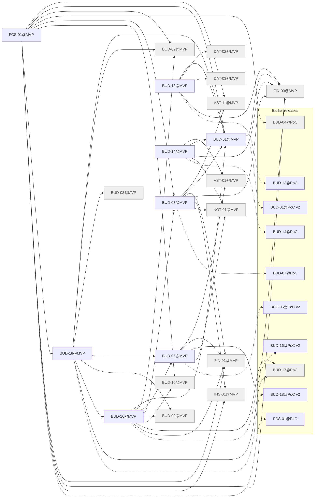

# Release MVP

Generated by `node tools/req-check/index.mjs --traceability` (tools/req-check) from the link headers of the requirement slices. Do not edit by hand.

233 slices in MVP: 8 migrated, 225 not migrated.

## Migrated slices

| Slice | Module | Extends | Depends on | Design | Criteria |
| --- | --- | --- | --- | --- | ---: |
| [BUD-01@MVP](../../docs/requirements/bud/BUD-01.mvp.md) | categories, categorization | BUD-01@PoC v2 | FIN-03@MVP | S-047, S-049, S-121, S-196 | 17 |
| [BUD-05@MVP](../../docs/requirements/bud/BUD-05.mvp.md) | goals | BUD-05@PoC v2 | AST-01@MVP, FIN-01@MVP, FIN-03@MVP, NOT-01@MVP | S-136, S-137, S-138, S-140, S-139 | 23 |
| [BUD-07@MVP](../../docs/requirements/bud/BUD-07.mvp.md) | recurring | BUD-07@PoC | AST-11@MVP, BUD-01@MVP, FIN-01@MVP, FIN-03@MVP, INS-01@MVP, NOT-01@MVP | S-121, S-141 | 17 |
| [BUD-13@MVP](../../docs/requirements/bud/BUD-13.mvp.md) | transactions, file-storage | BUD-13@PoC | BUD-01@MVP, DAT-02@MVP, DAT-03@MVP, FIN-03@MVP | S-046, S-047, S-049 | 9 |
| [BUD-14@MVP](../../docs/requirements/bud/BUD-14.mvp.md) | merchants, categorization | BUD-14@PoC | AST-01@MVP, BUD-01@MVP, FIN-03@MVP, NOT-01@MVP | S-047, S-069, S-197, S-198, S-285 | 17 |
| [BUD-16@MVP](../../docs/requirements/bud/BUD-16.mvp.md) | budget | BUD-16@PoC v2 | BUD-01@MVP, BUD-02@MVP, BUD-05@MVP, BUD-07@MVP, BUD-09@MVP, BUD-10@MVP, BUD-17@PoC, FIN-01@MVP | S-121, S-125, S-129, S-130, S-133 | 12 |
| [BUD-18@MVP](../../docs/requirements/bud/BUD-18.mvp.md) | budget | BUD-18@PoC v2 | BUD-01@MVP, BUD-02@MVP, BUD-03@MVP, BUD-05@MVP, BUD-09@MVP, BUD-16@MVP, BUD-17@PoC | S-121, S-129, S-130, S-131 | 12 |
| [FCS-01@MVP](../../docs/requirements/fcs/FCS-01.mvp.md) | cashflow | FCS-01@PoC | AST-11@MVP, BUD-01@MVP, BUD-02@MVP, BUD-04@PoC, BUD-07@MVP, BUD-10@MVP, BUD-18@MVP, FIN-01@MVP, FIN-03@MVP, INS-01@MVP | S-121 | 15 |

## Dependency graph

Arrows point from a slice to what it needs. Dashed arrows: «Розширює» (the same requirement in the previous release). Grey: not migrated yet, own dependencies unknown.

## Build sequence

Topological order of the graph above, grouped into waves: every slice of a wave needs only slices of earlier waves or earlier releases, so slices of one wave can be built in parallel.

1. **Wave 1:** AST-01@MVP (не мігровано), AST-11@MVP (не мігровано), BUD-02@MVP (не мігровано), BUD-03@MVP (не мігровано), BUD-09@MVP (не мігровано), BUD-10@MVP (не мігровано), DAT-02@MVP (не мігровано), DAT-03@MVP (не мігровано), FIN-01@MVP (не мігровано), FIN-03@MVP (не мігровано), INS-01@MVP (не мігровано), NOT-01@MVP (не мігровано)
2. **Wave 2:** BUD-01@MVP, BUD-05@MVP
3. **Wave 3:** BUD-07@MVP, BUD-13@MVP, BUD-14@MVP
4. **Wave 4:** BUD-16@MVP
5. **Wave 5:** BUD-18@MVP
6. **Wave 6:** FCS-01@MVP

### Not migrated, not placed

213 slices whose dependencies are unknown until their requirement is migrated:

- ACC: ACC-01, ACC-03, ACC-04, ACC-05, ACC-06, ACC-07, ACC-08, ACC-09, ACC-10, ACC-11
- ADM: ADM-01, ADM-02, ADM-03, ADM-04, ADM-05
- ARC: ARC-10
- AST: AST-02, AST-03, AST-04, AST-05, AST-07, AST-08, AST-09, AST-12, AST-13, AST-14, AST-14a
- BUD: BUD-11, BUD-12, BUD-20
- CHT: CHT-03
- CICD: CICD-09, CICD-11
- CMP: CMP-06, CMP-15, CMP-16, CMP-29, CMP-30, CMP-31, CMP-34, CMP-35, CMP-36, CMP-38, CMP-39, CMP-40, CMP-41, CMP-44, CMP-45, CMP-46, CMP-50, CMP-52, CMP-54, CMP-57, CMP-58, CMP-65, CMP-66, CMP-67, CMP-68, CMP-69, CMP-70
- DAT: DAT-01, DAT-04
- DOC: DOC-01, DOC-02
- DS: DS-10, DS-11, DS-14, DS-17, DS-18, DS-19, DS-20, DS-21, DS-23
- FCS: FCS-03
- FIN: FIN-02, FIN-05, FIN-06, FIN-11, FIN-18
- FLW: FLW-01, FLW-02, FLW-03, FLW-04, FLW-05, FLW-07, FLW-08, FLW-10, FLW-11, FLW-12, FLW-13, FLW-14, FLW-15, FLW-16, FLW-17, FLW-18, FLW-20, FLW-23, FLW-24, FLW-25, FLW-26, FLW-27, FLW-28, FLW-34, FLW-37, FLW-38, FLW-39, FLW-49, FLW-50, FLW-51, FLW-52, FLW-53, FLW-54, FLW-55, FLW-56, FLW-57
- GRID: GRID-00, GRID-01, GRID-03, GRID-05, GRID-06, GRID-07
- IMP: IMP-01, IMP-04, IMP-06, IMP-07, IMP-08, IMP-10, IMP-11, IMP-12, IMP-13
- INS: INS-02
- JRN: JRN-01, JRN-02, JRN-03, JRN-05, JRN-06, JRN-07
- L10N: L10N-01, L10N-02
- LEG: LEG-01
- NFR: NFR-01, NFR-02, NFR-03, NFR-04, NFR-07, NFR-08, NFR-09, NFR-18, NFR-19
- RPT: RPT-01
- SUB: SUB-01, SUB-02, SUB-03, SUB-05, SUB-07
- SUP: SUP-01
- UX: UX-01, UX-02, UX-03, UX-04, UX-08, UX-09
- VAL: VAL-01, VAL-02, VAL-03, VAL-04, VAL-05, VAL-07, VAL-09, VAL-11
- VLT: VLT-01, VLT-02, VLT-03, VLT-04, VLT-05, VLT-06, VLT-07, VLT-08, VLT-09, VLT-10, VLT-11, VLT-12, VLT-13, VLT-14, VLT-15, VLT-16, VLT-17, VLT-18
- WGT: WGT-00, WGT-01, WGT-02, WGT-10, WGT-11, WGT-12, WGT-13, WGT-14, WGT-15, WGT-16, WGT-17, WGT-18, WGT-19, WGT-20, WGT-21, WGT-22, WGT-23, WGT-24, WGT-25, WGT-26, WGT-27, WGT-28, WGT-29, WGT-30, WGT-31
