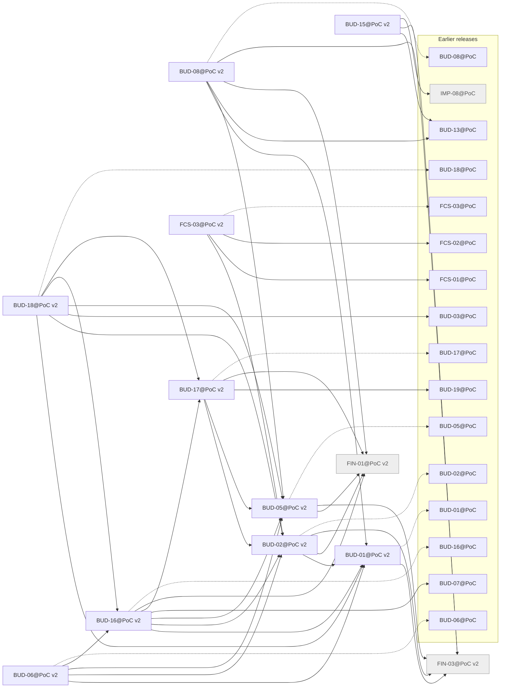

# Release PoC v2

Generated by `node tools/req-check/index.mjs --traceability` (tools/req-check) from the link headers of the requirement slices. Do not edit by hand.

29 slices in PoC v2: 10 migrated, 19 not migrated.

## Migrated slices

| Slice | Module | Extends | Depends on | Design | Criteria |
| --- | --- | --- | --- | --- | ---: |
| [BUD-01@PoC v2](../../docs/requirements/bud/BUD-01.poc-v2.md) | categories, categorization | BUD-01@PoC | FIN-03@PoC v2 | S-047, S-049, S-121, S-196 | 17 |
| [BUD-02@PoC v2](../../docs/requirements/bud/BUD-02.poc-v2.md) | budget | BUD-02@PoC | BUD-01@PoC v2, FIN-01@PoC v2, FIN-03@PoC v2 | S-121, S-122, S-123, S-124, S-125, S-127, S-128, S-135, S-287, S-288, S-289 | 17 |
| [BUD-05@PoC v2](../../docs/requirements/bud/BUD-05.poc-v2.md) | goals | BUD-05@PoC | FIN-01@PoC v2, FIN-03@PoC v2 | S-136, S-137, S-138, S-140 | 20 |
| [BUD-06@PoC v2](../../docs/requirements/bud/BUD-06.poc-v2.md) | budget | BUD-06@PoC | BUD-01@PoC v2, BUD-02@PoC v2, BUD-05@PoC v2, BUD-16@PoC v2 | S-047, S-132, S-133, S-135, S-290 | 16 |
| [BUD-08@PoC v2](../../docs/requirements/bud/BUD-08.poc-v2.md) | cashflow | BUD-08@PoC | BUD-01@PoC v2, BUD-05@PoC v2, BUD-13@PoC, FIN-01@PoC v2, FIN-03@PoC v2 | S-134 | 9 |
| [BUD-15@PoC v2](../../docs/requirements/bud/BUD-15.poc-v2.md) | receipts | — | BUD-13@PoC, FIN-03@PoC v2, IMP-08@PoC | S-065, S-066, S-067, S-068 | 15 |
| [BUD-16@PoC v2](../../docs/requirements/bud/BUD-16.poc-v2.md) | budget | BUD-16@PoC | BUD-01@PoC v2, BUD-02@PoC v2, BUD-05@PoC v2, BUD-07@PoC, BUD-17@PoC v2, FIN-01@PoC v2 | S-121, S-125, S-129, S-130, S-133 | 12 |
| [BUD-17@PoC v2](../../docs/requirements/bud/BUD-17.poc-v2.md) | budget | BUD-17@PoC | BUD-02@PoC v2, BUD-05@PoC v2, BUD-19@PoC, FIN-01@PoC v2 | S-126, S-288, S-289 | 12 |
| [BUD-18@PoC v2](../../docs/requirements/bud/BUD-18.poc-v2.md) | budget | BUD-18@PoC | BUD-01@PoC v2, BUD-02@PoC v2, BUD-03@PoC, BUD-05@PoC v2, BUD-16@PoC v2, BUD-17@PoC v2 | S-121, S-129, S-130, S-131 | 12 |
| [FCS-03@PoC v2](../../docs/requirements/fcs/FCS-03.poc-v2.md) | cashflow | FCS-03@PoC | BUD-02@PoC v2, FCS-01@PoC, FCS-02@PoC | S-121 | 15 |

## Dependency graph

Arrows point from a slice to what it needs. Dashed arrows: «Розширює» (the same requirement in the previous release). Grey: not migrated yet, own dependencies unknown.

## Build sequence

Topological order of the graph above, grouped into waves: every slice of a wave needs only slices of earlier waves or earlier releases, so slices of one wave can be built in parallel.

1. **Wave 1:** FIN-01@PoC v2 (не мігровано), FIN-03@PoC v2 (не мігровано)
2. **Wave 2:** BUD-01@PoC v2, BUD-05@PoC v2, BUD-15@PoC v2
3. **Wave 3:** BUD-02@PoC v2, BUD-08@PoC v2
4. **Wave 4:** BUD-17@PoC v2, FCS-03@PoC v2
5. **Wave 5:** BUD-16@PoC v2
6. **Wave 6:** BUD-06@PoC v2, BUD-18@PoC v2

### Not migrated, not placed

17 slices whose dependencies are unknown until their requirement is migrated:

- ACC: ACC-08
- CMP: CMP-32, CMP-69
- DAT: DAT-01, DAT-05
- DS: DS-01, DS-23
- FIN: FIN-12
- FLW: FLW-29, FLW-34, FLW-38, FLW-42, FLW-43
- GRID: GRID-04
- JRN: JRN-06
- SUP: SUP-01
- UX: UX-09
