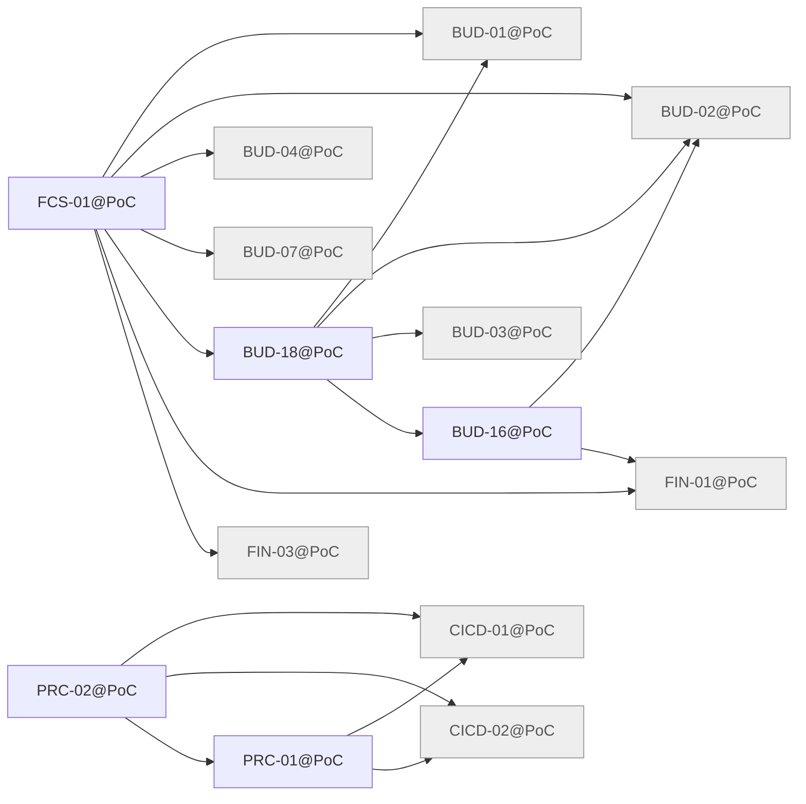

# Release PoC

Generated by `node tools/req-check/index.mjs --traceability` (tools/req-check) from the link headers of the requirement slices. Do not edit by hand.

172 slices in PoC: 5 migrated, 167 not migrated.

## Migrated slices

| Slice | Module | Extends | Depends on | Design | Criteria |
| --- | --- | --- | --- | --- | ---: |
| [BUD-16@PoC](../../docs/requirements/bud/BUD-16.poc.md) | budget | — | BUD-02@PoC, FIN-01@PoC | S-121, S-133 | 1 |
| [BUD-18@PoC](../../docs/requirements/bud/BUD-18.poc.md) | budget | — | BUD-01@PoC, BUD-02@PoC, BUD-03@PoC, BUD-16@PoC | S-121, S-131 | 7 |
| [FCS-01@PoC](../../docs/requirements/fcs/FCS-01.poc.md) | cashflow | — | BUD-01@PoC, BUD-02@PoC, BUD-04@PoC, BUD-07@PoC, BUD-18@PoC, FIN-01@PoC, FIN-03@PoC | S-121 | 15 |
| [PRC-01@PoC](../../docs/requirements/prc/PRC-01.poc.md) | — | — | CICD-01@PoC, CICD-02@PoC | — | 10 |
| [PRC-02@PoC](../../docs/requirements/prc/PRC-02.poc.md) | — | — | CICD-01@PoC, CICD-02@PoC, PRC-01@PoC | — | 9 |

## Dependency graph

Arrows point from a slice to what it needs. Dashed arrows: «Розширює» (the same requirement in the previous release). Grey: not migrated yet, own dependencies unknown.

## Build sequence

Topological order of the graph above, grouped into waves: every slice of a wave needs only slices of earlier waves or earlier releases, so slices of one wave can be built in parallel.

1. **Wave 1:** BUD-01@PoC (не мігровано), BUD-02@PoC (не мігровано), BUD-03@PoC (не мігровано), BUD-04@PoC (не мігровано), BUD-07@PoC (не мігровано), CICD-01@PoC (не мігровано), CICD-02@PoC (не мігровано), FIN-01@PoC (не мігровано), FIN-03@PoC (не мігровано)
2. **Wave 2:** BUD-16@PoC, PRC-01@PoC
3. **Wave 3:** BUD-18@PoC, PRC-02@PoC
4. **Wave 4:** FCS-01@PoC

### Not migrated, not placed

158 slices whose dependencies are unknown until their requirement is migrated:

- ACC: ACC-01, ACC-05, ACC-06, ACC-08
- ARC: ARC-01, ARC-02, ARC-03, ARC-04, ARC-05, ARC-06, ARC-07, ARC-08, ARC-09, ARC-11
- BUD: BUD-05, BUD-06, BUD-08, BUD-11, BUD-12, BUD-13, BUD-14, BUD-17, BUD-19
- CHT: CHT-00, CHT-01, CHT-02
- CICD: CICD-03, CICD-04, CICD-05, CICD-06, CICD-07, CICD-08, CICD-12
- CMP: CMP-01, CMP-02, CMP-03, CMP-04, CMP-05, CMP-07, CMP-08, CMP-09, CMP-10, CMP-11, CMP-12, CMP-13, CMP-14, CMP-17, CMP-18, CMP-19, CMP-20, CMP-21, CMP-22, CMP-23, CMP-24, CMP-25, CMP-26, CMP-27, CMP-28, CMP-32, CMP-33, CMP-42, CMP-47, CMP-48, CMP-49, CMP-53, CMP-55, CMP-56, CMP-59, CMP-60, CMP-61, CMP-62, CMP-63, CMP-64, CMP-69, CMP-71, CMP-72
- DAT: DAT-01, DAT-03, DAT-04, DAT-05
- DS: DS-01, DS-02, DS-03, DS-04, DS-05, DS-06, DS-07, DS-08, DS-09, DS-12, DS-13, DS-14, DS-15, DS-16, DS-17, DS-22, DS-23
- FCS: FCS-02, FCS-03
- FIN: FIN-02, FIN-04, FIN-11, FIN-12
- FLW: FLW-01, FLW-02, FLW-10, FLW-17, FLW-18, FLW-19, FLW-34, FLW-35, FLW-36, FLW-37, FLW-38, FLW-41, FLW-44
- GRID: GRID-00, GRID-02, GRID-04, GRID-05, GRID-06
- IMP: IMP-01, IMP-02, IMP-03, IMP-04, IMP-05, IMP-06, IMP-07, IMP-08, IMP-09, IMP-10, IMP-14, IMP-15, IMP-16, IMP-17, IMP-18, IMP-19
- JRN: JRN-05, JRN-06
- NFR: NFR-01, NFR-02, NFR-03, NFR-04, NFR-05, NFR-06, NFR-07, NFR-10, NFR-11, NFR-12, NFR-14, NFR-15, NFR-16, NFR-17, NFR-18, NFR-19
- UX: UX-09
- VAL: VAL-04, VAL-05
