# Release PoC

Generated by `node tools/req-check/index.mjs --traceability` (tools/req-check) from the link headers of the requirement slices. Do not edit by hand.

157 slices in PoC: 157 migrated, 0 not migrated.

## Migrated slices

| Slice | Module | Extends | Depends on | Design | Criteria |
| --- | --- | --- | --- | --- | ---: |
| [ACC-01@PoC](../../docs/requirements/acc/ACC-01.poc.md) | identity, household | — | — | S-001, S-002, S-003, S-004, S-007 | 27 |
| [ACC-04@PoC](../../docs/requirements/acc/ACC-04.poc.md) | identity | — | ACC-01@PoC | S-004, S-004b | 7 |
| [ACC-05@PoC](../../docs/requirements/acc/ACC-05.poc.md) | identity | — | ACC-01@PoC | S-187, S-032 | 6 |
| [ACC-06@PoC](../../docs/requirements/acc/ACC-06.poc.md) | household, fx-rates | — | ACC-08@PoC, VAL-04@PoC, VAL-05@PoC | S-050 | 5 |
| [ACC-08@PoC](../../docs/requirements/acc/ACC-08.poc.md) | household | — | ACC-01@PoC | S-121, S-200 | 5 |
| [ARC-01@PoC](../../docs/requirements/arc/ARC-01.poc.md) | — | — | — | — | 0 |
| [ARC-02@PoC](../../docs/requirements/arc/ARC-02.poc.md) | — | — | — | — | 0 |
| [ARC-03@PoC](../../docs/requirements/arc/ARC-03.poc.md) | — | — | — | — | 0 |
| [ARC-04@PoC](../../docs/requirements/arc/ARC-04.poc.md) | — | — | ARC-03@PoC | — | 0 |
| [ARC-05@PoC](../../docs/requirements/arc/ARC-05.poc.md) | — | — | — | — | 0 |
| [ARC-06@PoC](../../docs/requirements/arc/ARC-06.poc.md) | — | — | ARC-05@PoC | — | 0 |
| [ARC-07@PoC](../../docs/requirements/arc/ARC-07.poc.md) | — | — | — | — | 0 |
| [ARC-09@PoC](../../docs/requirements/arc/ARC-09.poc.md) | — | — | — | — | 0 |
| [ARC-11@PoC](../../docs/requirements/arc/ARC-11.poc.md) | ledger | — | ARC-03@PoC, ARC-04@PoC | — | 0 |
| [BUD-01@PoC](../../docs/requirements/bud/BUD-01.poc.md) | categories, categorization | — | FIN-03@PoC | S-047, S-049, S-121, S-196 | 17 |
| [BUD-02@PoC](../../docs/requirements/bud/BUD-02.poc.md) | budget | — | BUD-01@PoC, FIN-01@PoC, FIN-03@PoC | S-121, S-122, S-123, S-124, S-128, S-135, S-287, S-288, S-289 | 16 |
| [BUD-03@PoC](../../docs/requirements/bud/BUD-03.poc.md) | budget | — | BUD-01@PoC, BUD-02@PoC, BUD-05@PoC, BUD-07@PoC, FIN-01@PoC, FIN-03@PoC | S-121 | 9 |
| [BUD-05@PoC](../../docs/requirements/bud/BUD-05.poc.md) | goals | — | FIN-01@PoC, FIN-03@PoC | S-136, S-137, S-138 | 14 |
| [BUD-06@PoC](../../docs/requirements/bud/BUD-06.poc.md) | budget | — | BUD-01@PoC, BUD-02@PoC, BUD-05@PoC | S-047, S-132, S-133, S-135, S-290 | 15 |
| [BUD-07@PoC](../../docs/requirements/bud/BUD-07.poc.md) | recurring | — | BUD-01@PoC, FIN-01@PoC, FIN-03@PoC | S-121, S-141 | 16 |
| [BUD-08@PoC](../../docs/requirements/bud/BUD-08.poc.md) | cashflow | — | BUD-01@PoC, BUD-05@PoC, BUD-13@PoC, FIN-01@PoC, FIN-03@PoC | S-134 | 7 |
| [BUD-11@PoC](../../docs/requirements/bud/BUD-11.poc.md) | transactions, duplicate-matching | — | BUD-01@PoC, BUD-12@PoC, BUD-14@PoC, FIN-01@PoC, FIN-03@PoC, FIN-12@PoC, IMP-08@PoC | S-025, S-048, S-053, S-055a | 6 |
| [BUD-12@PoC](../../docs/requirements/bud/BUD-12.poc.md) | transactions, categorization | — | BUD-01@PoC, BUD-14@PoC, DAT-03@PoC, FIN-03@PoC | S-046, S-047, S-058 | 10 |
| [BUD-13@PoC](../../docs/requirements/bud/BUD-13.poc.md) | transactions | — | BUD-01@PoC, DAT-03@PoC, FIN-03@PoC | S-046, S-047, S-049 | 9 |
| [BUD-14@PoC](../../docs/requirements/bud/BUD-14.poc.md) | merchants, categorization | — | BUD-01@PoC, FIN-03@PoC | S-047, S-197, S-198 | 16 |
| [BUD-16@PoC](../../docs/requirements/bud/BUD-16.poc.md) | budget | — | BUD-02@PoC, FIN-01@PoC | S-121, S-133 | 1 |
| [BUD-17@PoC](../../docs/requirements/bud/BUD-17.poc.md) | budget | — | BUD-02@PoC, BUD-05@PoC, BUD-19@PoC, FIN-01@PoC | S-126, S-289 | 7 |
| [BUD-19@PoC](../../docs/requirements/bud/BUD-19.poc.md) | debt-payoff | — | BUD-02@PoC, FIN-01@PoC, FIN-03@PoC | S-143, S-144, S-145, S-146 | 11 |
| [CHT-00@PoC](../../docs/requirements/cht/CHT-00.poc.md) | — | — | — | — | 3 |
| [CHT-01@PoC](../../docs/requirements/cht/CHT-01.poc.md) | — | — | CMP-12@PoC | S-053 | 10 |
| [CICD-01@PoC](../../docs/requirements/cicd/CICD-01.poc.md) | — | — | — | — | 0 |
| [CICD-02@PoC](../../docs/requirements/cicd/CICD-02.poc.md) | — | — | CICD-01@PoC | — | 0 |
| [CICD-03@PoC](../../docs/requirements/cicd/CICD-03.poc.md) | — | — | CICD-02@PoC | — | 0 |
| [CICD-04@PoC](../../docs/requirements/cicd/CICD-04.poc.md) | — | — | — | — | 0 |
| [CICD-05@PoC](../../docs/requirements/cicd/CICD-05.poc.md) | — | — | CICD-03@PoC, CICD-04@PoC | — | 0 |
| [CICD-06@PoC](../../docs/requirements/cicd/CICD-06.poc.md) | — | — | — | — | 0 |
| [CICD-07@PoC](../../docs/requirements/cicd/CICD-07.poc.md) | — | — | CICD-04@PoC | — | 0 |
| [CICD-08@PoC](../../docs/requirements/cicd/CICD-08.poc.md) | — | — | CICD-05@PoC | — | 0 |
| [CICD-12@PoC](../../docs/requirements/cicd/CICD-12.poc.md) | — | — | — | — | 0 |
| [CMP-01@PoC](../../docs/requirements/cmp/CMP-01.poc.md) | — | — | CMP-33@PoC | — | 8 |
| [CMP-02@PoC](../../docs/requirements/cmp/CMP-02.poc.md) | — | — | CMP-25@PoC | — | 9 |
| [CMP-03@PoC](../../docs/requirements/cmp/CMP-03.poc.md) | — | — | CMP-02@PoC | — | 10 |
| [CMP-04@PoC](../../docs/requirements/cmp/CMP-04.poc.md) | — | — | CMP-25@PoC | — | 6 |
| [CMP-05@PoC](../../docs/requirements/cmp/CMP-05.poc.md) | — | — | — | — | 4 |
| [CMP-07@PoC](../../docs/requirements/cmp/CMP-07.poc.md) | — | — | CMP-22@PoC, CMP-25@PoC | — | 10 |
| [CMP-08@PoC](../../docs/requirements/cmp/CMP-08.poc.md) | — | — | CMP-22@PoC | — | 7 |
| [CMP-09@PoC](../../docs/requirements/cmp/CMP-09.poc.md) | — | — | CMP-22@PoC, CMP-25@PoC | — | 5 |
| [CMP-10@PoC](../../docs/requirements/cmp/CMP-10.poc.md) | — | — | CMP-01@PoC, CMP-25@PoC, CMP-59@PoC | — | 4 |
| [CMP-11@PoC](../../docs/requirements/cmp/CMP-11.poc.md) | — | — | — | — | 3 |
| [CMP-12@PoC](../../docs/requirements/cmp/CMP-12.poc.md) | — | — | — | — | 8 |
| [CMP-13@PoC](../../docs/requirements/cmp/CMP-13.poc.md) | — | — | CMP-59@PoC, CMP-61@PoC | S-046 | 4 |
| [CMP-14@PoC](../../docs/requirements/cmp/CMP-14.poc.md) | — | — | — | — | 6 |
| [CMP-18@PoC](../../docs/requirements/cmp/CMP-18.poc.md) | — | — | CMP-25@PoC | — | 7 |
| [CMP-19@PoC](../../docs/requirements/cmp/CMP-19.poc.md) | — | — | CMP-01@PoC | — | 5 |
| [CMP-20@PoC](../../docs/requirements/cmp/CMP-20.poc.md) | — | — | CMP-59@PoC | — | 10 |
| [CMP-21@PoC](../../docs/requirements/cmp/CMP-21.poc.md) | — | — | CMP-01@PoC, CMP-02@PoC | — | 26 |
| [CMP-22@PoC](../../docs/requirements/cmp/CMP-22.poc.md) | — | — | — | — | 5 |
| [CMP-23@PoC](../../docs/requirements/cmp/CMP-23.poc.md) | — | — | CMP-01@PoC, CMP-33@PoC | — | 6 |
| [CMP-24@PoC](../../docs/requirements/cmp/CMP-24.poc.md) | — | — | CMP-01@PoC | — | 6 |
| [CMP-25@PoC](../../docs/requirements/cmp/CMP-25.poc.md) | — | — | — | — | 4 |
| [CMP-26@PoC](../../docs/requirements/cmp/CMP-26.poc.md) | — | — | CMP-04@PoC, CMP-13@PoC, CMP-22@PoC, CMP-23@PoC, CMP-24@PoC, CMP-25@PoC | — | 8 |
| [CMP-27@PoC](../../docs/requirements/cmp/CMP-27.poc.md) | — | — | CMP-07@PoC, CMP-08@PoC, CMP-18@PoC | — | 5 |
| [CMP-28@PoC](../../docs/requirements/cmp/CMP-28.poc.md) | — | — | CMP-01@PoC, CMP-07@PoC, CMP-18@PoC, CMP-59@PoC | S-046 | 6 |
| [CMP-32@PoC](../../docs/requirements/cmp/CMP-32.poc.md) | — | — | CMP-01@PoC, CMP-03@PoC, CMP-18@PoC, CMP-61@PoC, CMP-64@PoC | S-046 | 9 |
| [CMP-33@PoC](../../docs/requirements/cmp/CMP-33.poc.md) | — | — | — | — | 5 |
| [CMP-42@PoC](../../docs/requirements/cmp/CMP-42.poc.md) | — | — | CMP-12@PoC, CMP-25@PoC | — | 7 |
| [CMP-47@PoC](../../docs/requirements/cmp/CMP-47.poc.md) | — | — | CMP-25@PoC | — | 4 |
| [CMP-53@PoC](../../docs/requirements/cmp/CMP-53.poc.md) | — | — | CMP-59@PoC | — | 4 |
| [CMP-55@PoC](../../docs/requirements/cmp/CMP-55.poc.md) | — | — | CMP-07@PoC | — | 6 |
| [CMP-59@PoC](../../docs/requirements/cmp/CMP-59.poc.md) | — | — | CMP-25@PoC, CMP-33@PoC | — | 6 |
| [CMP-60@PoC](../../docs/requirements/cmp/CMP-60.poc.md) | — | — | CMP-12@PoC, CMP-32@PoC, CMP-59@PoC, CMP-62@PoC | — | 4 |
| [CMP-61@PoC](../../docs/requirements/cmp/CMP-61.poc.md) | — | — | — | — | 11 |
| [CMP-62@PoC](../../docs/requirements/cmp/CMP-62.poc.md) | — | — | CMP-59@PoC, CMP-61@PoC | — | 3 |
| [CMP-64@PoC](../../docs/requirements/cmp/CMP-64.poc.md) | — | — | — | — | 4 |
| [CMP-69@PoC](../../docs/requirements/cmp/CMP-69.poc.md) | — | — | CMP-33@PoC, CMP-61@PoC, CMP-71@PoC | — | 7 |
| [CMP-71@PoC](../../docs/requirements/cmp/CMP-71.poc.md) | — | — | — | — | 5 |
| [CMP-72@PoC](../../docs/requirements/cmp/CMP-72.poc.md) | — | — | CMP-59@PoC, CMP-61@PoC | S-132, S-290 | 9 |
| [CMP-73@PoC](../../docs/requirements/cmp/CMP-73.poc.md) | — | — | CMP-01@PoC, CMP-04@PoC, CMP-07@PoC, CMP-59@PoC, CMP-61@PoC | S-046 | 9 |
| [CMP-74@PoC](../../docs/requirements/cmp/CMP-74.poc.md) | — | — | — | PocMoneyBank5, PocMoneyImport1, PocMoneyReview | 6 |
| [DAT-01@PoC](../../docs/requirements/dat/DAT-01.poc.md) | transactions | — | — | S-046 | 6 |
| [DAT-03@PoC](../../docs/requirements/dat/DAT-03.poc.md) | bulk-actions, transactions | — | DAT-01@PoC | S-036, S-046 | 12 |
| [DAT-05@PoC](../../docs/requirements/dat/DAT-05.poc.md) | feature-flags | — | — | S-029 | 7 |
| [DS-01@PoC](../../docs/requirements/ds/DS-01.poc.md) | — | — | CMP-59@PoC | S-048, S-052, S-198 | 35 |
| [DS-02@PoC](../../docs/requirements/ds/DS-02.poc.md) | — | — | — | — | 7 |
| [DS-03@PoC](../../docs/requirements/ds/DS-03.poc.md) | — | — | — | — | 10 |
| [DS-04@PoC](../../docs/requirements/ds/DS-04.poc.md) | — | — | — | — | 16 |
| [DS-05@PoC](../../docs/requirements/ds/DS-05.poc.md) | — | — | DS-04@PoC | — | 6 |
| [DS-06@PoC](../../docs/requirements/ds/DS-06.poc.md) | — | — | — | — | 11 |
| [DS-07@PoC](../../docs/requirements/ds/DS-07.poc.md) | — | — | DS-06@PoC | — | 7 |
| [DS-08@PoC](../../docs/requirements/ds/DS-08.poc.md) | — | — | — | — | 7 |
| [DS-09@PoC](../../docs/requirements/ds/DS-09.poc.md) | — | — | DS-06@PoC | — | 6 |
| [DS-12@PoC](../../docs/requirements/ds/DS-12.poc.md) | — | — | — | — | 5 |
| [DS-13@PoC](../../docs/requirements/ds/DS-13.poc.md) | — | — | — | — | 6 |
| [DS-14@PoC](../../docs/requirements/ds/DS-14.poc.md) | — | — | DS-06@PoC | — | 9 |
| [DS-15@PoC](../../docs/requirements/ds/DS-15.poc.md) | — | — | — | — | 6 |
| [DS-16@PoC](../../docs/requirements/ds/DS-16.poc.md) | — | — | DS-04@PoC, DS-15@PoC | — | 7 |
| [DS-17@PoC](../../docs/requirements/ds/DS-17.poc.md) | — | — | DS-16@PoC | — | 1 |
| [DS-23@PoC](../../docs/requirements/ds/DS-23.poc.md) | — | — | DS-07@PoC | S-121 | 8 |
| [FIN-01@PoC](../../docs/requirements/fin/FIN-01.poc.md) | accounts, ledger, liabilities, fx-rates | — | ACC-08@PoC, FIN-04@PoC, VAL-04@PoC, VAL-05@PoC | S-050, S-051, S-052, S-053 | 21 |
| [FIN-03@PoC](../../docs/requirements/fin/FIN-03.poc.md) | transactions, ledger, categorization, duplicate-matching, transfer-matching, bulk-actions | — | DAT-01@PoC, DAT-03@PoC, FIN-01@PoC, FIN-04@PoC | S-025, S-046, S-047, S-048 | 24 |
| [FIN-04@PoC](../../docs/requirements/fin/FIN-04.poc.md) | ledger, accounts | — | — | S-053, S-055a | 7 |
| [FIN-12@PoC](../../docs/requirements/fin/FIN-12.poc.md) | accounts, ledger | — | FIN-01@PoC, FIN-04@PoC | S-050, S-052, S-053, S-054, S-055, S-055a | 19 |
| [FLW-01@PoC](../../docs/requirements/flw/FLW-01.poc.md) | identity, household | — | ACC-01@PoC, ACC-06@PoC, ACC-08@PoC, BUD-02@PoC | S-001, S-002, S-003, S-121 | 9 |
| [FLW-02@PoC](../../docs/requirements/flw/FLW-02.poc.md) | identity | — | ACC-01@PoC, ACC-04@PoC, BUD-02@PoC | S-004, S-007, S-121 | 6 |
| [FLW-10@PoC](../../docs/requirements/flw/FLW-10.poc.md) | import-sessions, file-parsers, import-recipes, transactions | — | FIN-01@PoC, IMP-01@PoC, IMP-04@PoC, IMP-06@PoC, IMP-07@PoC, IMP-08@PoC, IMP-14@PoC, IMP-16@PoC | S-046, S-163, S-170, S-171, S-174 | 6 |
| [FLW-17@PoC](../../docs/requirements/flw/FLW-17.poc.md) | accounts, import-sessions, duplicate-matching | — | FIN-01@PoC, FIN-03@PoC, FIN-12@PoC, IMP-04@PoC, IMP-08@PoC | S-050, S-051, S-052, S-163, S-170, S-171, S-172, S-174 | 8 |
| [FLW-19@PoC](../../docs/requirements/flw/FLW-19.poc.md) | transactions, categorization, transfer-matching, ledger | — | BUD-01@PoC, BUD-12@PoC, BUD-13@PoC, DAT-01@PoC, DAT-03@PoC, FIN-01@PoC, FIN-03@PoC, FIN-04@PoC, IMP-03@PoC | S-046, S-047, S-048, S-049, S-058, S-059, S-163 | 5 |
| [FLW-34@PoC](../../docs/requirements/flw/FLW-34.poc.md) | budget, categories, categorization | — | BUD-01@PoC, BUD-02@PoC, BUD-03@PoC, BUD-12@PoC, BUD-16@PoC, FIN-01@PoC, IMP-08@PoC | S-051, S-052, S-121, S-122, S-123, S-124, S-170, S-196, S-287 | 6 |
| [FLW-35@PoC](../../docs/requirements/flw/FLW-35.poc.md) | transactions, categorization, budget | — | BUD-03@PoC, BUD-11@PoC, BUD-12@PoC, BUD-13@PoC, FIN-03@PoC | S-046, S-047, S-049, S-058, S-121 | 5 |
| [FLW-37@PoC](../../docs/requirements/flw/FLW-37.poc.md) | goals, budget | — | BUD-03@PoC, BUD-05@PoC | S-136, S-137, S-138, S-139 | 4 |
| [FLW-38@PoC](../../docs/requirements/flw/FLW-38.poc.md) | budget, reports | — | BUD-02@PoC, BUD-06@PoC, BUD-08@PoC, BUD-16@PoC, BUD-17@PoC | S-121, S-132, S-133, S-134, S-135 | 5 |
| [FLW-41@PoC](../../docs/requirements/flw/FLW-41.poc.md) | categorization, merchants | — | BUD-01@PoC, BUD-13@PoC, BUD-14@PoC, FIN-03@PoC | S-047, S-197, S-198 | 6 |
| [FLW-44@PoC](../../docs/requirements/flw/FLW-44.poc.md) | debt-payoff, accounts | — | BUD-03@PoC, BUD-19@PoC, FIN-01@PoC | S-143, S-144, S-145, S-146 | 7 |
| [GRID-00@PoC](../../docs/requirements/grid/GRID-00.poc.md) | — | — | CMP-69@PoC | — | 11 |
| [GRID-02@PoC](../../docs/requirements/grid/GRID-02.poc.md) | — | — | CMP-11@PoC, CMP-26@PoC, CMP-32@PoC, CMP-59@PoC, CMP-60@PoC, GRID-00@PoC | S-046, S-050, S-053, S-058 | 10 |
| [GRID-04@PoC](../../docs/requirements/grid/GRID-04.poc.md) | — | — | CMP-55@PoC, GRID-00@PoC | S-121, S-136, S-141, S-143 | 6 |
| [GRID-05@PoC](../../docs/requirements/grid/GRID-05.poc.md) | — | — | GRID-00@PoC | S-186 | 1 |
| [GRID-06@PoC](../../docs/requirements/grid/GRID-06.poc.md) | — | — | GRID-00@PoC | S-001, S-004 | 4 |
| [IMP-01@PoC](../../docs/requirements/imp/IMP-01.poc.md) | import-sessions, file-parsers, file-storage, transactions | — | FIN-01@PoC, FIN-03@PoC | S-163, S-170 | 12 |
| [IMP-02@PoC](../../docs/requirements/imp/IMP-02.poc.md) | accounts, import-sessions, file-parsers | — | FIN-01@PoC, FIN-04@PoC, VAL-04@PoC | S-054 | 14 |
| [IMP-03@PoC](../../docs/requirements/imp/IMP-03.poc.md) | transfer-matching, transactions, ledger | — | FIN-03@PoC, FIN-04@PoC, IMP-01@PoC, IMP-02@PoC | S-059 | 22 |
| [IMP-04@PoC](../../docs/requirements/imp/IMP-04.poc.md) | duplicate-matching, import-sessions, ledger | — | FIN-03@PoC, FIN-04@PoC, IMP-01@PoC | S-163, S-171 | 12 |
| [IMP-05@PoC](../../docs/requirements/imp/IMP-05.poc.md) | import-sessions, file-parsers | — | IMP-01@PoC, IMP-02@PoC | S-171 | 9 |
| [IMP-06@PoC](../../docs/requirements/imp/IMP-06.poc.md) | import-recipes, file-parsers | — | IMP-01@PoC | S-171, S-172 | 12 |
| [IMP-07@PoC](../../docs/requirements/imp/IMP-07.poc.md) | import-recipes, import-sessions | — | IMP-01@PoC, IMP-06@PoC | S-170, S-172, S-294 | 14 |
| [IMP-08@PoC](../../docs/requirements/imp/IMP-08.poc.md) | import-sessions | — | IMP-01@PoC, IMP-03@PoC, IMP-04@PoC, IMP-05@PoC, IMP-06@PoC, IMP-07@PoC, UX-09@PoC | S-025, S-163, S-170, S-171, S-174 | 15 |
| [IMP-09@PoC](../../docs/requirements/imp/IMP-09.poc.md) | import-recipes, file-parsers | — | IMP-06@PoC, IMP-07@PoC, IMP-08@PoC | S-172 | 13 |
| [IMP-10@PoC](../../docs/requirements/imp/IMP-10.poc.md) | import-recipes | — | IMP-06@PoC, IMP-07@PoC | — | 10 |
| [IMP-14@PoC](../../docs/requirements/imp/IMP-14.poc.md) | import-sessions, file-storage | — | IMP-01@PoC, IMP-04@PoC | S-163, S-174 | 3 |
| [IMP-16@PoC](../../docs/requirements/imp/IMP-16.poc.md) | import-sessions, ledger | — | FIN-04@PoC, IMP-01@PoC, IMP-04@PoC | S-163 | 5 |
| [IMP-17@PoC](../../docs/requirements/imp/IMP-17.poc.md) | import-sessions, ledger, accounts | — | FIN-04@PoC, FIN-12@PoC, IMP-05@PoC | S-171, S-173 | 3 |
| [IMP-18@PoC](../../docs/requirements/imp/IMP-18.poc.md) | duplicate-matching, import-sessions | — | IMP-01@PoC, IMP-04@PoC | S-171 | 3 |
| [IMP-19@PoC](../../docs/requirements/imp/IMP-19.poc.md) | import-sessions, file-parsers | — | IMP-01@PoC | S-163 | 2 |
| [JRN-05@PoC](../../docs/requirements/jrn/JRN-05.poc.md) | budget, goals, transactions, import-sessions | — | FLW-01@PoC, FLW-17@PoC, FLW-34@PoC, FLW-35@PoC, FLW-37@PoC, FLW-38@PoC | S-001, S-002, S-047, S-049, S-058, S-121, S-122, S-123, S-124, S-132, S-135, S-136, S-137, S-138, S-170, S-171, S-174 | 0 |
| [JRN-06@PoC](../../docs/requirements/jrn/JRN-06.poc.md) | import-sessions, budget, categorization | — | FLW-10@PoC, FLW-17@PoC, FLW-34@PoC, FLW-38@PoC, FLW-41@PoC | S-121, S-132, S-134, S-163, S-170, S-171, S-174, S-197, S-198 | 0 |
| [NFR-01@PoC](../../docs/requirements/nfr/NFR-01.poc.md) | — | — | — | — | 8 |
| [NFR-02@PoC](../../docs/requirements/nfr/NFR-02.poc.md) | — | — | — | — | 1 |
| [NFR-03@PoC](../../docs/requirements/nfr/NFR-03.poc.md) | — | — | NFR-16@PoC | — | 4 |
| [NFR-05@PoC](../../docs/requirements/nfr/NFR-05.poc.md) | — | — | — | — | 2 |
| [NFR-06@PoC](../../docs/requirements/nfr/NFR-06.poc.md) | — | — | — | — | 1 |
| [NFR-07@PoC](../../docs/requirements/nfr/NFR-07.poc.md) | — | — | — | — | 1 |
| [NFR-08@PoC](../../docs/requirements/nfr/NFR-08.poc.md) | — | — | — | — | 2 |
| [NFR-09@PoC](../../docs/requirements/nfr/NFR-09.poc.md) | — | — | — | — | 0 |
| [NFR-10@PoC](../../docs/requirements/nfr/NFR-10.poc.md) | — | — | — | — | 2 |
| [NFR-11@PoC](../../docs/requirements/nfr/NFR-11.poc.md) | — | — | — | — | 2 |
| [NFR-12@PoC](../../docs/requirements/nfr/NFR-12.poc.md) | — | — | — | — | 1 |
| [NFR-14@PoC](../../docs/requirements/nfr/NFR-14.poc.md) | — | — | — | — | 3 |
| [NFR-15@PoC](../../docs/requirements/nfr/NFR-15.poc.md) | — | — | — | — | 6 |
| [NFR-16@PoC](../../docs/requirements/nfr/NFR-16.poc.md) | — | — | CICD-07@PoC | — | 3 |
| [NFR-17@PoC](../../docs/requirements/nfr/NFR-17.poc.md) | — | — | — | — | 1 |
| [NFR-18@PoC](../../docs/requirements/nfr/NFR-18.poc.md) | — | — | NFR-03@PoC | — | 1 |
| [NFR-19@PoC](../../docs/requirements/nfr/NFR-19.poc.md) | — | — | — | — | 0 |
| [PRC-01@PoC](../../docs/requirements/prc/PRC-01.poc.md) | — | — | CICD-01@PoC, CICD-02@PoC | — | 13 |
| [PRC-02@PoC](../../docs/requirements/prc/PRC-02.poc.md) | — | — | CICD-01@PoC, CICD-02@PoC, PRC-01@PoC | — | 9 |
| [UX-09@PoC](../../docs/requirements/ux/UX-09.poc.md) | identity | — | BUD-02@PoC, FIN-03@PoC | S-031, S-046, S-050, S-121, S-141, S-143 | 16 |
| [VAL-04@PoC](../../docs/requirements/val/VAL-04.poc.md) | fx-rates | — | VAL-05@PoC | — | 4 |
| [VAL-05@PoC](../../docs/requirements/val/VAL-05.poc.md) | fx-rates | — | — | — | 5 |

## Dependency graph

Arrows point from a slice to what it needs. Dashed arrows: «Розширює» (the same requirement in the previous release). Grey: not migrated yet, own dependencies unknown.

```mermaid
flowchart LR
  ACC_01_PoC["ACC-01@PoC"]
  ACC_04_PoC["ACC-04@PoC"]
  ACC_05_PoC["ACC-05@PoC"]
  ACC_06_PoC["ACC-06@PoC"]
  ACC_08_PoC["ACC-08@PoC"]
  ARC_01_PoC["ARC-01@PoC"]
  ARC_02_PoC["ARC-02@PoC"]
  ARC_03_PoC["ARC-03@PoC"]
  ARC_04_PoC["ARC-04@PoC"]
  ARC_05_PoC["ARC-05@PoC"]
  ARC_06_PoC["ARC-06@PoC"]
  ARC_07_PoC["ARC-07@PoC"]
  ARC_09_PoC["ARC-09@PoC"]
  ARC_11_PoC["ARC-11@PoC"]
  BUD_01_PoC["BUD-01@PoC"]
  BUD_02_PoC["BUD-02@PoC"]
  BUD_03_PoC["BUD-03@PoC"]
  BUD_05_PoC["BUD-05@PoC"]
  BUD_06_PoC["BUD-06@PoC"]
  BUD_07_PoC["BUD-07@PoC"]
  BUD_08_PoC["BUD-08@PoC"]
  BUD_11_PoC["BUD-11@PoC"]
  BUD_12_PoC["BUD-12@PoC"]
  BUD_13_PoC["BUD-13@PoC"]
  BUD_14_PoC["BUD-14@PoC"]
  BUD_16_PoC["BUD-16@PoC"]
  BUD_17_PoC["BUD-17@PoC"]
  BUD_19_PoC["BUD-19@PoC"]
  CHT_00_PoC["CHT-00@PoC"]
  CHT_01_PoC["CHT-01@PoC"]
  CICD_01_PoC["CICD-01@PoC"]
  CICD_02_PoC["CICD-02@PoC"]
  CICD_03_PoC["CICD-03@PoC"]
  CICD_04_PoC["CICD-04@PoC"]
  CICD_05_PoC["CICD-05@PoC"]
  CICD_06_PoC["CICD-06@PoC"]
  CICD_07_PoC["CICD-07@PoC"]
  CICD_08_PoC["CICD-08@PoC"]
  CICD_12_PoC["CICD-12@PoC"]
  CMP_01_PoC["CMP-01@PoC"]
  CMP_02_PoC["CMP-02@PoC"]
  CMP_03_PoC["CMP-03@PoC"]
  CMP_04_PoC["CMP-04@PoC"]
  CMP_05_PoC["CMP-05@PoC"]
  CMP_07_PoC["CMP-07@PoC"]
  CMP_08_PoC["CMP-08@PoC"]
  CMP_09_PoC["CMP-09@PoC"]
  CMP_10_PoC["CMP-10@PoC"]
  CMP_11_PoC["CMP-11@PoC"]
  CMP_12_PoC["CMP-12@PoC"]
  CMP_13_PoC["CMP-13@PoC"]
  CMP_14_PoC["CMP-14@PoC"]
  CMP_18_PoC["CMP-18@PoC"]
  CMP_19_PoC["CMP-19@PoC"]
  CMP_20_PoC["CMP-20@PoC"]
  CMP_21_PoC["CMP-21@PoC"]
  CMP_22_PoC["CMP-22@PoC"]
  CMP_23_PoC["CMP-23@PoC"]
  CMP_24_PoC["CMP-24@PoC"]
  CMP_25_PoC["CMP-25@PoC"]
  CMP_26_PoC["CMP-26@PoC"]
  CMP_27_PoC["CMP-27@PoC"]
  CMP_28_PoC["CMP-28@PoC"]
  CMP_32_PoC["CMP-32@PoC"]
  CMP_33_PoC["CMP-33@PoC"]
  CMP_42_PoC["CMP-42@PoC"]
  CMP_47_PoC["CMP-47@PoC"]
  CMP_53_PoC["CMP-53@PoC"]
  CMP_55_PoC["CMP-55@PoC"]
  CMP_59_PoC["CMP-59@PoC"]
  CMP_60_PoC["CMP-60@PoC"]
  CMP_61_PoC["CMP-61@PoC"]
  CMP_62_PoC["CMP-62@PoC"]
  CMP_64_PoC["CMP-64@PoC"]
  CMP_69_PoC["CMP-69@PoC"]
  CMP_71_PoC["CMP-71@PoC"]
  CMP_72_PoC["CMP-72@PoC"]
  CMP_73_PoC["CMP-73@PoC"]
  CMP_74_PoC["CMP-74@PoC"]
  DAT_01_PoC["DAT-01@PoC"]
  DAT_03_PoC["DAT-03@PoC"]
  DAT_05_PoC["DAT-05@PoC"]
  DS_01_PoC["DS-01@PoC"]
  DS_02_PoC["DS-02@PoC"]
  DS_03_PoC["DS-03@PoC"]
  DS_04_PoC["DS-04@PoC"]
  DS_05_PoC["DS-05@PoC"]
  DS_06_PoC["DS-06@PoC"]
  DS_07_PoC["DS-07@PoC"]
  DS_08_PoC["DS-08@PoC"]
  DS_09_PoC["DS-09@PoC"]
  DS_12_PoC["DS-12@PoC"]
  DS_13_PoC["DS-13@PoC"]
  DS_14_PoC["DS-14@PoC"]
  DS_15_PoC["DS-15@PoC"]
  DS_16_PoC["DS-16@PoC"]
  DS_17_PoC["DS-17@PoC"]
  DS_23_PoC["DS-23@PoC"]
  FIN_01_PoC["FIN-01@PoC"]
  FIN_03_PoC["FIN-03@PoC"]
  FIN_04_PoC["FIN-04@PoC"]
  FIN_12_PoC["FIN-12@PoC"]
  FLW_01_PoC["FLW-01@PoC"]
  FLW_02_PoC["FLW-02@PoC"]
  FLW_10_PoC["FLW-10@PoC"]
  FLW_17_PoC["FLW-17@PoC"]
  FLW_19_PoC["FLW-19@PoC"]
  FLW_34_PoC["FLW-34@PoC"]
  FLW_35_PoC["FLW-35@PoC"]
  FLW_37_PoC["FLW-37@PoC"]
  FLW_38_PoC["FLW-38@PoC"]
  FLW_41_PoC["FLW-41@PoC"]
  FLW_44_PoC["FLW-44@PoC"]
  GRID_00_PoC["GRID-00@PoC"]
  GRID_02_PoC["GRID-02@PoC"]
  GRID_04_PoC["GRID-04@PoC"]
  GRID_05_PoC["GRID-05@PoC"]
  GRID_06_PoC["GRID-06@PoC"]
  IMP_01_PoC["IMP-01@PoC"]
  IMP_02_PoC["IMP-02@PoC"]
  IMP_03_PoC["IMP-03@PoC"]
  IMP_04_PoC["IMP-04@PoC"]
  IMP_05_PoC["IMP-05@PoC"]
  IMP_06_PoC["IMP-06@PoC"]
  IMP_07_PoC["IMP-07@PoC"]
  IMP_08_PoC["IMP-08@PoC"]
  IMP_09_PoC["IMP-09@PoC"]
  IMP_10_PoC["IMP-10@PoC"]
  IMP_14_PoC["IMP-14@PoC"]
  IMP_16_PoC["IMP-16@PoC"]
  IMP_17_PoC["IMP-17@PoC"]
  IMP_18_PoC["IMP-18@PoC"]
  IMP_19_PoC["IMP-19@PoC"]
  JRN_05_PoC["JRN-05@PoC"]
  JRN_06_PoC["JRN-06@PoC"]
  NFR_01_PoC["NFR-01@PoC"]
  NFR_02_PoC["NFR-02@PoC"]
  NFR_03_PoC["NFR-03@PoC"]
  NFR_05_PoC["NFR-05@PoC"]
  NFR_06_PoC["NFR-06@PoC"]
  NFR_07_PoC["NFR-07@PoC"]
  NFR_08_PoC["NFR-08@PoC"]
  NFR_09_PoC["NFR-09@PoC"]
  NFR_10_PoC["NFR-10@PoC"]
  NFR_11_PoC["NFR-11@PoC"]
  NFR_12_PoC["NFR-12@PoC"]
  NFR_14_PoC["NFR-14@PoC"]
  NFR_15_PoC["NFR-15@PoC"]
  NFR_16_PoC["NFR-16@PoC"]
  NFR_17_PoC["NFR-17@PoC"]
  NFR_18_PoC["NFR-18@PoC"]
  NFR_19_PoC["NFR-19@PoC"]
  PRC_01_PoC["PRC-01@PoC"]
  PRC_02_PoC["PRC-02@PoC"]
  UX_09_PoC["UX-09@PoC"]
  VAL_04_PoC["VAL-04@PoC"]
  VAL_05_PoC["VAL-05@PoC"]
  ACC_04_PoC --> ACC_01_PoC
  ACC_05_PoC --> ACC_01_PoC
  ACC_06_PoC --> ACC_08_PoC
  ACC_06_PoC --> VAL_04_PoC
  ACC_06_PoC --> VAL_05_PoC
  ACC_08_PoC --> ACC_01_PoC
  ARC_04_PoC --> ARC_03_PoC
  ARC_06_PoC --> ARC_05_PoC
  ARC_11_PoC --> ARC_03_PoC
  ARC_11_PoC --> ARC_04_PoC
  BUD_01_PoC --> FIN_03_PoC
  BUD_02_PoC --> BUD_01_PoC
  BUD_02_PoC --> FIN_01_PoC
  BUD_02_PoC --> FIN_03_PoC
  BUD_03_PoC --> BUD_01_PoC
  BUD_03_PoC --> BUD_02_PoC
  BUD_03_PoC --> BUD_05_PoC
  BUD_03_PoC --> BUD_07_PoC
  BUD_03_PoC --> FIN_01_PoC
  BUD_03_PoC --> FIN_03_PoC
  BUD_05_PoC --> FIN_01_PoC
  BUD_05_PoC --> FIN_03_PoC
  BUD_06_PoC --> BUD_01_PoC
  BUD_06_PoC --> BUD_02_PoC
  BUD_06_PoC --> BUD_05_PoC
  BUD_07_PoC --> BUD_01_PoC
  BUD_07_PoC --> FIN_01_PoC
  BUD_07_PoC --> FIN_03_PoC
  BUD_08_PoC --> BUD_01_PoC
  BUD_08_PoC --> BUD_05_PoC
  BUD_08_PoC --> BUD_13_PoC
  BUD_08_PoC --> FIN_01_PoC
  BUD_08_PoC --> FIN_03_PoC
  BUD_11_PoC --> BUD_01_PoC
  BUD_11_PoC --> BUD_12_PoC
  BUD_11_PoC --> BUD_14_PoC
  BUD_11_PoC --> FIN_01_PoC
  BUD_11_PoC --> FIN_03_PoC
  BUD_11_PoC --> FIN_12_PoC
  BUD_11_PoC --> IMP_08_PoC
  BUD_12_PoC --> BUD_01_PoC
  BUD_12_PoC --> BUD_14_PoC
  BUD_12_PoC --> DAT_03_PoC
  BUD_12_PoC --> FIN_03_PoC
  BUD_13_PoC --> BUD_01_PoC
  BUD_13_PoC --> DAT_03_PoC
  BUD_13_PoC --> FIN_03_PoC
  BUD_14_PoC --> BUD_01_PoC
  BUD_14_PoC --> FIN_03_PoC
  BUD_16_PoC --> BUD_02_PoC
  BUD_16_PoC --> FIN_01_PoC
  BUD_17_PoC --> BUD_02_PoC
  BUD_17_PoC --> BUD_05_PoC
  BUD_17_PoC --> BUD_19_PoC
  BUD_17_PoC --> FIN_01_PoC
  BUD_19_PoC --> BUD_02_PoC
  BUD_19_PoC --> FIN_01_PoC
  BUD_19_PoC --> FIN_03_PoC
  CHT_01_PoC --> CMP_12_PoC
  CICD_02_PoC --> CICD_01_PoC
  CICD_03_PoC --> CICD_02_PoC
  CICD_05_PoC --> CICD_03_PoC
  CICD_05_PoC --> CICD_04_PoC
  CICD_07_PoC --> CICD_04_PoC
  CICD_08_PoC --> CICD_05_PoC
  CMP_01_PoC --> CMP_33_PoC
  CMP_02_PoC --> CMP_25_PoC
  CMP_03_PoC --> CMP_02_PoC
  CMP_04_PoC --> CMP_25_PoC
  CMP_07_PoC --> CMP_22_PoC
  CMP_07_PoC --> CMP_25_PoC
  CMP_08_PoC --> CMP_22_PoC
  CMP_09_PoC --> CMP_22_PoC
  CMP_09_PoC --> CMP_25_PoC
  CMP_10_PoC --> CMP_01_PoC
  CMP_10_PoC --> CMP_25_PoC
  CMP_10_PoC --> CMP_59_PoC
  CMP_13_PoC --> CMP_59_PoC
  CMP_13_PoC --> CMP_61_PoC
  CMP_18_PoC --> CMP_25_PoC
  CMP_19_PoC --> CMP_01_PoC
  CMP_20_PoC --> CMP_59_PoC
  CMP_21_PoC --> CMP_01_PoC
  CMP_21_PoC --> CMP_02_PoC
  CMP_23_PoC --> CMP_01_PoC
  CMP_23_PoC --> CMP_33_PoC
  CMP_24_PoC --> CMP_01_PoC
  CMP_26_PoC --> CMP_04_PoC
  CMP_26_PoC --> CMP_13_PoC
  CMP_26_PoC --> CMP_22_PoC
  CMP_26_PoC --> CMP_23_PoC
  CMP_26_PoC --> CMP_24_PoC
  CMP_26_PoC --> CMP_25_PoC
  CMP_27_PoC --> CMP_07_PoC
  CMP_27_PoC --> CMP_08_PoC
  CMP_27_PoC --> CMP_18_PoC
  CMP_28_PoC --> CMP_01_PoC
  CMP_28_PoC --> CMP_07_PoC
  CMP_28_PoC --> CMP_18_PoC
  CMP_28_PoC --> CMP_59_PoC
  CMP_32_PoC --> CMP_01_PoC
  CMP_32_PoC --> CMP_03_PoC
  CMP_32_PoC --> CMP_18_PoC
  CMP_32_PoC --> CMP_61_PoC
  CMP_32_PoC --> CMP_64_PoC
  CMP_42_PoC --> CMP_12_PoC
  CMP_42_PoC --> CMP_25_PoC
  CMP_47_PoC --> CMP_25_PoC
  CMP_53_PoC --> CMP_59_PoC
  CMP_55_PoC --> CMP_07_PoC
  CMP_59_PoC --> CMP_25_PoC
  CMP_59_PoC --> CMP_33_PoC
  CMP_60_PoC --> CMP_12_PoC
  CMP_60_PoC --> CMP_32_PoC
  CMP_60_PoC --> CMP_59_PoC
  CMP_60_PoC --> CMP_62_PoC
  CMP_62_PoC --> CMP_59_PoC
  CMP_62_PoC --> CMP_61_PoC
  CMP_69_PoC --> CMP_33_PoC
  CMP_69_PoC --> CMP_61_PoC
  CMP_69_PoC --> CMP_71_PoC
  CMP_72_PoC --> CMP_59_PoC
  CMP_72_PoC --> CMP_61_PoC
  CMP_73_PoC --> CMP_01_PoC
  CMP_73_PoC --> CMP_04_PoC
  CMP_73_PoC --> CMP_07_PoC
  CMP_73_PoC --> CMP_59_PoC
  CMP_73_PoC --> CMP_61_PoC
  DAT_03_PoC --> DAT_01_PoC
  DS_01_PoC --> CMP_59_PoC
  DS_05_PoC --> DS_04_PoC
  DS_07_PoC --> DS_06_PoC
  DS_09_PoC --> DS_06_PoC
  DS_14_PoC --> DS_06_PoC
  DS_16_PoC --> DS_04_PoC
  DS_16_PoC --> DS_15_PoC
  DS_17_PoC --> DS_16_PoC
  DS_23_PoC --> DS_07_PoC
  FIN_01_PoC --> ACC_08_PoC
  FIN_01_PoC --> FIN_04_PoC
  FIN_01_PoC --> VAL_04_PoC
  FIN_01_PoC --> VAL_05_PoC
  FIN_03_PoC --> DAT_01_PoC
  FIN_03_PoC --> DAT_03_PoC
  FIN_03_PoC --> FIN_01_PoC
  FIN_03_PoC --> FIN_04_PoC
  FIN_12_PoC --> FIN_01_PoC
  FIN_12_PoC --> FIN_04_PoC
  FLW_01_PoC --> ACC_01_PoC
  FLW_01_PoC --> ACC_06_PoC
  FLW_01_PoC --> ACC_08_PoC
  FLW_01_PoC --> BUD_02_PoC
  FLW_02_PoC --> ACC_01_PoC
  FLW_02_PoC --> ACC_04_PoC
  FLW_02_PoC --> BUD_02_PoC
  FLW_10_PoC --> FIN_01_PoC
  FLW_10_PoC --> IMP_01_PoC
  FLW_10_PoC --> IMP_04_PoC
  FLW_10_PoC --> IMP_06_PoC
  FLW_10_PoC --> IMP_07_PoC
  FLW_10_PoC --> IMP_08_PoC
  FLW_10_PoC --> IMP_14_PoC
  FLW_10_PoC --> IMP_16_PoC
  FLW_17_PoC --> FIN_01_PoC
  FLW_17_PoC --> FIN_03_PoC
  FLW_17_PoC --> FIN_12_PoC
  FLW_17_PoC --> IMP_04_PoC
  FLW_17_PoC --> IMP_08_PoC
  FLW_19_PoC --> BUD_01_PoC
  FLW_19_PoC --> BUD_12_PoC
  FLW_19_PoC --> BUD_13_PoC
  FLW_19_PoC --> DAT_01_PoC
  FLW_19_PoC --> DAT_03_PoC
  FLW_19_PoC --> FIN_01_PoC
  FLW_19_PoC --> FIN_03_PoC
  FLW_19_PoC --> FIN_04_PoC
  FLW_19_PoC --> IMP_03_PoC
  FLW_34_PoC --> BUD_01_PoC
  FLW_34_PoC --> BUD_02_PoC
  FLW_34_PoC --> BUD_03_PoC
  FLW_34_PoC --> BUD_12_PoC
  FLW_34_PoC --> BUD_16_PoC
  FLW_34_PoC --> FIN_01_PoC
  FLW_34_PoC --> IMP_08_PoC
  FLW_35_PoC --> BUD_03_PoC
  FLW_35_PoC --> BUD_11_PoC
  FLW_35_PoC --> BUD_12_PoC
  FLW_35_PoC --> BUD_13_PoC
  FLW_35_PoC --> FIN_03_PoC
  FLW_37_PoC --> BUD_03_PoC
  FLW_37_PoC --> BUD_05_PoC
  FLW_38_PoC --> BUD_02_PoC
  FLW_38_PoC --> BUD_06_PoC
  FLW_38_PoC --> BUD_08_PoC
  FLW_38_PoC --> BUD_16_PoC
  FLW_38_PoC --> BUD_17_PoC
  FLW_41_PoC --> BUD_01_PoC
  FLW_41_PoC --> BUD_13_PoC
  FLW_41_PoC --> BUD_14_PoC
  FLW_41_PoC --> FIN_03_PoC
  FLW_44_PoC --> BUD_03_PoC
  FLW_44_PoC --> BUD_19_PoC
  FLW_44_PoC --> FIN_01_PoC
  GRID_00_PoC --> CMP_69_PoC
  GRID_02_PoC --> CMP_11_PoC
  GRID_02_PoC --> CMP_26_PoC
  GRID_02_PoC --> CMP_32_PoC
  GRID_02_PoC --> CMP_59_PoC
  GRID_02_PoC --> CMP_60_PoC
  GRID_02_PoC --> GRID_00_PoC
  GRID_04_PoC --> CMP_55_PoC
  GRID_04_PoC --> GRID_00_PoC
  GRID_05_PoC --> GRID_00_PoC
  GRID_06_PoC --> GRID_00_PoC
  IMP_01_PoC --> FIN_01_PoC
  IMP_01_PoC --> FIN_03_PoC
  IMP_02_PoC --> FIN_01_PoC
  IMP_02_PoC --> FIN_04_PoC
  IMP_02_PoC --> VAL_04_PoC
  IMP_03_PoC --> FIN_03_PoC
  IMP_03_PoC --> FIN_04_PoC
  IMP_03_PoC --> IMP_01_PoC
  IMP_03_PoC --> IMP_02_PoC
  IMP_04_PoC --> FIN_03_PoC
  IMP_04_PoC --> FIN_04_PoC
  IMP_04_PoC --> IMP_01_PoC
  IMP_05_PoC --> IMP_01_PoC
  IMP_05_PoC --> IMP_02_PoC
  IMP_06_PoC --> IMP_01_PoC
  IMP_07_PoC --> IMP_01_PoC
  IMP_07_PoC --> IMP_06_PoC
  IMP_08_PoC --> IMP_01_PoC
  IMP_08_PoC --> IMP_03_PoC
  IMP_08_PoC --> IMP_04_PoC
  IMP_08_PoC --> IMP_05_PoC
  IMP_08_PoC --> IMP_06_PoC
  IMP_08_PoC --> IMP_07_PoC
  IMP_08_PoC --> UX_09_PoC
  IMP_09_PoC --> IMP_06_PoC
  IMP_09_PoC --> IMP_07_PoC
  IMP_09_PoC --> IMP_08_PoC
  IMP_10_PoC --> IMP_06_PoC
  IMP_10_PoC --> IMP_07_PoC
  IMP_14_PoC --> IMP_01_PoC
  IMP_14_PoC --> IMP_04_PoC
  IMP_16_PoC --> FIN_04_PoC
  IMP_16_PoC --> IMP_01_PoC
  IMP_16_PoC --> IMP_04_PoC
  IMP_17_PoC --> FIN_04_PoC
  IMP_17_PoC --> FIN_12_PoC
  IMP_17_PoC --> IMP_05_PoC
  IMP_18_PoC --> IMP_01_PoC
  IMP_18_PoC --> IMP_04_PoC
  IMP_19_PoC --> IMP_01_PoC
  JRN_05_PoC --> FLW_01_PoC
  JRN_05_PoC --> FLW_17_PoC
  JRN_05_PoC --> FLW_34_PoC
  JRN_05_PoC --> FLW_35_PoC
  JRN_05_PoC --> FLW_37_PoC
  JRN_05_PoC --> FLW_38_PoC
  JRN_06_PoC --> FLW_10_PoC
  JRN_06_PoC --> FLW_17_PoC
  JRN_06_PoC --> FLW_34_PoC
  JRN_06_PoC --> FLW_38_PoC
  JRN_06_PoC --> FLW_41_PoC
  NFR_03_PoC --> NFR_16_PoC
  NFR_16_PoC --> CICD_07_PoC
  NFR_18_PoC --> NFR_03_PoC
  PRC_01_PoC --> CICD_01_PoC
  PRC_01_PoC --> CICD_02_PoC
  PRC_02_PoC --> CICD_01_PoC
  PRC_02_PoC --> CICD_02_PoC
  PRC_02_PoC --> PRC_01_PoC
  UX_09_PoC --> BUD_02_PoC
  UX_09_PoC --> FIN_03_PoC
  VAL_04_PoC --> VAL_05_PoC
```

## Build sequence

Topological order of the graph above, grouped into waves: every slice of a wave needs only slices of earlier waves or earlier releases, so slices of one wave can be built in parallel.

1. **Wave 1:** ACC-01@PoC, ARC-01@PoC, ARC-02@PoC, ARC-03@PoC, ARC-05@PoC, ARC-07@PoC, ARC-09@PoC, CHT-00@PoC, CICD-01@PoC, CICD-04@PoC, CICD-06@PoC, CICD-12@PoC, CMP-05@PoC, CMP-11@PoC, CMP-12@PoC, CMP-14@PoC, CMP-22@PoC, CMP-25@PoC, CMP-33@PoC, CMP-61@PoC, CMP-64@PoC, CMP-71@PoC, CMP-74@PoC, DAT-01@PoC, DAT-05@PoC, DS-02@PoC, DS-03@PoC, DS-04@PoC, DS-06@PoC, DS-08@PoC, DS-12@PoC, DS-13@PoC, DS-15@PoC, FIN-04@PoC, NFR-01@PoC, NFR-02@PoC, NFR-05@PoC, NFR-06@PoC, NFR-07@PoC, NFR-08@PoC, NFR-09@PoC, NFR-10@PoC, NFR-11@PoC, NFR-12@PoC, NFR-14@PoC, NFR-15@PoC, NFR-17@PoC, NFR-19@PoC, VAL-05@PoC
2. **Wave 2:** ACC-04@PoC, ACC-05@PoC, ACC-08@PoC, ARC-04@PoC, ARC-06@PoC, CHT-01@PoC, CICD-02@PoC, CICD-07@PoC, CMP-01@PoC, CMP-02@PoC, CMP-04@PoC, CMP-07@PoC, CMP-08@PoC, CMP-09@PoC, CMP-18@PoC, CMP-42@PoC, CMP-47@PoC, CMP-59@PoC, CMP-69@PoC, DAT-03@PoC, DS-05@PoC, DS-07@PoC, DS-09@PoC, DS-14@PoC, DS-16@PoC, VAL-04@PoC
3. **Wave 3:** ACC-06@PoC, ARC-11@PoC, CICD-03@PoC, CMP-03@PoC, CMP-10@PoC, CMP-13@PoC, CMP-19@PoC, CMP-20@PoC, CMP-21@PoC, CMP-23@PoC, CMP-24@PoC, CMP-27@PoC, CMP-28@PoC, CMP-53@PoC, CMP-55@PoC, CMP-62@PoC, CMP-72@PoC, CMP-73@PoC, DS-01@PoC, DS-17@PoC, DS-23@PoC, FIN-01@PoC, GRID-00@PoC, NFR-16@PoC, PRC-01@PoC
4. **Wave 4:** CICD-05@PoC, CMP-26@PoC, CMP-32@PoC, FIN-03@PoC, FIN-12@PoC, GRID-04@PoC, GRID-05@PoC, GRID-06@PoC, IMP-02@PoC, NFR-03@PoC, PRC-02@PoC
5. **Wave 5:** BUD-01@PoC, BUD-05@PoC, CICD-08@PoC, CMP-60@PoC, IMP-01@PoC, NFR-18@PoC
6. **Wave 6:** BUD-02@PoC, BUD-07@PoC, BUD-13@PoC, BUD-14@PoC, GRID-02@PoC, IMP-03@PoC, IMP-04@PoC, IMP-05@PoC, IMP-06@PoC, IMP-19@PoC
7. **Wave 7:** BUD-03@PoC, BUD-06@PoC, BUD-08@PoC, BUD-12@PoC, BUD-16@PoC, BUD-19@PoC, FLW-01@PoC, FLW-02@PoC, FLW-41@PoC, IMP-07@PoC, IMP-14@PoC, IMP-16@PoC, IMP-17@PoC, IMP-18@PoC, UX-09@PoC
8. **Wave 8:** BUD-17@PoC, FLW-19@PoC, FLW-37@PoC, FLW-44@PoC, IMP-08@PoC, IMP-10@PoC
9. **Wave 9:** BUD-11@PoC, FLW-10@PoC, FLW-17@PoC, FLW-34@PoC, FLW-38@PoC, IMP-09@PoC
10. **Wave 10:** FLW-35@PoC, JRN-06@PoC
11. **Wave 11:** JRN-05@PoC

### Not migrated, not placed

None.
