# Release PoC

Generated by `node tools/req-check/index.mjs --traceability` (tools/req-check) from the link headers of the requirement slices. Do not edit by hand.

175 slices in PoC: 85 migrated, 90 not migrated.

## Migrated slices

| Slice | Module | Extends | Depends on | Design | Criteria |
| --- | --- | --- | --- | --- | ---: |
| [ARC-01@PoC](../../docs/requirements/arc/ARC-01.poc.md) | — | — | — | — | 0 |
| [ARC-02@PoC](../../docs/requirements/arc/ARC-02.poc.md) | — | — | — | — | 0 |
| [ARC-03@PoC](../../docs/requirements/arc/ARC-03.poc.md) | — | — | — | — | 0 |
| [ARC-04@PoC](../../docs/requirements/arc/ARC-04.poc.md) | — | — | ARC-03@PoC | — | 0 |
| [ARC-05@PoC](../../docs/requirements/arc/ARC-05.poc.md) | — | — | — | — | 0 |
| [ARC-06@PoC](../../docs/requirements/arc/ARC-06.poc.md) | — | — | ARC-05@PoC | — | 0 |
| [ARC-07@PoC](../../docs/requirements/arc/ARC-07.poc.md) | — | — | — | — | 0 |
| [ARC-08@PoC](../../docs/requirements/arc/ARC-08.poc.md) | — | — | ARC-05@PoC, ARC-06@PoC | — | 0 |
| [ARC-09@PoC](../../docs/requirements/arc/ARC-09.poc.md) | — | — | — | — | 0 |
| [ARC-10@PoC](../../docs/requirements/arc/ARC-10.poc.md) | — | — | ARC-02@PoC, ARC-04@PoC | — | 0 |
| [ARC-11@PoC](../../docs/requirements/arc/ARC-11.poc.md) | ledger | — | ARC-03@PoC, ARC-04@PoC | — | 0 |
| [BUD-01@PoC](../../docs/requirements/bud/BUD-01.poc.md) | categories, categorization | — | FIN-03@PoC | S-047, S-049, S-121, S-196 | 17 |
| [BUD-02@PoC](../../docs/requirements/bud/BUD-02.poc.md) | budget | — | BUD-01@PoC, FIN-01@PoC, FIN-03@PoC | S-121, S-122, S-123, S-124, S-128, S-135, S-287, S-288, S-289 | 16 |
| [BUD-03@PoC](../../docs/requirements/bud/BUD-03.poc.md) | budget | — | BUD-01@PoC, BUD-02@PoC, BUD-05@PoC, BUD-07@PoC, BUD-18@PoC, FIN-01@PoC, FIN-03@PoC | S-121 | 11 |
| [BUD-04@PoC](../../docs/requirements/bud/BUD-04.poc.md) | budget | — | BUD-03@PoC, BUD-05@PoC, BUD-06@PoC | S-142 | 8 |
| [BUD-05@PoC](../../docs/requirements/bud/BUD-05.poc.md) | goals | — | FIN-01@PoC, FIN-03@PoC | S-136, S-137, S-138, S-140 | 20 |
| [BUD-06@PoC](../../docs/requirements/bud/BUD-06.poc.md) | budget | — | BUD-01@PoC, BUD-02@PoC, BUD-05@PoC | S-047, S-132, S-133, S-135, S-290 | 15 |
| [BUD-07@PoC](../../docs/requirements/bud/BUD-07.poc.md) | recurring | — | BUD-01@PoC, FIN-01@PoC, FIN-03@PoC | S-121, S-141 | 17 |
| [BUD-08@PoC](../../docs/requirements/bud/BUD-08.poc.md) | cashflow | — | BUD-01@PoC, BUD-05@PoC, BUD-13@PoC, FIN-01@PoC, FIN-03@PoC | S-134 | 7 |
| [BUD-11@PoC](../../docs/requirements/bud/BUD-11.poc.md) | transactions, duplicate-matching | — | BUD-01@PoC, BUD-12@PoC, BUD-14@PoC, FIN-01@PoC, FIN-03@PoC, FIN-12@PoC, IMP-08@PoC | S-025, S-048, S-053, S-055a | 6 |
| [BUD-12@PoC](../../docs/requirements/bud/BUD-12.poc.md) | transactions, categorization | — | BUD-01@PoC, BUD-14@PoC, DAT-03@PoC, FIN-03@PoC | S-046, S-047, S-058, S-199 | 10 |
| [BUD-13@PoC](../../docs/requirements/bud/BUD-13.poc.md) | transactions, file-storage | — | BUD-01@PoC, DAT-03@PoC, FIN-03@PoC | S-046, S-047, S-049 | 8 |
| [BUD-14@PoC](../../docs/requirements/bud/BUD-14.poc.md) | merchants, categorization | — | BUD-01@PoC, FIN-03@PoC | S-047, S-069, S-197, S-198 | 17 |
| [BUD-16@PoC](../../docs/requirements/bud/BUD-16.poc.md) | budget | — | BUD-02@PoC, FIN-01@PoC | S-121, S-133 | 1 |
| [BUD-17@PoC](../../docs/requirements/bud/BUD-17.poc.md) | budget | — | BUD-02@PoC, BUD-05@PoC, BUD-19@PoC, FIN-01@PoC | S-126, S-288, S-289 | 11 |
| [BUD-18@PoC](../../docs/requirements/bud/BUD-18.poc.md) | budget | — | BUD-01@PoC, BUD-02@PoC, BUD-16@PoC | S-121, S-131 | 7 |
| [BUD-19@PoC](../../docs/requirements/bud/BUD-19.poc.md) | debt-payoff | — | BUD-02@PoC, FIN-01@PoC, FIN-03@PoC | S-143, S-144, S-145, S-146 | 10 |
| [CICD-01@PoC](../../docs/requirements/cicd/CICD-01.poc.md) | — | — | — | — | 0 |
| [CICD-02@PoC](../../docs/requirements/cicd/CICD-02.poc.md) | — | — | CICD-01@PoC | — | 0 |
| [CICD-03@PoC](../../docs/requirements/cicd/CICD-03.poc.md) | — | — | CICD-02@PoC | — | 0 |
| [CICD-04@PoC](../../docs/requirements/cicd/CICD-04.poc.md) | — | — | — | — | 0 |
| [CICD-05@PoC](../../docs/requirements/cicd/CICD-05.poc.md) | — | — | CICD-03@PoC, CICD-04@PoC | — | 0 |
| [CICD-06@PoC](../../docs/requirements/cicd/CICD-06.poc.md) | — | — | — | — | 0 |
| [CICD-07@PoC](../../docs/requirements/cicd/CICD-07.poc.md) | — | — | CICD-04@PoC | — | 0 |
| [CICD-08@PoC](../../docs/requirements/cicd/CICD-08.poc.md) | — | — | CICD-05@PoC | — | 0 |
| [CICD-12@PoC](../../docs/requirements/cicd/CICD-12.poc.md) | — | — | — | — | 0 |
| [DAT-01@PoC](../../docs/requirements/dat/DAT-01.poc.md) | transactions | — | — | S-046 | 1 |
| [DAT-03@PoC](../../docs/requirements/dat/DAT-03.poc.md) | bulk-actions, transactions | — | DAT-01@PoC | S-036, S-046 | 11 |
| [DAT-04@PoC](../../docs/requirements/dat/DAT-04.poc.md) | import-sessions, transactions | — | FIN-01@PoC, FIN-03@PoC, IMP-04@PoC | S-163, S-164, S-165, S-167, S-168, S-169 | 9 |
| [DAT-05@PoC](../../docs/requirements/dat/DAT-05.poc.md) | feature-flags | — | — | S-029 | 7 |
| [FCS-01@PoC](../../docs/requirements/fcs/FCS-01.poc.md) | cashflow | — | BUD-01@PoC, BUD-02@PoC, BUD-04@PoC, BUD-07@PoC, BUD-18@PoC, FIN-01@PoC, FIN-03@PoC | S-121 | 15 |
| [FCS-02@PoC](../../docs/requirements/fcs/FCS-02.poc.md) | cashflow | — | BUD-01@PoC, BUD-03@PoC, FCS-01@PoC | S-121 | 13 |
| [FCS-03@PoC](../../docs/requirements/fcs/FCS-03.poc.md) | cashflow | — | BUD-02@PoC, FCS-01@PoC, FCS-02@PoC | S-121 | 14 |
| [FIN-01@PoC](../../docs/requirements/fin/FIN-01.poc.md) | accounts, ledger, liabilities, fx-rates | — | ACC-08@PoC, FIN-04@PoC, VAL-04@PoC, VAL-05@PoC | S-050, S-051, S-052, S-053 | 21 |
| [FIN-02@PoC](../../docs/requirements/fin/FIN-02.poc.md) | bank-consents, bank-sync, bank-monobank, bank-enablebanking, accounts | — | ACC-01@PoC, FIN-01@PoC, FIN-03@PoC, FIN-11@PoC | S-051, S-060, S-061, S-062 | 17 |
| [FIN-03@PoC](../../docs/requirements/fin/FIN-03.poc.md) | transactions, ledger, categorization, duplicate-matching, transfer-matching, bulk-actions | — | DAT-01@PoC, DAT-03@PoC, FIN-01@PoC, FIN-04@PoC | S-025, S-046, S-047, S-048 | 22 |
| [FIN-04@PoC](../../docs/requirements/fin/FIN-04.poc.md) | ledger, accounts | — | — | S-053, S-055a | 11 |
| [FIN-11@PoC](../../docs/requirements/fin/FIN-11.poc.md) | bank-sync, bank-consents, transactions | — | FIN-03@PoC | S-060, S-061, S-062 | 9 |
| [FIN-12@PoC](../../docs/requirements/fin/FIN-12.poc.md) | accounts, ledger | — | FIN-01@PoC, FIN-02@PoC, FIN-04@PoC | S-050, S-052, S-053, S-054, S-055, S-055a | 21 |
| [IMP-01@PoC](../../docs/requirements/imp/IMP-01.poc.md) | import-sessions, file-parsers, file-storage, transactions | — | FIN-01@PoC, FIN-03@PoC | S-163, S-170 | 12 |
| [IMP-02@PoC](../../docs/requirements/imp/IMP-02.poc.md) | accounts, import-sessions, file-parsers | — | FIN-01@PoC, FIN-04@PoC, VAL-04@PoC | S-054 | 14 |
| [IMP-03@PoC](../../docs/requirements/imp/IMP-03.poc.md) | transfer-matching, transactions, ledger | — | FIN-03@PoC, FIN-04@PoC, IMP-01@PoC, IMP-02@PoC | S-059, S-286 | 24 |
| [IMP-04@PoC](../../docs/requirements/imp/IMP-04.poc.md) | duplicate-matching, import-sessions, ledger | — | FIN-03@PoC, FIN-04@PoC, IMP-01@PoC | S-163, S-171 | 12 |
| [IMP-05@PoC](../../docs/requirements/imp/IMP-05.poc.md) | import-sessions, file-parsers | — | IMP-01@PoC, IMP-02@PoC | S-171 | 9 |
| [IMP-06@PoC](../../docs/requirements/imp/IMP-06.poc.md) | import-recipes, file-parsers | — | IMP-01@PoC | S-171, S-172 | 15 |
| [IMP-07@PoC](../../docs/requirements/imp/IMP-07.poc.md) | import-recipes, import-sessions | — | IMP-01@PoC, IMP-06@PoC | S-170, S-172, S-294 | 14 |
| [IMP-08@PoC](../../docs/requirements/imp/IMP-08.poc.md) | import-sessions | — | IMP-01@PoC, IMP-03@PoC, IMP-04@PoC, IMP-05@PoC, IMP-06@PoC, IMP-07@PoC, UX-09@PoC | S-025, S-163, S-170, S-171, S-174 | 16 |
| [IMP-09@PoC](../../docs/requirements/imp/IMP-09.poc.md) | import-recipes, file-parsers | — | IMP-06@PoC, IMP-07@PoC, IMP-08@PoC | S-172 | 13 |
| [IMP-10@PoC](../../docs/requirements/imp/IMP-10.poc.md) | import-recipes, staff-admin | — | IMP-06@PoC, IMP-07@PoC | S-268, S-269 | 9 |
| [IMP-14@PoC](../../docs/requirements/imp/IMP-14.poc.md) | import-sessions, file-storage | — | IMP-01@PoC, IMP-04@PoC | S-163, S-174 | 4 |
| [IMP-15@PoC](../../docs/requirements/imp/IMP-15.poc.md) | import-sessions, file-parsers | — | IMP-01@PoC, IMP-03@PoC, IMP-05@PoC | S-170, S-171 | 3 |
| [IMP-16@PoC](../../docs/requirements/imp/IMP-16.poc.md) | import-sessions, ledger | — | FIN-04@PoC, IMP-01@PoC, IMP-04@PoC | S-163 | 5 |
| [IMP-17@PoC](../../docs/requirements/imp/IMP-17.poc.md) | import-sessions, ledger, accounts | — | FIN-04@PoC, FIN-12@PoC, IMP-05@PoC | S-171, S-173 | 3 |
| [IMP-18@PoC](../../docs/requirements/imp/IMP-18.poc.md) | duplicate-matching, import-sessions | — | IMP-01@PoC, IMP-04@PoC | S-171 | 3 |
| [IMP-19@PoC](../../docs/requirements/imp/IMP-19.poc.md) | import-sessions, file-parsers | — | IMP-01@PoC | S-163 | 3 |
| [NFR-01@PoC](../../docs/requirements/nfr/NFR-01.poc.md) | — | — | — | — | 7 |
| [NFR-02@PoC](../../docs/requirements/nfr/NFR-02.poc.md) | — | — | — | — | 1 |
| [NFR-03@PoC](../../docs/requirements/nfr/NFR-03.poc.md) | — | — | NFR-16@PoC | — | 4 |
| [NFR-04@PoC](../../docs/requirements/nfr/NFR-04.poc.md) | — | — | IMP-19@PoC | — | 2 |
| [NFR-05@PoC](../../docs/requirements/nfr/NFR-05.poc.md) | — | — | — | — | 2 |
| [NFR-06@PoC](../../docs/requirements/nfr/NFR-06.poc.md) | — | — | — | — | 1 |
| [NFR-07@PoC](../../docs/requirements/nfr/NFR-07.poc.md) | — | — | — | — | 1 |
| [NFR-08@PoC](../../docs/requirements/nfr/NFR-08.poc.md) | — | — | — | — | 2 |
| [NFR-09@PoC](../../docs/requirements/nfr/NFR-09.poc.md) | — | — | — | — | 0 |
| [NFR-10@PoC](../../docs/requirements/nfr/NFR-10.poc.md) | — | — | — | — | 2 |
| [NFR-11@PoC](../../docs/requirements/nfr/NFR-11.poc.md) | — | — | — | — | 2 |
| [NFR-12@PoC](../../docs/requirements/nfr/NFR-12.poc.md) | — | — | — | — | 2 |
| [NFR-14@PoC](../../docs/requirements/nfr/NFR-14.poc.md) | — | — | — | — | 3 |
| [NFR-15@PoC](../../docs/requirements/nfr/NFR-15.poc.md) | — | — | — | — | 2 |
| [NFR-16@PoC](../../docs/requirements/nfr/NFR-16.poc.md) | — | — | CICD-07@PoC | — | 3 |
| [NFR-17@PoC](../../docs/requirements/nfr/NFR-17.poc.md) | — | — | — | — | 1 |
| [NFR-18@PoC](../../docs/requirements/nfr/NFR-18.poc.md) | — | — | NFR-03@PoC | — | 1 |
| [NFR-19@PoC](../../docs/requirements/nfr/NFR-19.poc.md) | — | — | — | — | 0 |
| [PRC-01@PoC](../../docs/requirements/prc/PRC-01.poc.md) | — | — | CICD-01@PoC, CICD-02@PoC | — | 10 |
| [PRC-02@PoC](../../docs/requirements/prc/PRC-02.poc.md) | — | — | CICD-01@PoC, CICD-02@PoC, PRC-01@PoC | — | 9 |

## Dependency graph

Arrows point from a slice to what it needs. Dashed arrows: «Розширює» (the same requirement in the previous release). Grey: not migrated yet, own dependencies unknown.

```mermaid
flowchart LR
  ACC_01_PoC["ACC-01@PoC"]
  ACC_08_PoC["ACC-08@PoC"]
  ARC_01_PoC["ARC-01@PoC"]
  ARC_02_PoC["ARC-02@PoC"]
  ARC_03_PoC["ARC-03@PoC"]
  ARC_04_PoC["ARC-04@PoC"]
  ARC_05_PoC["ARC-05@PoC"]
  ARC_06_PoC["ARC-06@PoC"]
  ARC_07_PoC["ARC-07@PoC"]
  ARC_08_PoC["ARC-08@PoC"]
  ARC_09_PoC["ARC-09@PoC"]
  ARC_10_PoC["ARC-10@PoC"]
  ARC_11_PoC["ARC-11@PoC"]
  BUD_01_PoC["BUD-01@PoC"]
  BUD_02_PoC["BUD-02@PoC"]
  BUD_03_PoC["BUD-03@PoC"]
  BUD_04_PoC["BUD-04@PoC"]
  BUD_05_PoC["BUD-05@PoC"]
  BUD_06_PoC["BUD-06@PoC"]
  BUD_07_PoC["BUD-07@PoC"]
  BUD_08_PoC["BUD-08@PoC"]
  BUD_11_PoC["BUD-11@PoC"]
  BUD_12_PoC["BUD-12@PoC"]
  BUD_13_PoC["BUD-13@PoC"]
  BUD_14_PoC["BUD-14@PoC"]
  BUD_16_PoC["BUD-16@PoC"]
  BUD_17_PoC["BUD-17@PoC"]
  BUD_18_PoC["BUD-18@PoC"]
  BUD_19_PoC["BUD-19@PoC"]
  CICD_01_PoC["CICD-01@PoC"]
  CICD_02_PoC["CICD-02@PoC"]
  CICD_03_PoC["CICD-03@PoC"]
  CICD_04_PoC["CICD-04@PoC"]
  CICD_05_PoC["CICD-05@PoC"]
  CICD_06_PoC["CICD-06@PoC"]
  CICD_07_PoC["CICD-07@PoC"]
  CICD_08_PoC["CICD-08@PoC"]
  CICD_12_PoC["CICD-12@PoC"]
  DAT_01_PoC["DAT-01@PoC"]
  DAT_03_PoC["DAT-03@PoC"]
  DAT_04_PoC["DAT-04@PoC"]
  DAT_05_PoC["DAT-05@PoC"]
  FCS_01_PoC["FCS-01@PoC"]
  FCS_02_PoC["FCS-02@PoC"]
  FCS_03_PoC["FCS-03@PoC"]
  FIN_01_PoC["FIN-01@PoC"]
  FIN_02_PoC["FIN-02@PoC"]
  FIN_03_PoC["FIN-03@PoC"]
  FIN_04_PoC["FIN-04@PoC"]
  FIN_11_PoC["FIN-11@PoC"]
  FIN_12_PoC["FIN-12@PoC"]
  IMP_01_PoC["IMP-01@PoC"]
  IMP_02_PoC["IMP-02@PoC"]
  IMP_03_PoC["IMP-03@PoC"]
  IMP_04_PoC["IMP-04@PoC"]
  IMP_05_PoC["IMP-05@PoC"]
  IMP_06_PoC["IMP-06@PoC"]
  IMP_07_PoC["IMP-07@PoC"]
  IMP_08_PoC["IMP-08@PoC"]
  IMP_09_PoC["IMP-09@PoC"]
  IMP_10_PoC["IMP-10@PoC"]
  IMP_14_PoC["IMP-14@PoC"]
  IMP_15_PoC["IMP-15@PoC"]
  IMP_16_PoC["IMP-16@PoC"]
  IMP_17_PoC["IMP-17@PoC"]
  IMP_18_PoC["IMP-18@PoC"]
  IMP_19_PoC["IMP-19@PoC"]
  NFR_01_PoC["NFR-01@PoC"]
  NFR_02_PoC["NFR-02@PoC"]
  NFR_03_PoC["NFR-03@PoC"]
  NFR_04_PoC["NFR-04@PoC"]
  NFR_05_PoC["NFR-05@PoC"]
  NFR_06_PoC["NFR-06@PoC"]
  NFR_07_PoC["NFR-07@PoC"]
  NFR_08_PoC["NFR-08@PoC"]
  NFR_09_PoC["NFR-09@PoC"]
  NFR_10_PoC["NFR-10@PoC"]
  NFR_11_PoC["NFR-11@PoC"]
  NFR_12_PoC["NFR-12@PoC"]
  NFR_14_PoC["NFR-14@PoC"]
  NFR_15_PoC["NFR-15@PoC"]
  NFR_16_PoC["NFR-16@PoC"]
  NFR_17_PoC["NFR-17@PoC"]
  NFR_18_PoC["NFR-18@PoC"]
  NFR_19_PoC["NFR-19@PoC"]
  PRC_01_PoC["PRC-01@PoC"]
  PRC_02_PoC["PRC-02@PoC"]
  UX_09_PoC["UX-09@PoC"]
  VAL_04_PoC["VAL-04@PoC"]
  VAL_05_PoC["VAL-05@PoC"]
  ARC_04_PoC --> ARC_03_PoC
  ARC_06_PoC --> ARC_05_PoC
  ARC_08_PoC --> ARC_05_PoC
  ARC_08_PoC --> ARC_06_PoC
  ARC_10_PoC --> ARC_02_PoC
  ARC_10_PoC --> ARC_04_PoC
  ARC_11_PoC --> ARC_03_PoC
  ARC_11_PoC --> ARC_04_PoC
  BUD_01_PoC --> FIN_03_PoC
  BUD_02_PoC --> BUD_01_PoC
  BUD_02_PoC --> FIN_01_PoC
  BUD_02_PoC --> FIN_03_PoC
  BUD_03_PoC --> BUD_01_PoC
  BUD_03_PoC --> BUD_02_PoC
  BUD_03_PoC --> BUD_05_PoC
  BUD_03_PoC --> BUD_07_PoC
  BUD_03_PoC --> BUD_18_PoC
  BUD_03_PoC --> FIN_01_PoC
  BUD_03_PoC --> FIN_03_PoC
  BUD_04_PoC --> BUD_03_PoC
  BUD_04_PoC --> BUD_05_PoC
  BUD_04_PoC --> BUD_06_PoC
  BUD_05_PoC --> FIN_01_PoC
  BUD_05_PoC --> FIN_03_PoC
  BUD_06_PoC --> BUD_01_PoC
  BUD_06_PoC --> BUD_02_PoC
  BUD_06_PoC --> BUD_05_PoC
  BUD_07_PoC --> BUD_01_PoC
  BUD_07_PoC --> FIN_01_PoC
  BUD_07_PoC --> FIN_03_PoC
  BUD_08_PoC --> BUD_01_PoC
  BUD_08_PoC --> BUD_05_PoC
  BUD_08_PoC --> BUD_13_PoC
  BUD_08_PoC --> FIN_01_PoC
  BUD_08_PoC --> FIN_03_PoC
  BUD_11_PoC --> BUD_01_PoC
  BUD_11_PoC --> BUD_12_PoC
  BUD_11_PoC --> BUD_14_PoC
  BUD_11_PoC --> FIN_01_PoC
  BUD_11_PoC --> FIN_03_PoC
  BUD_11_PoC --> FIN_12_PoC
  BUD_11_PoC --> IMP_08_PoC
  BUD_12_PoC --> BUD_01_PoC
  BUD_12_PoC --> BUD_14_PoC
  BUD_12_PoC --> DAT_03_PoC
  BUD_12_PoC --> FIN_03_PoC
  BUD_13_PoC --> BUD_01_PoC
  BUD_13_PoC --> DAT_03_PoC
  BUD_13_PoC --> FIN_03_PoC
  BUD_14_PoC --> BUD_01_PoC
  BUD_14_PoC --> FIN_03_PoC
  BUD_16_PoC --> BUD_02_PoC
  BUD_16_PoC --> FIN_01_PoC
  BUD_17_PoC --> BUD_02_PoC
  BUD_17_PoC --> BUD_05_PoC
  BUD_17_PoC --> BUD_19_PoC
  BUD_17_PoC --> FIN_01_PoC
  BUD_18_PoC --> BUD_01_PoC
  BUD_18_PoC --> BUD_02_PoC
  BUD_18_PoC --> BUD_16_PoC
  BUD_19_PoC --> BUD_02_PoC
  BUD_19_PoC --> FIN_01_PoC
  BUD_19_PoC --> FIN_03_PoC
  CICD_02_PoC --> CICD_01_PoC
  CICD_03_PoC --> CICD_02_PoC
  CICD_05_PoC --> CICD_03_PoC
  CICD_05_PoC --> CICD_04_PoC
  CICD_07_PoC --> CICD_04_PoC
  CICD_08_PoC --> CICD_05_PoC
  DAT_03_PoC --> DAT_01_PoC
  DAT_04_PoC --> FIN_01_PoC
  DAT_04_PoC --> FIN_03_PoC
  DAT_04_PoC --> IMP_04_PoC
  FCS_01_PoC --> BUD_01_PoC
  FCS_01_PoC --> BUD_02_PoC
  FCS_01_PoC --> BUD_04_PoC
  FCS_01_PoC --> BUD_07_PoC
  FCS_01_PoC --> BUD_18_PoC
  FCS_01_PoC --> FIN_01_PoC
  FCS_01_PoC --> FIN_03_PoC
  FCS_02_PoC --> BUD_01_PoC
  FCS_02_PoC --> BUD_03_PoC
  FCS_02_PoC --> FCS_01_PoC
  FCS_03_PoC --> BUD_02_PoC
  FCS_03_PoC --> FCS_01_PoC
  FCS_03_PoC --> FCS_02_PoC
  FIN_01_PoC --> ACC_08_PoC
  FIN_01_PoC --> FIN_04_PoC
  FIN_01_PoC --> VAL_04_PoC
  FIN_01_PoC --> VAL_05_PoC
  FIN_02_PoC --> ACC_01_PoC
  FIN_02_PoC --> FIN_01_PoC
  FIN_02_PoC --> FIN_03_PoC
  FIN_02_PoC --> FIN_11_PoC
  FIN_03_PoC --> DAT_01_PoC
  FIN_03_PoC --> DAT_03_PoC
  FIN_03_PoC --> FIN_01_PoC
  FIN_03_PoC --> FIN_04_PoC
  FIN_11_PoC --> FIN_03_PoC
  FIN_12_PoC --> FIN_01_PoC
  FIN_12_PoC --> FIN_02_PoC
  FIN_12_PoC --> FIN_04_PoC
  IMP_01_PoC --> FIN_01_PoC
  IMP_01_PoC --> FIN_03_PoC
  IMP_02_PoC --> FIN_01_PoC
  IMP_02_PoC --> FIN_04_PoC
  IMP_02_PoC --> VAL_04_PoC
  IMP_03_PoC --> FIN_03_PoC
  IMP_03_PoC --> FIN_04_PoC
  IMP_03_PoC --> IMP_01_PoC
  IMP_03_PoC --> IMP_02_PoC
  IMP_04_PoC --> FIN_03_PoC
  IMP_04_PoC --> FIN_04_PoC
  IMP_04_PoC --> IMP_01_PoC
  IMP_05_PoC --> IMP_01_PoC
  IMP_05_PoC --> IMP_02_PoC
  IMP_06_PoC --> IMP_01_PoC
  IMP_07_PoC --> IMP_01_PoC
  IMP_07_PoC --> IMP_06_PoC
  IMP_08_PoC --> IMP_01_PoC
  IMP_08_PoC --> IMP_03_PoC
  IMP_08_PoC --> IMP_04_PoC
  IMP_08_PoC --> IMP_05_PoC
  IMP_08_PoC --> IMP_06_PoC
  IMP_08_PoC --> IMP_07_PoC
  IMP_08_PoC --> UX_09_PoC
  IMP_09_PoC --> IMP_06_PoC
  IMP_09_PoC --> IMP_07_PoC
  IMP_09_PoC --> IMP_08_PoC
  IMP_10_PoC --> IMP_06_PoC
  IMP_10_PoC --> IMP_07_PoC
  IMP_14_PoC --> IMP_01_PoC
  IMP_14_PoC --> IMP_04_PoC
  IMP_15_PoC --> IMP_01_PoC
  IMP_15_PoC --> IMP_03_PoC
  IMP_15_PoC --> IMP_05_PoC
  IMP_16_PoC --> FIN_04_PoC
  IMP_16_PoC --> IMP_01_PoC
  IMP_16_PoC --> IMP_04_PoC
  IMP_17_PoC --> FIN_04_PoC
  IMP_17_PoC --> FIN_12_PoC
  IMP_17_PoC --> IMP_05_PoC
  IMP_18_PoC --> IMP_01_PoC
  IMP_18_PoC --> IMP_04_PoC
  IMP_19_PoC --> IMP_01_PoC
  NFR_03_PoC --> NFR_16_PoC
  NFR_04_PoC --> IMP_19_PoC
  NFR_16_PoC --> CICD_07_PoC
  NFR_18_PoC --> NFR_03_PoC
  PRC_01_PoC --> CICD_01_PoC
  PRC_01_PoC --> CICD_02_PoC
  PRC_02_PoC --> CICD_01_PoC
  PRC_02_PoC --> CICD_02_PoC
  PRC_02_PoC --> PRC_01_PoC
  classDef notMigrated fill:#eee,stroke:#999,color:#555
  class ACC_01_PoC,ACC_08_PoC,UX_09_PoC,VAL_04_PoC,VAL_05_PoC notMigrated
```

## Build sequence

Topological order of the graph above, grouped into waves: every slice of a wave needs only slices of earlier waves or earlier releases, so slices of one wave can be built in parallel.

1. **Wave 1:** ACC-01@PoC (не мігровано), ACC-08@PoC (не мігровано), ARC-01@PoC, ARC-02@PoC, ARC-03@PoC, ARC-05@PoC, ARC-07@PoC, ARC-09@PoC, CICD-01@PoC, CICD-04@PoC, CICD-06@PoC, CICD-12@PoC, DAT-01@PoC, DAT-05@PoC, FIN-04@PoC, NFR-01@PoC, NFR-02@PoC, NFR-05@PoC, NFR-06@PoC, NFR-07@PoC, NFR-08@PoC, NFR-09@PoC, NFR-10@PoC, NFR-11@PoC, NFR-12@PoC, NFR-14@PoC, NFR-15@PoC, NFR-17@PoC, NFR-19@PoC, UX-09@PoC (не мігровано), VAL-04@PoC (не мігровано), VAL-05@PoC (не мігровано)
2. **Wave 2:** ARC-04@PoC, ARC-06@PoC, CICD-02@PoC, CICD-07@PoC, DAT-03@PoC, FIN-01@PoC
3. **Wave 3:** ARC-08@PoC, ARC-10@PoC, ARC-11@PoC, CICD-03@PoC, FIN-03@PoC, IMP-02@PoC, NFR-16@PoC, PRC-01@PoC
4. **Wave 4:** BUD-01@PoC, BUD-05@PoC, CICD-05@PoC, FIN-11@PoC, IMP-01@PoC, NFR-03@PoC, PRC-02@PoC
5. **Wave 5:** BUD-02@PoC, BUD-07@PoC, BUD-13@PoC, BUD-14@PoC, CICD-08@PoC, FIN-02@PoC, IMP-03@PoC, IMP-04@PoC, IMP-05@PoC, IMP-06@PoC, IMP-19@PoC, NFR-18@PoC
6. **Wave 6:** BUD-06@PoC, BUD-08@PoC, BUD-12@PoC, BUD-16@PoC, BUD-19@PoC, DAT-04@PoC, FIN-12@PoC, IMP-07@PoC, IMP-14@PoC, IMP-15@PoC, IMP-16@PoC, IMP-18@PoC, NFR-04@PoC
7. **Wave 7:** BUD-17@PoC, BUD-18@PoC, IMP-08@PoC, IMP-10@PoC, IMP-17@PoC
8. **Wave 8:** BUD-03@PoC, BUD-11@PoC, IMP-09@PoC
9. **Wave 9:** BUD-04@PoC
10. **Wave 10:** FCS-01@PoC
11. **Wave 11:** FCS-02@PoC
12. **Wave 12:** FCS-03@PoC

### Not migrated, not placed

85 slices whose dependencies are unknown until their requirement is migrated:

- ACC: ACC-05, ACC-06
- CHT: CHT-00, CHT-01, CHT-02
- CMP: CMP-01, CMP-02, CMP-03, CMP-04, CMP-05, CMP-07, CMP-08, CMP-09, CMP-10, CMP-11, CMP-12, CMP-13, CMP-14, CMP-17, CMP-18, CMP-19, CMP-20, CMP-21, CMP-22, CMP-23, CMP-24, CMP-25, CMP-26, CMP-27, CMP-28, CMP-32, CMP-33, CMP-42, CMP-47, CMP-48, CMP-49, CMP-53, CMP-55, CMP-56, CMP-59, CMP-60, CMP-61, CMP-62, CMP-63, CMP-64, CMP-69, CMP-71, CMP-72
- DS: DS-01, DS-02, DS-03, DS-04, DS-05, DS-06, DS-07, DS-08, DS-09, DS-12, DS-13, DS-14, DS-15, DS-16, DS-17, DS-22, DS-23
- FLW: FLW-01, FLW-02, FLW-10, FLW-17, FLW-18, FLW-19, FLW-34, FLW-35, FLW-36, FLW-37, FLW-38, FLW-41, FLW-44
- GRID: GRID-00, GRID-02, GRID-04, GRID-05, GRID-06
- JRN: JRN-05, JRN-06
