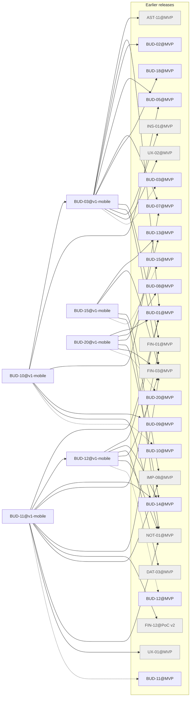

# Release v1-mobile

Generated by `node tools/req-check/index.mjs --traceability` (tools/req-check) from the link headers of the requirement slices. Do not edit by hand.

16 slices in v1-mobile: 6 migrated, 10 not migrated.

## Migrated slices

| Slice | Module | Extends | Depends on | Design | Criteria |
| --- | --- | --- | --- | --- | ---: |
| [BUD-03@v1-mobile](../../docs/requirements/bud/BUD-03.v1-mobile.md) | budget | BUD-03@MVP | AST-11@MVP, BUD-01@MVP, BUD-02@MVP, BUD-05@MVP, BUD-07@MVP, BUD-18@MVP, FIN-01@MVP, FIN-03@MVP, INS-01@MVP, UX-02@MVP | S-040, S-121 | 15 |
| [BUD-10@v1-mobile](../../docs/requirements/bud/BUD-10.v1-mobile.md) | budget, notification-preferences | BUD-10@MVP | BUD-03@v1-mobile, BUD-05@MVP, BUD-07@MVP, BUD-09@MVP, NOT-01@MVP | S-194, S-288 | 13 |
| [BUD-11@v1-mobile](../../docs/requirements/bud/BUD-11.v1-mobile.md) | transactions, duplicate-matching | BUD-11@MVP | BUD-01@MVP, BUD-12@v1-mobile, BUD-14@MVP, FIN-01@MVP, FIN-03@MVP, FIN-12@PoC v2, IMP-08@MVP, NOT-01@MVP, UX-01@MVP | S-025, S-048, S-053, S-055a | 9 |
| [BUD-12@v1-mobile](../../docs/requirements/bud/BUD-12.v1-mobile.md) | transactions, categorization | BUD-12@MVP | BUD-01@MVP, BUD-14@MVP, DAT-03@MVP, FIN-03@MVP, NOT-01@MVP | S-046, S-047, S-058, S-199 | 15 |
| [BUD-15@v1-mobile](../../docs/requirements/bud/BUD-15.v1-mobile.md) | receipts | BUD-15@MVP | BUD-13@MVP, FIN-03@MVP, IMP-08@MVP, NOT-01@MVP | S-065, S-066, S-067, S-068, S-281 | 16 |
| [BUD-20@v1-mobile](../../docs/requirements/bud/BUD-20.v1-mobile.md) | reports | BUD-20@MVP | BUD-01@MVP, BUD-08@MVP, BUD-13@MVP, BUD-14@MVP, FIN-03@MVP | S-147, S-148 | 11 |

## Dependency graph

Arrows point from a slice to what it needs. Dashed arrows: «Розширює» (the same requirement in the previous release). Grey: not migrated yet, own dependencies unknown.

## Build sequence

Topological order of the graph above, grouped into waves: every slice of a wave needs only slices of earlier waves or earlier releases, so slices of one wave can be built in parallel.

1. **Wave 1:** BUD-03@v1-mobile, BUD-12@v1-mobile, BUD-15@v1-mobile, BUD-20@v1-mobile
2. **Wave 2:** BUD-10@v1-mobile, BUD-11@v1-mobile

### Not migrated, not placed

10 slices whose dependencies are unknown until their requirement is migrated:

- ACC: ACC-02
- CICD: CICD-10
- FIN: FIN-18
- FLW: FLW-42, FLW-51, FLW-52
- JRN: JRN-07
- NFR: NFR-13
- PLT: PLT-01
- VLT: VLT-17
