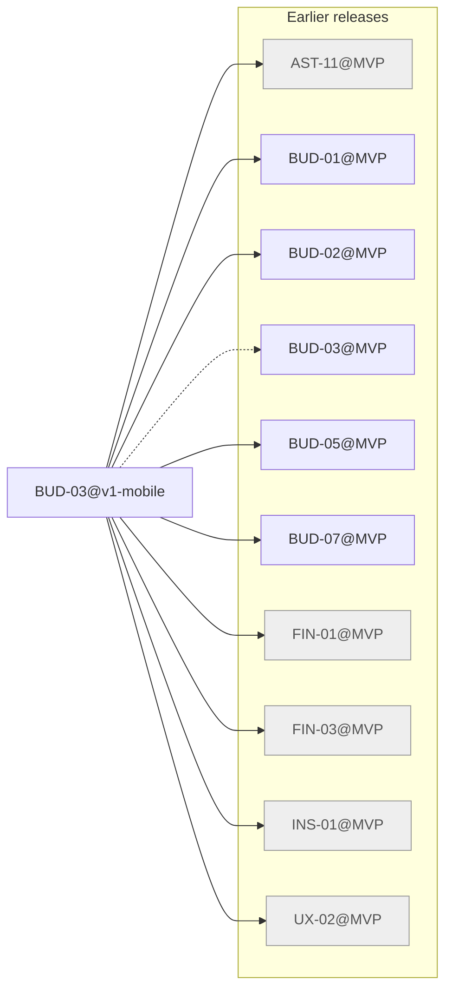

# Release v1-mobile

Generated by `node tools/req-check/index.mjs --traceability` (tools/req-check) from the link headers of the requirement slices. Do not edit by hand.

11 slices in v1-mobile: 1 migrated, 10 not migrated.

## Migrated slices

| Slice | Module | Extends | Depends on | Design | Criteria |
| --- | --- | --- | --- | --- | ---: |
| [BUD-03@v1-mobile](../../docs/requirements/bud/BUD-03.v1-mobile.md) | budget | BUD-03@MVP | AST-11@MVP, BUD-01@MVP, BUD-02@MVP, BUD-05@MVP, BUD-07@MVP, FIN-01@MVP, FIN-03@MVP, INS-01@MVP, UX-02@MVP | S-040, S-121 | 15 |

## Dependency graph

Arrows point from a slice to what it needs. Dashed arrows: «Розширює» (the same requirement in the previous release). Grey: not migrated yet, own dependencies unknown.

## Build sequence

Topological order of the graph above, grouped into waves: every slice of a wave needs only slices of earlier waves or earlier releases, so slices of one wave can be built in parallel.

1. **Wave 1:** BUD-03@v1-mobile

### Not migrated, not placed

10 slices whose dependencies are unknown until their requirement is migrated:

- ACC: ACC-02
- CICD: CICD-10
- FIN: FIN-18
- FLW: FLW-42, FLW-51, FLW-52
- JRN: JRN-07
- NFR: NFR-13
- PLT: PLT-01
- VLT: VLT-17
