# Release v1-mobile

Generated by `node tools/req-check/index.mjs --traceability` (tools/req-check) from the link headers of the requirement slices. Do not edit by hand.

51 slices in v1-mobile: 49 migrated, 2 not migrated.

## Migrated slices

| Slice | Module | Extends | Depends on | Design | Criteria |
| --- | --- | --- | --- | --- | ---: |
| [ACC-02@v1-mobile](../../docs/requirements/acc/ACC-02.v1-mobile.md) | identity, billing | — | ACC-01@MVP, ACC-03@v1-mobile, PLT-01@v1-mobile | S-279 | 7 |
| [ACC-03@v1-mobile](../../docs/requirements/acc/ACC-03.v1-mobile.md) | identity | ACC-03@MVP | ACC-01@MVP, PLT-01@v1-mobile | S-005, S-006, S-015, S-032, S-189, S-190 | 20 |
| [ACC-04@v1-mobile](../../docs/requirements/acc/ACC-04.v1-mobile.md) | identity | ACC-04@MVP | ACC-01@MVP, ACC-03@v1-mobile, PLT-01@v1-mobile | S-004, S-035, S-189, S-200 | 16 |
| [ACC-07@v1-mobile](../../docs/requirements/acc/ACC-07.v1-mobile.md) | data-export, data-erasure, identity | ACC-07@MVP | ACC-02@v1-mobile, ACC-03@v1-mobile, ACC-08@v1-mobile, ACC-11@MVP | S-008, S-210, S-211, S-212 | 25 |
| [ACC-08@v1-mobile](../../docs/requirements/acc/ACC-08.v1-mobile.md) | household, data-erasure | ACC-08@MVP | ACC-01@MVP, ACC-02@v1-mobile, ACC-03@v1-mobile, ACC-11@MVP, SUB-02@v1-mobile | S-011, S-026, S-027, S-200, S-201, S-202, S-203 | 29 |
| [ADM-02@v1-mobile](../../docs/requirements/adm/ADM-02.v1-mobile.md) | plan-catalog | ADM-02@MVP | ACC-02@v1-mobile, ADM-01@MVP, ADM-05@MVP | S-261 | 8 |
| [BUD-03@v1-mobile](../../docs/requirements/bud/BUD-03.v1-mobile.md) | budget | BUD-03@MVP | AST-11@MVP, BUD-01@MVP, BUD-02@MVP, BUD-05@MVP, BUD-07@MVP, BUD-18@MVP, FIN-01@MVP, FIN-03@MVP, INS-01@MVP, UX-02@v1-mobile | S-040, S-121 | 15 |
| [BUD-10@v1-mobile](../../docs/requirements/bud/BUD-10.v1-mobile.md) | budget, notification-preferences | BUD-10@MVP | BUD-03@v1-mobile, BUD-05@MVP, BUD-07@MVP, BUD-09@MVP, NOT-01@v1-mobile | S-194, S-288 | 13 |
| [BUD-11@v1-mobile](../../docs/requirements/bud/BUD-11.v1-mobile.md) | transactions, duplicate-matching | BUD-11@MVP | BUD-01@MVP, BUD-12@v1-mobile, BUD-14@MVP, FIN-01@MVP, FIN-03@MVP, FIN-12@MVP, IMP-08@MVP, NOT-01@v1-mobile, UX-01@MVP | S-025, S-048, S-053, S-055a | 9 |
| [BUD-12@v1-mobile](../../docs/requirements/bud/BUD-12.v1-mobile.md) | transactions, categorization | BUD-12@MVP | BUD-01@MVP, BUD-14@MVP, DAT-03@MVP, FIN-03@MVP, NOT-01@v1-mobile | S-046, S-047, S-058, S-199 | 15 |
| [BUD-15@v1-mobile](../../docs/requirements/bud/BUD-15.v1-mobile.md) | receipts | BUD-15@MVP | BUD-13@MVP, FIN-03@MVP, IMP-08@MVP, NOT-01@v1-mobile | S-065, S-066, S-067, S-068, S-281 | 16 |
| [BUD-20@v1-mobile](../../docs/requirements/bud/BUD-20.v1-mobile.md) | reports | BUD-20@MVP | BUD-01@MVP, BUD-08@MVP, BUD-13@MVP, BUD-14@MVP, FIN-03@MVP | S-147, S-148 | 11 |
| [CICD-10@v1-mobile](../../docs/requirements/cicd/CICD-10.v1-mobile.md) | — | — | CICD-02@MVP, CICD-05@MVP | — | 0 |
| [CMP-29@v1-mobile](../../docs/requirements/cmp/CMP-29.v1-mobile.md) | — | CMP-29@MVP | CMP-59@MVP | S-024 | 9 |
| [DAT-01@v1-mobile](../../docs/requirements/dat/DAT-01.v1-mobile.md) | transactions, saved-views, asset-registry | DAT-01@MVP | ACC-10@MVP | S-046, S-070 | 13 |
| [DAT-02@v1-mobile](../../docs/requirements/dat/DAT-02.v1-mobile.md) | search | DAT-02@MVP | ACC-10@MVP, DAT-01@v1-mobile | S-021, S-022 | 14 |
| [DAT-05@v1-mobile](../../docs/requirements/dat/DAT-05.v1-mobile.md) | feature-flags, support, access-scope, onboarding, dashboard | DAT-05@MVP | ACC-10@MVP, SUP-01@MVP, UX-01@MVP | S-028, S-029 | 11 |
| [DOC-01@v1-mobile](../../docs/requirements/doc/DOC-01.v1-mobile.md) | documents, file-storage | DOC-01@MVP | ACC-10@MVP, AST-01@MVP, PLT-01@v1-mobile | S-078, S-085, S-086, S-109, S-110, S-111, S-207 | 19 |
| [DS-10@v1-mobile](../../docs/requirements/ds/DS-10.v1-mobile.md) | — | DS-10@MVP | DS-09@MVP | — | 12 |
| [DS-11@v1-mobile](../../docs/requirements/ds/DS-11.v1-mobile.md) | — | DS-11@MVP | DS-06@MVP | — | 8 |
| [DS-18@v1-mobile](../../docs/requirements/ds/DS-18.v1-mobile.md) | — | DS-18@MVP | DS-04@MVP | — | 9 |
| [FIN-18@v1-mobile](../../docs/requirements/fin/FIN-18.v1-mobile.md) | bank-sync, bank-consents, bank-monobank, bank-enablebanking, bank-saltedge, transactions | FIN-18@MVP | FIN-02@MVP, FIN-11@MVP | S-063 | 13 |
| [FLW-01@v1-mobile](../../docs/requirements/flw/FLW-01.v1-mobile.md) | identity, household, onboarding, legal-consents, demo-space | FLW-01@MVP | ACC-01@MVP, ACC-02@v1-mobile, ACC-03@v1-mobile, ACC-06@MVP, ACC-08@v1-mobile, ACC-09@MVP, BUD-02@MVP, FIN-01@MVP, FIN-02@MVP, LEG-01@MVP, UX-01@MVP, UX-08@MVP | S-001, S-002, S-003, S-010, S-011, S-012, S-013, S-014, S-015, S-016, S-028, S-040, S-051, S-052 | 14 |
| [FLW-05@v1-mobile](../../docs/requirements/flw/FLW-05.v1-mobile.md) | billing, plan-catalog | FLW-05@MVP | ACC-02@v1-mobile, ADM-04@MVP, SUB-01@v1-mobile, SUB-02@v1-mobile, SUB-03@v1-mobile, UX-01@MVP | S-020, S-040, S-157, S-158, S-159, S-279 | 8 |
| [FLW-07@v1-mobile](../../docs/requirements/flw/FLW-07.v1-mobile.md) | billing | FLW-07@MVP | ACC-02@v1-mobile, ADM-04@MVP, NOT-01@v1-mobile, SUB-01@v1-mobile, SUB-02@v1-mobile, SUB-03@v1-mobile | S-040, S-157, S-159, S-160, S-161 | 5 |
| [FLW-08@v1-mobile](../../docs/requirements/flw/FLW-08.v1-mobile.md) | asset-registry, valuation, asset-media | FLW-08@MVP | ACC-02@v1-mobile, AST-01@MVP, AST-02@MVP, AST-03@MVP, AST-07@MVP, UX-08@MVP, VAL-02@MVP | S-025, S-030, S-034, S-071, S-072, S-073, S-074, S-075, S-282 | 9 |
| [FLW-23@v1-mobile](../../docs/requirements/flw/FLW-23.v1-mobile.md) | documents, file-storage | FLW-23@MVP | ACC-02@v1-mobile, DOC-01@v1-mobile, DOC-02@MVP, IMP-13@MVP | S-078, S-086, S-109, S-110, S-111, S-281 | 7 |
| [FLW-25@v1-mobile](../../docs/requirements/flw/FLW-25.v1-mobile.md) | notification-delivery, notification-preferences, weekly-digest | FLW-25@MVP | ACC-02@v1-mobile, BUD-10@v1-mobile, NOT-01@v1-mobile, UX-02@v1-mobile | S-024, S-156, S-194, S-195 | 6 |
| [FLW-28@v1-mobile](../../docs/requirements/flw/FLW-28.v1-mobile.md) | data-export, data-erasure, identity | FLW-28@MVP | ACC-02@v1-mobile, ACC-03@v1-mobile, ACC-07@v1-mobile, ACC-08@v1-mobile, DAT-04@MVP | S-008, S-032, S-200, S-201, S-210, S-211, S-212 | 7 |
| [FLW-35@v1-mobile](../../docs/requirements/flw/FLW-35.v1-mobile.md) | transactions, categorization, budget, dashboard, notification-delivery | FLW-35@MVP | BUD-03@v1-mobile, BUD-10@v1-mobile, BUD-11@v1-mobile, BUD-12@v1-mobile, BUD-13@MVP, FIN-03@MVP, NOT-01@v1-mobile, PLT-01@v1-mobile, UX-01@MVP | S-040, S-047, S-049, S-058, S-280 | 7 |
| [FLW-39@v1-mobile](../../docs/requirements/flw/FLW-39.v1-mobile.md) | plan-catalog, staff-admin | FLW-39@MVP | ACC-02@v1-mobile, ADM-01@MVP, ADM-02@v1-mobile, ADM-03@MVP, ADM-04@MVP, ADM-05@MVP | S-259, S-260, S-261, S-262, S-263, S-264, S-272, S-273 | 8 |
| [FLW-42@v1-mobile](../../docs/requirements/flw/FLW-42.v1-mobile.md) | receipts, ocr, transactions | FLW-42@MVP | BUD-13@MVP, BUD-15@v1-mobile, FIN-03@MVP, IMP-13@MVP, PLT-01@v1-mobile | S-046, S-065, S-066, S-067, S-068, S-281 | 7 |
| [FLW-51@v1-mobile](../../docs/requirements/flw/FLW-51.v1-mobile.md) | vault-items, file-storage | FLW-51@MVP | ACC-02@v1-mobile, VLT-01@MVP, VLT-02@MVP, VLT-03@MVP, VLT-05@MVP, VLT-06@MVP | S-220, S-227, S-228, S-229, S-232, S-281 | 5 |
| [FLW-52@v1-mobile](../../docs/requirements/flw/FLW-52.v1-mobile.md) | vault-items | FLW-52@MVP | ACC-02@v1-mobile, VLT-01@MVP, VLT-08@MVP, VLT-09@MVP, VLT-14@MVP | S-220, S-225, S-233, S-283 | 6 |
| [FLW-54@v1-mobile](../../docs/requirements/flw/FLW-54.v1-mobile.md) | vault-items | FLW-54@MVP | ACC-02@v1-mobile, BUD-05@MVP, VLT-08@MVP, VLT-09@MVP | S-137, S-236, S-237, S-283 | 6 |
| [FLW-55@v1-mobile](../../docs/requirements/flw/FLW-55.v1-mobile.md) | vault-items | FLW-55@MVP | ACC-02@v1-mobile, VLT-08@MVP, VLT-09@MVP, VLT-11@MVP | S-220, S-238, S-283 | 6 |
| [JRN-07@v1-mobile](../../docs/requirements/jrn/JRN-07.v1-mobile.md) | vault-items, goals | JRN-07@MVP | FLW-37@MVP, FLW-50@MVP, FLW-51@v1-mobile, FLW-52@v1-mobile, FLW-53@MVP, FLW-54@v1-mobile, FLW-55@v1-mobile | S-137, S-220, S-221, S-222, S-223, S-224, S-227, S-228, S-229, S-232, S-233, S-234, S-236, S-237, S-238 | 0 |
| [NFR-01@v1-mobile](../../docs/requirements/nfr/NFR-01.v1-mobile.md) | — | NFR-01@MVP | — | — | 9 |
| [NFR-04@v1-mobile](../../docs/requirements/nfr/NFR-04.v1-mobile.md) | — | NFR-04@MVP | IMP-19@MVP | — | 4 |
| [NFR-07@v1-mobile](../../docs/requirements/nfr/NFR-07.v1-mobile.md) | — | NFR-07@MVP | — | — | 3 |
| [NFR-08@v1-mobile](../../docs/requirements/nfr/NFR-08.v1-mobile.md) | — | NFR-08@MVP | — | — | 6 |
| [NFR-11@v1-mobile](../../docs/requirements/nfr/NFR-11.v1-mobile.md) | — | NFR-11@MVP | — | — | 2 |
| [NFR-13@v1-mobile](../../docs/requirements/nfr/NFR-13.v1-mobile.md) | — | — | — | — | 1 |
| [NOT-01@v1-mobile](../../docs/requirements/not/NOT-01.v1-mobile.md) | notification-delivery, notification-preferences, weekly-digest | NOT-01@MVP | ACC-05@MVP, PLT-01@v1-mobile | S-024, S-084, S-156, S-194 | 32 |
| [SUB-01@v1-mobile](../../docs/requirements/sub/SUB-01.v1-mobile.md) | plan-catalog, usage-limits | SUB-01@MVP | ACC-02@v1-mobile, ADM-01@MVP, ADM-02@v1-mobile, ADM-03@MVP | S-020, S-030, S-157, S-158 | 11 |
| [SUB-02@v1-mobile](../../docs/requirements/sub/SUB-02.v1-mobile.md) | billing | SUB-02@MVP | ACC-02@v1-mobile, NOT-01@v1-mobile, SUB-01@v1-mobile | S-040, S-157, S-159 | 14 |
| [SUB-03@v1-mobile](../../docs/requirements/sub/SUB-03.v1-mobile.md) | billing | SUB-03@MVP | ACC-02@v1-mobile, NOT-01@v1-mobile, SUB-01@v1-mobile, SUB-02@v1-mobile | S-157, S-159, S-160 | 9 |
| [UX-02@v1-mobile](../../docs/requirements/ux/UX-02.v1-mobile.md) | dashboard, identity | UX-02@MVP | ACC-02@v1-mobile, ACC-05@MVP, DAT-05@v1-mobile, PLT-01@v1-mobile | S-040 | 11 |
| [UX-03@v1-mobile](../../docs/requirements/ux/UX-03.v1-mobile.md) | dashboard | UX-03@MVP | ACC-02@v1-mobile, UX-08@MVP, WGT-00@MVP, WGT-01@MVP | S-040, S-042 | 9 |

## Dependency graph

Arrows point from a slice to what it needs. Dashed arrows: «Розширює» (the same requirement in the previous release). Grey: not migrated yet, own dependencies unknown.

```mermaid
flowchart LR
  ACC_02_v1_mobile["ACC-02@v1-mobile"]
  ACC_03_v1_mobile["ACC-03@v1-mobile"]
  ACC_04_v1_mobile["ACC-04@v1-mobile"]
  ACC_07_v1_mobile["ACC-07@v1-mobile"]
  ACC_08_v1_mobile["ACC-08@v1-mobile"]
  ADM_02_v1_mobile["ADM-02@v1-mobile"]
  BUD_03_v1_mobile["BUD-03@v1-mobile"]
  BUD_10_v1_mobile["BUD-10@v1-mobile"]
  BUD_11_v1_mobile["BUD-11@v1-mobile"]
  BUD_12_v1_mobile["BUD-12@v1-mobile"]
  BUD_15_v1_mobile["BUD-15@v1-mobile"]
  BUD_20_v1_mobile["BUD-20@v1-mobile"]
  CICD_10_v1_mobile["CICD-10@v1-mobile"]
  CMP_29_v1_mobile["CMP-29@v1-mobile"]
  DAT_01_v1_mobile["DAT-01@v1-mobile"]
  DAT_02_v1_mobile["DAT-02@v1-mobile"]
  DAT_05_v1_mobile["DAT-05@v1-mobile"]
  DOC_01_v1_mobile["DOC-01@v1-mobile"]
  DS_10_v1_mobile["DS-10@v1-mobile"]
  DS_11_v1_mobile["DS-11@v1-mobile"]
  DS_18_v1_mobile["DS-18@v1-mobile"]
  FIN_18_v1_mobile["FIN-18@v1-mobile"]
  FLW_01_v1_mobile["FLW-01@v1-mobile"]
  FLW_05_v1_mobile["FLW-05@v1-mobile"]
  FLW_07_v1_mobile["FLW-07@v1-mobile"]
  FLW_08_v1_mobile["FLW-08@v1-mobile"]
  FLW_23_v1_mobile["FLW-23@v1-mobile"]
  FLW_25_v1_mobile["FLW-25@v1-mobile"]
  FLW_28_v1_mobile["FLW-28@v1-mobile"]
  FLW_35_v1_mobile["FLW-35@v1-mobile"]
  FLW_39_v1_mobile["FLW-39@v1-mobile"]
  FLW_42_v1_mobile["FLW-42@v1-mobile"]
  FLW_51_v1_mobile["FLW-51@v1-mobile"]
  FLW_52_v1_mobile["FLW-52@v1-mobile"]
  FLW_54_v1_mobile["FLW-54@v1-mobile"]
  FLW_55_v1_mobile["FLW-55@v1-mobile"]
  JRN_07_v1_mobile["JRN-07@v1-mobile"]
  NFR_01_v1_mobile["NFR-01@v1-mobile"]
  NFR_04_v1_mobile["NFR-04@v1-mobile"]
  NFR_07_v1_mobile["NFR-07@v1-mobile"]
  NFR_08_v1_mobile["NFR-08@v1-mobile"]
  NFR_11_v1_mobile["NFR-11@v1-mobile"]
  NFR_13_v1_mobile["NFR-13@v1-mobile"]
  NOT_01_v1_mobile["NOT-01@v1-mobile"]
  PLT_01_v1_mobile["PLT-01@v1-mobile"]
  SUB_01_v1_mobile["SUB-01@v1-mobile"]
  SUB_02_v1_mobile["SUB-02@v1-mobile"]
  SUB_03_v1_mobile["SUB-03@v1-mobile"]
  UX_02_v1_mobile["UX-02@v1-mobile"]
  UX_03_v1_mobile["UX-03@v1-mobile"]
  subgraph earlier["Earlier releases"]
    ACC_01_MVP["ACC-01@MVP"]
    ACC_03_MVP["ACC-03@MVP"]
    ACC_04_MVP["ACC-04@MVP"]
    ACC_05_MVP["ACC-05@MVP"]
    ACC_06_MVP["ACC-06@MVP"]
    ACC_07_MVP["ACC-07@MVP"]
    ACC_08_MVP["ACC-08@MVP"]
    ACC_09_MVP["ACC-09@MVP"]
    ACC_10_MVP["ACC-10@MVP"]
    ACC_11_MVP["ACC-11@MVP"]
    ADM_01_MVP["ADM-01@MVP"]
    ADM_02_MVP["ADM-02@MVP"]
    ADM_03_MVP["ADM-03@MVP"]
    ADM_04_MVP["ADM-04@MVP"]
    ADM_05_MVP["ADM-05@MVP"]
    AST_01_MVP["AST-01@MVP"]
    AST_02_MVP["AST-02@MVP"]
    AST_03_MVP["AST-03@MVP"]
    AST_07_MVP["AST-07@MVP"]
    AST_11_MVP["AST-11@MVP"]
    BUD_01_MVP["BUD-01@MVP"]
    BUD_02_MVP["BUD-02@MVP"]
    BUD_03_MVP["BUD-03@MVP"]
    BUD_05_MVP["BUD-05@MVP"]
    BUD_07_MVP["BUD-07@MVP"]
    BUD_08_MVP["BUD-08@MVP"]
    BUD_09_MVP["BUD-09@MVP"]
    BUD_10_MVP["BUD-10@MVP"]
    BUD_11_MVP["BUD-11@MVP"]
    BUD_12_MVP["BUD-12@MVP"]
    BUD_13_MVP["BUD-13@MVP"]
    BUD_14_MVP["BUD-14@MVP"]
    BUD_15_MVP["BUD-15@MVP"]
    BUD_18_MVP["BUD-18@MVP"]
    BUD_20_MVP["BUD-20@MVP"]
    CICD_02_MVP["CICD-02@MVP"]
    CICD_05_MVP["CICD-05@MVP"]
    CMP_29_MVP["CMP-29@MVP"]
    CMP_59_MVP["CMP-59@MVP"]
    DAT_01_MVP["DAT-01@MVP"]
    DAT_02_MVP["DAT-02@MVP"]
    DAT_03_MVP["DAT-03@MVP"]
    DAT_04_MVP["DAT-04@MVP"]
    DAT_05_MVP["DAT-05@MVP"]
    DOC_01_MVP["DOC-01@MVP"]
    DOC_02_MVP["DOC-02@MVP"]
    DS_04_MVP["DS-04@MVP"]
    DS_06_MVP["DS-06@MVP"]
    DS_09_MVP["DS-09@MVP"]
    DS_10_MVP["DS-10@MVP"]
    DS_11_MVP["DS-11@MVP"]
    DS_18_MVP["DS-18@MVP"]
    FIN_01_MVP["FIN-01@MVP"]
    FIN_02_MVP["FIN-02@MVP"]
    FIN_03_MVP["FIN-03@MVP"]
    FIN_11_MVP["FIN-11@MVP"]
    FIN_12_MVP["FIN-12@MVP"]
    FIN_18_MVP["FIN-18@MVP"]
    FLW_01_MVP["FLW-01@MVP"]
    FLW_05_MVP["FLW-05@MVP"]
    FLW_07_MVP["FLW-07@MVP"]
    FLW_08_MVP["FLW-08@MVP"]
    FLW_23_MVP["FLW-23@MVP"]
    FLW_25_MVP["FLW-25@MVP"]
    FLW_28_MVP["FLW-28@MVP"]
    FLW_35_MVP["FLW-35@MVP"]
    FLW_37_MVP["FLW-37@MVP"]
    FLW_39_MVP["FLW-39@MVP"]
    FLW_42_MVP["FLW-42@MVP"]
    FLW_50_MVP["FLW-50@MVP"]
    FLW_51_MVP["FLW-51@MVP"]
    FLW_52_MVP["FLW-52@MVP"]
    FLW_53_MVP["FLW-53@MVP"]
    FLW_54_MVP["FLW-54@MVP"]
    FLW_55_MVP["FLW-55@MVP"]
    IMP_08_MVP["IMP-08@MVP"]
    IMP_13_MVP["IMP-13@MVP"]
    IMP_19_MVP["IMP-19@MVP"]
    INS_01_MVP["INS-01@MVP"]
    JRN_07_MVP["JRN-07@MVP"]
    LEG_01_MVP["LEG-01@MVP"]
    NFR_01_MVP["NFR-01@MVP"]
    NFR_04_MVP["NFR-04@MVP"]
    NFR_07_MVP["NFR-07@MVP"]
    NFR_08_MVP["NFR-08@MVP"]
    NFR_11_MVP["NFR-11@MVP"]
    NOT_01_MVP["NOT-01@MVP"]
    SUB_01_MVP["SUB-01@MVP"]
    SUB_02_MVP["SUB-02@MVP"]
    SUB_03_MVP["SUB-03@MVP"]
    SUP_01_MVP["SUP-01@MVP"]
    UX_01_MVP["UX-01@MVP"]
    UX_02_MVP["UX-02@MVP"]
    UX_03_MVP["UX-03@MVP"]
    UX_08_MVP["UX-08@MVP"]
    VAL_02_MVP["VAL-02@MVP"]
    VLT_01_MVP["VLT-01@MVP"]
    VLT_02_MVP["VLT-02@MVP"]
    VLT_03_MVP["VLT-03@MVP"]
    VLT_05_MVP["VLT-05@MVP"]
    VLT_06_MVP["VLT-06@MVP"]
    VLT_08_MVP["VLT-08@MVP"]
    VLT_09_MVP["VLT-09@MVP"]
    VLT_11_MVP["VLT-11@MVP"]
    VLT_14_MVP["VLT-14@MVP"]
    WGT_00_MVP["WGT-00@MVP"]
    WGT_01_MVP["WGT-01@MVP"]
  end
  ACC_02_v1_mobile --> ACC_01_MVP
  ACC_02_v1_mobile --> ACC_03_v1_mobile
  ACC_02_v1_mobile --> PLT_01_v1_mobile
  ACC_03_v1_mobile --> ACC_01_MVP
  ACC_03_v1_mobile --> PLT_01_v1_mobile
  ACC_03_v1_mobile -.-> ACC_03_MVP
  ACC_04_v1_mobile --> ACC_01_MVP
  ACC_04_v1_mobile --> ACC_03_v1_mobile
  ACC_04_v1_mobile --> PLT_01_v1_mobile
  ACC_04_v1_mobile -.-> ACC_04_MVP
  ACC_07_v1_mobile --> ACC_02_v1_mobile
  ACC_07_v1_mobile --> ACC_03_v1_mobile
  ACC_07_v1_mobile --> ACC_08_v1_mobile
  ACC_07_v1_mobile --> ACC_11_MVP
  ACC_07_v1_mobile -.-> ACC_07_MVP
  ACC_08_v1_mobile --> ACC_01_MVP
  ACC_08_v1_mobile --> ACC_02_v1_mobile
  ACC_08_v1_mobile --> ACC_03_v1_mobile
  ACC_08_v1_mobile --> ACC_11_MVP
  ACC_08_v1_mobile --> SUB_02_v1_mobile
  ACC_08_v1_mobile -.-> ACC_08_MVP
  ADM_02_v1_mobile --> ACC_02_v1_mobile
  ADM_02_v1_mobile --> ADM_01_MVP
  ADM_02_v1_mobile --> ADM_05_MVP
  ADM_02_v1_mobile -.-> ADM_02_MVP
  BUD_03_v1_mobile --> AST_11_MVP
  BUD_03_v1_mobile --> BUD_01_MVP
  BUD_03_v1_mobile --> BUD_02_MVP
  BUD_03_v1_mobile --> BUD_05_MVP
  BUD_03_v1_mobile --> BUD_07_MVP
  BUD_03_v1_mobile --> BUD_18_MVP
  BUD_03_v1_mobile --> FIN_01_MVP
  BUD_03_v1_mobile --> FIN_03_MVP
  BUD_03_v1_mobile --> INS_01_MVP
  BUD_03_v1_mobile --> UX_02_v1_mobile
  BUD_03_v1_mobile -.-> BUD_03_MVP
  BUD_10_v1_mobile --> BUD_03_v1_mobile
  BUD_10_v1_mobile --> BUD_05_MVP
  BUD_10_v1_mobile --> BUD_07_MVP
  BUD_10_v1_mobile --> BUD_09_MVP
  BUD_10_v1_mobile --> NOT_01_v1_mobile
  BUD_10_v1_mobile -.-> BUD_10_MVP
  BUD_11_v1_mobile --> BUD_01_MVP
  BUD_11_v1_mobile --> BUD_12_v1_mobile
  BUD_11_v1_mobile --> BUD_14_MVP
  BUD_11_v1_mobile --> FIN_01_MVP
  BUD_11_v1_mobile --> FIN_03_MVP
  BUD_11_v1_mobile --> FIN_12_MVP
  BUD_11_v1_mobile --> IMP_08_MVP
  BUD_11_v1_mobile --> NOT_01_v1_mobile
  BUD_11_v1_mobile --> UX_01_MVP
  BUD_11_v1_mobile -.-> BUD_11_MVP
  BUD_12_v1_mobile --> BUD_01_MVP
  BUD_12_v1_mobile --> BUD_14_MVP
  BUD_12_v1_mobile --> DAT_03_MVP
  BUD_12_v1_mobile --> FIN_03_MVP
  BUD_12_v1_mobile --> NOT_01_v1_mobile
  BUD_12_v1_mobile -.-> BUD_12_MVP
  BUD_15_v1_mobile --> BUD_13_MVP
  BUD_15_v1_mobile --> FIN_03_MVP
  BUD_15_v1_mobile --> IMP_08_MVP
  BUD_15_v1_mobile --> NOT_01_v1_mobile
  BUD_15_v1_mobile -.-> BUD_15_MVP
  BUD_20_v1_mobile --> BUD_01_MVP
  BUD_20_v1_mobile --> BUD_08_MVP
  BUD_20_v1_mobile --> BUD_13_MVP
  BUD_20_v1_mobile --> BUD_14_MVP
  BUD_20_v1_mobile --> FIN_03_MVP
  BUD_20_v1_mobile -.-> BUD_20_MVP
  CICD_10_v1_mobile --> CICD_02_MVP
  CICD_10_v1_mobile --> CICD_05_MVP
  CMP_29_v1_mobile --> CMP_59_MVP
  CMP_29_v1_mobile -.-> CMP_29_MVP
  DAT_01_v1_mobile --> ACC_10_MVP
  DAT_01_v1_mobile -.-> DAT_01_MVP
  DAT_02_v1_mobile --> ACC_10_MVP
  DAT_02_v1_mobile --> DAT_01_v1_mobile
  DAT_02_v1_mobile -.-> DAT_02_MVP
  DAT_05_v1_mobile --> ACC_10_MVP
  DAT_05_v1_mobile --> SUP_01_MVP
  DAT_05_v1_mobile --> UX_01_MVP
  DAT_05_v1_mobile -.-> DAT_05_MVP
  DOC_01_v1_mobile --> ACC_10_MVP
  DOC_01_v1_mobile --> AST_01_MVP
  DOC_01_v1_mobile --> PLT_01_v1_mobile
  DOC_01_v1_mobile -.-> DOC_01_MVP
  DS_10_v1_mobile --> DS_09_MVP
  DS_10_v1_mobile -.-> DS_10_MVP
  DS_11_v1_mobile --> DS_06_MVP
  DS_11_v1_mobile -.-> DS_11_MVP
  DS_18_v1_mobile --> DS_04_MVP
  DS_18_v1_mobile -.-> DS_18_MVP
  FIN_18_v1_mobile --> FIN_02_MVP
  FIN_18_v1_mobile --> FIN_11_MVP
  FIN_18_v1_mobile -.-> FIN_18_MVP
  FLW_01_v1_mobile --> ACC_01_MVP
  FLW_01_v1_mobile --> ACC_02_v1_mobile
  FLW_01_v1_mobile --> ACC_03_v1_mobile
  FLW_01_v1_mobile --> ACC_06_MVP
  FLW_01_v1_mobile --> ACC_08_v1_mobile
  FLW_01_v1_mobile --> ACC_09_MVP
  FLW_01_v1_mobile --> BUD_02_MVP
  FLW_01_v1_mobile --> FIN_01_MVP
  FLW_01_v1_mobile --> FIN_02_MVP
  FLW_01_v1_mobile --> LEG_01_MVP
  FLW_01_v1_mobile --> UX_01_MVP
  FLW_01_v1_mobile --> UX_08_MVP
  FLW_01_v1_mobile -.-> FLW_01_MVP
  FLW_05_v1_mobile --> ACC_02_v1_mobile
  FLW_05_v1_mobile --> ADM_04_MVP
  FLW_05_v1_mobile --> SUB_01_v1_mobile
  FLW_05_v1_mobile --> SUB_02_v1_mobile
  FLW_05_v1_mobile --> SUB_03_v1_mobile
  FLW_05_v1_mobile --> UX_01_MVP
  FLW_05_v1_mobile -.-> FLW_05_MVP
  FLW_07_v1_mobile --> ACC_02_v1_mobile
  FLW_07_v1_mobile --> ADM_04_MVP
  FLW_07_v1_mobile --> NOT_01_v1_mobile
  FLW_07_v1_mobile --> SUB_01_v1_mobile
  FLW_07_v1_mobile --> SUB_02_v1_mobile
  FLW_07_v1_mobile --> SUB_03_v1_mobile
  FLW_07_v1_mobile -.-> FLW_07_MVP
  FLW_08_v1_mobile --> ACC_02_v1_mobile
  FLW_08_v1_mobile --> AST_01_MVP
  FLW_08_v1_mobile --> AST_02_MVP
  FLW_08_v1_mobile --> AST_03_MVP
  FLW_08_v1_mobile --> AST_07_MVP
  FLW_08_v1_mobile --> UX_08_MVP
  FLW_08_v1_mobile --> VAL_02_MVP
  FLW_08_v1_mobile -.-> FLW_08_MVP
  FLW_23_v1_mobile --> ACC_02_v1_mobile
  FLW_23_v1_mobile --> DOC_01_v1_mobile
  FLW_23_v1_mobile --> DOC_02_MVP
  FLW_23_v1_mobile --> IMP_13_MVP
  FLW_23_v1_mobile -.-> FLW_23_MVP
  FLW_25_v1_mobile --> ACC_02_v1_mobile
  FLW_25_v1_mobile --> BUD_10_v1_mobile
  FLW_25_v1_mobile --> NOT_01_v1_mobile
  FLW_25_v1_mobile --> UX_02_v1_mobile
  FLW_25_v1_mobile -.-> FLW_25_MVP
  FLW_28_v1_mobile --> ACC_02_v1_mobile
  FLW_28_v1_mobile --> ACC_03_v1_mobile
  FLW_28_v1_mobile --> ACC_07_v1_mobile
  FLW_28_v1_mobile --> ACC_08_v1_mobile
  FLW_28_v1_mobile --> DAT_04_MVP
  FLW_28_v1_mobile -.-> FLW_28_MVP
  FLW_35_v1_mobile --> BUD_03_v1_mobile
  FLW_35_v1_mobile --> BUD_10_v1_mobile
  FLW_35_v1_mobile --> BUD_11_v1_mobile
  FLW_35_v1_mobile --> BUD_12_v1_mobile
  FLW_35_v1_mobile --> BUD_13_MVP
  FLW_35_v1_mobile --> FIN_03_MVP
  FLW_35_v1_mobile --> NOT_01_v1_mobile
  FLW_35_v1_mobile --> PLT_01_v1_mobile
  FLW_35_v1_mobile --> UX_01_MVP
  FLW_35_v1_mobile -.-> FLW_35_MVP
  FLW_39_v1_mobile --> ACC_02_v1_mobile
  FLW_39_v1_mobile --> ADM_01_MVP
  FLW_39_v1_mobile --> ADM_02_v1_mobile
  FLW_39_v1_mobile --> ADM_03_MVP
  FLW_39_v1_mobile --> ADM_04_MVP
  FLW_39_v1_mobile --> ADM_05_MVP
  FLW_39_v1_mobile -.-> FLW_39_MVP
  FLW_42_v1_mobile --> BUD_13_MVP
  FLW_42_v1_mobile --> BUD_15_v1_mobile
  FLW_42_v1_mobile --> FIN_03_MVP
  FLW_42_v1_mobile --> IMP_13_MVP
  FLW_42_v1_mobile --> PLT_01_v1_mobile
  FLW_42_v1_mobile -.-> FLW_42_MVP
  FLW_51_v1_mobile --> ACC_02_v1_mobile
  FLW_51_v1_mobile --> VLT_01_MVP
  FLW_51_v1_mobile --> VLT_02_MVP
  FLW_51_v1_mobile --> VLT_03_MVP
  FLW_51_v1_mobile --> VLT_05_MVP
  FLW_51_v1_mobile --> VLT_06_MVP
  FLW_51_v1_mobile -.-> FLW_51_MVP
  FLW_52_v1_mobile --> ACC_02_v1_mobile
  FLW_52_v1_mobile --> VLT_01_MVP
  FLW_52_v1_mobile --> VLT_08_MVP
  FLW_52_v1_mobile --> VLT_09_MVP
  FLW_52_v1_mobile --> VLT_14_MVP
  FLW_52_v1_mobile -.-> FLW_52_MVP
  FLW_54_v1_mobile --> ACC_02_v1_mobile
  FLW_54_v1_mobile --> BUD_05_MVP
  FLW_54_v1_mobile --> VLT_08_MVP
  FLW_54_v1_mobile --> VLT_09_MVP
  FLW_54_v1_mobile -.-> FLW_54_MVP
  FLW_55_v1_mobile --> ACC_02_v1_mobile
  FLW_55_v1_mobile --> VLT_08_MVP
  FLW_55_v1_mobile --> VLT_09_MVP
  FLW_55_v1_mobile --> VLT_11_MVP
  FLW_55_v1_mobile -.-> FLW_55_MVP
  JRN_07_v1_mobile --> FLW_37_MVP
  JRN_07_v1_mobile --> FLW_50_MVP
  JRN_07_v1_mobile --> FLW_51_v1_mobile
  JRN_07_v1_mobile --> FLW_52_v1_mobile
  JRN_07_v1_mobile --> FLW_53_MVP
  JRN_07_v1_mobile --> FLW_54_v1_mobile
  JRN_07_v1_mobile --> FLW_55_v1_mobile
  JRN_07_v1_mobile -.-> JRN_07_MVP
  NFR_01_v1_mobile -.-> NFR_01_MVP
  NFR_04_v1_mobile --> IMP_19_MVP
  NFR_04_v1_mobile -.-> NFR_04_MVP
  NFR_07_v1_mobile -.-> NFR_07_MVP
  NFR_08_v1_mobile -.-> NFR_08_MVP
  NFR_11_v1_mobile -.-> NFR_11_MVP
  NOT_01_v1_mobile --> ACC_05_MVP
  NOT_01_v1_mobile --> PLT_01_v1_mobile
  NOT_01_v1_mobile -.-> NOT_01_MVP
  SUB_01_v1_mobile --> ACC_02_v1_mobile
  SUB_01_v1_mobile --> ADM_01_MVP
  SUB_01_v1_mobile --> ADM_02_v1_mobile
  SUB_01_v1_mobile --> ADM_03_MVP
  SUB_01_v1_mobile -.-> SUB_01_MVP
  SUB_02_v1_mobile --> ACC_02_v1_mobile
  SUB_02_v1_mobile --> NOT_01_v1_mobile
  SUB_02_v1_mobile --> SUB_01_v1_mobile
  SUB_02_v1_mobile -.-> SUB_02_MVP
  SUB_03_v1_mobile --> ACC_02_v1_mobile
  SUB_03_v1_mobile --> NOT_01_v1_mobile
  SUB_03_v1_mobile --> SUB_01_v1_mobile
  SUB_03_v1_mobile --> SUB_02_v1_mobile
  SUB_03_v1_mobile -.-> SUB_03_MVP
  UX_02_v1_mobile --> ACC_02_v1_mobile
  UX_02_v1_mobile --> ACC_05_MVP
  UX_02_v1_mobile --> DAT_05_v1_mobile
  UX_02_v1_mobile --> PLT_01_v1_mobile
  UX_02_v1_mobile -.-> UX_02_MVP
  UX_03_v1_mobile --> ACC_02_v1_mobile
  UX_03_v1_mobile --> UX_08_MVP
  UX_03_v1_mobile --> WGT_00_MVP
  UX_03_v1_mobile --> WGT_01_MVP
  UX_03_v1_mobile -.-> UX_03_MVP
  classDef notMigrated fill:#eee,stroke:#999,color:#555
  class AST_01_MVP,AST_02_MVP,AST_03_MVP,AST_07_MVP,AST_11_MVP,PLT_01_v1_mobile,VAL_02_MVP,VLT_01_MVP,VLT_02_MVP,VLT_03_MVP,VLT_05_MVP,VLT_06_MVP,VLT_08_MVP,VLT_09_MVP,VLT_11_MVP,VLT_14_MVP,WGT_00_MVP,WGT_01_MVP notMigrated
```

## Build sequence

Topological order of the graph above, grouped into waves: every slice of a wave needs only slices of earlier waves or earlier releases, so slices of one wave can be built in parallel.

1. **Wave 1:** BUD-20@v1-mobile, CICD-10@v1-mobile, CMP-29@v1-mobile, DAT-01@v1-mobile, DAT-05@v1-mobile, DS-10@v1-mobile, DS-11@v1-mobile, DS-18@v1-mobile, FIN-18@v1-mobile, NFR-01@v1-mobile, NFR-04@v1-mobile, NFR-07@v1-mobile, NFR-08@v1-mobile, NFR-11@v1-mobile, NFR-13@v1-mobile, PLT-01@v1-mobile (не мігровано)
2. **Wave 2:** ACC-03@v1-mobile, DAT-02@v1-mobile, DOC-01@v1-mobile, NOT-01@v1-mobile
3. **Wave 3:** ACC-02@v1-mobile, ACC-04@v1-mobile, BUD-12@v1-mobile, BUD-15@v1-mobile
4. **Wave 4:** ADM-02@v1-mobile, BUD-11@v1-mobile, FLW-08@v1-mobile, FLW-23@v1-mobile, FLW-42@v1-mobile, FLW-51@v1-mobile, FLW-52@v1-mobile, FLW-54@v1-mobile, FLW-55@v1-mobile, UX-02@v1-mobile, UX-03@v1-mobile
5. **Wave 5:** BUD-03@v1-mobile, FLW-39@v1-mobile, JRN-07@v1-mobile, SUB-01@v1-mobile
6. **Wave 6:** BUD-10@v1-mobile, SUB-02@v1-mobile
7. **Wave 7:** ACC-08@v1-mobile, FLW-25@v1-mobile, FLW-35@v1-mobile, SUB-03@v1-mobile
8. **Wave 8:** ACC-07@v1-mobile, FLW-01@v1-mobile, FLW-05@v1-mobile, FLW-07@v1-mobile
9. **Wave 9:** FLW-28@v1-mobile

### Not migrated, not placed

1 slices whose dependencies are unknown until their requirement is migrated:

- VLT: VLT-17
