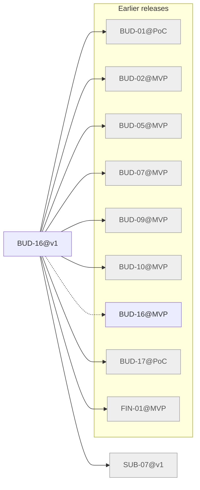

# Release v1

Generated by `node tools/req-check/index.mjs --traceability` (tools/req-check) from the link headers of the requirement slices. Do not edit by hand.

49 slices in v1: 1 migrated, 48 not migrated.

## Migrated slices

| Slice | Module | Extends | Depends on | Design | Criteria |
| --- | --- | --- | --- | --- | ---: |
| [BUD-16@v1](../../docs/requirements/bud/BUD-16.v1.md) | budget | BUD-16@MVP | BUD-01@PoC, BUD-02@MVP, BUD-05@MVP, BUD-07@MVP, BUD-09@MVP, BUD-10@MVP, BUD-17@PoC, FIN-01@MVP, SUB-07@v1 | S-121, S-125, S-129, S-130, S-133 | 13 |

## Dependency graph

Arrows point from a slice to what it needs. Dashed arrows: «Розширює» (the same requirement in the previous release). Grey: not migrated yet, own dependencies unknown.

## Build sequence

Topological order of the graph above, grouped into waves: every slice of a wave needs only slices of earlier waves or earlier releases, so slices of one wave can be built in parallel.

1. **Wave 1:** SUB-07@v1 (не мігровано)
2. **Wave 2:** BUD-16@v1

### Not migrated, not placed

47 slices whose dependencies are unknown until their requirement is migrated:

- ADM: ADM-04, ADM-06, ADM-07, ADM-08, ADM-09
- AI: AI-01, AI-02, AI-04
- AST: AST-05, AST-06, AST-10, AST-16
- CMP: CMP-37, CMP-43, CMP-51
- CRY: CRY-01, CRY-02
- FIN: FIN-02, FIN-05, FIN-06, FIN-07, FIN-08, FIN-09, FIN-13, FIN-14, FIN-16
- FLW: FLW-06, FLW-17, FLW-20, FLW-21, FLW-40, FLW-45, FLW-46
- INS: INS-02
- INV: INV-01, INV-02, INV-03
- JRN: JRN-02, JRN-06
- NOT: NOT-02
- SUB: SUB-05
- VAL: VAL-03, VAL-05, VAL-06, VAL-08, VAL-10
- VLT: VLT-17
