# Release v1

Generated by `node tools/req-check/index.mjs --traceability` (tools/req-check) from the link headers of the requirement slices. Do not edit by hand.

66 slices in v1: 16 migrated, 50 not migrated.

## Migrated slices

| Slice | Module | Extends | Depends on | Design | Criteria |
| --- | --- | --- | --- | --- | ---: |
| [BUD-02@v1](../../docs/requirements/bud/BUD-02.v1.md) | budget | BUD-02@MVP | BUD-01@MVP, FIN-01@MVP, FIN-03@MVP, SUB-07@v1 | S-121, S-122, S-123, S-124, S-125, S-127, S-128, S-135, S-287, S-288, S-289 | 17 |
| [BUD-04@v1](../../docs/requirements/bud/BUD-04.v1.md) | budget | BUD-04@MVP | BUD-03@v1-mobile, BUD-05@v1, BUD-06@MVP, SUB-07@v1 | S-142 | 8 |
| [BUD-05@v1](../../docs/requirements/bud/BUD-05.v1.md) | goals | BUD-05@MVP | AST-01@MVP, FIN-01@MVP, FIN-03@MVP, NOT-01@MVP, SUB-07@v1 | S-136, S-137, S-138, S-140, S-139 | 24 |
| [BUD-08@v1](../../docs/requirements/bud/BUD-08.v1.md) | cashflow | BUD-08@MVP | AST-11@MVP, BUD-01@MVP, BUD-05@v1, BUD-13@v1, FIN-01@MVP, FIN-03@MVP, SUB-07@v1 | S-134 | 10 |
| [BUD-09@v1](../../docs/requirements/bud/BUD-09.v1.md) | budget | BUD-09@MVP | BUD-02@v1, BUD-05@v1, FIN-01@MVP, FIN-12@PoC v2, NOT-01@MVP, SUB-07@v1 | S-121, S-128 | 14 |
| [BUD-12@v1](../../docs/requirements/bud/BUD-12.v1.md) | transactions, categorization | BUD-12@v1-mobile | BUD-01@MVP, BUD-14@v1, DAT-03@v1, FIN-03@MVP, NOT-01@MVP | S-046, S-047, S-058, S-199 | 15 |
| [BUD-13@v1](../../docs/requirements/bud/BUD-13.v1.md) | transactions, file-storage | BUD-13@MVP | BUD-01@MVP, DAT-02@v1, DAT-03@v1, FIN-03@MVP, SUB-07@v1 | S-046, S-047, S-049 | 10 |
| [BUD-14@v1](../../docs/requirements/bud/BUD-14.v1.md) | merchants, categorization | BUD-14@MVP | AST-01@MVP, BUD-01@MVP, FIN-03@MVP, NOT-01@MVP | S-047, S-069, S-197, S-198, S-285 | 17 |
| [BUD-16@v1](../../docs/requirements/bud/BUD-16.v1.md) | budget | BUD-16@MVP | BUD-01@MVP, BUD-02@v1, BUD-05@v1, BUD-07@MVP, BUD-09@v1, BUD-17@v1, FIN-01@MVP, NOT-01@MVP, SUB-07@v1 | S-121, S-125, S-129, S-130, S-133 | 13 |
| [BUD-17@v1](../../docs/requirements/bud/BUD-17.v1.md) | budget | BUD-17@MVP | AST-11@MVP, BUD-02@v1, BUD-05@v1, BUD-19@MVP, FIN-01@MVP, SUB-07@v1 | S-126, S-288, S-289 | 14 |
| [BUD-18@v1](../../docs/requirements/bud/BUD-18.v1.md) | budget | BUD-18@MVP | BUD-01@MVP, BUD-02@v1, BUD-05@v1, BUD-09@v1, BUD-16@v1, BUD-17@v1, SUB-07@v1 | S-121, S-129, S-130, S-131 | 12 |
| [BUD-20@v1](../../docs/requirements/bud/BUD-20.v1.md) | reports | BUD-20@v1-mobile | BUD-01@MVP, BUD-08@v1, BUD-13@v1, BUD-14@v1, FIN-03@MVP, SUB-07@v1 | S-147, S-148 | 11 |
| [DAT-02@v1](../../docs/requirements/dat/DAT-02.v1.md) | search, plan-catalog | DAT-02@v1-mobile | ACC-10@MVP, DAT-01@v1-mobile, SUB-07@v1 | S-021, S-022 | 14 |
| [DAT-03@v1](../../docs/requirements/dat/DAT-03.v1.md) | bulk-actions, transactions, asset-registry, plan-catalog | DAT-03@MVP | AST-01@MVP, AST-12@MVP, DAT-01@v1-mobile, SUB-07@v1, VAL-07@MVP | S-036, S-046, S-070 | 16 |
| [DAT-04@v1](../../docs/requirements/dat/DAT-04.v1.md) | import-sessions, import-recipes, transactions, asset-registry, parties, holdings, notification-delivery, usage-limits | DAT-04@MVP | AST-01@MVP, AST-11@MVP, DOC-01@MVP, FIN-01@MVP, FIN-03@MVP, FIN-05@v1, IMP-04@MVP, NOT-01@MVP, SUB-07@v1 | S-162, S-166, S-175, S-176, S-177, S-179, S-163, S-164, S-165, S-167, S-168, S-169 | 17 |
| [DAT-05@v1](../../docs/requirements/dat/DAT-05.v1.md) | feature-flags, support, access-scope, onboarding, dashboard, plan-catalog | DAT-05@v1-mobile | ACC-10@MVP, SUB-07@v1, SUP-01@MVP, UX-01@MVP | S-028, S-029 | 12 |

## Dependency graph

Arrows point from a slice to what it needs. Dashed arrows: «Розширює» (the same requirement in the previous release). Grey: not migrated yet, own dependencies unknown.

```mermaid
flowchart LR
  BUD_02_v1["BUD-02@v1"]
  BUD_04_v1["BUD-04@v1"]
  BUD_05_v1["BUD-05@v1"]
  BUD_08_v1["BUD-08@v1"]
  BUD_09_v1["BUD-09@v1"]
  BUD_12_v1["BUD-12@v1"]
  BUD_13_v1["BUD-13@v1"]
  BUD_14_v1["BUD-14@v1"]
  BUD_16_v1["BUD-16@v1"]
  BUD_17_v1["BUD-17@v1"]
  BUD_18_v1["BUD-18@v1"]
  BUD_20_v1["BUD-20@v1"]
  DAT_02_v1["DAT-02@v1"]
  DAT_03_v1["DAT-03@v1"]
  DAT_04_v1["DAT-04@v1"]
  DAT_05_v1["DAT-05@v1"]
  FIN_05_v1["FIN-05@v1"]
  SUB_07_v1["SUB-07@v1"]
  subgraph earlier["Earlier releases"]
    ACC_10_MVP["ACC-10@MVP"]
    AST_01_MVP["AST-01@MVP"]
    AST_11_MVP["AST-11@MVP"]
    AST_12_MVP["AST-12@MVP"]
    BUD_01_MVP["BUD-01@MVP"]
    BUD_02_MVP["BUD-02@MVP"]
    BUD_03_v1_mobile["BUD-03@v1-mobile"]
    BUD_04_MVP["BUD-04@MVP"]
    BUD_05_MVP["BUD-05@MVP"]
    BUD_06_MVP["BUD-06@MVP"]
    BUD_07_MVP["BUD-07@MVP"]
    BUD_08_MVP["BUD-08@MVP"]
    BUD_09_MVP["BUD-09@MVP"]
    BUD_12_v1_mobile["BUD-12@v1-mobile"]
    BUD_13_MVP["BUD-13@MVP"]
    BUD_14_MVP["BUD-14@MVP"]
    BUD_16_MVP["BUD-16@MVP"]
    BUD_17_MVP["BUD-17@MVP"]
    BUD_18_MVP["BUD-18@MVP"]
    BUD_19_MVP["BUD-19@MVP"]
    BUD_20_v1_mobile["BUD-20@v1-mobile"]
    DAT_01_v1_mobile["DAT-01@v1-mobile"]
    DAT_02_v1_mobile["DAT-02@v1-mobile"]
    DAT_03_MVP["DAT-03@MVP"]
    DAT_04_MVP["DAT-04@MVP"]
    DAT_05_v1_mobile["DAT-05@v1-mobile"]
    DOC_01_MVP["DOC-01@MVP"]
    FIN_01_MVP["FIN-01@MVP"]
    FIN_03_MVP["FIN-03@MVP"]
    FIN_12_PoC_v2["FIN-12@PoC v2"]
    IMP_04_MVP["IMP-04@MVP"]
    NOT_01_MVP["NOT-01@MVP"]
    SUP_01_MVP["SUP-01@MVP"]
    UX_01_MVP["UX-01@MVP"]
    VAL_07_MVP["VAL-07@MVP"]
  end
  BUD_02_v1 --> BUD_01_MVP
  BUD_02_v1 --> FIN_01_MVP
  BUD_02_v1 --> FIN_03_MVP
  BUD_02_v1 --> SUB_07_v1
  BUD_02_v1 -.-> BUD_02_MVP
  BUD_04_v1 --> BUD_03_v1_mobile
  BUD_04_v1 --> BUD_05_v1
  BUD_04_v1 --> BUD_06_MVP
  BUD_04_v1 --> SUB_07_v1
  BUD_04_v1 -.-> BUD_04_MVP
  BUD_05_v1 --> AST_01_MVP
  BUD_05_v1 --> FIN_01_MVP
  BUD_05_v1 --> FIN_03_MVP
  BUD_05_v1 --> NOT_01_MVP
  BUD_05_v1 --> SUB_07_v1
  BUD_05_v1 -.-> BUD_05_MVP
  BUD_08_v1 --> AST_11_MVP
  BUD_08_v1 --> BUD_01_MVP
  BUD_08_v1 --> BUD_05_v1
  BUD_08_v1 --> BUD_13_v1
  BUD_08_v1 --> FIN_01_MVP
  BUD_08_v1 --> FIN_03_MVP
  BUD_08_v1 --> SUB_07_v1
  BUD_08_v1 -.-> BUD_08_MVP
  BUD_09_v1 --> BUD_02_v1
  BUD_09_v1 --> BUD_05_v1
  BUD_09_v1 --> FIN_01_MVP
  BUD_09_v1 --> FIN_12_PoC_v2
  BUD_09_v1 --> NOT_01_MVP
  BUD_09_v1 --> SUB_07_v1
  BUD_09_v1 -.-> BUD_09_MVP
  BUD_12_v1 --> BUD_01_MVP
  BUD_12_v1 --> BUD_14_v1
  BUD_12_v1 --> DAT_03_v1
  BUD_12_v1 --> FIN_03_MVP
  BUD_12_v1 --> NOT_01_MVP
  BUD_12_v1 -.-> BUD_12_v1_mobile
  BUD_13_v1 --> BUD_01_MVP
  BUD_13_v1 --> DAT_02_v1
  BUD_13_v1 --> DAT_03_v1
  BUD_13_v1 --> FIN_03_MVP
  BUD_13_v1 --> SUB_07_v1
  BUD_13_v1 -.-> BUD_13_MVP
  BUD_14_v1 --> AST_01_MVP
  BUD_14_v1 --> BUD_01_MVP
  BUD_14_v1 --> FIN_03_MVP
  BUD_14_v1 --> NOT_01_MVP
  BUD_14_v1 -.-> BUD_14_MVP
  BUD_16_v1 --> BUD_01_MVP
  BUD_16_v1 --> BUD_02_v1
  BUD_16_v1 --> BUD_05_v1
  BUD_16_v1 --> BUD_07_MVP
  BUD_16_v1 --> BUD_09_v1
  BUD_16_v1 --> BUD_17_v1
  BUD_16_v1 --> FIN_01_MVP
  BUD_16_v1 --> NOT_01_MVP
  BUD_16_v1 --> SUB_07_v1
  BUD_16_v1 -.-> BUD_16_MVP
  BUD_17_v1 --> AST_11_MVP
  BUD_17_v1 --> BUD_02_v1
  BUD_17_v1 --> BUD_05_v1
  BUD_17_v1 --> BUD_19_MVP
  BUD_17_v1 --> FIN_01_MVP
  BUD_17_v1 --> SUB_07_v1
  BUD_17_v1 -.-> BUD_17_MVP
  BUD_18_v1 --> BUD_01_MVP
  BUD_18_v1 --> BUD_02_v1
  BUD_18_v1 --> BUD_05_v1
  BUD_18_v1 --> BUD_09_v1
  BUD_18_v1 --> BUD_16_v1
  BUD_18_v1 --> BUD_17_v1
  BUD_18_v1 --> SUB_07_v1
  BUD_18_v1 -.-> BUD_18_MVP
  BUD_20_v1 --> BUD_01_MVP
  BUD_20_v1 --> BUD_08_v1
  BUD_20_v1 --> BUD_13_v1
  BUD_20_v1 --> BUD_14_v1
  BUD_20_v1 --> FIN_03_MVP
  BUD_20_v1 --> SUB_07_v1
  BUD_20_v1 -.-> BUD_20_v1_mobile
  DAT_02_v1 --> ACC_10_MVP
  DAT_02_v1 --> DAT_01_v1_mobile
  DAT_02_v1 --> SUB_07_v1
  DAT_02_v1 -.-> DAT_02_v1_mobile
  DAT_03_v1 --> AST_01_MVP
  DAT_03_v1 --> AST_12_MVP
  DAT_03_v1 --> DAT_01_v1_mobile
  DAT_03_v1 --> SUB_07_v1
  DAT_03_v1 --> VAL_07_MVP
  DAT_03_v1 -.-> DAT_03_MVP
  DAT_04_v1 --> AST_01_MVP
  DAT_04_v1 --> AST_11_MVP
  DAT_04_v1 --> DOC_01_MVP
  DAT_04_v1 --> FIN_01_MVP
  DAT_04_v1 --> FIN_03_MVP
  DAT_04_v1 --> FIN_05_v1
  DAT_04_v1 --> IMP_04_MVP
  DAT_04_v1 --> NOT_01_MVP
  DAT_04_v1 --> SUB_07_v1
  DAT_04_v1 -.-> DAT_04_MVP
  DAT_05_v1 --> ACC_10_MVP
  DAT_05_v1 --> SUB_07_v1
  DAT_05_v1 --> SUP_01_MVP
  DAT_05_v1 --> UX_01_MVP
  DAT_05_v1 -.-> DAT_05_v1_mobile
  classDef notMigrated fill:#eee,stroke:#999,color:#555
  class ACC_10_MVP,AST_01_MVP,AST_11_MVP,AST_12_MVP,DOC_01_MVP,FIN_01_MVP,FIN_03_MVP,FIN_05_v1,FIN_12_PoC_v2,IMP_04_MVP,NOT_01_MVP,SUB_07_v1,SUP_01_MVP,UX_01_MVP,VAL_07_MVP notMigrated
```

## Build sequence

Topological order of the graph above, grouped into waves: every slice of a wave needs only slices of earlier waves or earlier releases, so slices of one wave can be built in parallel.

1. **Wave 1:** BUD-14@v1, FIN-05@v1 (не мігровано), SUB-07@v1 (не мігровано)
2. **Wave 2:** BUD-02@v1, BUD-05@v1, DAT-02@v1, DAT-03@v1, DAT-04@v1, DAT-05@v1
3. **Wave 3:** BUD-04@v1, BUD-09@v1, BUD-12@v1, BUD-13@v1, BUD-17@v1
4. **Wave 4:** BUD-08@v1, BUD-16@v1
5. **Wave 5:** BUD-18@v1, BUD-20@v1

### Not migrated, not placed

48 slices whose dependencies are unknown until their requirement is migrated:

- ADM: ADM-04, ADM-06, ADM-07, ADM-08, ADM-09
- AI: AI-01, AI-02, AI-04
- AST: AST-05, AST-06, AST-10, AST-16
- CMP: CMP-37, CMP-43, CMP-51
- CRY: CRY-01, CRY-02
- FIN: FIN-02, FIN-06, FIN-07, FIN-08, FIN-09, FIN-13, FIN-14, FIN-16
- FLW: FLW-06, FLW-17, FLW-20, FLW-21, FLW-24, FLW-25, FLW-40, FLW-45, FLW-46
- INS: INS-02
- INV: INV-01, INV-02, INV-03
- JRN: JRN-02, JRN-06
- NOT: NOT-02
- SUB: SUB-05
- VAL: VAL-03, VAL-05, VAL-06, VAL-08, VAL-10
- VLT: VLT-17
