# Release v1

Generated by `node tools/req-check/index.mjs --traceability` (tools/req-check) from the link headers of the requirement slices. Do not edit by hand.

88 slices in v1: 50 migrated, 38 not migrated.

## Migrated slices

| Slice | Module | Extends | Depends on | Design | Criteria |
| --- | --- | --- | --- | --- | ---: |
| [ARC-01@v1](../../docs/requirements/arc/ARC-01.v1.md) | — | ARC-01@MVP | — | — | 0 |
| [BUD-02@v1](../../docs/requirements/bud/BUD-02.v1.md) | budget | BUD-02@MVP | BUD-01@MVP, FIN-01@v1, FIN-03@v1, SUB-07@v1 | S-121, S-122, S-123, S-124, S-125, S-127, S-128, S-135, S-287, S-288, S-289 | 17 |
| [BUD-04@v1](../../docs/requirements/bud/BUD-04.v1.md) | budget | BUD-04@MVP | BUD-03@v1-mobile, BUD-05@v1, BUD-06@MVP, SUB-07@v1 | S-142 | 8 |
| [BUD-05@v1](../../docs/requirements/bud/BUD-05.v1.md) | goals | BUD-05@MVP | AST-01@MVP, FIN-01@v1, FIN-03@v1, NOT-01@MVP, SUB-07@v1 | S-136, S-137, S-138, S-140, S-139 | 24 |
| [BUD-08@v1](../../docs/requirements/bud/BUD-08.v1.md) | cashflow | BUD-08@MVP | AST-11@MVP, BUD-01@MVP, BUD-05@v1, BUD-13@v1, FIN-01@v1, FIN-03@v1, SUB-07@v1 | S-134 | 10 |
| [BUD-09@v1](../../docs/requirements/bud/BUD-09.v1.md) | budget | BUD-09@MVP | BUD-02@v1, BUD-05@v1, FIN-01@v1, FIN-12@v1, NOT-01@MVP, SUB-07@v1 | S-121, S-128 | 14 |
| [BUD-12@v1](../../docs/requirements/bud/BUD-12.v1.md) | transactions, categorization | BUD-12@v1-mobile | BUD-01@MVP, BUD-14@v1, DAT-03@v1, FIN-03@v1, NOT-01@MVP | S-046, S-047, S-058, S-199 | 15 |
| [BUD-13@v1](../../docs/requirements/bud/BUD-13.v1.md) | transactions, file-storage | BUD-13@MVP | BUD-01@MVP, DAT-02@v1, DAT-03@v1, FIN-03@v1, SUB-07@v1 | S-046, S-047, S-049 | 10 |
| [BUD-14@v1](../../docs/requirements/bud/BUD-14.v1.md) | merchants, categorization | BUD-14@MVP | AST-01@MVP, BUD-01@MVP, FIN-03@v1, NOT-01@MVP | S-047, S-069, S-197, S-198, S-285 | 17 |
| [BUD-16@v1](../../docs/requirements/bud/BUD-16.v1.md) | budget | BUD-16@MVP | BUD-01@MVP, BUD-02@v1, BUD-05@v1, BUD-07@MVP, BUD-09@v1, BUD-17@v1, FIN-01@v1, NOT-01@MVP, SUB-07@v1 | S-121, S-125, S-129, S-130, S-133 | 13 |
| [BUD-17@v1](../../docs/requirements/bud/BUD-17.v1.md) | budget | BUD-17@MVP | AST-11@MVP, BUD-02@v1, BUD-05@v1, BUD-19@MVP, FIN-01@v1, SUB-07@v1 | S-126, S-288, S-289 | 14 |
| [BUD-18@v1](../../docs/requirements/bud/BUD-18.v1.md) | budget | BUD-18@MVP | BUD-01@MVP, BUD-02@v1, BUD-05@v1, BUD-09@v1, BUD-16@v1, BUD-17@v1, SUB-07@v1 | S-121, S-129, S-130, S-131 | 12 |
| [BUD-20@v1](../../docs/requirements/bud/BUD-20.v1.md) | reports | BUD-20@v1-mobile | BUD-01@MVP, BUD-08@v1, BUD-13@v1, BUD-14@v1, FIN-03@v1, SUB-07@v1 | S-147, S-148 | 11 |
| [CHT-01@v1](../../docs/requirements/cht/CHT-01.v1.md) | — | CHT-01@MVP | CMP-12@MVP | S-041, S-053 | 14 |
| [CMP-06@v1](../../docs/requirements/cmp/CMP-06.v1.md) | — | CMP-06@MVP | CMP-01@MVP | S-111 | 6 |
| [CMP-23@v1](../../docs/requirements/cmp/CMP-23.v1.md) | — | CMP-23@MVP | CMP-01@MVP, CMP-33@MVP | S-070 | 6 |
| [CMP-37@v1](../../docs/requirements/cmp/CMP-37.v1.md) | — | — | CMP-34@MVP | S-117 | 7 |
| [CMP-38@v1](../../docs/requirements/cmp/CMP-38.v1.md) | — | CMP-38@MVP | CMP-35@MVP, CMP-54@MVP | — | 6 |
| [CMP-39@v1](../../docs/requirements/cmp/CMP-39.v1.md) | — | CMP-39@MVP | CMP-36@MVP, CMP-54@MVP | — | 5 |
| [CMP-40@v1](../../docs/requirements/cmp/CMP-40.v1.md) | — | CMP-40@MVP | CMP-26@MVP, CMP-47@MVP, CMP-48@MVP, CMP-54@MVP, CMP-58@MVP | — | 9 |
| [CMP-41@v1](../../docs/requirements/cmp/CMP-41.v1.md) | — | CMP-41@MVP | CMP-44@MVP, CMP-54@MVP | — | 9 |
| [CMP-43@v1](../../docs/requirements/cmp/CMP-43.v1.md) | — | — | CMP-44@MVP | — | 4 |
| [CMP-51@v1](../../docs/requirements/cmp/CMP-51.v1.md) | — | — | CMP-26@MVP | — | 4 |
| [CMP-70@v1](../../docs/requirements/cmp/CMP-70.v1.md) | — | CMP-70@MVP | CMP-07@MVP, CMP-08@MVP, CMP-54@MVP | — | 5 |
| [DAT-02@v1](../../docs/requirements/dat/DAT-02.v1.md) | search, plan-catalog | DAT-02@v1-mobile | ACC-10@MVP, DAT-01@v1-mobile, SUB-07@v1 | S-021, S-022 | 14 |
| [DAT-03@v1](../../docs/requirements/dat/DAT-03.v1.md) | bulk-actions, transactions, asset-registry, plan-catalog | DAT-03@MVP | AST-01@MVP, AST-12@MVP, DAT-01@v1-mobile, SUB-07@v1, VAL-07@MVP | S-036, S-046, S-070 | 16 |
| [DAT-04@v1](../../docs/requirements/dat/DAT-04.v1.md) | import-sessions, import-recipes, transactions, asset-registry, parties, holdings, notification-delivery, usage-limits | DAT-04@MVP | AST-01@MVP, AST-11@MVP, DOC-01@MVP, FIN-01@v1, FIN-03@v1, FIN-05@v1, IMP-04@MVP, NOT-01@MVP, SUB-07@v1 | S-162, S-166, S-175, S-176, S-177, S-179, S-163, S-164, S-165, S-167, S-168, S-169 | 17 |
| [DAT-05@v1](../../docs/requirements/dat/DAT-05.v1.md) | feature-flags, support, access-scope, onboarding, dashboard, plan-catalog | DAT-05@v1-mobile | ACC-10@MVP, SUB-07@v1, SUP-01@MVP, UX-01@MVP | S-028, S-029 | 12 |
| [DS-01@v1](../../docs/requirements/ds/DS-01.v1.md) | — | DS-01@MVP | — | S-048, S-052, S-198 | 40 |
| [FIN-01@v1](../../docs/requirements/fin/FIN-01.v1.md) | accounts, ledger, liabilities, fx-rates, notification-delivery | FIN-01@MVP | ACC-08@MVP, AST-11@MVP, FIN-04@MVP, NOT-01@MVP, VAL-04@MVP, VAL-05@v1, VAL-07@MVP | S-050, S-051, S-052, S-053 | 20 |
| [FIN-02@v1](../../docs/requirements/fin/FIN-02.v1.md) | bank-consents, bank-sync, bank-monobank, accounts, bank-saltedge, notification-delivery, usage-limits | FIN-02@MVP | ACC-01@MVP, AST-11@MVP, FIN-01@v1, FIN-03@v1, FIN-11@v1, NOT-01@MVP, SUB-07@v1 | S-051, S-060, S-061, S-062 | 20 |
| [FIN-03@v1](../../docs/requirements/fin/FIN-03.v1.md) | transactions, ledger, categorization, duplicate-matching, transfer-matching, bulk-actions, receipts, saved-views | FIN-03@MVP | AST-01@MVP, AST-06@v1, AST-11@MVP, DAT-01@v1-mobile, DAT-03@v1, FIN-01@v1, FIN-04@MVP, FIN-13@v1, SUP-01@MVP | S-025, S-046, S-047, S-048, S-285 | 26 |
| [FIN-05@v1](../../docs/requirements/fin/FIN-05.v1.md) | holdings, cost-basis, broker-events, market-data, ledger, accounts | FIN-05@MVP | FIN-01@v1, FIN-04@MVP, FIN-11@v1, INV-01@v1, INV-02@v1, SUB-07@v1, VAL-04@MVP, VAL-05@v1 | S-095, S-096, S-097, S-098 | 14 |
| [FIN-06@v1](../../docs/requirements/fin/FIN-06.v1.md) | holdings, reports, usage-limits | FIN-06@MVP | FIN-05@v1, SUB-07@v1, VAL-05@v1 | S-095, S-099 | 7 |
| [FIN-07@v1](../../docs/requirements/fin/FIN-07.v1.md) | crypto, usage-limits | — | FIN-05@v1, FIN-11@v1, SUB-07@v1, VAL-05@v1 | S-101 | 7 |
| [FIN-08@v1](../../docs/requirements/fin/FIN-08.v1.md) | asset-business, ledger | — | FIN-04@MVP, FIN-05@v1, VAL-07@MVP | S-104, S-105 | 6 |
| [FIN-09@v1](../../docs/requirements/fin/FIN-09.v1.md) | accounts, insurance | — | FIN-01@v1, FIN-11@v1, INS-01@MVP, VAL-07@MVP | S-103 | 5 |
| [FIN-11@v1](../../docs/requirements/fin/FIN-11.v1.md) | bank-sync, bank-consents, transactions, notification-delivery, usage-limits | FIN-11@MVP | FIN-03@v1, NOT-01@MVP, SUB-07@v1 | S-060, S-061, S-062 | 9 |
| [FIN-12@v1](../../docs/requirements/fin/FIN-12.v1.md) | accounts, ledger | FIN-12@MVP | AST-11@MVP, FIN-01@v1, FIN-02@v1, FIN-04@MVP, FIN-13@v1 | S-050, S-052, S-053, S-054, S-055, S-055a | 20 |
| [FIN-13@v1](../../docs/requirements/fin/FIN-13.v1.md) | ledger, accounts | — | FIN-01@v1, FIN-04@MVP | S-056, S-057 | 9 |
| [FIN-14@v1](../../docs/requirements/fin/FIN-14.v1.md) | accounts, liabilities | — | FIN-01@v1, FIN-11@v1, FIN-12@v1 | S-064 | 9 |
| [FIN-16@v1](../../docs/requirements/fin/FIN-16.v1.md) | holdings | — | FIN-05@v1, VAL-07@MVP | S-106, S-107 | 6 |
| [FIN-18@v1](../../docs/requirements/fin/FIN-18.v1.md) | bank-sync, bank-consents, bank-monobank, bank-saltedge, transactions, usage-limits | FIN-18@v1-mobile | FIN-02@v1, FIN-11@v1, SUB-07@v1 | S-063 | 13 |
| [GRID-01@v1](../../docs/requirements/grid/GRID-01.v1.md) | — | GRID-01@MVP | CMP-54@MVP, GRID-00@MVP | S-040, S-041 | 11 |
| [GRID-02@v1](../../docs/requirements/grid/GRID-02.v1.md) | — | GRID-02@MVP | CMP-11@MVP, CMP-26@MVP, CMP-32@MVP, CMP-60@MVP, GRID-00@MVP | S-046, S-050, S-053, S-058 | 13 |
| [GRID-03@v1](../../docs/requirements/grid/GRID-03.v1.md) | — | GRID-03@MVP | CMP-26@MVP, CMP-35@MVP, GRID-00@MVP | S-070, S-075 | 14 |
| [GRID-04@v1](../../docs/requirements/grid/GRID-04.v1.md) | — | GRID-04@MVP | CMP-55@MVP, GRID-00@MVP | S-121, S-136, S-141, S-142, S-147 | 10 |
| [GRID-05@v1](../../docs/requirements/grid/GRID-05.v1.md) | — | GRID-05@MVP | GRID-00@MVP | S-156, S-157, S-162, S-180, S-186 | 12 |
| [GRID-07@v1](../../docs/requirements/grid/GRID-07.v1.md) | — | GRID-07@MVP | GRID-00@MVP | S-260, S-261, S-297 | 10 |
| [NFR-17@v1](../../docs/requirements/nfr/NFR-17.v1.md) | — | NFR-17@MVP | — | — | 3 |

## Dependency graph

Arrows point from a slice to what it needs. Dashed arrows: «Розширює» (the same requirement in the previous release). Grey: not migrated yet, own dependencies unknown.

```mermaid
flowchart LR
  ARC_01_v1["ARC-01@v1"]
  AST_06_v1["AST-06@v1"]
  BUD_02_v1["BUD-02@v1"]
  BUD_04_v1["BUD-04@v1"]
  BUD_05_v1["BUD-05@v1"]
  BUD_08_v1["BUD-08@v1"]
  BUD_09_v1["BUD-09@v1"]
  BUD_12_v1["BUD-12@v1"]
  BUD_13_v1["BUD-13@v1"]
  BUD_14_v1["BUD-14@v1"]
  BUD_16_v1["BUD-16@v1"]
  BUD_17_v1["BUD-17@v1"]
  BUD_18_v1["BUD-18@v1"]
  BUD_20_v1["BUD-20@v1"]
  CHT_01_v1["CHT-01@v1"]
  CMP_06_v1["CMP-06@v1"]
  CMP_23_v1["CMP-23@v1"]
  CMP_37_v1["CMP-37@v1"]
  CMP_38_v1["CMP-38@v1"]
  CMP_39_v1["CMP-39@v1"]
  CMP_40_v1["CMP-40@v1"]
  CMP_41_v1["CMP-41@v1"]
  CMP_43_v1["CMP-43@v1"]
  CMP_51_v1["CMP-51@v1"]
  CMP_70_v1["CMP-70@v1"]
  DAT_02_v1["DAT-02@v1"]
  DAT_03_v1["DAT-03@v1"]
  DAT_04_v1["DAT-04@v1"]
  DAT_05_v1["DAT-05@v1"]
  DS_01_v1["DS-01@v1"]
  FIN_01_v1["FIN-01@v1"]
  FIN_02_v1["FIN-02@v1"]
  FIN_03_v1["FIN-03@v1"]
  FIN_05_v1["FIN-05@v1"]
  FIN_06_v1["FIN-06@v1"]
  FIN_07_v1["FIN-07@v1"]
  FIN_08_v1["FIN-08@v1"]
  FIN_09_v1["FIN-09@v1"]
  FIN_11_v1["FIN-11@v1"]
  FIN_12_v1["FIN-12@v1"]
  FIN_13_v1["FIN-13@v1"]
  FIN_14_v1["FIN-14@v1"]
  FIN_16_v1["FIN-16@v1"]
  FIN_18_v1["FIN-18@v1"]
  GRID_01_v1["GRID-01@v1"]
  GRID_02_v1["GRID-02@v1"]
  GRID_03_v1["GRID-03@v1"]
  GRID_04_v1["GRID-04@v1"]
  GRID_05_v1["GRID-05@v1"]
  GRID_07_v1["GRID-07@v1"]
  INV_01_v1["INV-01@v1"]
  INV_02_v1["INV-02@v1"]
  NFR_17_v1["NFR-17@v1"]
  SUB_07_v1["SUB-07@v1"]
  VAL_05_v1["VAL-05@v1"]
  subgraph earlier["Earlier releases"]
    ACC_01_MVP["ACC-01@MVP"]
    ACC_08_MVP["ACC-08@MVP"]
    ACC_10_MVP["ACC-10@MVP"]
    ARC_01_MVP["ARC-01@MVP"]
    AST_01_MVP["AST-01@MVP"]
    AST_11_MVP["AST-11@MVP"]
    AST_12_MVP["AST-12@MVP"]
    BUD_01_MVP["BUD-01@MVP"]
    BUD_02_MVP["BUD-02@MVP"]
    BUD_03_v1_mobile["BUD-03@v1-mobile"]
    BUD_04_MVP["BUD-04@MVP"]
    BUD_05_MVP["BUD-05@MVP"]
    BUD_06_MVP["BUD-06@MVP"]
    BUD_07_MVP["BUD-07@MVP"]
    BUD_08_MVP["BUD-08@MVP"]
    BUD_09_MVP["BUD-09@MVP"]
    BUD_12_v1_mobile["BUD-12@v1-mobile"]
    BUD_13_MVP["BUD-13@MVP"]
    BUD_14_MVP["BUD-14@MVP"]
    BUD_16_MVP["BUD-16@MVP"]
    BUD_17_MVP["BUD-17@MVP"]
    BUD_18_MVP["BUD-18@MVP"]
    BUD_19_MVP["BUD-19@MVP"]
    BUD_20_v1_mobile["BUD-20@v1-mobile"]
    CHT_01_MVP["CHT-01@MVP"]
    CMP_01_MVP["CMP-01@MVP"]
    CMP_06_MVP["CMP-06@MVP"]
    CMP_07_MVP["CMP-07@MVP"]
    CMP_08_MVP["CMP-08@MVP"]
    CMP_11_MVP["CMP-11@MVP"]
    CMP_12_MVP["CMP-12@MVP"]
    CMP_23_MVP["CMP-23@MVP"]
    CMP_26_MVP["CMP-26@MVP"]
    CMP_32_MVP["CMP-32@MVP"]
    CMP_33_MVP["CMP-33@MVP"]
    CMP_34_MVP["CMP-34@MVP"]
    CMP_35_MVP["CMP-35@MVP"]
    CMP_36_MVP["CMP-36@MVP"]
    CMP_38_MVP["CMP-38@MVP"]
    CMP_39_MVP["CMP-39@MVP"]
    CMP_40_MVP["CMP-40@MVP"]
    CMP_41_MVP["CMP-41@MVP"]
    CMP_44_MVP["CMP-44@MVP"]
    CMP_47_MVP["CMP-47@MVP"]
    CMP_48_MVP["CMP-48@MVP"]
    CMP_54_MVP["CMP-54@MVP"]
    CMP_55_MVP["CMP-55@MVP"]
    CMP_58_MVP["CMP-58@MVP"]
    CMP_60_MVP["CMP-60@MVP"]
    CMP_70_MVP["CMP-70@MVP"]
    DAT_01_v1_mobile["DAT-01@v1-mobile"]
    DAT_02_v1_mobile["DAT-02@v1-mobile"]
    DAT_03_MVP["DAT-03@MVP"]
    DAT_04_MVP["DAT-04@MVP"]
    DAT_05_v1_mobile["DAT-05@v1-mobile"]
    DOC_01_MVP["DOC-01@MVP"]
    DS_01_MVP["DS-01@MVP"]
    FIN_01_MVP["FIN-01@MVP"]
    FIN_02_MVP["FIN-02@MVP"]
    FIN_03_MVP["FIN-03@MVP"]
    FIN_04_MVP["FIN-04@MVP"]
    FIN_05_MVP["FIN-05@MVP"]
    FIN_06_MVP["FIN-06@MVP"]
    FIN_11_MVP["FIN-11@MVP"]
    FIN_12_MVP["FIN-12@MVP"]
    FIN_18_v1_mobile["FIN-18@v1-mobile"]
    GRID_00_MVP["GRID-00@MVP"]
    GRID_01_MVP["GRID-01@MVP"]
    GRID_02_MVP["GRID-02@MVP"]
    GRID_03_MVP["GRID-03@MVP"]
    GRID_04_MVP["GRID-04@MVP"]
    GRID_05_MVP["GRID-05@MVP"]
    GRID_07_MVP["GRID-07@MVP"]
    IMP_04_MVP["IMP-04@MVP"]
    INS_01_MVP["INS-01@MVP"]
    NFR_17_MVP["NFR-17@MVP"]
    NOT_01_MVP["NOT-01@MVP"]
    SUP_01_MVP["SUP-01@MVP"]
    UX_01_MVP["UX-01@MVP"]
    VAL_04_MVP["VAL-04@MVP"]
    VAL_07_MVP["VAL-07@MVP"]
  end
  ARC_01_v1 -.-> ARC_01_MVP
  BUD_02_v1 --> BUD_01_MVP
  BUD_02_v1 --> FIN_01_v1
  BUD_02_v1 --> FIN_03_v1
  BUD_02_v1 --> SUB_07_v1
  BUD_02_v1 -.-> BUD_02_MVP
  BUD_04_v1 --> BUD_03_v1_mobile
  BUD_04_v1 --> BUD_05_v1
  BUD_04_v1 --> BUD_06_MVP
  BUD_04_v1 --> SUB_07_v1
  BUD_04_v1 -.-> BUD_04_MVP
  BUD_05_v1 --> AST_01_MVP
  BUD_05_v1 --> FIN_01_v1
  BUD_05_v1 --> FIN_03_v1
  BUD_05_v1 --> NOT_01_MVP
  BUD_05_v1 --> SUB_07_v1
  BUD_05_v1 -.-> BUD_05_MVP
  BUD_08_v1 --> AST_11_MVP
  BUD_08_v1 --> BUD_01_MVP
  BUD_08_v1 --> BUD_05_v1
  BUD_08_v1 --> BUD_13_v1
  BUD_08_v1 --> FIN_01_v1
  BUD_08_v1 --> FIN_03_v1
  BUD_08_v1 --> SUB_07_v1
  BUD_08_v1 -.-> BUD_08_MVP
  BUD_09_v1 --> BUD_02_v1
  BUD_09_v1 --> BUD_05_v1
  BUD_09_v1 --> FIN_01_v1
  BUD_09_v1 --> FIN_12_v1
  BUD_09_v1 --> NOT_01_MVP
  BUD_09_v1 --> SUB_07_v1
  BUD_09_v1 -.-> BUD_09_MVP
  BUD_12_v1 --> BUD_01_MVP
  BUD_12_v1 --> BUD_14_v1
  BUD_12_v1 --> DAT_03_v1
  BUD_12_v1 --> FIN_03_v1
  BUD_12_v1 --> NOT_01_MVP
  BUD_12_v1 -.-> BUD_12_v1_mobile
  BUD_13_v1 --> BUD_01_MVP
  BUD_13_v1 --> DAT_02_v1
  BUD_13_v1 --> DAT_03_v1
  BUD_13_v1 --> FIN_03_v1
  BUD_13_v1 --> SUB_07_v1
  BUD_13_v1 -.-> BUD_13_MVP
  BUD_14_v1 --> AST_01_MVP
  BUD_14_v1 --> BUD_01_MVP
  BUD_14_v1 --> FIN_03_v1
  BUD_14_v1 --> NOT_01_MVP
  BUD_14_v1 -.-> BUD_14_MVP
  BUD_16_v1 --> BUD_01_MVP
  BUD_16_v1 --> BUD_02_v1
  BUD_16_v1 --> BUD_05_v1
  BUD_16_v1 --> BUD_07_MVP
  BUD_16_v1 --> BUD_09_v1
  BUD_16_v1 --> BUD_17_v1
  BUD_16_v1 --> FIN_01_v1
  BUD_16_v1 --> NOT_01_MVP
  BUD_16_v1 --> SUB_07_v1
  BUD_16_v1 -.-> BUD_16_MVP
  BUD_17_v1 --> AST_11_MVP
  BUD_17_v1 --> BUD_02_v1
  BUD_17_v1 --> BUD_05_v1
  BUD_17_v1 --> BUD_19_MVP
  BUD_17_v1 --> FIN_01_v1
  BUD_17_v1 --> SUB_07_v1
  BUD_17_v1 -.-> BUD_17_MVP
  BUD_18_v1 --> BUD_01_MVP
  BUD_18_v1 --> BUD_02_v1
  BUD_18_v1 --> BUD_05_v1
  BUD_18_v1 --> BUD_09_v1
  BUD_18_v1 --> BUD_16_v1
  BUD_18_v1 --> BUD_17_v1
  BUD_18_v1 --> SUB_07_v1
  BUD_18_v1 -.-> BUD_18_MVP
  BUD_20_v1 --> BUD_01_MVP
  BUD_20_v1 --> BUD_08_v1
  BUD_20_v1 --> BUD_13_v1
  BUD_20_v1 --> BUD_14_v1
  BUD_20_v1 --> FIN_03_v1
  BUD_20_v1 --> SUB_07_v1
  BUD_20_v1 -.-> BUD_20_v1_mobile
  CHT_01_v1 --> CMP_12_MVP
  CHT_01_v1 -.-> CHT_01_MVP
  CMP_06_v1 --> CMP_01_MVP
  CMP_06_v1 -.-> CMP_06_MVP
  CMP_23_v1 --> CMP_01_MVP
  CMP_23_v1 --> CMP_33_MVP
  CMP_23_v1 -.-> CMP_23_MVP
  CMP_37_v1 --> CMP_34_MVP
  CMP_38_v1 --> CMP_35_MVP
  CMP_38_v1 --> CMP_54_MVP
  CMP_38_v1 -.-> CMP_38_MVP
  CMP_39_v1 --> CMP_36_MVP
  CMP_39_v1 --> CMP_54_MVP
  CMP_39_v1 -.-> CMP_39_MVP
  CMP_40_v1 --> CMP_26_MVP
  CMP_40_v1 --> CMP_47_MVP
  CMP_40_v1 --> CMP_48_MVP
  CMP_40_v1 --> CMP_54_MVP
  CMP_40_v1 --> CMP_58_MVP
  CMP_40_v1 -.-> CMP_40_MVP
  CMP_41_v1 --> CMP_44_MVP
  CMP_41_v1 --> CMP_54_MVP
  CMP_41_v1 -.-> CMP_41_MVP
  CMP_43_v1 --> CMP_44_MVP
  CMP_51_v1 --> CMP_26_MVP
  CMP_70_v1 --> CMP_07_MVP
  CMP_70_v1 --> CMP_08_MVP
  CMP_70_v1 --> CMP_54_MVP
  CMP_70_v1 -.-> CMP_70_MVP
  DAT_02_v1 --> ACC_10_MVP
  DAT_02_v1 --> DAT_01_v1_mobile
  DAT_02_v1 --> SUB_07_v1
  DAT_02_v1 -.-> DAT_02_v1_mobile
  DAT_03_v1 --> AST_01_MVP
  DAT_03_v1 --> AST_12_MVP
  DAT_03_v1 --> DAT_01_v1_mobile
  DAT_03_v1 --> SUB_07_v1
  DAT_03_v1 --> VAL_07_MVP
  DAT_03_v1 -.-> DAT_03_MVP
  DAT_04_v1 --> AST_01_MVP
  DAT_04_v1 --> AST_11_MVP
  DAT_04_v1 --> DOC_01_MVP
  DAT_04_v1 --> FIN_01_v1
  DAT_04_v1 --> FIN_03_v1
  DAT_04_v1 --> FIN_05_v1
  DAT_04_v1 --> IMP_04_MVP
  DAT_04_v1 --> NOT_01_MVP
  DAT_04_v1 --> SUB_07_v1
  DAT_04_v1 -.-> DAT_04_MVP
  DAT_05_v1 --> ACC_10_MVP
  DAT_05_v1 --> SUB_07_v1
  DAT_05_v1 --> SUP_01_MVP
  DAT_05_v1 --> UX_01_MVP
  DAT_05_v1 -.-> DAT_05_v1_mobile
  DS_01_v1 -.-> DS_01_MVP
  FIN_01_v1 --> ACC_08_MVP
  FIN_01_v1 --> AST_11_MVP
  FIN_01_v1 --> FIN_04_MVP
  FIN_01_v1 --> NOT_01_MVP
  FIN_01_v1 --> VAL_04_MVP
  FIN_01_v1 --> VAL_05_v1
  FIN_01_v1 --> VAL_07_MVP
  FIN_01_v1 -.-> FIN_01_MVP
  FIN_02_v1 --> ACC_01_MVP
  FIN_02_v1 --> AST_11_MVP
  FIN_02_v1 --> FIN_01_v1
  FIN_02_v1 --> FIN_03_v1
  FIN_02_v1 --> FIN_11_v1
  FIN_02_v1 --> NOT_01_MVP
  FIN_02_v1 --> SUB_07_v1
  FIN_02_v1 -.-> FIN_02_MVP
  FIN_03_v1 --> AST_01_MVP
  FIN_03_v1 --> AST_06_v1
  FIN_03_v1 --> AST_11_MVP
  FIN_03_v1 --> DAT_01_v1_mobile
  FIN_03_v1 --> DAT_03_v1
  FIN_03_v1 --> FIN_01_v1
  FIN_03_v1 --> FIN_04_MVP
  FIN_03_v1 --> FIN_13_v1
  FIN_03_v1 --> SUP_01_MVP
  FIN_03_v1 -.-> FIN_03_MVP
  FIN_05_v1 --> FIN_01_v1
  FIN_05_v1 --> FIN_04_MVP
  FIN_05_v1 --> FIN_11_v1
  FIN_05_v1 --> INV_01_v1
  FIN_05_v1 --> INV_02_v1
  FIN_05_v1 --> SUB_07_v1
  FIN_05_v1 --> VAL_04_MVP
  FIN_05_v1 --> VAL_05_v1
  FIN_05_v1 -.-> FIN_05_MVP
  FIN_06_v1 --> FIN_05_v1
  FIN_06_v1 --> SUB_07_v1
  FIN_06_v1 --> VAL_05_v1
  FIN_06_v1 -.-> FIN_06_MVP
  FIN_07_v1 --> FIN_05_v1
  FIN_07_v1 --> FIN_11_v1
  FIN_07_v1 --> SUB_07_v1
  FIN_07_v1 --> VAL_05_v1
  FIN_08_v1 --> FIN_04_MVP
  FIN_08_v1 --> FIN_05_v1
  FIN_08_v1 --> VAL_07_MVP
  FIN_09_v1 --> FIN_01_v1
  FIN_09_v1 --> FIN_11_v1
  FIN_09_v1 --> INS_01_MVP
  FIN_09_v1 --> VAL_07_MVP
  FIN_11_v1 --> FIN_03_v1
  FIN_11_v1 --> NOT_01_MVP
  FIN_11_v1 --> SUB_07_v1
  FIN_11_v1 -.-> FIN_11_MVP
  FIN_12_v1 --> AST_11_MVP
  FIN_12_v1 --> FIN_01_v1
  FIN_12_v1 --> FIN_02_v1
  FIN_12_v1 --> FIN_04_MVP
  FIN_12_v1 --> FIN_13_v1
  FIN_12_v1 -.-> FIN_12_MVP
  FIN_13_v1 --> FIN_01_v1
  FIN_13_v1 --> FIN_04_MVP
  FIN_14_v1 --> FIN_01_v1
  FIN_14_v1 --> FIN_11_v1
  FIN_14_v1 --> FIN_12_v1
  FIN_16_v1 --> FIN_05_v1
  FIN_16_v1 --> VAL_07_MVP
  FIN_18_v1 --> FIN_02_v1
  FIN_18_v1 --> FIN_11_v1
  FIN_18_v1 --> SUB_07_v1
  FIN_18_v1 -.-> FIN_18_v1_mobile
  GRID_01_v1 --> CMP_54_MVP
  GRID_01_v1 --> GRID_00_MVP
  GRID_01_v1 -.-> GRID_01_MVP
  GRID_02_v1 --> CMP_11_MVP
  GRID_02_v1 --> CMP_26_MVP
  GRID_02_v1 --> CMP_32_MVP
  GRID_02_v1 --> CMP_60_MVP
  GRID_02_v1 --> GRID_00_MVP
  GRID_02_v1 -.-> GRID_02_MVP
  GRID_03_v1 --> CMP_26_MVP
  GRID_03_v1 --> CMP_35_MVP
  GRID_03_v1 --> GRID_00_MVP
  GRID_03_v1 -.-> GRID_03_MVP
  GRID_04_v1 --> CMP_55_MVP
  GRID_04_v1 --> GRID_00_MVP
  GRID_04_v1 -.-> GRID_04_MVP
  GRID_05_v1 --> GRID_00_MVP
  GRID_05_v1 -.-> GRID_05_MVP
  GRID_07_v1 --> GRID_00_MVP
  GRID_07_v1 -.-> GRID_07_MVP
  NFR_17_v1 -.-> NFR_17_MVP
  classDef notMigrated fill:#eee,stroke:#999,color:#555
  class ACC_01_MVP,ACC_08_MVP,ACC_10_MVP,AST_01_MVP,AST_06_v1,AST_11_MVP,AST_12_MVP,DOC_01_MVP,INS_01_MVP,INV_01_v1,INV_02_v1,NOT_01_MVP,SUB_07_v1,SUP_01_MVP,UX_01_MVP,VAL_04_MVP,VAL_05_v1,VAL_07_MVP notMigrated
```

## Build sequence

Topological order of the graph above, grouped into waves: every slice of a wave needs only slices of earlier waves or earlier releases, so slices of one wave can be built in parallel.

1. **Wave 1:** ARC-01@v1, AST-06@v1 (не мігровано), CHT-01@v1, CMP-06@v1, CMP-23@v1, CMP-37@v1, CMP-38@v1, CMP-39@v1, CMP-40@v1, CMP-41@v1, CMP-43@v1, CMP-51@v1, CMP-70@v1, DS-01@v1, GRID-01@v1, GRID-02@v1, GRID-03@v1, GRID-04@v1, GRID-05@v1, GRID-07@v1, INV-01@v1 (не мігровано), INV-02@v1 (не мігровано), NFR-17@v1, SUB-07@v1 (не мігровано), VAL-05@v1 (не мігровано)
2. **Wave 2:** DAT-02@v1, DAT-03@v1, DAT-05@v1, FIN-01@v1
3. **Wave 3:** FIN-13@v1
4. **Wave 4:** FIN-03@v1
5. **Wave 5:** BUD-02@v1, BUD-05@v1, BUD-13@v1, BUD-14@v1, FIN-11@v1
6. **Wave 6:** BUD-04@v1, BUD-08@v1, BUD-12@v1, BUD-17@v1, FIN-02@v1, FIN-05@v1, FIN-09@v1
7. **Wave 7:** BUD-20@v1, DAT-04@v1, FIN-06@v1, FIN-07@v1, FIN-08@v1, FIN-12@v1, FIN-16@v1, FIN-18@v1
8. **Wave 8:** BUD-09@v1, FIN-14@v1
9. **Wave 9:** BUD-16@v1
10. **Wave 10:** BUD-18@v1

### Not migrated, not placed

33 slices whose dependencies are unknown until their requirement is migrated:

- ADM: ADM-04, ADM-06, ADM-07, ADM-08, ADM-09
- AI: AI-01, AI-02, AI-04
- AST: AST-05, AST-10, AST-16
- CRY: CRY-01, CRY-02
- FLW: FLW-06, FLW-17, FLW-20, FLW-21, FLW-24, FLW-25, FLW-40, FLW-45, FLW-46
- INS: INS-02
- INV: INV-03
- JRN: JRN-02, JRN-06
- NOT: NOT-02
- SUB: SUB-05
- VAL: VAL-03, VAL-06, VAL-08, VAL-10
- VLT: VLT-17
