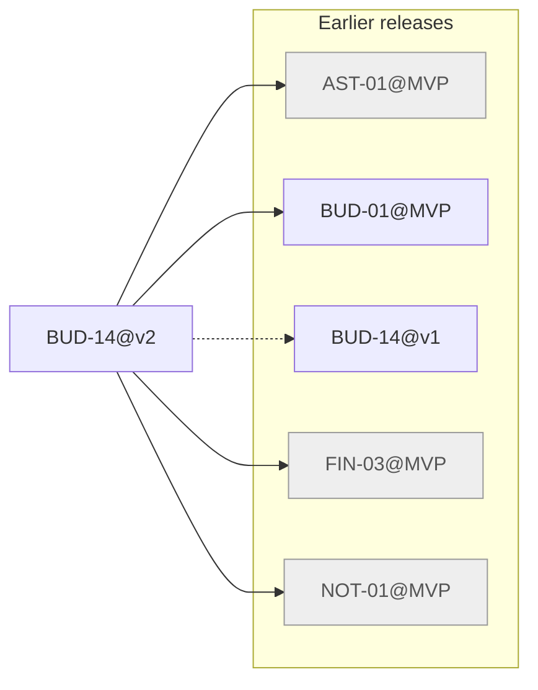

# Release v2

Generated by `node tools/req-check/index.mjs --traceability` (tools/req-check) from the link headers of the requirement slices. Do not edit by hand.

45 slices in v2: 1 migrated, 44 not migrated.

## Migrated slices

| Slice | Module | Extends | Depends on | Design | Criteria |
| --- | --- | --- | --- | --- | ---: |
| [BUD-14@v2](../../docs/requirements/bud/BUD-14.v2.md) | merchants, categorization | BUD-14@v1 | AST-01@MVP, BUD-01@MVP, FIN-03@MVP, NOT-01@MVP | S-047, S-069, S-197, S-198, S-285 | 17 |

## Dependency graph

Arrows point from a slice to what it needs. Dashed arrows: «Розширює» (the same requirement in the previous release). Grey: not migrated yet, own dependencies unknown.

## Build sequence

Topological order of the graph above, grouped into waves: every slice of a wave needs only slices of earlier waves or earlier releases, so slices of one wave can be built in parallel.

1. **Wave 1:** BUD-14@v2

### Not migrated, not placed

44 slices whose dependencies are unknown until their requirement is migrated:

- ACC: ACC-12
- ADV: ADV-01, ADV-02, ADV-03, ADV-04, ADV-05, ADV-06, ADV-07
- AI: AI-03
- AST: AST-15
- DOC: DOC-03
- FIN: FIN-10, FIN-15, FIN-17, FIN-19
- FLW: FLW-09, FLW-22, FLW-26, FLW-30, FLW-31, FLW-32, FLW-33, FLW-38, FLW-46, FLW-47, FLW-48, FLW-58
- INT: INT-01
- JRN: JRN-03, JRN-04
- PLN: PLN-01, PLN-02, PLN-03
- PLT: PLT-02
- RPT: RPT-02
- SUB: SUB-04, SUB-06, SUB-08
- UX: UX-05, UX-06, UX-07
- VLT: VLT-19, VLT-20, VLT-21
