# Release v2

Generated by `node tools/req-check/index.mjs --traceability` (tools/req-check) from the link headers of the requirement slices. Do not edit by hand.

60 slices in v2: 60 migrated, 0 not migrated.

## Migrated slices

| Slice | Module | Extends | Depends on | Design | Criteria |
| --- | --- | --- | --- | --- | ---: |
| [ACC-12@v2](../../docs/requirements/acc/ACC-12.v2.md) | household, access-scope | — | ACC-08@v1, ACC-09@v1, ACC-10@MVP, NOT-01@v1-mobile, SUB-01@v2 | S-216, S-217, S-218 | 11 |
| [ADV-01@v2](../../docs/requirements/adv/ADV-01.v2.md) | advisor | — | ACC-01@MVP, ACC-03@v1-mobile, ACC-04@v1-mobile, ACC-11@MVP, NOT-01@v1-mobile, SUB-01@v2 | S-248, S-253 | 7 |
| [ADV-02@v2](../../docs/requirements/adv/ADV-02.v2.md) | advisor | — | ACC-11@MVP, ADV-01@v2, ADV-04@v2, DAT-01@v1-mobile, FIN-11@v2, NOT-01@v1-mobile, VAL-03@v1, VAL-04@MVP, VAL-09@v1 | S-249, S-250 | 7 |
| [ADV-03@v2](../../docs/requirements/adv/ADV-03.v2.md) | advisor, household, billing | — | ACC-01@MVP, ACC-08@v1, ACC-09@v1, ACC-11@MVP, ADV-01@v2, ADV-04@v2, NOT-01@v1-mobile, SUB-02@v1, SUB-04@v2 | S-251, S-257, S-258 | 9 |
| [ADV-04@v2](../../docs/requirements/adv/ADV-04.v2.md) | advisor | — | ACC-04@v1-mobile, ACC-09@v1, ACC-10@MVP, ACC-11@MVP, ADV-01@v2, BUD-10@v1-mobile, DOC-01@v1, NOT-01@v1-mobile, VLT-10@MVP | S-258 | 6 |
| [ADV-05@v2](../../docs/requirements/adv/ADV-05.v2.md) | advisor | — | ACC-11@MVP, ADV-01@v2, ADV-04@v2, AST-01@v1, FIN-01@v1, FIN-03@v1, IMP-04@MVP | S-255 | 9 |
| [ADV-06@v2](../../docs/requirements/adv/ADV-06.v2.md) | advisor, audit | — | ACC-11@MVP, ADV-01@v2, ADV-04@v2, ADV-05@v2, AST-01@v1, FIN-03@v1, VAL-01@MVP | S-250, S-252, S-292 | 5 |
| [ADV-07@v2](../../docs/requirements/adv/ADV-07.v2.md) | advisor | — | ADV-01@v2, ADV-02@v2, ADV-04@v2, NOT-01@v1-mobile, RPT-01@v1, RPT-02@v2, VAL-04@MVP, VAL-09@v1 | S-250, S-254, S-256 | 6 |
| [AI-03@v2](../../docs/requirements/ai/AI-03.v2.md) | ai-assistant, documents | — | ACC-03@v1-mobile, ACC-11@MVP, ADV-04@v2, AI-04@v1, BUD-15@v1, DOC-01@v1, DOC-02@MVP, FIN-03@v1, IMP-04@MVP, IMP-08@MVP, INS-01@MVP, SUB-01@v2, SUB-07@v1 | S-120 | 10 |
| [ARC-01@v2](../../docs/requirements/arc/ARC-01.v2.md) | — | ARC-01@v1 | — | — | 0 |
| [AST-15@v2](../../docs/requirements/ast/AST-15.v2.md) | asset-registry | — | AST-01@v1, AST-02@v1, AST-16@v1 | S-119 | 5 |
| [BUD-14@v2](../../docs/requirements/bud/BUD-14.v2.md) | merchants, categorization | BUD-14@v1 | AST-01@v1, BUD-01@MVP, FIN-03@v1, NOT-01@v1-mobile | S-047, S-069, S-197, S-198, S-285 | 17 |
| [BUD-19@v2](../../docs/requirements/bud/BUD-19.v2.md) | debt-payoff | BUD-19@v1 | AST-11@MVP, BUD-02@v1, FIN-01@v1, FIN-03@v1, SUB-07@v1 | S-143, S-144, S-145, S-146 | 11 |
| [DOC-03@v2](../../docs/requirements/doc/DOC-03.v2.md) | documents, ocr | — | DOC-01@v1, DOC-02@MVP | S-120 | 12 |
| [FIN-05@v2](../../docs/requirements/fin/FIN-05.v2.md) | holdings, cost-basis, broker-events, market-data, ledger, accounts | FIN-05@v1 | FIN-01@v1, FIN-04@MVP, FIN-11@v2, INV-01@v1, INV-02@v1, SUB-07@v1, VAL-04@MVP, VAL-05@v1 | S-095, S-096, S-097, S-098 | 14 |
| [FIN-07@v2](../../docs/requirements/fin/FIN-07.v2.md) | crypto, usage-limits | FIN-07@v1 | FIN-05@v2, FIN-11@v2, SUB-07@v1, VAL-05@v1 | S-101 | 7 |
| [FIN-10@v2](../../docs/requirements/fin/FIN-10.v2.md) | cashflow, recurring | — | BUD-07@v1, BUD-08@v1, FIN-01@v1, FIN-03@v1, NOT-02@v1 | S-151 | 7 |
| [FIN-11@v2](../../docs/requirements/fin/FIN-11.v2.md) | bank-sync, bank-consents, transactions, notification-delivery, usage-limits, advisor | FIN-11@v1 | ADV-05@v2, FIN-03@v1, NOT-01@v1-mobile, SUB-07@v1 | S-060, S-061, S-062 | 10 |
| [FIN-15@v2](../../docs/requirements/fin/FIN-15.v2.md) | integrations | — | FIN-11@v2 | — | 4 |
| [FIN-16@v2](../../docs/requirements/fin/FIN-16.v2.md) | holdings, documents, ai-assistant | FIN-16@v1 | AI-03@v2, DOC-01@v1, FIN-05@v2, VAL-07@MVP | S-106, S-107 | 7 |
| [FIN-17@v2](../../docs/requirements/fin/FIN-17.v2.md) | holdings, market-data | — | FIN-05@v2, FIN-06@v1 | S-108 | 5 |
| [FIN-19@v2](../../docs/requirements/fin/FIN-19.v2.md) | asset-business, reports | — | AST-01@v1, FIN-01@v1, FIN-03@v1 | — | 8 |
| [FLW-05@v2](../../docs/requirements/flw/FLW-05.v2.md) | billing, plan-catalog, usage-limits | FLW-05@v1 | ACC-02@v1-mobile, ADM-04@v1, SUB-01@v2, SUB-02@v1, SUB-03@v1-mobile, SUB-06@v2, SUB-07@v1, UX-01@v1 | S-020, S-040, S-157, S-158, S-159, S-279 | 9 |
| [FLW-07@v2](../../docs/requirements/flw/FLW-07.v2.md) | billing, usage-limits | FLW-07@v1 | ACC-02@v1-mobile, ADM-04@v1, NOT-01@v1-mobile, RPT-02@v2, SUB-01@v2, SUB-02@v1, SUB-03@v1-mobile, SUB-07@v1 | S-040, S-157, S-159, S-160, S-161 | 7 |
| [FLW-09@v2](../../docs/requirements/flw/FLW-09.v2.md) | ocr, documents, asset-registry | — | AI-03@v2, AST-01@v1, AST-02@v1, DOC-03@v2 | S-025, S-073, S-075, S-120 | 6 |
| [FLW-22@v2](../../docs/requirements/flw/FLW-22.v2.md) | cashflow | — | BUD-07@v1, FIN-09@v1, FIN-10@v2 | S-141, S-151 | 5 |
| [FLW-26@v2](../../docs/requirements/flw/FLW-26.v2.md) | reports, usage-limits | FLW-26@v1 | FIN-06@v1, INS-02@v1, RPT-01@v1, RPT-02@v2, SUB-07@v1 | S-147, S-149, S-150 | 7 |
| [FLW-30@v2](../../docs/requirements/flw/FLW-30.v2.md) | household, access-scope | — | ACC-12@v2, SUB-05@v1 | S-216, S-217, S-218 | 6 |
| [FLW-31@v2](../../docs/requirements/flw/FLW-31.v2.md) | advisor | — | ADV-01@v2, ADV-02@v2, SUB-04@v2 | S-248, S-250, S-253, S-254 | 5 |
| [FLW-32@v2](../../docs/requirements/flw/FLW-32.v2.md) | advisor, access-scope | — | ADV-03@v2, ADV-04@v2 | S-251, S-257, S-258 | 6 |
| [FLW-33@v2](../../docs/requirements/flw/FLW-33.v2.md) | advisor | — | ADV-01@v2, ADV-03@v2, ADV-05@v2 | S-249, S-250, S-252, S-255, S-256 | 6 |
| [FLW-44@v2](../../docs/requirements/flw/FLW-44.v2.md) | debt-payoff, liabilities | FLW-44@MVP | AST-11@MVP, BUD-03@v1-mobile, BUD-19@v2, FIN-01@v1 | S-088, S-143, S-144, S-145, S-146 | 7 |
| [FLW-46@v2](../../docs/requirements/flw/FLW-46.v2.md) | holdings, asset-business, ocr, documents | FLW-46@v1 | DOC-03@v2, FIN-03@v1, FIN-16@v2 | S-025, S-106, S-107 | 6 |
| [FLW-47@v2](../../docs/requirements/flw/FLW-47.v2.md) | planning | — | PLN-01@v2, PLN-02@v2, PLN-03@v2 | S-152, S-153 | 7 |
| [FLW-48@v2](../../docs/requirements/flw/FLW-48.v2.md) | integrations | — | INT-01@v2 | S-214, S-215 | 7 |
| [FLW-58@v2](../../docs/requirements/flw/FLW-58.v2.md) | vault-items | — | VLT-20@v2, VLT-21@v2 | S-246 | 6 |
| [INT-01@v2](../../docs/requirements/int/INT-01.v2.md) | integrations | — | ACC-03@v1-mobile, ACC-04@v1-mobile, ACC-09@v1, ACC-10@MVP, ACC-11@MVP, AI-01@v1, FIN-01@v1, FIN-03@v1, FIN-12@v1, NOT-01@v1-mobile, SUB-01@v2, SUB-07@v1 | S-214, S-215 | 17 |
| [JRN-02@v2](../../docs/requirements/jrn/JRN-02.v2.md) | asset-registry, valuation, insurance, reports, auto-valuation, ocr | JRN-02@v1 | FLW-08@v1, FLW-09@v2, FLW-11@MVP, FLW-13@v1, FLW-15@v1, FLW-23@v1, FLW-24@v1, FLW-25@v1 | S-036, S-070, S-071, S-072, S-075, S-076, S-077, S-082, S-091, S-092, S-112, S-114, S-115, S-116, S-194, S-195 | 0 |
| [JRN-03@v2](../../docs/requirements/jrn/JRN-03.v2.md) | vault-emergency-access, household, access-scope | JRN-03@MVP | FLW-30@v2, FLW-57@v1 | S-024, S-041, S-116, S-149, S-156, S-180, S-182, S-201, S-210, S-216, S-217, S-218, S-243, S-244 | 0 |
| [JRN-04@v2](../../docs/requirements/jrn/JRN-04.v2.md) | advisor | — | FLW-31@v2, FLW-32@v2, FLW-33@v2 | S-040, S-076, S-079, S-157, S-250, S-251, S-252, S-257, S-258 | 0 |
| [LEG-01@v2](../../docs/requirements/leg/LEG-01.v2.md) | legal-consents | LEG-01@v1 | ADV-04@v2, AI-01@v1, INT-01@v2 | S-001, S-009, S-017, S-018, S-019, S-191 | 15 |
| [NFR-12@v2](../../docs/requirements/nfr/NFR-12.v2.md) | — | NFR-12@v1 | — | — | 11 |
| [NFR-15@v2](../../docs/requirements/nfr/NFR-15.v2.md) | — | NFR-15@MVP | — | — | 12 |
| [NFR-17@v2](../../docs/requirements/nfr/NFR-17.v2.md) | — | NFR-17@v1 | — | — | 4 |
| [PLN-01@v2](../../docs/requirements/pln/PLN-01.v2.md) | planning | — | ACC-03@v1-mobile, ACC-10@MVP, ADV-04@v2, AST-01@v1, AST-11@MVP, BUD-02@v1, BUD-08@v1, FIN-12@v1, SUB-01@v2, SUB-07@v1, VAL-04@MVP, VAL-08@v1, VAL-09@v1 | S-152 | 9 |
| [PLN-02@v2](../../docs/requirements/pln/PLN-02.v2.md) | planning | — | ACC-05@MVP, ACC-10@MVP, ADV-04@v2, FIN-01@v1, FIN-09@v1, FIN-12@v1, PLN-01@v2, SUB-01@v2, SUB-07@v1 | S-153 | 9 |
| [PLN-03@v2](../../docs/requirements/pln/PLN-03.v2.md) | planning, documents | — | ACC-10@MVP, ACC-11@MVP, ACC-12@v2, DOC-01@v1, DOC-02@MVP, SUB-01@v2, SUB-07@v1 | S-154 | 8 |
| [PLT-02@v2](../../docs/requirements/plt/PLT-02.v2.md) | dashboard | — | ACC-03@v1-mobile, ACC-04@v1-mobile, ADV-04@v2, BUD-03@v1-mobile, FIN-03@v1, PLT-01@v1, SUB-01@v2, SUB-07@v1, UX-02@v1-mobile, UX-04@v1 | — | 13 |
| [RPT-02@v2](../../docs/requirements/rpt/RPT-02.v2.md) | reports | — | NOT-01@v1-mobile, RPT-01@v1, SUB-01@v2 | S-150 | 10 |
| [SUB-01@v2](../../docs/requirements/sub/SUB-01.v2.md) | plan-catalog, usage-limits | SUB-01@v1 | ACC-02@v1-mobile, ADM-01@MVP, ADM-02@v1, ADM-03@MVP, ADM-04@v1 | S-020, S-030, S-157, S-158 | 11 |
| [SUB-04@v2](../../docs/requirements/sub/SUB-04.v2.md) | plan-catalog, billing, advisor | — | ADV-01@v2, SUB-01@v2, SUB-02@v1 | S-248, S-249 | 6 |
| [SUB-06@v2](../../docs/requirements/sub/SUB-06.v2.md) | billing | — | SUB-01@v2, SUB-02@v1 | S-276 | 7 |
| [SUB-08@v2](../../docs/requirements/sub/SUB-08.v2.md) | billing | — | SUB-01@v2, SUB-02@v1 | S-277, S-295, S-296 | 11 |
| [UX-05@v2](../../docs/requirements/ux/UX-05.v2.md) | identity | — | ACC-05@MVP | — | 8 |
| [UX-06@v2](../../docs/requirements/ux/UX-06.v2.md) | weekly-digest, dashboard | — | BUD-09@v1, NOT-01@v1-mobile | — | 8 |
| [UX-07@v2](../../docs/requirements/ux/UX-07.v2.md) | support | — | SUP-01@v1 | — | 9 |
| [VAL-06@v2](../../docs/requirements/val/VAL-06.v2.md) | auto-valuation | VAL-06@v1 | LEG-01@v2, SUB-01@v2, SUB-07@v1, VAL-01@MVP, VAL-02@MVP, VAL-05@v1 | S-076 | 7 |
| [VLT-19@v2](../../docs/requirements/vlt/VLT-19.v2.md) | vault-items | — | PLT-02@v2, VLT-02@v1, VLT-04@v1-mobile | S-247 | 5 |
| [VLT-20@v2](../../docs/requirements/vlt/VLT-20.v2.md) | vault-items | — | VLT-04@v1-mobile, VLT-15@v1 | S-246 | 6 |
| [VLT-21@v2](../../docs/requirements/vlt/VLT-21.v2.md) | vault-items | — | VLT-02@v1, VLT-20@v2 | S-246 | 5 |

## Dependency graph

Arrows point from a slice to what it needs. Dashed arrows: «Розширює» (the same requirement in the previous release). Grey: not migrated yet, own dependencies unknown.

```mermaid
flowchart LR
  ACC_12_v2["ACC-12@v2"]
  ADV_01_v2["ADV-01@v2"]
  ADV_02_v2["ADV-02@v2"]
  ADV_03_v2["ADV-03@v2"]
  ADV_04_v2["ADV-04@v2"]
  ADV_05_v2["ADV-05@v2"]
  ADV_06_v2["ADV-06@v2"]
  ADV_07_v2["ADV-07@v2"]
  AI_03_v2["AI-03@v2"]
  ARC_01_v2["ARC-01@v2"]
  AST_15_v2["AST-15@v2"]
  BUD_14_v2["BUD-14@v2"]
  BUD_19_v2["BUD-19@v2"]
  DOC_03_v2["DOC-03@v2"]
  FIN_05_v2["FIN-05@v2"]
  FIN_07_v2["FIN-07@v2"]
  FIN_10_v2["FIN-10@v2"]
  FIN_11_v2["FIN-11@v2"]
  FIN_15_v2["FIN-15@v2"]
  FIN_16_v2["FIN-16@v2"]
  FIN_17_v2["FIN-17@v2"]
  FIN_19_v2["FIN-19@v2"]
  FLW_05_v2["FLW-05@v2"]
  FLW_07_v2["FLW-07@v2"]
  FLW_09_v2["FLW-09@v2"]
  FLW_22_v2["FLW-22@v2"]
  FLW_26_v2["FLW-26@v2"]
  FLW_30_v2["FLW-30@v2"]
  FLW_31_v2["FLW-31@v2"]
  FLW_32_v2["FLW-32@v2"]
  FLW_33_v2["FLW-33@v2"]
  FLW_44_v2["FLW-44@v2"]
  FLW_46_v2["FLW-46@v2"]
  FLW_47_v2["FLW-47@v2"]
  FLW_48_v2["FLW-48@v2"]
  FLW_58_v2["FLW-58@v2"]
  INT_01_v2["INT-01@v2"]
  JRN_02_v2["JRN-02@v2"]
  JRN_03_v2["JRN-03@v2"]
  JRN_04_v2["JRN-04@v2"]
  LEG_01_v2["LEG-01@v2"]
  NFR_12_v2["NFR-12@v2"]
  NFR_15_v2["NFR-15@v2"]
  NFR_17_v2["NFR-17@v2"]
  PLN_01_v2["PLN-01@v2"]
  PLN_02_v2["PLN-02@v2"]
  PLN_03_v2["PLN-03@v2"]
  PLT_02_v2["PLT-02@v2"]
  RPT_02_v2["RPT-02@v2"]
  SUB_01_v2["SUB-01@v2"]
  SUB_04_v2["SUB-04@v2"]
  SUB_06_v2["SUB-06@v2"]
  SUB_08_v2["SUB-08@v2"]
  UX_05_v2["UX-05@v2"]
  UX_06_v2["UX-06@v2"]
  UX_07_v2["UX-07@v2"]
  VAL_06_v2["VAL-06@v2"]
  VLT_19_v2["VLT-19@v2"]
  VLT_20_v2["VLT-20@v2"]
  VLT_21_v2["VLT-21@v2"]
  subgraph earlier["Earlier releases"]
    ACC_01_MVP["ACC-01@MVP"]
    ACC_02_v1_mobile["ACC-02@v1-mobile"]
    ACC_03_v1_mobile["ACC-03@v1-mobile"]
    ACC_04_v1_mobile["ACC-04@v1-mobile"]
    ACC_05_MVP["ACC-05@MVP"]
    ACC_08_v1["ACC-08@v1"]
    ACC_09_v1["ACC-09@v1"]
    ACC_10_MVP["ACC-10@MVP"]
    ACC_11_MVP["ACC-11@MVP"]
    ADM_01_MVP["ADM-01@MVP"]
    ADM_02_v1["ADM-02@v1"]
    ADM_03_MVP["ADM-03@MVP"]
    ADM_04_v1["ADM-04@v1"]
    AI_01_v1["AI-01@v1"]
    AI_04_v1["AI-04@v1"]
    ARC_01_v1["ARC-01@v1"]
    AST_01_v1["AST-01@v1"]
    AST_02_v1["AST-02@v1"]
    AST_11_MVP["AST-11@MVP"]
    AST_16_v1["AST-16@v1"]
    BUD_01_MVP["BUD-01@MVP"]
    BUD_02_v1["BUD-02@v1"]
    BUD_03_v1_mobile["BUD-03@v1-mobile"]
    BUD_07_v1["BUD-07@v1"]
    BUD_08_v1["BUD-08@v1"]
    BUD_09_v1["BUD-09@v1"]
    BUD_10_v1_mobile["BUD-10@v1-mobile"]
    BUD_14_v1["BUD-14@v1"]
    BUD_15_v1["BUD-15@v1"]
    BUD_19_v1["BUD-19@v1"]
    DAT_01_v1_mobile["DAT-01@v1-mobile"]
    DOC_01_v1["DOC-01@v1"]
    DOC_02_MVP["DOC-02@MVP"]
    FIN_01_v1["FIN-01@v1"]
    FIN_03_v1["FIN-03@v1"]
    FIN_04_MVP["FIN-04@MVP"]
    FIN_05_v1["FIN-05@v1"]
    FIN_06_v1["FIN-06@v1"]
    FIN_07_v1["FIN-07@v1"]
    FIN_09_v1["FIN-09@v1"]
    FIN_11_v1["FIN-11@v1"]
    FIN_12_v1["FIN-12@v1"]
    FIN_16_v1["FIN-16@v1"]
    FLW_05_v1["FLW-05@v1"]
    FLW_07_v1["FLW-07@v1"]
    FLW_08_v1["FLW-08@v1"]
    FLW_11_MVP["FLW-11@MVP"]
    FLW_13_v1["FLW-13@v1"]
    FLW_15_v1["FLW-15@v1"]
    FLW_23_v1["FLW-23@v1"]
    FLW_24_v1["FLW-24@v1"]
    FLW_25_v1["FLW-25@v1"]
    FLW_26_v1["FLW-26@v1"]
    FLW_44_MVP["FLW-44@MVP"]
    FLW_46_v1["FLW-46@v1"]
    FLW_57_v1["FLW-57@v1"]
    IMP_04_MVP["IMP-04@MVP"]
    IMP_08_MVP["IMP-08@MVP"]
    INS_01_MVP["INS-01@MVP"]
    INS_02_v1["INS-02@v1"]
    INV_01_v1["INV-01@v1"]
    INV_02_v1["INV-02@v1"]
    JRN_02_v1["JRN-02@v1"]
    JRN_03_MVP["JRN-03@MVP"]
    LEG_01_v1["LEG-01@v1"]
    NFR_12_v1["NFR-12@v1"]
    NFR_15_MVP["NFR-15@MVP"]
    NFR_17_v1["NFR-17@v1"]
    NOT_01_v1_mobile["NOT-01@v1-mobile"]
    NOT_02_v1["NOT-02@v1"]
    PLT_01_v1["PLT-01@v1"]
    RPT_01_v1["RPT-01@v1"]
    SUB_01_v1["SUB-01@v1"]
    SUB_02_v1["SUB-02@v1"]
    SUB_03_v1_mobile["SUB-03@v1-mobile"]
    SUB_05_v1["SUB-05@v1"]
    SUB_07_v1["SUB-07@v1"]
    SUP_01_v1["SUP-01@v1"]
    UX_01_v1["UX-01@v1"]
    UX_02_v1_mobile["UX-02@v1-mobile"]
    UX_04_v1["UX-04@v1"]
    VAL_01_MVP["VAL-01@MVP"]
    VAL_02_MVP["VAL-02@MVP"]
    VAL_03_v1["VAL-03@v1"]
    VAL_04_MVP["VAL-04@MVP"]
    VAL_05_v1["VAL-05@v1"]
    VAL_06_v1["VAL-06@v1"]
    VAL_07_MVP["VAL-07@MVP"]
    VAL_08_v1["VAL-08@v1"]
    VAL_09_v1["VAL-09@v1"]
    VLT_02_v1["VLT-02@v1"]
    VLT_04_v1_mobile["VLT-04@v1-mobile"]
    VLT_10_MVP["VLT-10@MVP"]
    VLT_15_v1["VLT-15@v1"]
  end
  ACC_12_v2 --> ACC_08_v1
  ACC_12_v2 --> ACC_09_v1
  ACC_12_v2 --> ACC_10_MVP
  ACC_12_v2 --> NOT_01_v1_mobile
  ACC_12_v2 --> SUB_01_v2
  ADV_01_v2 --> ACC_01_MVP
  ADV_01_v2 --> ACC_03_v1_mobile
  ADV_01_v2 --> ACC_04_v1_mobile
  ADV_01_v2 --> ACC_11_MVP
  ADV_01_v2 --> NOT_01_v1_mobile
  ADV_01_v2 --> SUB_01_v2
  ADV_02_v2 --> ACC_11_MVP
  ADV_02_v2 --> ADV_01_v2
  ADV_02_v2 --> ADV_04_v2
  ADV_02_v2 --> DAT_01_v1_mobile
  ADV_02_v2 --> FIN_11_v2
  ADV_02_v2 --> NOT_01_v1_mobile
  ADV_02_v2 --> VAL_03_v1
  ADV_02_v2 --> VAL_04_MVP
  ADV_02_v2 --> VAL_09_v1
  ADV_03_v2 --> ACC_01_MVP
  ADV_03_v2 --> ACC_08_v1
  ADV_03_v2 --> ACC_09_v1
  ADV_03_v2 --> ACC_11_MVP
  ADV_03_v2 --> ADV_01_v2
  ADV_03_v2 --> ADV_04_v2
  ADV_03_v2 --> NOT_01_v1_mobile
  ADV_03_v2 --> SUB_02_v1
  ADV_03_v2 --> SUB_04_v2
  ADV_04_v2 --> ACC_04_v1_mobile
  ADV_04_v2 --> ACC_09_v1
  ADV_04_v2 --> ACC_10_MVP
  ADV_04_v2 --> ACC_11_MVP
  ADV_04_v2 --> ADV_01_v2
  ADV_04_v2 --> BUD_10_v1_mobile
  ADV_04_v2 --> DOC_01_v1
  ADV_04_v2 --> NOT_01_v1_mobile
  ADV_04_v2 --> VLT_10_MVP
  ADV_05_v2 --> ACC_11_MVP
  ADV_05_v2 --> ADV_01_v2
  ADV_05_v2 --> ADV_04_v2
  ADV_05_v2 --> AST_01_v1
  ADV_05_v2 --> FIN_01_v1
  ADV_05_v2 --> FIN_03_v1
  ADV_05_v2 --> IMP_04_MVP
  ADV_06_v2 --> ACC_11_MVP
  ADV_06_v2 --> ADV_01_v2
  ADV_06_v2 --> ADV_04_v2
  ADV_06_v2 --> ADV_05_v2
  ADV_06_v2 --> AST_01_v1
  ADV_06_v2 --> FIN_03_v1
  ADV_06_v2 --> VAL_01_MVP
  ADV_07_v2 --> ADV_01_v2
  ADV_07_v2 --> ADV_02_v2
  ADV_07_v2 --> ADV_04_v2
  ADV_07_v2 --> NOT_01_v1_mobile
  ADV_07_v2 --> RPT_01_v1
  ADV_07_v2 --> RPT_02_v2
  ADV_07_v2 --> VAL_04_MVP
  ADV_07_v2 --> VAL_09_v1
  AI_03_v2 --> ACC_03_v1_mobile
  AI_03_v2 --> ACC_11_MVP
  AI_03_v2 --> ADV_04_v2
  AI_03_v2 --> AI_04_v1
  AI_03_v2 --> BUD_15_v1
  AI_03_v2 --> DOC_01_v1
  AI_03_v2 --> DOC_02_MVP
  AI_03_v2 --> FIN_03_v1
  AI_03_v2 --> IMP_04_MVP
  AI_03_v2 --> IMP_08_MVP
  AI_03_v2 --> INS_01_MVP
  AI_03_v2 --> SUB_01_v2
  AI_03_v2 --> SUB_07_v1
  ARC_01_v2 -.-> ARC_01_v1
  AST_15_v2 --> AST_01_v1
  AST_15_v2 --> AST_02_v1
  AST_15_v2 --> AST_16_v1
  BUD_14_v2 --> AST_01_v1
  BUD_14_v2 --> BUD_01_MVP
  BUD_14_v2 --> FIN_03_v1
  BUD_14_v2 --> NOT_01_v1_mobile
  BUD_14_v2 -.-> BUD_14_v1
  BUD_19_v2 --> AST_11_MVP
  BUD_19_v2 --> BUD_02_v1
  BUD_19_v2 --> FIN_01_v1
  BUD_19_v2 --> FIN_03_v1
  BUD_19_v2 --> SUB_07_v1
  BUD_19_v2 -.-> BUD_19_v1
  DOC_03_v2 --> DOC_01_v1
  DOC_03_v2 --> DOC_02_MVP
  FIN_05_v2 --> FIN_01_v1
  FIN_05_v2 --> FIN_04_MVP
  FIN_05_v2 --> FIN_11_v2
  FIN_05_v2 --> INV_01_v1
  FIN_05_v2 --> INV_02_v1
  FIN_05_v2 --> SUB_07_v1
  FIN_05_v2 --> VAL_04_MVP
  FIN_05_v2 --> VAL_05_v1
  FIN_05_v2 -.-> FIN_05_v1
  FIN_07_v2 --> FIN_05_v2
  FIN_07_v2 --> FIN_11_v2
  FIN_07_v2 --> SUB_07_v1
  FIN_07_v2 --> VAL_05_v1
  FIN_07_v2 -.-> FIN_07_v1
  FIN_10_v2 --> BUD_07_v1
  FIN_10_v2 --> BUD_08_v1
  FIN_10_v2 --> FIN_01_v1
  FIN_10_v2 --> FIN_03_v1
  FIN_10_v2 --> NOT_02_v1
  FIN_11_v2 --> ADV_05_v2
  FIN_11_v2 --> FIN_03_v1
  FIN_11_v2 --> NOT_01_v1_mobile
  FIN_11_v2 --> SUB_07_v1
  FIN_11_v2 -.-> FIN_11_v1
  FIN_15_v2 --> FIN_11_v2
  FIN_16_v2 --> AI_03_v2
  FIN_16_v2 --> DOC_01_v1
  FIN_16_v2 --> FIN_05_v2
  FIN_16_v2 --> VAL_07_MVP
  FIN_16_v2 -.-> FIN_16_v1
  FIN_17_v2 --> FIN_05_v2
  FIN_17_v2 --> FIN_06_v1
  FIN_19_v2 --> AST_01_v1
  FIN_19_v2 --> FIN_01_v1
  FIN_19_v2 --> FIN_03_v1
  FLW_05_v2 --> ACC_02_v1_mobile
  FLW_05_v2 --> ADM_04_v1
  FLW_05_v2 --> SUB_01_v2
  FLW_05_v2 --> SUB_02_v1
  FLW_05_v2 --> SUB_03_v1_mobile
  FLW_05_v2 --> SUB_06_v2
  FLW_05_v2 --> SUB_07_v1
  FLW_05_v2 --> UX_01_v1
  FLW_05_v2 -.-> FLW_05_v1
  FLW_07_v2 --> ACC_02_v1_mobile
  FLW_07_v2 --> ADM_04_v1
  FLW_07_v2 --> NOT_01_v1_mobile
  FLW_07_v2 --> RPT_02_v2
  FLW_07_v2 --> SUB_01_v2
  FLW_07_v2 --> SUB_02_v1
  FLW_07_v2 --> SUB_03_v1_mobile
  FLW_07_v2 --> SUB_07_v1
  FLW_07_v2 -.-> FLW_07_v1
  FLW_09_v2 --> AI_03_v2
  FLW_09_v2 --> AST_01_v1
  FLW_09_v2 --> AST_02_v1
  FLW_09_v2 --> DOC_03_v2
  FLW_22_v2 --> BUD_07_v1
  FLW_22_v2 --> FIN_09_v1
  FLW_22_v2 --> FIN_10_v2
  FLW_26_v2 --> FIN_06_v1
  FLW_26_v2 --> INS_02_v1
  FLW_26_v2 --> RPT_01_v1
  FLW_26_v2 --> RPT_02_v2
  FLW_26_v2 --> SUB_07_v1
  FLW_26_v2 -.-> FLW_26_v1
  FLW_30_v2 --> ACC_12_v2
  FLW_30_v2 --> SUB_05_v1
  FLW_31_v2 --> ADV_01_v2
  FLW_31_v2 --> ADV_02_v2
  FLW_31_v2 --> SUB_04_v2
  FLW_32_v2 --> ADV_03_v2
  FLW_32_v2 --> ADV_04_v2
  FLW_33_v2 --> ADV_01_v2
  FLW_33_v2 --> ADV_03_v2
  FLW_33_v2 --> ADV_05_v2
  FLW_44_v2 --> AST_11_MVP
  FLW_44_v2 --> BUD_03_v1_mobile
  FLW_44_v2 --> BUD_19_v2
  FLW_44_v2 --> FIN_01_v1
  FLW_44_v2 -.-> FLW_44_MVP
  FLW_46_v2 --> DOC_03_v2
  FLW_46_v2 --> FIN_03_v1
  FLW_46_v2 --> FIN_16_v2
  FLW_46_v2 -.-> FLW_46_v1
  FLW_47_v2 --> PLN_01_v2
  FLW_47_v2 --> PLN_02_v2
  FLW_47_v2 --> PLN_03_v2
  FLW_48_v2 --> INT_01_v2
  FLW_58_v2 --> VLT_20_v2
  FLW_58_v2 --> VLT_21_v2
  INT_01_v2 --> ACC_03_v1_mobile
  INT_01_v2 --> ACC_04_v1_mobile
  INT_01_v2 --> ACC_09_v1
  INT_01_v2 --> ACC_10_MVP
  INT_01_v2 --> ACC_11_MVP
  INT_01_v2 --> AI_01_v1
  INT_01_v2 --> FIN_01_v1
  INT_01_v2 --> FIN_03_v1
  INT_01_v2 --> FIN_12_v1
  INT_01_v2 --> NOT_01_v1_mobile
  INT_01_v2 --> SUB_01_v2
  INT_01_v2 --> SUB_07_v1
  JRN_02_v2 --> FLW_08_v1
  JRN_02_v2 --> FLW_09_v2
  JRN_02_v2 --> FLW_11_MVP
  JRN_02_v2 --> FLW_13_v1
  JRN_02_v2 --> FLW_15_v1
  JRN_02_v2 --> FLW_23_v1
  JRN_02_v2 --> FLW_24_v1
  JRN_02_v2 --> FLW_25_v1
  JRN_02_v2 -.-> JRN_02_v1
  JRN_03_v2 --> FLW_30_v2
  JRN_03_v2 --> FLW_57_v1
  JRN_03_v2 -.-> JRN_03_MVP
  JRN_04_v2 --> FLW_31_v2
  JRN_04_v2 --> FLW_32_v2
  JRN_04_v2 --> FLW_33_v2
  LEG_01_v2 --> ADV_04_v2
  LEG_01_v2 --> AI_01_v1
  LEG_01_v2 --> INT_01_v2
  LEG_01_v2 -.-> LEG_01_v1
  NFR_12_v2 -.-> NFR_12_v1
  NFR_15_v2 -.-> NFR_15_MVP
  NFR_17_v2 -.-> NFR_17_v1
  PLN_01_v2 --> ACC_03_v1_mobile
  PLN_01_v2 --> ACC_10_MVP
  PLN_01_v2 --> ADV_04_v2
  PLN_01_v2 --> AST_01_v1
  PLN_01_v2 --> AST_11_MVP
  PLN_01_v2 --> BUD_02_v1
  PLN_01_v2 --> BUD_08_v1
  PLN_01_v2 --> FIN_12_v1
  PLN_01_v2 --> SUB_01_v2
  PLN_01_v2 --> SUB_07_v1
  PLN_01_v2 --> VAL_04_MVP
  PLN_01_v2 --> VAL_08_v1
  PLN_01_v2 --> VAL_09_v1
  PLN_02_v2 --> ACC_05_MVP
  PLN_02_v2 --> ACC_10_MVP
  PLN_02_v2 --> ADV_04_v2
  PLN_02_v2 --> FIN_01_v1
  PLN_02_v2 --> FIN_09_v1
  PLN_02_v2 --> FIN_12_v1
  PLN_02_v2 --> PLN_01_v2
  PLN_02_v2 --> SUB_01_v2
  PLN_02_v2 --> SUB_07_v1
  PLN_03_v2 --> ACC_10_MVP
  PLN_03_v2 --> ACC_11_MVP
  PLN_03_v2 --> ACC_12_v2
  PLN_03_v2 --> DOC_01_v1
  PLN_03_v2 --> DOC_02_MVP
  PLN_03_v2 --> SUB_01_v2
  PLN_03_v2 --> SUB_07_v1
  PLT_02_v2 --> ACC_03_v1_mobile
  PLT_02_v2 --> ACC_04_v1_mobile
  PLT_02_v2 --> ADV_04_v2
  PLT_02_v2 --> BUD_03_v1_mobile
  PLT_02_v2 --> FIN_03_v1
  PLT_02_v2 --> PLT_01_v1
  PLT_02_v2 --> SUB_01_v2
  PLT_02_v2 --> SUB_07_v1
  PLT_02_v2 --> UX_02_v1_mobile
  PLT_02_v2 --> UX_04_v1
  RPT_02_v2 --> NOT_01_v1_mobile
  RPT_02_v2 --> RPT_01_v1
  RPT_02_v2 --> SUB_01_v2
  SUB_01_v2 --> ACC_02_v1_mobile
  SUB_01_v2 --> ADM_01_MVP
  SUB_01_v2 --> ADM_02_v1
  SUB_01_v2 --> ADM_03_MVP
  SUB_01_v2 --> ADM_04_v1
  SUB_01_v2 -.-> SUB_01_v1
  SUB_04_v2 --> ADV_01_v2
  SUB_04_v2 --> SUB_01_v2
  SUB_04_v2 --> SUB_02_v1
  SUB_06_v2 --> SUB_01_v2
  SUB_06_v2 --> SUB_02_v1
  SUB_08_v2 --> SUB_01_v2
  SUB_08_v2 --> SUB_02_v1
  UX_05_v2 --> ACC_05_MVP
  UX_06_v2 --> BUD_09_v1
  UX_06_v2 --> NOT_01_v1_mobile
  UX_07_v2 --> SUP_01_v1
  VAL_06_v2 --> LEG_01_v2
  VAL_06_v2 --> SUB_01_v2
  VAL_06_v2 --> SUB_07_v1
  VAL_06_v2 --> VAL_01_MVP
  VAL_06_v2 --> VAL_02_MVP
  VAL_06_v2 --> VAL_05_v1
  VAL_06_v2 -.-> VAL_06_v1
  VLT_19_v2 --> PLT_02_v2
  VLT_19_v2 --> VLT_02_v1
  VLT_19_v2 --> VLT_04_v1_mobile
  VLT_20_v2 --> VLT_04_v1_mobile
  VLT_20_v2 --> VLT_15_v1
  VLT_21_v2 --> VLT_02_v1
  VLT_21_v2 --> VLT_20_v2
```

## Build sequence

Topological order of the graph above, grouped into waves: every slice of a wave needs only slices of earlier waves or earlier releases, so slices of one wave can be built in parallel.

1. **Wave 1:** ARC-01@v2, AST-15@v2, BUD-14@v2, BUD-19@v2, DOC-03@v2, FIN-10@v2, FIN-19@v2, NFR-12@v2, NFR-15@v2, NFR-17@v2, SUB-01@v2, UX-05@v2, UX-06@v2, UX-07@v2, VLT-20@v2
2. **Wave 2:** ACC-12@v2, ADV-01@v2, FLW-22@v2, FLW-44@v2, INT-01@v2, RPT-02@v2, SUB-06@v2, SUB-08@v2, VLT-21@v2
3. **Wave 3:** ADV-04@v2, FLW-05@v2, FLW-07@v2, FLW-26@v2, FLW-30@v2, FLW-48@v2, FLW-58@v2, PLN-03@v2, SUB-04@v2
4. **Wave 4:** ADV-03@v2, ADV-05@v2, AI-03@v2, JRN-03@v2, LEG-01@v2, PLN-01@v2, PLT-02@v2
5. **Wave 5:** ADV-06@v2, FIN-11@v2, FLW-09@v2, FLW-32@v2, FLW-33@v2, PLN-02@v2, VAL-06@v2, VLT-19@v2
6. **Wave 6:** ADV-02@v2, FIN-05@v2, FIN-15@v2, FLW-47@v2, JRN-02@v2
7. **Wave 7:** ADV-07@v2, FIN-07@v2, FIN-16@v2, FIN-17@v2, FLW-31@v2
8. **Wave 8:** FLW-46@v2, JRN-04@v2

### Not migrated, not placed

None.
