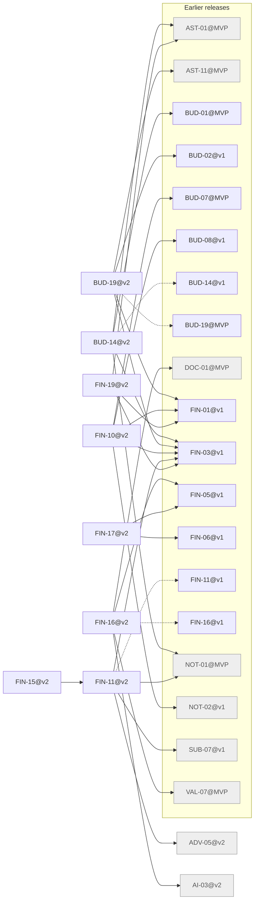

# Release v2

Generated by `node tools/req-check/index.mjs --traceability` (tools/req-check) from the link headers of the requirement slices. Do not edit by hand.

48 slices in v2: 8 migrated, 40 not migrated.

## Migrated slices

| Slice | Module | Extends | Depends on | Design | Criteria |
| --- | --- | --- | --- | --- | ---: |
| [BUD-14@v2](../../docs/requirements/bud/BUD-14.v2.md) | merchants, categorization | BUD-14@v1 | AST-01@MVP, BUD-01@MVP, FIN-03@v1, NOT-01@MVP | S-047, S-069, S-197, S-198, S-285 | 17 |
| [BUD-19@v2](../../docs/requirements/bud/BUD-19.v2.md) | debt-payoff | BUD-19@MVP | AST-11@MVP, BUD-02@v1, FIN-01@v1, FIN-03@v1 | S-143, S-144, S-145, S-146 | 10 |
| [FIN-10@v2](../../docs/requirements/fin/FIN-10.v2.md) | cashflow, recurring | — | BUD-07@MVP, BUD-08@v1, FIN-01@v1, FIN-03@v1, NOT-02@v1 | S-151 | 7 |
| [FIN-11@v2](../../docs/requirements/fin/FIN-11.v2.md) | bank-sync, bank-consents, transactions, notification-delivery, usage-limits, advisor | FIN-11@v1 | ADV-05@v2, FIN-03@v1, NOT-01@MVP, SUB-07@v1 | S-060, S-061, S-062 | 9 |
| [FIN-15@v2](../../docs/requirements/fin/FIN-15.v2.md) | integrations | — | FIN-11@v2 | — | 4 |
| [FIN-16@v2](../../docs/requirements/fin/FIN-16.v2.md) | holdings, documents, ai-assistant | FIN-16@v1 | AI-03@v2, DOC-01@MVP, FIN-05@v1, VAL-07@MVP | S-106, S-107 | 7 |
| [FIN-17@v2](../../docs/requirements/fin/FIN-17.v2.md) | holdings, market-data | — | FIN-05@v1, FIN-06@v1 | S-108 | 5 |
| [FIN-19@v2](../../docs/requirements/fin/FIN-19.v2.md) | asset-business, reports | — | AST-01@MVP, FIN-01@v1, FIN-03@v1 | — | 8 |

## Dependency graph

Arrows point from a slice to what it needs. Dashed arrows: «Розширює» (the same requirement in the previous release). Grey: not migrated yet, own dependencies unknown.

## Build sequence

Topological order of the graph above, grouped into waves: every slice of a wave needs only slices of earlier waves or earlier releases, so slices of one wave can be built in parallel.

1. **Wave 1:** ADV-05@v2 (не мігровано), AI-03@v2 (не мігровано), BUD-14@v2, BUD-19@v2, FIN-10@v2, FIN-17@v2, FIN-19@v2
2. **Wave 2:** FIN-11@v2, FIN-16@v2
3. **Wave 3:** FIN-15@v2

### Not migrated, not placed

38 slices whose dependencies are unknown until their requirement is migrated:

- ACC: ACC-12
- ADV: ADV-01, ADV-02, ADV-03, ADV-04, ADV-06, ADV-07
- AST: AST-15
- DOC: DOC-03
- FLW: FLW-09, FLW-22, FLW-26, FLW-30, FLW-31, FLW-32, FLW-33, FLW-38, FLW-46, FLW-47, FLW-48, FLW-58
- INT: INT-01
- JRN: JRN-03, JRN-04
- PLN: PLN-01, PLN-02, PLN-03
- PLT: PLT-02
- RPT: RPT-02
- SUB: SUB-04, SUB-06, SUB-08
- UX: UX-05, UX-06, UX-07
- VLT: VLT-19, VLT-20, VLT-21
