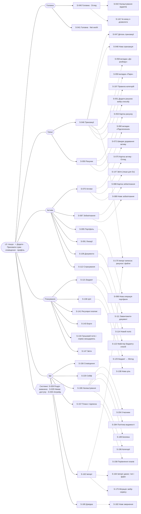

# Карта екранів Willowsum

2026-11-02 (оновлено за рішеннями власника 2026-11-02) · Джерело: `docs/requirements/` (00-general, UX, GRID, SCR, CMP, FLW-01…58, JRN-00…08 і модульні вимоги). Карта не є вимогою: якщо вона розходиться з файлом вимоги, діє вимога, а розбіжність іде в розділ «Знахідки».

**Умовні позначення.**

- Тип: `screen` — сторінка з власною адресою; `dialog` — модальне вікно, меню або нижній аркуш (на Compact діалог стає аркушем, `grid/GRID-00.md` п. 14); `drawer` — бічна панель або панель деталі master-detail (на Compact — окремий екран); `wizard step` — крок майстра чи онбордингу в режимі фокусу; `admin` — екран адмін-панелі персоналу.
- Стани (додатково до вмісту): `E` — порожній, `L` — завантаження (скелетон, після 3 с текст), `ERR` — помилка з «Спробувати ще раз» і кодом, `NA` — «Немає доступу» (роль або scope), `OFF` — «Розділ вимкнено» (рівень складності), `UPG` — пропозиція апгрейду (план), `HID` — режим «Приховати суми», `RS` — обмежений scope («Частковий перегляд», «Без вартості», «Без документів»). Після «;» — специфічні стани екрана.
- Ролі: `Ow` Owner, `Ad` Admin, `Ed` Editor, `Vw` Viewer, `Sc` учасник з обмеженим scope (лише читає), `Adv` радник (v2), `Pub` без входу, `Trusted` довірена особа, `Recipient` одержувач копії; персонал: `SA` Super admin, `PM` Pricing manager, `SP` Support, `RO` Read-only, `Staff` — будь-яка роль персоналу. Роль у дужках — лише перегляд.
- Маршрути — пропозиція для `apps/web` і `apps/admin`; L3 і L4 вкладені в маршрут розділу, щоб хлібні крихти обчислювалися з адреси (`ux/UX-09.md` п. 9).

## 1. Структура навігації

### 1.1 Оболонка за шириною вікна (`ux/UX-09.md` п. 5–6, `grid/GRID-00.md` п. 12, `cmp/CMP-69.md`)

| Клас ширини | Навігація L1 | Як показано L2 | L0 (глобальні дії) | Діалоги |
| --- | --- | --- | --- | --- |
| Compact 360–599 px | Нижня панель 56 px: 5 пунктів, бо «Активи» видно завжди (`ux/UX-09.md` п. 4); обмежений учасник за замовчуванням — 3 («Головна», «Активи», «Ще»); ніколи більше 5 | Вкладки під заголовком (єдина горизонтальна смуга з прокруткою); «Ще» відкриває нижній аркуш S-155 | Верхній рядок 56 px: заголовок, пошук, «+ Додати», «Приховати суми», сповіщення, профіль | Нижні аркуші; деталь master-detail — окремий екран; хлібні крихти замінює «Назад» |
| Medium 600–1023 px і Expanded до 1279 px | Рейка 64 px з іконками і коротким підписом | Вкладки під заголовком | Шапка сторінки | Модальні вікна, панелі |
| Від 1280 px (Expanded, Large) | Бічна панель 212 px з підписами; L2 активного розділу — підпункти з відступом 32 px | Підпункти бічної панелі | Шапка сторінки | Модальні вікна, панелі |
| Режим фокусу (вхід, онбординг, майстри імпорту, увімкнення Сейфу) | Немає | Немає | Лише «×» — повернення туди, звідки прийшли | — |

### 1.2 Розділи L1 і сторінки L2 з умовами видимості

Рівень складності впливає лише на видимість (`ux/UX-01.md` п. 23, `ux/UX-08.md` п. 12). «Тільки бюджет» = рівень «Базовий» і в просторі немає активів та інвестиційних рахунків. Розділ «Активи» видно завжди; у «Тільки бюджет» у ньому лише сторінка «Активи» з порожнім станом-прикладом (`ux/UX-09.md` п. 21). Колонка «План» показує стартові значення, що діють з v1: у MVP ліміти не застосовуються і всі функції доступні всім незалежно від плану (`00-general.md` розд. 0.4). Модуль поза планом не ховається, а відкриває пропозицію апгрейду; модуль поза роллю чи scope зникає з меню, а пряме посилання показує «Немає доступу» (`ux/UX-09.md` п. 13–14; див. З-17).

| L1 | L2 (екран) | Реліз | «Тільки бюджет» | «Базовий» з капіталом | «Розширений» | План | Роль / scope |
| --- | --- | --- | --- | --- | --- | --- | --- |
| Головна | Огляд · S-040 | MVP | так (починається з «Можна витратити») | так | так | усі | усі; Sc — частковий огляд |
| Головна | Net worth · S-041 | MVP (історія — v1) | ні | так (лише гроші і зобов'язання, `scr/SCR-01.md`) | так | історія: `valuation.history_depth` Free 3 міс. | усі; Sc — «часткова картина» |
| Гроші | Транзакції (корінь; лічильник черги «До розбору»; вкладки «Транзакції» · «До розбору · N» · «Пари · N») · S-046 | MVP | так | так | так | усі | Ow Ad Ed Vw; Sc — лише якщо політика видимості відкриває фінанси (за замовчуванням немає) |
| Гроші | Рахунки (вкладки «Рахунки» · «Підключення») · S-050 | MVP | так | так | так | усі | Ow Ad Ed Vw |
| Гроші | ↳ вкладка «До розбору · N» сторінки «Транзакції» (не пункт меню; рішення 2026-11-02 ~18:25) · S-058 | MVP | так | так | так | усі | Ow Ad Ed |
| Гроші | ↳ вкладка «Пари · N» сторінки «Транзакції» (не пункт меню) · S-059 | MVP | так | так | так | усі | Ow Ad Ed Vw |
| Гроші | ↳ вкладка «Підключення» сторінки «Рахунки» (не пункт меню) · S-060 | MVP (рішення власника 2026-11-02, З-12) | так | так | так | `banks.connections` 1 / 10 / 30 | Ow Ad Ed Vw |
| Активи | Активи (корінь) · S-070 | MVP | так (порожній стан-приклад «Додати перший актив») | так | так | `assets.count` Free 25 (з v1) | усі; Sc — лише записи в scope |
| Активи | Зобов'язання (`ast/AST-11.md` п. 12) · S-087 | MVP | ні | так | так | усі | Ow Ad Ed Vw; Sc — на картці активу лише алокована частка, сторінка — якщо політика видимості відкриває |
| Активи | Портфель · S-095 | MVP (дохідність — v1) | ні | так (`ux/UX-08.md` припущення) | так | усі | Ow Ad Ed Vw; Sc — якщо політика видимості відкриває |
| Активи | Локації · S-091 | MVP | ні | так (`ux/UX-08.md` припущення) | так | усі | Ow Ad Ed Vw; точна адреса — лише Ow Ad; Sc — лише якщо політика видимості відкриває «Локації» (на картці активу — завжди місто і зона 1500 м) |
| Активи | Документи · S-109 | MVP | ні | ні (`ux/UX-09.md` припущення) | так | `documents.storage` 1 / 25 / 100 ГБ (з v1) | усі; паспорт, заповіт, довіреність — Ow Ad, Ed Vw — лише якщо з документа знято обмеження; Sc — ніколи; Sc «Без документів» — немає |
| Активи | Страхування · S-112 | MVP | ні | так | так | усі | Ow Ad Ed Vw; Sc — якщо політика видимості відкриває |
| Активи | Звіти (лише для Sc) · S-147 | MVP | — | — | — | усі | Sc — лише звіти про активи в межах scope (`rpt/RPT-01.md` п. 1) |
| Активи | Групи · S-094 | v1 | ні | так | так | усі | керують Ow Ad |
| Планування | Бюджет (корінь) · S-121 | MVP | так | так | так | `budget.budgets` 2 / 3 / 7 (з v1) | Ow Ad Ed Vw; Sc — лише якщо політика видимості відкриває «Бюджет і цілі» |
| Планування | Цілі · S-136 | MVP | так | так | так | `budget.goals` Free 1 | Ow Ad Ed Vw |
| Планування | Регулярні платежі · S-141 | MVP | так | так | так | усі | Ow Ad Ed Vw |
| Планування | Чи можу я дозволити · S-142 | MVP | так | так | так | усі | Ow Ad Ed Vw |
| Планування | Борги (`scr/SCR-01.md` припущення, З-11) · S-143 | MVP | так | так | так | усі | Ow Ad Ed Vw |
| Планування | Грошовий потік (`bud/BUD-08.md`, З-08) · S-134 | MVP | так | так | так | усі | Ow Ad Ed Vw |
| Планування | Звіти · S-147 | MVP (стандартні звіти, конструктор, збережені звіти) | так, без конструктора (`ux/UX-01.md` п. 23) | так, без конструктора | так | `reports.standard` 2 / 8 / 8 (з v1) | Ow Ad Ed Vw; Sc — «Активи › Звіти» |
| Планування | Cash flow, Прогноз, Пенсія, Спадок · S-151 | v2 | так | так | так | `planning.*` — Plus, Family | Ow Ad (Cash flow — також Ed Vw) |
| Ще | Сповіщення · S-156 | MVP | так | так | так | усі | усі |
| Ще | Налаштування · S-186 | MVP | так | так | так | усі | усі (розділи за роллю) |
| Ще | Плани і підписка · S-157 | MVP | так | так | так | усі | Ow; Ad Ed Vw — план і стан, запит до Owner; Sc — немає (`sub/SUB-01.md` права) |
| Ще | Імпорт · S-162 | MVP | так | так | так | `data.import` усі плани | Ow Ad Ed (Vw — перегляд партій, З-54); Sc — немає. Майстер виписок також з S-046 і S-025 (`imp/IMP-08.md` п. 1) |
| Ще | Довідка · S-180 | MVP | так | так | так | усі | усі і без входу |
| Ще | Сейф (`ux/UX-09.md` п. 2) · S-220 | MVP | так | так | так | `vault.items` Free 10; поширення — Plus; екстрений доступ — Family | усі з увімкненою 2FA; чужі записи — ніколи |
| Ще | Навчання · S-185 | v2 | так | так | так | усі | усі |

Поведінка (`ux/UX-09.md` п. 7–17): перше натискання L1 відкриває останню L2 цього розділу в сесії, повторне — корінь із прокруткою нагору; корені — «Гроші › Транзакції», «Планування › Бюджет», «Активи › Активи»; L3 (картка сутності) — лише через хлібні крихти; L4 — вкладки сутності (картка активу: Огляд, Вартість, Документи, Історія, Власність). Перемикання простору лишає на тій самій сторінці, якщо вона доступна, інакше веде на «Головна».

**Учасник з обмеженим scope** бачить L1 «Головна» (частковий огляд), «Активи» (лише записи в scope і сторінка «Звіти» зі звітами про активи), «Ще» (без «Імпорту» і без «Плани і підписка»). «Гроші» і «Планування» за замовчуванням зникають; Owner або Admin може відкрити окремі області в «Політиці видимості» простору S-284 (`00-general.md` розд. 0.3, `acc/ACC-10.md` п. 12).

### 1.3 Глобальні дії L0

Пошук і командний рядок S-021 (Cmd/Ctrl+K, «/»), «+ Додати» S-025 (лише ролі зі створенням; «Додати транзакцію» з пунктом «Імпортувати виписку», `ux/UX-09.md` п. 20), «Приховати суми» (перемикач з `aria-pressed`, `ux/UX-02.md`), центр сповіщень S-024, «?» → довідка S-180, профіль і перемикач простору S-026, асистент S-037 (v1). Скорочення: G H — Головна, G T — Транзакції, G B — Бюджет, N — нова транзакція, ? — список скорочень (`ux/UX-04.md` п. 11).

### 1.4 Адмін-панель (окрема оболонка, `apps/admin`)

Окрема оболонка з тією самою сіткою (`grid/GRID-07.md`, `ux/UX-09.md` п. 18); пункти поза роллю персоналу не показуються, пряме посилання — «Немає доступу» (`adm/ADM-05.md`).

| L1 адмінки | Екрани | Реліз | Ролі |
| --- | --- | --- | --- |
| Функції | S-260 | MVP | SA PM RO |
| Плани | S-261, S-262, S-263, S-264, S-272, S-273, S-271 | MVP (перегляд, аналітика, перевизначення — v1) | SA PM (RO — перегляд, SP — перевизначення до 30 днів) |
| Простори і користувачі | S-266, S-274 | MVP (back office — v1) | SA SP RO |
| Підтримка | S-267 | MVP | SA SP |
| Шаблони імпорту | S-268, S-269, S-270 | MVP (З-36) | SA (роль не визначена, З-36) |
| Персонал і журнал | S-265 | MVP | SA (RO — перегляд) |
| Довідники | S-275 | v1 | SA |
| Промо, подарунки, навчання | S-276, S-277, S-278 | v2 | SA PM |

Вхід персоналу — S-259 (SSO або email і пароль, обов'язкова 2FA, сесія до 8 год, дозволені IP).

## 2. Інвентар екранів

### 2.1 Підсумок

| Реліз | screen | dialog | drawer | wizard step | admin | Разом |
| --- | --- | --- | --- | --- | --- | --- |
| MVP (разом із Сейфом) | 116 | 55 | 7 | 31 | 12 | 221 |
| v1-mobile | 5 | 0 | 0 | 0 | 0 | 5 |
| v1 | 14 | 5 | 2 | 1 | 5 | 27 |
| v2 | 20 | 7 | 1 | 2 | 3 | 33 |
| **Разом** | **155** | **67** | **10** | **34** | **20** | **286** |

### 2.2 Вхід і онбординг (режим фокусу)

| ID | Тип | Назва | Маршрут | Батьківський розділ | Реліз | Вимоги | Стани | Ролі |
| --- | --- | --- | --- | --- | --- | --- | --- | --- |
| S-001 | screen | Реєстрація | `/signup` | Вхід і онбординг | MVP | ACC-01, LEG-01, GRID-06, FLW-01 | L ERR; помилка поля, CAPTCHA | Pub |
| S-002 | screen | Перевірте пошту (змінити email, надіслати ще раз) | `/signup/check-email` | Вхід і онбординг | MVP | ACC-01, FLW-01 | L ERR | Pub |
| S-003 | screen | Посилання недійсне / прострочене | `/verify/expired` | Вхід і онбординг | MVP | ACC-01, FLW-01 | ERR | Pub |
| S-004 | screen | Вхід (пароль або passkey, CAPTCHA) | `/login` | Вхід і онбординг | MVP | ACC-01, ACC-04, GRID-06, FLW-02 | L ERR; блокування 15 хв, сесію завершено, чернетку збережено | Pub |
| S-005 | screen | Другий фактор (код, довіряти пристрою 30 днів) | `/login/2fa` | Вхід і онбординг | MVP | ACC-03, GRID-06, FLW-02 | ERR; неправильний код, забагато спроб | Pub |
| S-006 | screen | Код відновлення / «Немає ні пристрою, ні кодів» | `/login/recovery` | Вхід і онбординг | MVP | ACC-03, SUP-01, FLW-02 | ERR; процедура 72 год | Pub |
| S-007 | screen | Відновлення пароля (запит, лист надіслано, новий пароль) | `/password/reset` | Вхід і онбординг | MVP | ACC-01, FLW-02 | ERR; посилання недійсне | Pub |
| S-008 | screen | Акаунт закрито (відновити / вийти) | `/account/closed` | Вхід і онбординг | MVP | ACC-07, FLW-02, FLW-28 | ERR | Ow Ad Ed Vw |
| S-009 | screen | Умови оновлено (погоджуюсь / не погоджуюсь) | `/legal/updated` | Вхід і онбординг | MVP | LEG-01 | L ERR; конфлікт версій, режим відмови | Ow Ad Ed Vw |
| S-010 | screen | Вас запрошено до \<простір> (прийняття запрошення) | `/invite/:token` | Вхід і онбординг | MVP | ACC-09, FLW-01, FLW-03 | L ERR; запрошення недійсне / прострочене | Pub |
| S-011 | screen | У вас поки немає простору | `/households/none` | Вхід і онбординг | MVP | ACC-08, FLW-01 | E ERR | Ow Ad Ed Vw |
| S-012 | wizard step | Інтро: 3 слайди (Далі / Пропустити / Спробувати демо) | `/onboarding/intro` | Вхід і онбординг | MVP | UX-01, GRID-06, FLW-01 | пропуск інтро | Ow |
| S-013 | wizard step | Питання про мету «Що для вас найважливіше зараз?» | `/onboarding/goal` | Вхід і онбординг | MVP | UX-01, UX-08, GRID-06, FLW-01 | — | Ow |
| S-014 | wizard step | Валюта звітності (крок 1 з 2) | `/onboarding/currency` | Вхід і онбординг | MVP | ACC-06, UX-01, FLW-01 | L ERR | Ow |
| S-015 | wizard step | Захистіть акаунт (крок 2 з 2: passkey, TOTP, коди відновлення) | `/onboarding/security` | Вхід і онбординг | MVP | ACC-03, FLW-01 | ERR; пільговий період минув | Ow |
| S-016 | screen | Демо-простір (банер «Демо-режим · дані вигадані» на всіх екранах) | `/demo` | Вхід і онбординг | MVP | UX-01, UX-02, GRID-06, FLW-01 | видаляється через 30 днів | Ow |

### 2.3 Публічні сторінки

| ID | Тип | Назва | Маршрут | Батьківський розділ | Реліз | Вимоги | Стани | Ролі |
| --- | --- | --- | --- | --- | --- | --- | --- | --- |
| S-017 | screen | Політика приватності | `/legal/privacy` | Публічні | MVP | LEG-01, L10N-02 | L; лише англійською, статична версія без JS | Pub |
| S-018 | screen | Умови використання | `/legal/terms` | Публічні | MVP | LEG-01, L10N-02 | L; лише англійською | Pub |
| S-019 | dialog | Банер cookie (лише необхідні / прийняти аналітику) | — (оверлей) | Публічні | MVP | LEG-01 | — | Pub |
| S-020 | screen | Плани (публічна сторінка цін) | `/pricing` | Публічні | MVP | SUB-01, FLW-05 | L ERR; ціни не опубліковані | Pub |

### 2.4 Глобальні (L0) і системні

| ID | Тип | Назва | Маршрут | Батьківський розділ | Реліз | Вимоги | Стани | Ролі |
| --- | --- | --- | --- | --- | --- | --- | --- | --- |
| S-021 | dialog | Палітра пошуку і командний рядок (Cmd/Ctrl+K) | — (оверлей) | L0 | MVP | UX-04, DAT-02, CMP-16, FLW-27 | E L ERR HID RS; нічого не знайдено | Ow Ad Ed Vw Sc |
| S-022 | screen | Усі результати пошуку | `/search` | L0 | MVP | DAT-02, UX-04, FLW-27 | E L ERR HID RS | Ow Ad Ed Vw Sc |
| S-023 | dialog | Клавіатурні скорочення | — (оверлей) | L0 | MVP | UX-04 | — | Ow Ad Ed Vw Sc |
| S-024 | drawer | Центр сповіщень (позначити все прочитаним) | — (оверлей) | L0 | MVP | NOT-01, CMP-29, FLW-25 | E L ERR HID RS | Ow Ad Ed Vw Sc |
| S-025 | dialog | Меню «+ Додати» («Додати транзакцію» з пунктом «Імпортувати виписку», актив, зобов'язання, рахунок, документ…) | — (оверлей) | L0 | MVP | UX-09, BUD-11, FIN-03, IMP-08, FLW-08, FLW-12, FLW-17, FLW-19, FLW-23 | NA (дії поза роллю не показуються) | Ow Ad Ed |
| S-026 | dialog | Меню профілю і перемикач простору | — (оверлей) | L0 | MVP | UX-09, ACC-08, SUP-01 | — | Ow Ad Ed Vw Sc |
| S-027 | dialog | Створити простір | — (оверлей) | L0 | MVP | ACC-08 | ERR UPG | Ow Ad Ed Vw |
| S-028 | screen | Розділ «\<назва>» вимкнено | будь-який прихований маршрут | Системні | MVP | UX-09, DAT-05, SUB-07, П-7 | — | Ow Ad Ed Vw Sc |
| S-029 | screen | Немає доступу | будь-який закритий маршрут | Системні | MVP | UX-09, ACC-10, DAT-05, П-7 | — | Ow Ad Ed Vw Sc |
| S-030 | dialog | Пропозиція апгрейду (модаль / нижній аркуш / на місці модуля; «Попросити власника») | — (оверлей) або маршрут модуля | Системні | MVP | SUB-07, SUB-01, UX-03, FLW-06 | чернетку збережено, запит надіслано | Ow Ad Ed Vw |
| S-031 | screen | Сторінка не знайдена | `/*` | Системні | MVP | SCR-01 | — | Ow Ad Ed Vw Sc Pub |
| S-032 | dialog | Step-up: повторне підтвердження особи | — (оверлей) | Системні | MVP | ACC-03, SCR-02, FLW-03, FLW-04, FLW-28 | ERR | Ow Ad Ed Vw |
| S-033 | dialog | Зберегти зміни? (Зберегти / Не зберігати / Скасувати) | — (оверлей) | Системні | MVP | SCR-02, UX-09 | — | Ow Ad Ed |
| S-034 | dialog | Конфлікт редагування (порівняння полів) | — (оверлей) | Системні | MVP | AST-03, П-11, FLW-08 | — | Ow Ad Ed |
| S-035 | dialog | Попередження про завершення сесії | — (оверлей) | Системні | MVP | ACC-04, FLW-04 | — | Ow Ad Ed Vw Sc |
| S-036 | dialog | Масова дія: підсумок, прогрес, банер «Скасувати» 24 год | — (оверлей) | Системні | MVP | DAT-03, SCR-02, FLW-13 | ERR; перервано | Ow Ad Ed |
| S-037 | drawer | Асистент (бічна панель або повний екран) | — (оверлей) | L0 | v1 | AI-01, AI-04, FLW-45 | E L ERR NA UPG RS; згоди немає, недоступний | Ow Ad Ed Vw |
| S-038 | dialog | Згода на AI | — (оверлей) | L0 | v1 | AI-01, AI-04, FLW-45 | — | Ow Ad Ed Vw |
| S-039 | dialog | AI-пояснення «Поясни» (графік, транзакція) | — (оверлей) | L0 | v1 | AI-02 | L ERR UPG | Ow Ad Ed Vw |

### 2.5 Головна

| ID | Тип | Назва | Маршрут | Батьківський розділ | Реліз | Вимоги | Стани | Ролі |
| --- | --- | --- | --- | --- | --- | --- | --- | --- |
| S-040 | screen | Головна · Огляд (чек-лист, «Що потребує уваги», віджети) | `/` | Головна | MVP | VAL-09, UX-01, UX-03, UX-08, BUD-03, SUB-02, GRID-01, FLW-14, WGT-00, WGT-01, WGT-10…31, CHT-01…03 | E L ERR UPG HID RS; «Тільки бюджет», віджет з помилкою, банер пробного періоду | Ow Ad Ed Vw Sc |
| S-041 | screen | Головна · Net worth (графік, активи і зобов'язання, драйвери, «Усі позиції») | `/net-worth` | Головна | MVP | VAL-09, VAL-04, VAL-07, GRID-01, FLW-14, FLW-16, CHT-01, CHT-03 | E L ERR OFF HID RS; немає в «Тільки бюджет» | Ow Ad Ed Vw Sc |
| S-042 | dialog | Режим редагування «Огляду» і каталог «Додати віджет» (порядок, видимість, «Скинути до типового»; без вибору ширини) | — (режим сторінки) | Головна | MVP | WGT-02, UX-03, UX-08, FLW-14 | L ERR | Ow Ad Ed Vw Sc |
| S-043 | screen | Історія net worth і розклад змін | `/net-worth/history` | Головна | v1 | VAL-08, FLW-14 | L ERR UPG HID RS; період за межами плану | Ow Ad Ed Vw Sc |
| S-044 | dialog | «Ваш \<місяць> у підсумках» (слайди) і річний підсумок | `/recap/:period` | Головна | v2 | UX-06 | L HID; нерозібрані транзакції | Ow Ad Ed Vw |
| S-045 | dialog | Поширення підсумку зображенням | — (оверлей) | Головна | v2 | UX-06, FLW-38 | HID (за замовчуванням увімкнено) | Ow Ad Ed Vw |

### 2.6 Гроші

| ID | Тип | Назва | Маршрут | Батьківський розділ | Реліз | Вимоги | Стани | Ролі |
| --- | --- | --- | --- | --- | --- | --- | --- | --- |
| S-046 | screen | Транзакції (корінь «Гроші»; заголовок «Імпортувати виписку» · «Нова транзакція» · «…»; «Фільтри · N» з чипами, «Представлення», сортування в заголовках, вкладки сторінки «Транзакції» · «До розбору · N» · «Пари · N», «Дії з вибраними», пагінація праворуч унизу) | `/money/transactions` | Гроші | MVP | FIN-03, BUD-13, DAT-01, DAT-03, GRID-02, FLW-19 | E L ERR NA HID; фільтр без результатів, масовий вибір, відкрита панель фільтрів, меню «Представлення», меню «Дії з вибраними», меню «…» | Ow Ad Ed Vw |
| S-047 | drawer | Деталь транзакції (панель master-detail; на Compact — окремий екран; меню «…», чек з позиціями, «Змінити правило», «Схожі транзакції», «Прив'язати до активу або зобов'язання») | `/money/transactions/:id` | Гроші | MVP | FIN-03, BUD-01, BUD-12, BUD-13, BUD-14, BUD-15, FLW-19, FLW-35 | L ERR NA HID; звірена, прихована, можливий дубль, очікує, розділено, без чека (пунктирна «Додати чек»), з чеком, вибір активу | Ow Ad Ed Vw |
| S-048 | dialog | Нова транзакція (діалог-форма 560 px: тип, Сума*, Рахунок*, Дата*, Контрагент, Категорія, «Додатково») | — (оверлей) | Гроші | MVP | FIN-03, UX-04, DS-01, FLW-19 | ERR; варіанти: Списання / Надходження / Переказ між рахунками; рахунків ще немає (пояснення і «+ Новий рахунок»), коротка форма нового рахунку поверх, відкрито календар, комбобокс контрагента, вибір категорії, «Додатково» розгорнуто | Ow Ad Ed |
| S-049 | dialog | Розділення транзакції (режими «За категоріями» і «На кілька місяців») | — (оверлей) | Гроші | MVP | BUD-13, FLW-19, FLW-35 | ERR; режим «За категоріями»; режим «На кілька місяців» (до 60 міс., розклад згорнутий / розгорнутий з прокруткою) | Ow Ad Ed |
| S-050 | screen | Рахунки («Гроші разом» з розбивкою за валютами, «Джерела даних», «Готівкові», «Кредитні»; брокерські — у «Портфелі») | `/money/accounts` | Гроші | MVP | FIN-01, FIN-12, GRID-02, FLW-17 | E L ERR NA HID; «Приховані · N» розгорнуто, «Показати закриті», мультивалютний рахунок розгорнуто | Ow Ad Ed Vw |
| S-051 | wizard step | Додати рахунок: вибір способу («Підключити банк» — рекомендовано / «Імпортувати виписку» / «Додати вручну») | — (оверлей) | Гроші | MVP | FIN-01, FIN-02, UX-01, FLW-17, FLW-34 | NA; email не підтверджено | Ow Ad Ed |
| S-052 | dialog | Новий рахунок (діалог-форма 560 px: Тип рахунку*, Назва*, Банк, Залишок* + Валюта*, На дату*, Власники*, «Додатково») | — (оверлей) | Гроші | MVP | FIN-01, FIN-12, DS-01, FLW-17 | ERR; дубль (помилка під полем номера, «Відкрити наявний»); типи з різними полями; кілька валют | Ow Ad Ed |
| S-053 | screen | Картка рахунку (заголовок «…» · шестерня «Налаштування рахунку» · «Імпортувати виписку»; баланс з графіком «1М · 3М · 1Р · Усе», транзакції, регулярні і цілі з автопоповненням, «Інформація» з олівцем) | `/money/accounts/:id` | Гроші | MVP | FIN-01, FIN-12, GRID-02, SCR-02, CHT-01 | L ERR NA HID; ручний, імпорт, підключений | Ow Ad Ed Vw |
| S-054 | screen | Рахунок → Налаштування (Основне, Показ, Реквізити, Джерело даних, Об'єднати / Закрити) | `/money/accounts/:id/settings` | Гроші | MVP | FIN-12 | L ERR NA; реквізити приховані для не-власника | Ow Ad Ed |
| S-055 | dialog | Закрити рахунок / Об'єднати рахунки | — (оверлей) | Гроші | MVP | FIN-12 | ERR; залишок не нуль (перенести / списати коригуванням / лише приховати) | Ow Ad Ed |
| S-056 | screen | Звірка (залишок у банку, різниця, коригування) | `/money/accounts/:id/reconcile` | Гроші | v1 | FIN-13, FLW-40 | E L ERR; різниця 0 / не 0 | Ow Ad Ed |
| S-057 | screen | Історія звірок | `/money/accounts/:id/reconciliations` | Гроші | v1 | FLW-40 | E L ERR | Ow Ad Ed Vw |
| S-058 | screen | Вкладка «До розбору · N» сторінки «Транзакції» (черга, групи за мерчантом, «Лишилось N», «Усе розібрано») | `/money/review` | Гроші | MVP | BUD-12, GRID-02, FLW-35 | E L ERR NA HID | Ow Ad Ed |
| S-059 | screen | Вкладка «Пари · N» сторінки «Транзакції» (пропозиції переказів і обмінів, односторонні перекази) | `/money/pairs` | Гроші | MVP | IMP-03 | E L ERR NA HID | Ow Ad Ed Vw |
| S-060 | screen | Вкладка «Підключення» сторінки «Рахунки» (картки за статусами) | `/money/connections` | Гроші | MVP | FIN-02, FIN-11, CMP-56, FLW-17, FLW-18 | E L ERR NA UPG; потребує дії, помилка | Ow Ad Ed Vw |
| S-061 | wizard step | Підключення банку: 1 Що отримаємо → 2 Згода → 3 Банк (сторінка банку) → 4 Рахунки → 5 Синхронізація | — (фокус) | Гроші | MVP | FIN-02, FIN-11, FLW-17 | ERR UPG; галочки згоди не відмічені, повернення з банку, зіставлення з наявним рахунком, «Продовжити у фоні» | Ow Ad Ed |
| S-062 | dialog | «Перепідключити <банк>», «Зіставте рахунки <банку>», відключення | — (оверлей) | Гроші | MVP | FIN-02, FIN-11, FLW-18 | ERR; потребує дії («дані не оновлюються з <дата>», «Пізніше» / «Перейти до <банку>»); незіставлені рахунки після перепідключення (причина, «Зіставити з*», «Пропустити» / «Зберегти зіставлення») | Ow Ad Ed |
| S-063 | screen | Джерело даних (крихти «Гроші › Рахунки › Підключення › \<банк>»), «Не розпізнано» | `/money/connections/:id/source` | Гроші | MVP | FIN-18 | E L ERR; відкрите питання про листи від банку | Ow Ad Ed |
| S-064 | screen | Рахунки → Кредитні (ліміт, виписка, деталі кредиту) | `/money/accounts/credit` | Гроші | v1 | FIN-14 | E L ERR HID | Ow Ad Ed Vw |
| S-065 | dialog | Додати чек (файл, адреса пересилання, розпізнавання) | — (оверлей) | Гроші | MVP | BUD-15, FLW-42 | L ERR; не розпізнано суму | Ow Ad Ed |
| S-066 | dialog | Розпізнаний чек: фото оригіналу, позиції, «Лише прикріпити» / «Розділити за категоріями», зміна транзакції | — (оверлей) | Гроші | MVP | BUD-15, FLW-42 | ERR; незіставлений; зіставлено автоматично (олівець «Змінити транзакцію»), додано до конкретної транзакції (без зміни), невпевнені позиції | Ow Ad Ed |
| S-067 | screen | Незіставлені чеки | `/money/receipts/unmatched` | Гроші | MVP | BUD-15, FLW-42 | E L ERR | Ow Ad Ed |
| S-068 | dialog | Імпорт замовлень магазину: вибір магазину → інструкція → завантаження файлу → підсумок | — (оверлей) | Гроші | MVP | BUD-15, FLW-42 | L ERR; вибір магазину, магазин «Ще недоступно» (пояснення, «Повідомити мене»), інструкція вивантаження, повторне завантаження без дублів | Ow Ad Ed |
| S-069 | screen | Мерчант (перейменування, об'єднання, логотип — v2) | `/money/merchants/:id` | Гроші | MVP | BUD-14, UX-05, FLW-41 | L ERR | Ow Ad Ed |
| S-285 | dialog | Прив'язати до активу (пошук; групи «Активи · <тип>» і «Зобов'язання»; «Прив'язувати так усі транзакції <мерчант>») | — (оверлей) | Гроші | MVP | FIN-03 | E L ERR; вибрано, нічого не знайдено | Ow Ad Ed |
| S-286 | dialog | Поєднати вручну («Звідки · списання» / «Куди · надходження», 30 днів, рядок комісії) | — (оверлей) | Гроші | MVP | IMP-03 | E L ERR; обрано одну сторону, різні суми | Ow Ad Ed |
| S-197 | screen | Правила категорій (крихти «Гроші › Транзакції › Правила»; таблиця: #, умова, категорія або актив, «Застосовано: N», перемикач, олівець; «Нове правило», пошук) | `/money/transactions/rules` | Гроші | MVP | BUD-14, FLW-41 | E L ERR NA; застосування у фоні, перетягування, «Потребує уваги» | Ow Ad Ed Vw |
| S-198 | dialog | Правило категорії (умови*, категорія*, «Додатково»: теги, лише для рахунків, прив'язка до активу, інші дії; «Застосувати до N наявних» з «Показати») | — (оверлей) | Гроші | MVP | BUD-14, FLW-41, DS-01 | ERR; нове / зміна; попередній перегляд «було → стане» | Ow Ad Ed |

#### 2.6.1 Точки входу екранів «Гроші» (рішення ревʼю «Гроші» 2026-11-02)

Навігація між екранами показується клікабельним прототипом на полотні (Play: кнопки й посилання ведуть на цільові борди, бічне меню працює), а не окремою діаграмою (AGENTS.md «Process: design before code» п. 10). Для кожного екрана нижче — звідки на нього потрапляють; ці входи записано у вимогах.

| Екран | Точки входу | Де записано |
| --- | --- | --- |
| S-046 Транзакції | бічне меню «Гроші → Транзакції» (корінь, з лічильником черги); вкладка «Транзакції» сторінки; «Усі N транзакцій рахунку» на S-053 (з фільтром рахунку); «Схожі транзакції» на S-047 (з фільтром мерчанта); «Назад» з S-047 | `fin/FIN-03.md` п. 22, 36; `ux/UX-09.md` п. 2 |
| S-047 Деталь транзакції | рядок S-046, рядок таблиці транзакцій S-053, картка S-058 | `fin/FIN-03.md` п. 29 |
| S-048 Нова транзакція | «Нова транзакція» на S-046 і S-053; «+ Додати → Транзакція»; «Додати вручну» в порожньому стані S-046 | `fin/FIN-03.md` п. 1 |
| S-049 Розділення | «Розділити» на S-047 | `bud/BUD-13.md` п. 1, 6 |
| S-050 Рахунки | бічне меню «Гроші → Рахунки»; вкладка «Рахунки» сторінки | `ux/UX-09.md` п. 2 |
| S-051 Додати рахунок | «Додати рахунок» на S-050; «+ Додати → Рахунок»; онбординг; чек-лист «Підключити рахунок» | `fin/FIN-01.md` п. 24–25; `flw/FLW-17.md` |
| S-052 Новий рахунок | «Додати вручну» на S-051; «+ Новий рахунок» у полі «Рахунок» на S-048 (коротка форма) | `fin/FIN-01.md` п. 25; `fin/FIN-03.md` п. 34 |
| S-053 Картка рахунку | рядок S-050; «Відкрити наявний» у помилці дубля на S-052 | `fin/FIN-01.md` п. 26 |
| S-054 Налаштування рахунку | шестерня «Налаштування рахунку» і олівець картки «Інформація» на S-053 | `grid/GRID-02.md` п. 15, 19; `fin/FIN-12.md` п. 4 |
| S-055 Закрити / об'єднати | «…» на S-053 («Об'єднати з іншим рахунком», «Закрити рахунок»); S-054 | `grid/GRID-02.md` п. 15; `fin/FIN-12.md` п. 7, 13 |
| S-056 Звірка (v1; у MVP пункт прихований прапорцем) | S-053 → «…» → «Звірити з банком» | `fin/FIN-13.md` п. 10 |
| S-057 Історія звірок (v1; у MVP пункт прихований прапорцем) | S-053 → «…» → «Історія звірок» | `fin/FIN-13.md` п. 10 |
| S-058 До розбору | вкладка «До розбору · N» сторінки «Транзакції»; лічильник на пункті «Транзакції» бічного меню; чип на Головній; «До розбору» на результаті імпорту S-174 | `bud/BUD-12.md` п. 2; `fin/FIN-03.md` п. 22, 27 |
| S-059 Пари | вкладка «Пари · N» сторінки «Транзакції»; посилання з S-058 і S-174 | `imp/IMP-03.md` п. 18, 20 |
| S-060 Підключення | вкладка «Підключення» сторінки «Рахунки»; «Керувати підключеннями» на картці «Джерела даних» S-050 | `fin/FIN-02.md` п. 4; `fin/FIN-01.md` п. 22 |
| S-061 Майстер підключення банку | «Підключити банк» на S-051 і S-060 | `fin/FIN-02.md` п. 4, 22 |
| S-062 Перепідключити / зіставити / відключити | S-060 → картка «Потребує дії» → «Перепідключити»; сповіщення «Перепідключити»; бейдж на S-053; після перепідключення — «Зіставте рахунки», якщо є незіставлені; S-060 → «…» на картці → «Відключити» | `fin/FIN-02.md` п. 4, 14, 24, 25 |
| S-063 Джерело даних | S-060 → картка підключення (крихти «Гроші › Рахунки › Підключення › <банк>»); «Джерело даних» у налаштуваннях рахунку S-054 | `fin/FIN-18.md` п. 3; `fin/FIN-12.md` п. 4 |
| S-064 Кредитні (v1; у MVP заголовок групи — текст без «›») | заголовок групи «Кредитні ›» на S-050 | `fin/FIN-14.md` п. 9 |
| S-065 Додати чек | S-046 → «…» → «Додати чек»; S-047 → «Чек» → «Додати чек»; «Фото або файл чека» на S-048; «+ Додати → Чек»; пересланий лист | `bud/BUD-15.md` п. 1 |
| S-066 Розпізнаний чек | після розпізнавання на S-065; рядок S-067 | `bud/BUD-15.md` п. 4, 13 |
| S-067 Незіставлені чеки | S-046 → «…» → «Незіставлені чеки»; посилання на S-065 | `bud/BUD-15.md` п. 1 |
| S-068 Імпорт замовлень магазину | S-046 → «…» → «Імпорт замовлень магазину»; «Ще → Імпорт → Замовлення ритейлера» | `bud/BUD-15.md` п. 15 |
| S-069 Мерчант | назва мерчанта на S-047 | `bud/BUD-14.md` п. 2 |
| S-285 Прив'язати до активу | «Прив'язати до активу або зобов'язання» на S-047; «Дії з вибраними» → «Прив'язати до активу» на S-046 | `fin/FIN-03.md` п. 14, 28 |
| S-286 Поєднати вручну | «Поєднати вручну» на S-059 | `imp/IMP-03.md` п. 23, 24 |
| S-198 Правило категорії | «Нове правило» і олівець на S-197; олівець «Змінити правило» на S-047 | `bud/BUD-14.md` п. 4 |
| S-170 Імпорт виписки | «Імпортувати виписку» на S-046, S-050, S-053 (рахунок підставлено), S-051; «Ще → Імпорт»; «+ Додати → Транзакція» | `imp/IMP-08.md` п. 1–2; `fin/FIN-01.md` п. 24 |
| S-197 Правила категорій | S-046 → «…» → «Правила категорій» (з кількістю правил); олівець «Змінити правило» на S-047 відкриває S-198 | `bud/BUD-14.md` п. 4, 13 |

Намальовано на полотні після злиття PR #15: меню «…» на «Транзакціях», деталь транзакції без чека, S-285, S-197, S-198, S-286, S-062 («Перепідключити», «Зіставте рахунки»). Ще не намальовано: екран підтримки (`docs/validation/money-review-2026-11-02-coverage.md`, розділ «Q»).

### 2.7 Активи

| ID | Тип | Назва | Маршрут | Батьківський розділ | Реліз | Вимоги | Стани | Ролі |
| --- | --- | --- | --- | --- | --- | --- | --- | --- |
| S-070 | screen | Активи (таблиця / картки / галерея, підсумок з мапою, фільтри «Вибулі», «Неповні») | `/assets` | Активи | MVP | AST-01, AST-02, AST-04, AST-14, DAT-01, DAT-03, GRID-03, UX-08, UX-09, CMP-23, FLW-13 | E L ERR NA UPG HID RS; порожній стан-приклад («Приклад», «Додати перший актив») | Ow Ad Ed Vw Sc |
| S-071 | dialog | Вибір типу активу | — (оверлей) | Активи | MVP | AST-01, FLW-08 | L ERR UPG | Ow Ad Ed |
| S-072 | dialog | Швидке додавання активу (мінімальна форма) | — (оверлей) | Активи | MVP | AST-02, SUB-07, FLW-08 | ERR UPG; попередження 80 % | Ow Ad Ed |
| S-073 | screen | Форма активу з вкладками (Основне, Придбання, Локація, Атрибути, Власність, Бенефіціари, Страхування, Вкладення) | `/assets/new, /assets/:id/edit` | Активи | MVP | AST-03, AST-07, AST-08, VAL-07, FLW-08 | L ERR UPG; чернетка, вкладка з помилкою | Ow Ad Ed |
| S-074 | screen | Чернетки активів | `/assets/drafts` | Активи | MVP | AST-03, FLW-08 | E L ERR | Ow Ad Ed |
| S-075 | screen | Картка активу · Огляд (фото, підписний вигляд типу, вартість, власники, документи, страхування, локація, блок «Зобов'язання» з LTV) | `/assets/:id` | Активи | MVP | AST-01, AST-02, AST-11, AST-14, AST-14a, INS-01, GRID-03, FLW-08, FLW-12 | L ERR OFF NA HID RS; проданий, вибулий, у позиці, без фото | Ow Ad Ed Vw Sc |
| S-076 | screen | Картка активу · Вартість (спостереження, графік, джерела, свіжість) | `/assets/:id/value` | Активи | MVP | VAL-01, VAL-02, VAL-03, VAL-06, VAL-10, FLW-15 | E L ERR HID RS; лише ціна придбання, застаріла | Ow Ad Ed Vw Sc |
| S-077 | dialog | Додати оцінку | — (оверлей) | Активи | MVP | VAL-01, FLW-15 | ERR; дата в майбутньому | Ow Ad Ed |
| S-078 | screen | Картка активу · Документи | `/assets/:id/documents` | Активи | MVP | DOC-01, DOC-02, FLW-23 | E L ERR RS; «Без документів» — вкладки немає | Ow Ad Ed Vw Sc |
| S-079 | screen | Картка активу · Історія (хронологія змін і подій) | `/assets/:id/history` | Активи | MVP | ACC-11, AST-04, FLW-11 | E L ERR HID RS | Ow Ad Ed Vw Sc |
| S-080 | screen | Картка активу · Власність | `/assets/:id/ownership` | Активи | MVP | VAL-07, FLW-16 | L ERR HID RS | Ow Ad Ed Vw Sc |
| S-081 | dialog | Змінити частки власників (з датою) | — (оверлей) | Активи | MVP | VAL-07, AST-03, FLW-16 | ERR; сума > 100 % | Ow Ad Ed |
| S-082 | dialog | Меню «Дії» → подія (продаж, позика, комісія, подарунок, втрата, вибуття) | — (оверлей) | Активи | MVP | AST-04, AST-05, AST-08, FLW-11 | ERR; дата раніше придбання, кількість > N | Ow Ad Ed |
| S-083 | dialog | Рішення щодо застав при вибутті | — (оверлей) | Активи | MVP | AST-13, FLW-11 | ERR | Ow Ad Ed |
| S-084 | dialog | Нагадування на картці активу | — (оверлей) | Активи | MVP | NOT-01 | ERR | Ow Ad Ed |
| S-085 | dialog | Видалити актив (відв'язати / видалити документи) | — (оверлей) | Активи | MVP | AST-04, DOC-01, SCR-02 | — | Ow Ad |
| S-086 | screen | Кошик (активи і документи, 30 днів) | `/assets/trash` | Активи | MVP | AST-04, DOC-01, SCR-02, FLW-23 | E L ERR | Ow Ad Ed |
| S-087 | screen | Зобов'язання (список, фільтри, загальний борг) | `/assets/liabilities` | Активи | MVP | AST-11, FLW-12 | E L ERR OFF NA HID RS | Ow Ad Ed Vw (Sc — якщо політика видимості відкриває) |
| S-088 | screen | Картка зобов'язання (залишок, наступний платіж, графік, застава з LTV) | `/assets/liabilities/:id` | Активи | MVP | AST-11, AST-12, FLW-12, FLW-44 | L ERR NA HID RS; погашене, розрахунковий залишок | Ow Ad Ed Vw Sc |
| S-089 | dialog | Нове зобов'язання | — (оверлей) | Активи | MVP | AST-11, FLW-12 | ERR | Ow Ad Ed |
| S-090 | dialog | Алокація застав (додати актив забезпечення) | — (оверлей) | Активи | MVP | AST-12, FLW-12 | ERR; від'ємна чиста вартість | Ow Ad Ed |
| S-091 | screen | Локації (агрегат, мапа + дерево, таблиця) | `/assets/locations` | Активи | MVP | AST-09, VAL-11, GRID-03, CMP-35, FLW-13 | E L ERR OFF NA HID RS; мапа не завантажилась, точна адреса прихована | Ow Ad Ed Vw Sc |
| S-092 | screen | Сторінка локації | `/assets/locations/:id` | Активи | MVP | AST-09, VAL-11, GRID-03, FLW-13 | L ERR HID RS | Ow Ad Ed Vw Sc |
| S-093 | dialog | Нова локація (адреса з автодоповненням, вкладеність до 5 рівнів) | — (оверлей) | Активи | MVP | AST-09 | ERR; автодоповнення недоступне | Ow Ad Ed |
| S-094 | screen | Групи (картки-папки, склад групи) | `/assets/groups` | Активи | v1 | AST-10, FLW-13 | E L ERR OFF NA HID RS | Ow Ad Ed Vw Sc |
| S-095 | screen | Портфель (графік, розподіл, позиції, дивіденди) | `/assets/portfolio` | Активи | MVP | FIN-05, FIN-06, GRID-03, FLW-20 | E L ERR OFF NA HID RS; ціна застаріла | Ow Ad Ed Vw |
| S-096 | screen | Картка портфеля | `/assets/portfolio/:id` | Активи | MVP | FIN-05, FLW-20 | L ERR NA HID | Ow Ad Ed Vw |
| S-097 | screen | Позиція (інструмент, операції, собівартість) | `/assets/portfolio/:id/positions/:instrument` | Активи | MVP | FIN-05, INV-03, FLW-20 | L ERR HID | Ow Ad Ed Vw |
| S-098 | dialog | Нова операція портфеля | — (оверлей) | Активи | MVP | FIN-05, FLW-20 | ERR | Ow Ad Ed |
| S-099 | screen | Портфель · Дохідність (TWR / MWR, бенчмарки) | `/assets/portfolio/:id/performance` | Активи | v1 (розрахунок TWR/MWR — MVP лише для звіту RPT-01) | FIN-06, FLW-20 | L ERR UPG HID; недостатньо даних | Ow Ad Ed Vw |
| S-100 | screen | Невпізнані інструменти | `/assets/portfolio/instruments/unmatched` | Активи | v1 | INV-01 | E L ERR | Ow Ad Ed |
| S-101 | screen | Криптоактиви (гаманці, біржі, журнали) | `/assets/portfolio/crypto` | Активи | v1 | FIN-07, CRY-01 | E L ERR HID | Ow Ad Ed Vw |
| S-102 | screen | Непарні переміщення біржа ↔ гаманець ↔ банк | `/assets/portfolio/crypto/unpaired` | Активи | v1 | CRY-02 | E L ERR | Ow Ad Ed |
| S-103 | dialog | Оновити баланс пенсійного рахунку / поліса життя | — (оверлей) | Активи | v1 | FIN-09 | ERR | Ow Ad Ed |
| S-104 | screen | Приватна інвестиція (commitment, paid-in, NAV, потоки) | `/assets/private/:id` | Активи | v1 | FIN-08, FLW-21 | L ERR HID; NAV застарів | Ow Ad Ed Vw |
| S-105 | dialog | Новий capital call / розподіл | — (оверлей) | Активи | v1 | FIN-08, FLW-21 | ERR | Ow Ad Ed |
| S-106 | screen | Компенсація акціями: картка гранту (вестовано / невестовано) | `/assets/grants/:id` | Активи | v1 | FIN-16, FLW-46 | L ERR HID; анульовано | Ow Ad Ed Vw |
| S-107 | wizard step | Додати грант → графік вестингу → оцінка (з документа — v2) | — (оверлей) | Активи | v1 | FIN-16, FLW-46 | ERR | Ow Ad Ed |
| S-108 | screen | Аналіз фондів і портфеля («Інвестиції → Аналіз») | `/assets/portfolio/analysis` | Активи | v2 | FIN-17 | E L ERR UPG HID | Ow Ad Ed Vw |
| S-109 | screen | Документи (експорт і квота, фільтри, список + перегляд) | `/assets/documents` | Активи | MVP | DOC-01, DOC-02, VLT-01, GRID-03, FLW-23 | E L ERR OFF NA UPG RS; закінчується, прострочено, захищено паролем | Ow Ad Ed Vw Sc |
| S-110 | drawer | Картка документа (прев'ю, поля типу, версії, «Пов'язано з») | `/assets/documents/:id` | Активи | MVP | DOC-01, DOC-02, FLW-23 | L ERR NA RS | Ow Ad Ed Vw Sc |
| S-111 | dialog | Завантажити документ (зона завантаження, перевірка на віруси) | — (оверлей) | Активи | MVP | DOC-01, CMP-06, FLW-23 | ERR UPG; сховище заповнене | Ow Ad Ed |
| S-112 | screen | Страхування (попередження, покриття, поліси, календар) | `/assets/insurance` | Активи | MVP | INS-01, INS-02, GRID-03, FLW-24 | E L ERR OFF NA HID; «Без покриття», «Недострахування» | Ow Ad Ed Vw |
| S-113 | screen | Картка поліса (дані, застраховані активи) | `/assets/insurance/:id` | Активи | MVP | INS-01, FLW-24 | L ERR NA HID | Ow Ad Ed Vw |
| S-114 | dialog | Новий поліс | — (оверлей) | Активи | MVP | INS-01, FLW-24 | ERR; дубль номера | Ow Ad Ed |
| S-115 | dialog | Додати активи до поліса | — (оверлей) | Активи | MVP | INS-01, FLW-24 | ERR | Ow Ad Ed |
| S-116 | screen | Страховий розклад і чек-лист прогалин | `/assets/insurance/:id/schedule` | Активи | MVP (фото — v1) | INS-02, RPT-01, FLW-24 | L ERR UPG; формується | Ow Ad Ed Vw |
| S-117 | drawer | Медіа і фотогалерея активу | `/assets/:id/media` | Активи | v1 | AST-16, CMP-37 | E L ERR; перевіряється, відхилено | Ow Ad Ed Vw Sc |
| S-118 | dialog | Доходи і витрати активу (yield) | — (оверлей) | Активи | v1 | AST-06 | E L ERR HID | Ow Ad Ed Vw |
| S-119 | screen | Список бажаних покупок (Wishlist) | `/assets/wishlist` | Активи | v2 | AST-15 | E L ERR UPG | Ow Ad Ed Vw |
| S-120 | screen | Імпорт з документів (розпізнавання → чернетки з документа) | `/assets/import-documents` | Активи | v2 | DOC-03, AI-03, FLW-09 | E L ERR UPG; не вдалося розпізнати | Ow Ad Ed |

### 2.8 Планування

| ID | Тип | Назва | Маршрут | Батьківський розділ | Реліз | Вимоги | Стани | Ролі |
| --- | --- | --- | --- | --- | --- | --- | --- | --- |
| S-121 | screen | Бюджет (корінь «Планування»; «Можна витратити», «Гроші до розподілу», рядки категорій, темп) | `/planning/budget` | Планування | MVP | BUD-02, BUD-03, BUD-09, BUD-11, BUD-16, BUD-17, BUD-18, GRID-04, FLW-34, FLW-43 | E L ERR NA UPG HID; простий вигляд другого учасника, перерозподілено, від'ємний залишок | Ow Ad Ed Vw |
| S-122 | wizard step | Майстер бюджету: спосіб («За моїми витратами» / «Почати з нуля») | `/planning/budget/new` | Планування | MVP | BUD-02, FLW-34 | ERR UPG; менше 3 міс. історії | Ow Ad Ed |
| S-123 | wizard step | Майстер бюджету: період, «Ви починаєте посеред місяця» | `/planning/budget/new/period` | Планування | MVP | BUD-02, UX-01, FLW-34 | — | Ow Ad Ed |
| S-124 | wizard step | Майстер бюджету: ліміти категорій | `/planning/budget/new/limits` | Планування | MVP | BUD-02, BUD-18, FLW-34 | ERR | Ow Ad Ed |
| S-125 | screen | Бюджет → Метод («Ліміти», «Flex», «Кожній копійці — завдання») | `/planning/budget/method` | Планування | MVP | BUD-16, FLW-43, FLW-49 | L ERR | Ow Ad Ed |
| S-126 | screen | Бюджет → План (зміни плану, перевитрати) | `/planning/budget/plan` | Планування | MVP | BUD-17 | L ERR HID | Ow Ad Ed Vw |
| S-127 | screen | Бюджет → Період | `/planning/budget/period` | Планування | MVP | BUD-02 | L ERR | Ow Ad Ed |
| S-128 | screen | Бюджет → Рахунки бюджету (приватні рахунки) | `/planning/budget/accounts` | Планування | MVP | BUD-02, BUD-09 | L ERR | Ow Ad Ed |
| S-129 | dialog | Призначити до цільових сум / Перемістити гроші / Недофінансовані | — (оверлей) | Планування | MVP | BUD-16, BUD-18, FLW-43 | ERR | Ow Ad Ed |
| S-130 | drawer | Історія переміщень | — (оверлей) | Планування | MVP | BUD-16, FLW-43 | E L ERR | Ow Ad Ed Vw |
| S-131 | dialog | Категорія → Цільова сума («Відкласти на місяць») | — (оверлей) | Планування | MVP | BUD-18 | ERR | Ow Ad Ed |
| S-132 | screen | Порівняння періодів | `/planning/budget/compare` | Планування | MVP | BUD-06, FLW-38 | E L ERR HID | Ow Ad Ed Vw |
| S-133 | screen | Тренд витрат | `/planning/budget/trend` | Планування | MVP | BUD-06, FLW-38 | E L ERR HID | Ow Ad Ed Vw |
| S-134 | screen | Грошовий потік і норма заощаджень (місяць / рік) | `/planning/money-flow` | Планування | MVP | BUD-08, FLW-38 | E L ERR HID | Ow Ad Ed Vw |
| S-135 | screen | Підсумок періоду (порівняння з середнім, категорії) | `/planning/budget/periods/:id` | Планування | MVP | BUD-06, BUD-10, FLW-38 | L ERR HID | Ow Ad Ed Vw |
| S-136 | screen | Цілі (список; master-detail) | `/planning/goals` | Планування | MVP | BUD-05, GRID-04, FLW-37 | E L ERR NA UPG HID; досягнута, на паузі | Ow Ad Ed Vw |
| S-137 | drawer | Картка цілі (проєкція, внески, «Зробити головною», «Витратити») | `/planning/goals/:id` | Планування | MVP | BUD-05, UX-03, FLW-37 | L ERR HID | Ow Ad Ed Vw |
| S-138 | dialog | Нова ціль (шаблони, форма, автовнесок) | — (оверлей) | Планування | MVP | BUD-05, SUB-07, FLW-36, FLW-37 | ERR UPG | Ow Ad Ed |
| S-139 | dialog | Витратити з цілі (створити актив) | — (оверлей) | Планування | MVP | BUD-05, FLW-37 | ERR | Ow Ad Ed |
| S-140 | screen | Архів цілей | `/planning/goals/archive` | Планування | MVP | BUD-05, FLW-37 | E L ERR | Ow Ad Ed Vw |
| S-141 | screen | Регулярні платежі (календар, найближчі, деталі) | `/planning/recurring` | Планування | MVP | BUD-07, GRID-04 | E L ERR NA HID; сплачено, сума змінилась, пропущено | Ow Ad Ed Vw |
| S-142 | screen | Чи можу я дозволити (форма, результат, розстрочка) | `/planning/afford` | Планування | MVP | BUD-04, GRID-04, FLW-36 | L ERR NA HID; «так», «так, але», «ні» | Ow Ad Ed Vw |
| S-143 | screen | Борги (список зобов'язань, прогрес) | `/planning/debts` | Планування | MVP | BUD-19, FLW-44 | E L ERR NA HID; «Борг зростає» | Ow Ad Ed Vw |
| S-144 | screen | Борги → План погашення (сценарій) | `/planning/debts/plan` | Планування | MVP | BUD-19, FLW-44 | L ERR HID | Ow Ad Ed Vw |
| S-145 | screen | Борги → Стратегія (avalanche / snowball) | `/planning/debts/strategy` | Планування | MVP | BUD-19, FLW-44 | L ERR | Ow Ad Ed |
| S-146 | screen | Борги → Прогрес (поділитися) | `/planning/debts/progress` | Планування | MVP | BUD-19, FLW-44 | E L ERR HID | Ow Ad Ed Vw |
| S-147 | screen | Звіти (стандартні звіти, архів, збережені звіти конструктора) | `/planning/reports`; для Sc — `/assets/reports` | Планування (для Sc — Активи) | MVP | BUD-20, RPT-01, GRID-04, FLW-26 | E L ERR NA UPG HID RS | Ow Ad Ed Vw (Sc — лише звіти про активи) |
| S-148 | screen | Звіти → Новий звіт (конструктор: Sankey, тренд, treemap, drill-down) | `/planning/reports/new` | Планування | MVP | BUD-20 | E L ERR NA HID | Ow Ad Ed Vw |
| S-149 | screen | Стандартний звіт: параметри і переглядач (8 звітів, експорт PDF/XLSX) | `/planning/reports/standard/:type` | Планування | MVP | RPT-01, FLW-26 | E L ERR UPG HID RS; формується у фоні, часткова картина | Ow Ad Ed Vw Sc |
| S-150 | dialog | Розклад звіту | — (оверлей) | Планування | v2 | RPT-02, FLW-26 | ERR UPG | Ow Ad |
| S-151 | screen | Cash flow і ліквідність (календар, таблиця, сценарії) | `/planning/cash-flow` | Планування | v2 | FIN-10, FLW-22 | E L ERR NA UPG HID; дефіцит нижче порогу | Ow Ad Ed Vw |
| S-152 | screen | Прогноз (сценарії, припущення, життєві події) | `/planning/forecast` | Планування | v2 | PLN-01, FLW-47 | E L ERR NA UPG HID; без історії | Ow Ad |
| S-153 | screen | Пенсія і порядок вилучення | `/planning/retirement` | Планування | v2 | PLN-02, FLW-47 | E L ERR NA UPG HID | Ow Ad |
| S-154 | screen | Спадок (спадкове планування з партнером) | `/planning/estate` | Планування | v2 | PLN-03 | E L ERR NA UPG | Ow Ad |

### 2.9 Ще

| ID | Тип | Назва | Маршрут | Батьківський розділ | Реліз | Вимоги | Стани | Ролі |
| --- | --- | --- | --- | --- | --- | --- | --- | --- |
| S-155 | drawer | Меню розділу «Ще» (нижній аркуш на Compact) | — (оверлей) | Ще | MVP | CMP-69, UX-09 | — | Ow Ad Ed Vw Sc |
| S-156 | screen | Сповіщення (нові, прочитані, вирішені) | `/more/notifications` | Ще | MVP | NOT-01, GRID-05, FLW-25 | E L ERR HID RS; згруповані розгортаються | Ow Ad Ed Vw Sc |
| S-157 | screen | Плани і підписка (поточний план, використання, плани, рахунки, оплата) | `/more/billing` | Ще | MVP | SUB-01, SUB-02, SUB-03, GRID-05, FLW-05, FLW-07 | L ERR NA; пробний період, прострочена оплата, скасовується | Ow (Ad Ed Vw — план і стан, лише запит до Owner; Sc — немає) |
| S-158 | dialog | Порівняння планів (матриця функцій, «Оплатити», «Спробувати 14 днів») | — (оверлей) | Ще | MVP | SUB-01, SUB-07, CMP-57, FLW-05, FLW-06 | L ERR | Ow Ad Ed Vw |
| S-159 | screen | Оплата (Stripe) → «Підписку оформлено» / «Оплату не завершено» | зовнішня сторінка + /more/billing/result | Ще | MVP | SUB-02, SUB-03, FLW-05 | ERR | Ow |
| S-160 | dialog | Скасування підписки з опитуванням | — (оверлей) | Ще | MVP | SUB-03, FLW-07 | ERR | Ow |
| S-161 | screen | Вибір активних об'єктів після пониження плану | `/more/billing/keep-active` | Ще | MVP | SUB-02, ADM-04, FLW-07 | L ERR | Ow |
| S-162 | screen | Імпорт (вибір джерела: виписка, дані, міграція; майстер виписок також із S-046 і S-025) | `/more/import` | Ще | MVP | DAT-04, IMP-01, IMP-08, GRID-05, FLW-10, FLW-17 | NA; лише перегляд для Viewer | Ow Ad Ed (Vw — перегляд партій) |
| S-163 | screen | Історія імпорту (партії, «Відкотити» 7 днів, файл помилок) | `/more/import/history` | Ще | MVP | DAT-04, IMP-01, IMP-04, IMP-14, IMP-16, IMP-19, FLW-10 | E L ERR NA | Ow Ad Ed Vw |
| S-164 | wizard step | Імпорт даних: тип і файл | `/more/import/data/file` | Ще | MVP | DAT-04, FLW-10 | ERR; файл порожній, не таблиця, > 10 000 рядків | Ow Ad Ed |
| S-165 | wizard step | Імпорт даних: зіставлення колонок (зберегти схему) | `/more/import/data/mapping` | Ще | MVP | DAT-04, FLW-10, FLW-49 | ERR | Ow Ad Ed |
| S-166 | wizard step | Імпорт даних: режим («Створити нові» / «Оновити існуючі») | `/more/import/data/mode` | Ще | MVP | DAT-04, FLW-10 | — | Ow Ad Ed |
| S-167 | wizard step | Імпорт даних: перевірка (кількості, помилки, ліміт плану) | `/more/import/data/check` | Ще | MVP | DAT-04, FLW-10 | ERR UPG | Ow Ad Ed |
| S-168 | wizard step | Імпорт даних: прогрес | `/more/import/data/progress` | Ще | MVP | DAT-04, FLW-10, FLW-49 | L ERR | Ow Ad Ed |
| S-169 | wizard step | Імпорт даних: результат | `/more/import/data/result` | Ще | MVP | DAT-04, FLW-10 | ERR | Ow Ad Ed |
| S-170 | wizard step | Імпорт виписок: рахунок і файли (підбір шаблону, пароль PDF) | `/more/import/statement/files` | Ще | MVP | IMP-01, IMP-07, IMP-08, IMP-12, IMP-13, IMP-15, FLW-17 | L ERR; формат змінився | Ow Ad Ed |
| S-171 | wizard step | Імпорт виписок: перевірка розпізнавання (оригінал ↔ рядки, банери партії) | `/more/import/statement/review` | Ще | MVP | IMP-04, IMP-05, IMP-06, IMP-08, IMP-15, IMP-17, IMP-18, FLW-17 | E L ERR; розбіжність контрольних сум, розрив, чужий рахунок | Ow Ad Ed (Vw — перегляд) |
| S-172 | screen | Редактор правил розпізнавання (рецепт, сирі клітинки) | `/more/import/statement/rules` | Ще | MVP | IMP-06, IMP-07, IMP-09 | L ERR; < 600 px — недоступний | Ow Ad Ed |
| S-173 | dialog | Підтвердити розбіжність залишку | — (оверлей) | Ще | MVP | IMP-17 | ERR | Ow Ad Ed |
| S-174 | wizard step | Імпорт виписок: результат (створено, замінено, пари, без категорії) | `/more/import/statement/result` | Ще | MVP | IMP-08, IMP-14, FLW-17 | ERR | Ow Ad Ed |
| S-175 | wizard step | Міграція: вибір сервісу | `/more/import/migration` | Ще | MVP | DAT-04, FLW-49 | — | Ow Ad Ed |
| S-176 | wizard step | Міграція: інструкція експорту і файл | `/more/import/migration/file` | Ще | MVP | DAT-04, FLW-49 | ERR | Ow Ad Ed |
| S-177 | wizard step | Міграція: передперегляд | `/more/import/migration/preview` | Ще | MVP | DAT-04, FLW-49 | ERR | Ow Ad Ed |
| S-178 | wizard step | Міграція: вибір методу бюджету | `/more/import/migration/method` | Ще | MVP | BUD-16, FLW-49 | — | Ow Ad Ed |
| S-179 | wizard step | Міграція: підсумок з поясненням відмінностей | `/more/import/migration/summary` | Ще | MVP | DAT-04, FLW-49 | ERR | Ow Ad Ed |
| S-180 | screen | Довідка (категорії, пошук по базі знань) | `/help` | Ще | MVP | SUP-01, GRID-05, FLW-29 | E L ERR; доступна без входу | Ow Ad Ed Vw Sc Pub |
| S-181 | screen | Стаття довідки | `/help/:slug` | Ще | MVP | SUP-01, GRID-05 | L ERR | Ow Ad Ed Vw Sc Pub |
| S-182 | dialog | Нове звернення (і з екрана входу з CAPTCHA) | — (оверлей) | Ще | MVP | SUP-01, FLW-29, FLW-02 | ERR; email не підтверджено | Ow Ad Ed Vw Sc Pub |
| S-183 | screen | Мої звернення (відкрите, з відповіддю, закрите) | `/help/tickets` | Ще | MVP | SUP-01, FLW-29 | E L ERR | Ow Ad Ed Vw Sc |
| S-184 | dialog | Запит доступу підтримки: погодити / відхилити / відкликати | — (банер + оверлей) | Ще | MVP | SUP-01, SUB-05, FLW-29 | — | Ow Ad |
| S-185 | screen | Навчання (гайди, відео, глосарій, події) | `/more/learn` | Ще | v2 | UX-07 | E L ERR | Ow Ad Ed Vw Sc |

### 2.10 Ще › Налаштування

| ID | Тип | Назва | Маршрут | Батьківський розділ | Реліз | Вимоги | Стани | Ролі |
| --- | --- | --- | --- | --- | --- | --- | --- | --- |
| S-186 | screen | Налаштування (список розділів; на Compact — окремий екран) | `/settings` | Налаштування | MVP | GRID-05, SCR-01 | — | Ow Ad Ed Vw Sc |
| S-187 | screen | Профіль (ім'я, аватар, телефон, зміна email) | `/settings/profile` | Налаштування | MVP | ACC-05, L10N-01 | L ERR; очікує підтвердження email | Ow Ad Ed Vw Sc |
| S-188 | screen | Мова і формати | `/settings/language` | Налаштування | MVP | ACC-05, L10N-01, L10N-02 | L ERR; машинний переклад | Ow Ad Ed Vw Sc |
| S-189 | screen | Безпека (пароль, 2FA, passkey, активні сесії, історія входів) | `/settings/security` | Налаштування | MVP | ACC-03, ACC-04, ACC-11, FLW-04 | E L ERR; пільговий період 2FA | Ow Ad Ed Vw Sc |
| S-190 | wizard step | Налаштування 2FA (passkey / QR і секрет / коди відновлення) | `/settings/security/2fa` | Налаштування | MVP | ACC-03, FLW-04 | ERR; секрет прострочено | Ow Ad Ed Vw Sc |
| S-191 | screen | Конфіденційність / Приватність (приховати суми, аналітика, згоди, демо для показу) | `/settings/privacy` | Налаштування | MVP | UX-02, LEG-01, IMP-11, VLT-18 | L ERR | Ow Ad Ed Vw Sc |
| S-192 | screen | Рівень складності (Базовий / Розширений) | `/settings/complexity` | Налаштування | MVP | UX-01, UX-08 | ERR | Ow Ad Ed Vw Sc |
| S-193 | screen | Онбординг (показати чек-лист знову) | `/settings/onboarding` | Налаштування | MVP | UX-01 | — | Ow Ad Ed Vw |
| S-194 | screen | Налаштування сповіщень (канали за типами, тихі години, деталі, бюджет) | `/settings/notifications` | Налаштування | MVP | NOT-01, BUD-10, GRID-05, FLW-25 | L ERR | Ow Ad Ed Vw Sc |
| S-195 | screen | Сповіщення → Тригери | `/settings/notifications/triggers` | Налаштування | v1 | NOT-02, FLW-25 | L ERR UPG | Ow Ad Ed Vw |
| S-196 | screen | Категорії (дерево, перейменування, об'єднання) | `/settings/categories` | Налаштування | MVP | BUD-01, UX-01, UX-05, FLW-34 | E L ERR NA | Ow Ad Ed Vw |
| S-199 | screen | Розбір транзакцій (налаштування черги) | `/settings/review` | Налаштування | MVP | BUD-12 | L ERR | Ow Ad Ed |
| S-200 | screen | Простір: загальне (назва, валюта звітності, тайм-аут, передати, видалити) | `/settings/household` | Налаштування | MVP | ACC-04, ACC-06, ACC-08 | L ERR NA; поле валюти лише для читання | Ow Ad (Ed Vw — перегляд) |
| S-201 | dialog | Передати власність простору | — (оверлей) | Налаштування | MVP | ACC-08, FLW-28 | ERR; очікування підтвердження | Ow |
| S-202 | dialog | Видалити простір (ввести назву) | — (оверлей) | Налаштування | MVP | ACC-08 | ERR | Ow |
| S-203 | screen | Простори (список, відновити видалений) | `/settings/households` | Налаштування | MVP | ACC-08 | E L ERR UPG | Ow Ad Ed Vw Sc |
| S-204 | screen | Учасники (ролі, scope, запрошення) | `/settings/household/members` | Налаштування | MVP | ACC-09, ACC-10, FLW-03 | E L ERR; запрошення очікує | Ow Ad (Ed Vw — перегляд) |
| S-284 | screen | Політика видимості (перемикачі областей для обмежених учасників, за замовчуванням «Закрито») | `/settings/household/visibility` | Налаштування | MVP | ACC-10, 00-general розд. 0.3 | L ERR NA; помилка збереження — попередні значення чинні | Ow Ad |
| S-205 | dialog | Запросити учасника (роль, шаблони «Подружжя» / «Бухгалтер», блок «Доступ», попередній перегляд, термін) | — (оверлей) | Налаштування | MVP | ACC-09, ACC-10, GRID-05, FLW-03 | ERR UPG; email не підтверджено | Ow Ad |
| S-206 | screen | Власники і структури | `/settings/household/owners` | Налаштування | MVP | VAL-07, FLW-16 | E L ERR | Ow Ad Ed Vw |
| S-207 | screen | Картка особи / структури (частки, документи) | `/settings/household/owners/:id` | Налаштування | MVP | VAL-07, DOC-01, FLW-16 | L ERR HID; циклічне володіння | Ow Ad Ed Vw |
| S-208 | screen | Власні поля активів | `/settings/household/custom-fields` | Налаштування | MVP | AST-01 | E L ERR UPG | Ow Ad |
| S-209 | screen | Журнал аудиту простору | `/settings/household/audit` | Налаштування | MVP | ACC-11, FLW-04 | E L ERR NA | Ow Ad |
| S-210 | screen | Дані: експорт (сформувати, статуси, частини) | `/settings/data/export` | Налаштування | MVP | ACC-07, FLW-28 | E L ERR NA; готується, готовий, термін минув | Ow Ad |
| S-211 | screen | Закрити акаунт (наслідки, «Перш ніж закрити») | `/settings/account/close` | Налаштування | MVP | ACC-07, GRID-05, FLW-28 | ERR | Ow Ad Ed Vw Sc |
| S-212 | dialog | Підтвердження закриття («ВИДАЛИТИ» + step-up) | — (оверлей) | Налаштування | MVP | ACC-07, GRID-05, SCR-02, FLW-28 | ERR | Ow Ad Ed Vw Sc |
| S-213 | screen | AI (для простору, для мене, журнал звернень) | `/settings/ai` | Налаштування | v1 | AI-01, AI-04, FLW-45 | L ERR NA UPG; згоду не надано | Ow Ad Ed Vw |
| S-214 | screen | Інтеграції і API (токени, MCP-конектор, журнал доступу) | `/settings/integrations` | Налаштування | v2 | INT-01, FLW-48 | E L ERR NA UPG | Ow Ad Ed Vw |
| S-215 | dialog | Створити токен → «Токен показано один раз» | — (оверлей) | Налаштування | v2 | INT-01, FLW-48 | ERR | Ow Ad Ed Vw |
| S-216 | screen | Аварійний доступ (довірені особи, рівень, період очікування) | `/settings/emergency-access` | Налаштування | v2 | ACC-12, FLW-30 | E L ERR UPG; очікування з відліком | Ow |
| S-217 | dialog | Додати довірену особу | — (оверлей) | Налаштування | v2 | ACC-12, FLW-30 | ERR | Ow |
| S-218 | screen | Аварійний доступ до \<простір> (у довіреної особи: запит, відлік, доступ) | `/emergency/:household` | Налаштування | v2 | ACC-12, FLW-30 | L ERR; відхилено, очікування | Trusted |
| S-219 | screen | Вигляд (кольори учасників, порядок сторінок) | `/settings/appearance` | Налаштування | v2 | UX-05 | L ERR | Ow Ad Ed Vw |

### 2.11 Ще › Сейф

| ID | Тип | Назва | Маршрут | Батьківський розділ | Реліз | Вимоги | Стани | Ролі |
| --- | --- | --- | --- | --- | --- | --- | --- | --- |
| S-220 | screen | Сейф (Обрані, Потребує уваги, 9 категорій, «Від інших», пошук) | `/vault` | Сейф | MVP | VLT-01, VLT-05, VLT-07, VLT-10, VLT-14 | E L ERR UPG; заблоковано, ключ втрачено | Ow Ad Ed Vw Sc |
| S-221 | wizard step | Увімкнення Сейфу: пояснення класів даних | `/vault/setup` | Сейф | MVP | VLT-04, FLW-50 | NA (потрібна 2FA) | Ow Ad Ed Vw Sc |
| S-222 | wizard step | Ключ відновлення: 24 слова | `/vault/setup/key` | Сейф | MVP | VLT-04, FLW-50 | — | Ow Ad Ed Vw Sc |
| S-223 | wizard step | Перевірка 3 слів | `/vault/setup/verify` | Сейф | MVP | VLT-04, FLW-50 | ERR | Ow Ad Ed Vw Sc |
| S-224 | wizard step | Пропозиція екстреного доступу | `/vault/setup/emergency` | Сейф | MVP | VLT-12, FLW-50 | UPG | Ow Ad Ed Vw |
| S-225 | screen | Сейф заблоковано / розблокування | `/vault/unlock` | Сейф | MVP | VLT-06, FLW-52 | ERR | Ow Ad Ed Vw Sc |
| S-226 | screen | Відновлення Сейфу (ключ, довірений пристрій) | `/vault/recover` | Сейф | MVP | VLT-04, FLW-50, FLW-58 | ERR; ключ втрачено | Ow Ad Ed Vw Sc |
| S-227 | wizard step | Додати запис: особа (зокрема дитина з двома опікунами) і тип | `/vault/new` | Сейф | MVP | VLT-02, VLT-10, FLW-51 | UPG | Ow Ad Ed Vw |
| S-228 | wizard step | Додати запис: форма за шаблоном (картка без CVV/PIN) | `/vault/new/form` | Сейф | MVP | VLT-02, VLT-17, FLW-51 | ERR | Ow Ad Ed Vw |
| S-229 | wizard step | Додати запис: файли (шифрується) і перевірка полів | `/vault/new/files` | Сейф | MVP | VLT-03, FLW-51 | L ERR | Ow Ad Ed Vw |
| S-230 | dialog | Згода на медичні дані | — (оверлей) | Сейф | MVP | VLT-18, FLW-50 | — | Ow Ad Ed Vw Sc |
| S-231 | dialog | Запис-посилання на офіційний цифровий документ | — (оверлей) | Сейф | MVP | VLT-15 | ERR | Ow Ad Ed Vw Sc |
| S-232 | screen | Запис Сейфу (поля, сторони, нагадування, «Показати», «Надіслати копію», «Втратив») | `/vault/items/:id` | Сейф | MVP | VLT-02, VLT-06, VLT-07, VLT-13, VLT-16, FLW-51, FLW-53 | L ERR NA; маскований номер, втрачено, замінено | Ow Ad Ed Vw Sc |
| S-233 | screen | Режим «Показати» (повний екран, позначка «Копія», набір сім'ї) | `/vault/items/:id/show` | Сейф | MVP | VLT-05, VLT-16, FLW-52 | без зображень — поля великим шрифтом | Ow Ad Ed Vw Sc |
| S-234 | dialog | Кроки продовження («Подано на продовження», «Позначити як замінений») | — (оверлей) | Сейф | MVP | VLT-07, FLW-53 | — | Ow Ad Ed Vw Sc |
| S-235 | screen | Нагадування Сейфу (налаштування строків) | `/vault/reminders` | Сейф | MVP | VLT-07, FLW-53 | E L ERR | Ow Ad Ed Vw Sc |
| S-236 | screen | В подорож (список подорожей) | `/vault/trips` | Сейф | MVP | VLT-08, FLW-54 | E L ERR | Ow Ad Ed Vw Sc |
| S-237 | screen | Подорож: перелік документів, вимоги країни, зв'язок з ціллю | `/vault/trips/:id` | Сейф | MVP | VLT-08, FLW-54 | L ERR; дійсний, проблема, відсутній | Ow Ad Ed Vw Sc |
| S-238 | screen | Втратив документ або картку (що втрачено, блокування, асистанс, копія для заяви) | `/vault/lost` | Сейф | MVP | VLT-09, VLT-16, FLW-55 | ERR | Ow Ad Ed Vw Sc |
| S-239 | dialog | Надіслати копію → посилання і код | — (оверлей) | Сейф | MVP | VLT-11, FLW-56 | ERR UPG | Ow Ad Ed Vw |
| S-240 | screen | Активні посилання | `/vault/links` | Сейф | MVP | VLT-11, FLW-56 | E L ERR UPG | Ow Ad Ed Vw |
| S-241 | screen | Сторінка одержувача копії (код, копія з водяним знаком) | `/s/:token` | Публічні | MVP | VLT-11, VLT-16, FLW-56 | ERR; доступ закінчився, заблоковано | Recipient |
| S-242 | screen | Налаштування Сейфу (ключ, довірені пристрої, автоблокування) | `/vault/settings` | Сейф | MVP | VLT-04, VLT-06 | L ERR | Ow Ad Ed Vw Sc |
| S-243 | screen | Сейф → Налаштування → Екстрений доступ | `/vault/settings/emergency` | Сейф | MVP | VLT-12, FLW-57 | E L ERR UPG | Ow Ad Ed Vw |
| S-244 | screen | Документи \<Ім'я> (екстрений доступ у довіреної особи: запит, відлік, перегляд) | `/vault/emergency/:person` | Сейф | MVP | VLT-12, FLW-57 | L ERR; відхилено, очікування | Trusted |
| S-245 | screen | Історія доступу до записів | `/vault/access-log` | Сейф | MVP | VLT-13, FLW-57 | E L ERR | Ow Ad Ed Vw Sc |
| S-246 | wizard step | Перевірка особи через цифровий гаманець (вибір, атрибути, QR, результат) | `/vault/verify-wallet` | Сейф | v2 | VLT-20, VLT-21, FLW-58 | ERR; не збігається, недоступно | Ow Ad Ed Vw Sc Trusted |
| S-247 | dialog | Додати приватну картку в Apple / Google Wallet | — (оверлей) | Сейф | v2 | VLT-19 | ERR | Ow Ad Ed Vw Sc |

### 2.12 Робочий простір радника

| ID | Тип | Назва | Маршрут | Батьківський розділ | Реліз | Вимоги | Стани | Ролі |
| --- | --- | --- | --- | --- | --- | --- | --- | --- |
| S-248 | wizard step | Створення організації радника | `/advisor/new` | Радник | v2 | ADV-01, SUB-04, FLW-31 | ERR | Adv |
| S-249 | screen | Клієнти (L1 радника) | `/advisor/clients` | Радник | v2 | ADV-02, SUB-04, FLW-33 | E L ERR; доступ відкликано, часткова картина | Adv |
| S-250 | screen | Картка клієнта (огляд, нотатки і задачі, звіти, історія правок) | `/advisor/clients/:id` | Радник | v2 | ADV-02, ADV-06, ADV-07, FLW-31, FLW-33 | L ERR NA | Adv |
| S-251 | dialog | Новий клієнт → запрошення | — (оверлей) | Радник | v2 | ADV-03, FLW-32 | ERR UPG | Adv |
| S-252 | drawer | Історія поля («змінено радником», «Повернути») | — (оверлей) | Радник | v2 | ADV-06, FLW-33 | L ERR | Adv Ow Ad |
| S-253 | screen | Організація → Співробітники | `/advisor/org/staff` | Радник | v2 | ADV-01, FLW-31 | E L ERR | Adv |
| S-254 | screen | Організація → Брендинг | `/advisor/org/branding` | Радник | v2 | ADV-07, FLW-31 | L ERR | Adv |
| S-255 | screen | Організація → Інтеграції і «Незіставлені» | `/advisor/org/integrations` | Радник | v2 | ADV-05, FLW-33 | E L ERR | Adv |
| S-256 | screen | Аналітика книги | `/advisor/analytics` | Радник | v2 | ADV-07, FLW-33 | E L ERR NA; лише Partner | Adv |
| S-257 | screen | Запрошення від радника (у клієнта) | `/advisor-invite/:token` | Налаштування | v2 | ADV-03, FLW-32 | ERR | Pub Ow |
| S-258 | screen | Надати доступ раднику / Хто має доступ / відкликати | `/settings/household/advisor` | Налаштування | v2 | ADV-03, ADV-04, FLW-32 | L ERR | Ow Ad |

### 2.13 Адмін-панель (окрема оболонка)

| ID | Тип | Назва | Маршрут | Батьківський розділ | Реліз | Вимоги | Стани | Ролі |
| --- | --- | --- | --- | --- | --- | --- | --- | --- |
| S-259 | admin | Вхід персоналу (SSO, 2FA, дозволені IP) | `/admin/login` | Адмін-панель | MVP | ADM-05, GRID-07 | ERR; мережа не дозволена, сесія 8 год | Staff |
| S-260 | admin | Функції (каталог ключів, прапорці, тексти апгрейду) | `/admin/features` | Адмін-панель | MVP | ADM-01, GRID-07, FLW-39 | E L ERR NA; архівовано | SA PM RO |
| S-261 | admin | Плани → Матриця (версія, ліміти, чернетка) | `/admin/plans/matrix` | Адмін-панель | MVP | ADM-02, ADM-04, ADM-07, GRID-07, FLW-39 | L ERR NA; помилка валідації | SA PM RO |
| S-262 | admin | Перевірка впливу і правило для поточних користувачів | `/admin/plans/matrix/impact` | Адмін-панель | MVP | ADM-03, ADM-04, FLW-39 | L ERR | SA PM |
| S-263 | admin | Підтвердження другою людиною → публікація або розклад | `/admin/plans/approvals/:id` | Адмін-панель | MVP | ADM-03, FLW-39 | ERR; очікує, відхилено | SA PM |
| S-264 | admin | Історія версій, різниця, відкат | `/admin/plans/versions` | Адмін-панель | MVP | ADM-03, GRID-07, FLW-39 | L ERR | SA PM RO |
| S-265 | admin | Персонал і журнал (ролі, журнал з IP) | `/admin/staff` | Адмін-панель | MVP | ADM-05, GRID-07 | E L ERR NA | SA (RO — перегляд) |
| S-266 | admin | Простори (фільтри, бічна панель, доступ підтримки) | `/admin/households` | Адмін-панель | MVP | SUP-01, SUB-05, GRID-07 | E L ERR; доступ підтримки активний | SA SP RO |
| S-267 | admin | Черга підтримки (звернення, запит доступу до 72 год) | `/admin/support` | Адмін-панель | MVP | SUP-01, GRID-07, FLW-29 | E L ERR; прострочено SLA | SA SP |
| S-268 | admin | Бібліотека шаблонів банків (список, версії) | `/admin/import-templates` | Адмін-панель | MVP | IMP-10 | E L ERR NA | SA (персонал з правом шаблонів) |
| S-269 | admin | Шаблон: версія, «Перевірити на зразку», «чотири ока» | `/admin/import-templates/:key` | Адмін-панель | MVP | IMP-10 | L ERR; помилки полів | SA |
| S-270 | admin | Покриття шаблонів і звіт про невдалі розпізнавання | `/admin/import-templates/coverage` | Адмін-панель | MVP | IMP-10, IMP-11 | E L ERR | SA RO |
| S-271 | admin | Перевизначення (індивідуальні, CSV) | `/admin/overrides` | Адмін-панель | v1 | ADM-06 | E L ERR | SA PM SP |
| S-272 | admin | Попередній перегляд «як план / регіон» | `/admin/plans/preview` | Адмін-панель | v1 | ADM-08, FLW-39 | L ERR | SA PM |
| S-273 | admin | Аналітика планів і використання функцій | `/admin/analytics` | Адмін-панель | v1 | ADM-09, FLW-39 | E L ERR; мала група | SA PM RO |
| S-274 | admin | Back office: пошук і картка користувача (trial, купон, план) | `/admin/users` | Адмін-панель | v1 | SUB-05 | E L ERR | SA PM SP RO |
| S-275 | admin | Довідники (типи активів, стилі, установи, категорії документів) | `/admin/dictionaries` | Адмін-панель | v1 | SUB-05 | E L ERR | SA |
| S-276 | admin | Купони і промо | `/admin/coupons` | Адмін-панель | v2 | SUB-06 | E L ERR | SA PM |
| S-277 | admin | Подарунки і спеціальні програми | `/admin/gifts` | Адмін-панель | v2 | SUB-08 | E L ERR | SA PM |
| S-278 | admin | Контент навчання (гайди, відео, глосарій, події) | `/admin/learning` | Адмін-панель | v2 | UX-07 | E L ERR | SA |

### 2.14 Мобільний застосунок (v1-mobile)

| ID | Тип | Назва | Маршрут | Батьківський розділ | Реліз | Вимоги | Стани | Ролі |
| --- | --- | --- | --- | --- | --- | --- | --- | --- |
| S-279 | screen | Плани і покупка в App Store / Google Play | app: Плани | Мобільний | v1-mobile | ACC-02, FLW-05 | L ERR; активуємо план, куплено в іншому каналі | Ow |
| S-280 | screen | Віджети домашнього екрана і швидкі дії | ОС телефона | Мобільний | v1-mobile | PLT-01, FLW-35 | HID | Ow Ad Ed Vw |
| S-281 | screen | Сканування камерою (документ, виписка, чек, документ Сейфу) | app: камера | Мобільний | v1-mobile | VLT-03, IMP-13, FLW-23, FLW-42, FLW-51 | ERR | Ow Ad Ed |
| S-282 | screen | Швидка інвентаризація активів камерою | app: камера | Мобільний | v1-mobile | AST-16, FLW-08 | ERR | Ow Ad Ed |
| S-283 | screen | Офлайн-пакет подорожі і Сейф без мережі | app: Сейф | Мобільний | v1-mobile | VLT-05, VLT-08, VLT-09, FLW-52, FLW-54, FLW-55 | — | Ow Ad Ed Vw Sc |

## 3. Шляхи і потоки → екрани

### 3.1 Карти досвіду (JRN)

| JRN | Назва | Реліз | Послідовність екранів за етапами |
| --- | --- | --- | --- |
| JRN-00 | Як читати вимоги до досвіду | — | Екранів немає: задає формат карт досвіду |
| JRN-01 | Родина з різнорідними активами: перші 90 днів | MVP | **2 Вибір:** S-020 → S-017 **3 Реєстрація:** S-001 → S-002 → S-012 → S-013 → S-014 → S-015 **4 Перше наповнення:** S-040 → S-051 → S-052 → S-170 → S-171 → S-174 **5 Момент цінності:** S-071 → S-072 → S-075 → S-041 **6 Довнесення:** S-162 → S-164 → S-165 → S-166 → S-167 → S-168 → S-169 → S-109 → S-111 **7 Спільний доступ:** S-204 → S-205 → S-032 **8 Рішення про оплату:** S-157 → S-158 → S-159 **9 Звичка:** S-156 → S-076 → S-077 → S-163 |
| JRN-02 | Колекціонер: купівля, облік, страхування, продаж | MVP / v1 | **1–2 Купівля і облік:** S-071 → S-073 **3 Організація:** S-070 → S-091 → S-092 → S-036 **4 Оцінка:** S-076 → S-077 **5 Страхування:** S-112 → S-114 → S-115 → S-116 **7 Продаж:** S-075 → S-082 **8 Звичка:** S-194 → S-195 |
| JRN-03 | Життєва подія: смерть або недієздатність власника | v2 / MVP (Сейф) | **1 Підготовка:** S-216 → S-217 → S-243 **2 Прийняття ролі:** S-218 **3 Подія (щорічне нагадування):** S-024 → S-156 **4 Запит доступу:** S-218 → S-244 **5–6 Доступ і врегулювання:** S-041 → S-149 → S-116 → S-210 **7 Продовження обліку:** S-180 → S-182 → S-201 |
| JRN-04 | Клієнт радника | v2 | **1–2 Підготовка радником:** S-251 → S-250 **3 Передача клієнтці:** S-257 → S-258 **4 Регулярне використання:** S-040 (простий вигляд Головної не визначено, З-52) **5 Підготовка до зустрічі:** S-250 → S-076 **6 Зміни в житті:** S-252 → S-079 **7 Зміна радника:** S-258 → S-157 |
| JRN-05 | Молода родина з бюджетом: перші 6 місяців | MVP | **2 Перший бюджет:** S-001 → S-002 → S-012 → S-013 → S-014 → S-015 → S-040 → S-051 → S-170 → S-171 → S-174 → S-196 → S-122 → S-123 → S-124 → S-121 **3 Спільний бюджет:** S-204 → S-205 → S-128 **4 Щоденна звичка:** S-040 → S-058 → S-047 → S-049 → S-156 **5 Ціль і рішення:** S-136 → S-138 → S-137 → S-142 **6 Підсумок місяця:** S-135 → S-132 **7 Зростання капіталу:** S-072 → S-041 |
| JRN-06 | Перехід з іншого бюджетного застосунку | MVP / v1 | **2 Оцінка:** S-016 **3 Міграція:** S-001 → S-175 → S-176 → S-165 → S-177 → S-178 → S-168 → S-179 **4 Паралельний місяць:** S-121 → S-125 → S-129 → S-197 → S-198 **5 Дружина приєднується:** S-204 → S-205 → S-121 **6 Увесь капітал:** S-073 → S-089 → S-107 **7 Рішення:** S-135 → S-157 → S-158 |
| JRN-07 | Сім'я збирається в подорож з документами в Сейфі | MVP | **1 Тригер:** S-137 **2 Увімкнення Сейфу:** S-220 → S-221 → S-222 → S-223 → S-224 **3 Додавання:** S-227 → S-228 → S-229 → S-232 **4–5 Перевірка і продовження:** S-236 → S-237 → S-234 **6 Стійка реєстрації:** S-233 **7 Втрата картки:** S-238 **8 Після поїздки:** S-137 |
| JRN-08 | Наскрізні вимоги з усіх шляхів | — | **Довіра до безпеки:** S-170 → S-061 → S-221 **Актуальність даних:** S-041 → S-076 → S-077 **Родина:** S-204 → S-205 → S-284 → S-216 → S-243 **Шарувата складність:** S-040 → S-070 (порожній стан-приклад) → S-192 → S-028 → S-029 → S-030 |

### 3.2 Потоки (FLW)

| FLW | Назва | Реліз | Екрани по порядку |
| --- | --- | --- | --- |
| FLW-01 | Реєстрація та онбординг | MVP | S-001 → S-002 → S-003 → S-012 → S-013 → S-014 → S-015 → S-040 → S-051 → S-052 → S-016 → S-028 → S-010 → S-011 |
| FLW-02 | Вхід, 2FA і відновлення доступу | MVP | S-004 → S-005 → S-006 → S-007 → S-008 → S-182 → S-040 |
| FLW-03 | Запрошення учасника і налаштування доступу | MVP | S-040 → S-186 → S-204 → S-205 → S-032 → S-010 |
| FLW-04 | Керування безпекою акаунта | MVP | S-186 → S-189 → S-190 → S-032 → S-035 → S-209 |
| FLW-05 | Вибір плану, пробний період і оплата | MVP | S-020 → S-040 → S-157 → S-158 → S-159 → S-279 |
| FLW-06 | Пропозиція апгрейду при досягненні ліміту | v1 | S-072 → S-030 → S-158 → S-159 |
| FLW-07 | Невдалий платіж, скасування, перехід на Free | MVP | S-040 → S-157 → S-159 → S-160 → S-161 |
| FLW-08 | Швидке додавання активу | MVP | S-025 → S-071 → S-072 → S-075 → S-073 → S-074 → S-034 → S-030 → S-282 |
| FLW-09 | Додавання активу з документа | v2 | S-025 → S-120 → S-073 |
| FLW-10 | Імпорт і міграція з іншого сервісу | MVP | (S-046 або S-025 для виписок) S-162 → S-164 → S-165 → S-166 → S-167 → S-168 → S-169 → S-163 |
| FLW-11 | Життєвий цикл активу | MVP | S-075 → S-082 → S-083 → S-079 → S-070 → S-085 |
| FLW-12 | Зобов'язання і застава | MVP | S-087 → S-025 → S-089 → S-090 → S-088 → S-075 |
| FLW-13 | Організація колекції: локації, групи, масові дії | MVP | S-091 → S-092 → S-093 → S-070 → S-036 → S-094 |
| FLW-14 | Перегляд Головної і net worth | MVP | S-040 → S-041 → S-042 → S-043 |
| FLW-15 | Оновлення оцінки активу | MVP | S-024 → S-075 → S-076 → S-077 |
| FLW-16 | Власницькі структури і частки | MVP | S-206 → S-207 → S-080 → S-081 → S-041 |
| FLW-17 | Додавання рахунків | MVP | S-050 → S-051 → S-052 → S-170 → S-171 → S-174 → S-060 → S-061 → S-172 → S-173 |
| FLW-18 | Відновлення зламаного підключення | MVP | S-024 → S-060 → S-062 → S-058 |
| FLW-19 | Робота з транзакціями | MVP | S-046 → S-047 → S-285 → S-049 → S-048 → S-058 → S-059 → S-286 |
| FLW-20 | Аналіз портфеля і дохідності | MVP | S-095 → S-096 → S-097 → S-098 → S-162 → S-099 |
| FLW-21 | Приватні інвестиції і capital call | v1 | S-025 → S-104 → S-105 |
| FLW-22 | Cash flow і прогноз ліквідності | v2 | S-151 → S-141 |
| FLW-23 | Завантаження і організація документів | MVP | S-078 → S-109 → S-111 → S-110 → S-086 → S-281 |
| FLW-24 | Страхування і аналіз покриття | MVP | S-112 → S-114 → S-113 → S-115 → S-075 → S-116 |
| FLW-25 | Реакція на сповіщення | MVP | S-024 → S-156 → S-194 → S-195 |
| FLW-26 | Формування і розклад звітів | MVP (розклад — v2) | S-147 → S-149 → S-150 |
| FLW-27 | Глобальний пошук | MVP | S-021 → S-022 |
| FLW-28 | Експорт даних і закриття акаунта | MVP | S-210 → S-032 → S-211 → S-200 → S-201 → S-212 → S-008 |
| FLW-29 | Звернення в підтримку | MVP | S-026 → S-180 → S-181 → S-182 → S-183 → S-184 → S-267 → S-266 |
| FLW-30 | Аварійний доступ до простору | v2 | S-216 → S-217 → S-218 |
| FLW-31 | Онбординг організації радника | v2 | S-248 → S-253 → S-254 → S-250 |
| FLW-32 | Підключення клієнта до радника | v2 | S-251 → S-257 → S-258 |
| FLW-33 | Щоденна робота радника | v2 | S-249 → S-250 → S-252 → S-256 → S-255 |
| FLW-34 | Перший бюджет | MVP | S-040 → S-051 → S-052 → S-170 → S-196 → S-122 → S-123 → S-124 → S-121 |
| FLW-35 | Щоденна перевірка і розбір транзакцій | MVP | S-040 → S-058 → S-047 → S-049 → S-280 |
| FLW-36 | «Чи можу я собі дозволити?» | MVP | S-040 → S-142 → S-138 |
| FLW-37 | Ціль накопичення | MVP | S-136 → S-138 → S-137 → S-139 → S-140 |
| FLW-38 | Підсумок періоду і порівняння витрат | MVP | S-024 → S-135 → S-132 → S-133 → S-134 → S-121 → S-045 |
| FLW-39 | Зміна складу плану в адмін-панелі | MVP | S-259 → S-260 → S-261 → S-262 → S-263 → S-264 → S-272 → S-273 |
| FLW-40 | Звірка рахунку з банком | v1 | S-053 → S-056 → S-057 |
| FLW-41 | Правила і мерчанти | MVP | S-197 → S-198 → S-047 → S-069 |
| FLW-42 | Чек: від фото до розділеної транзакції | MVP | S-046 → S-065 → S-066 → S-067 → S-068 → S-281 |
| FLW-43 | Місячний розподіл «Кожній копійці — завдання» | MVP | S-121 → S-125 → S-129 → S-130 → S-131 |
| FLW-44 | План погашення боргів | MVP | S-143 → S-088 → S-144 → S-145 → S-146 |
| FLW-45 | Розмова з AI-асистентом | v1 | S-038 → S-037 → S-213 → S-039 |
| FLW-46 | Компенсація акціями | v1 | S-025 → S-107 → S-106 |
| FLW-47 | Довгостроковий прогноз і сценарії | v2 | S-152 → S-153 |
| FLW-48 | Підключення зовнішнього AI або сервісу через API | v2 | S-214 → S-215 |
| FLW-49 | Перехід з іншого бюджетного застосунку | MVP | S-162 → S-175 → S-176 → S-165 → S-177 → S-178 → S-168 → S-179 → S-121 |
| FLW-50 | Увімкнення Сейфу і ключ відновлення | MVP | S-220 → S-221 → S-222 → S-223 → S-224 → S-230 → S-242 → S-226 |
| FLW-51 | Додавання документа в Сейф | MVP | S-220 → S-227 → S-228 → S-229 → S-232 → S-281 |
| FLW-52 | Показати документ на стійці | MVP | S-220 → S-225 → S-233 → S-283 |
| FLW-53 | Нагадування про строк дії і продовження | MVP | S-024 → S-220 → S-232 → S-234 → S-235 |
| FLW-54 | Набір «В подорож» | MVP | S-137 → S-236 → S-237 → S-283 |
| FLW-55 | Втратив картку або паспорт | MVP | S-220 → S-238 → S-283 |
| FLW-56 | Тимчасове поширення копії | MVP | S-232 → S-239 → S-241 → S-240 |
| FLW-57 | Екстрений доступ довіреної особи до Сейфу | MVP | S-243 → S-244 → S-245 |
| FLW-58 | Перевірка особи через цифровий гаманець | v2 | S-246 |

Екрани, яких не проходить жоден FLW чи JRN (48): S-009, S-018, S-019, S-023, S-027, S-031, S-033, S-044, S-054, S-055, S-063, S-064, S-084, S-100, S-101, S-102, S-103, S-108, S-117, S-118, S-119, S-126, S-127, S-148, S-154, S-155, S-185, S-187, S-188, S-191, S-193, S-199, S-202, S-203, S-208, S-219, S-231, S-247, S-265, S-268, S-269, S-270, S-271, S-274, S-275, S-276, S-277, S-278. Їх треба покрити тестами за модульними вимогами напряму.

## 4. Карта сайту MVP (L1 → L2 → ключові діалоги)

Суцільна стрілка — перехід L1 → L2; пунктир — діалог, панель, майстер або L3, що відкривається зі сторінки. Вхід і онбординг (режим фокусу) показано в розділі 2.2.

## 5. Знахідки

Вхідні дані для валідації вимог. Шляхи — відносно `docs/requirements/`. Нумерація З-NN стабільна для посилань.

### 5.1 Суперечності між потоками, екранами і модульними вимогами (тип c)

| № | Що суперечить | Джерело 1 (цитата) | Джерело 2 (цитата) | Як прийнято в цій карті |
| --- | --- | --- | --- | --- |
| З-01 | Де живе «Бюджет» | `flw/FLW-43.md`: «Owner, Admin, Editor (призначення в межах бюджету): «Гроші → Бюджет»» | `ux/UX-09.md` п. 2: «Планування» — «Бюджет» (корінь)»; `grid/GRID-04.md` п. 8: «Корінь розділу «Планування» — «Бюджет»» | «Планування › Бюджет» (S-121); FLW-43 виправити. **Вирішено 2026-11-02:** FLW-43 і BUD-06 виправлено на «Планування → Бюджет» |
| З-02 | Де живе майстер імпорту виписок | `imp/IMP-08.md` п. 1: «майстер імпорту виписок у режимі фокусу … в «Налаштування → Дані → Імпорт виписок»» | `ux/UX-09.md` п. 2: «Ще» — … «Імпорт»»; `flw/FLW-10.md`: «Owner або Admin: «Ще → Імпорт»»; `scr/SCR-01.md`: «Імпорт \| L2» | «Ще › Імпорт» (S-162) з трьома майстрами. **Вирішено 2026-11-02:** майстер виписок — «Ще → Імпорт», кнопка «Імпортувати виписку» на S-046 і пункт у «+ Додати → Додати транзакцію» (IMP-08 п. 1, UX-09 п. 20) |
| З-03 | Де живе підписка | `sub/SUB-03.md`: «розділ «Налаштування простору → Підписка»»; `sub/SUB-08.md`: «Налаштування → Підписка → Активувати код» | `ux/UX-09.md` п. 2: «Ще» — … «Плани і підписка»»; `flw/FLW-05.md`: «Owner: «Ще → Плани і підписка»» | «Ще › Плани і підписка» (S-157) |
| З-04 | Де живе довідка і як вона зветься | `sup/SUP-01.md` п. 1: «пункт «Допомога» в меню профілю та іконку «?» у верхній панелі»; `flw/FLW-29.md`: «Допомога» в меню профілю» | `ux/UX-09.md` п. 2: «Ще» — … «Довідка»»; `scr/SCR-01.md`: «Довідка \| L2» | Обидва входи ведуть на «Довідка» (S-180); узгодити назву |
| З-05 | Назва розділу налаштувань приватності | `ux/UX-02.md` п. 2, 14: «Налаштування → Конфіденційність» | `leg/LEG-01.md` п. 15, 17, `imp/IMP-11.md` п. 2, `vlt/VLT-18.md`: «Налаштування → Приватність» | Один екран S-191; узгодити назву |
| З-06 | Де мова інтерфейсу | `acc/ACC-05.md`: «Налаштування → Мова і формати» | `l10n/L10N-01.md`: «Налаштування → Профіль» | Окремий екран S-188 |
| З-07 | Де порівняння і тренд витрат | `bud/BUD-06.md`: екран «Витрати → Порівняння», «Витрати → Тренд» (розділу «Витрати» немає в UX-09) | `flw/FLW-38.md`: «Планування → Бюджет → Порівняння» і «Тренд»» | «Планування › Бюджет › Порівняння / Тренд» (S-132, S-133). **Вирішено 2026-11-02:** BUD-06 — «Планування → Бюджет → Порівняння / Тренд» |
| З-08 | Грошовий потік у MVP проти Cash flow у v2 | `bud/BUD-08.md` п. 1 (MVP): «Екран «Грошовий потік» (вкладка розділу «Планування»)» | `scr/SCR-01.md`: «Cash flow \| L2 \| … \| v2»; `fin/FIN-10.md` (v2) — немає MVP-екрана «Грошовий потік» в інвентарі | Два екрани: S-134 (MVP) і S-151 (v2); назви розвести |
| З-09 | Реліз і доступ «Звітів» | `bud/BUD-20.md` (MVP): «Екран «Звіти → Новий звіт»»; `ux/UX-09.md` п. 2 ставить «Звіти» в MVP-навігацію; крит. 8 BUD-20: обмежений scope — «сервер повертає 403 на будь-який маршрут звітів» | `scr/SCR-01.md`: «Звіти \| … \| v1»; `rpt/RPT-01.md` (v1): обмежений scope — «лише звіти про активи»; `flw/FLW-26.md`: «учасник з обмеженим scope — лише звіти про активи: «Планування → Звіти»», але `ux/UX-09.md` права: «Бачити «Планування»: обмежений scope — Ні» | S-147+S-148 — MVP, S-149 — v1; вхід обмеженого учасника до звітів про активи треба перенести в «Активи» або дозволити. **Вирішено 2026-11-02:** усі звіти — MVP (RPT-01, FLW-26, SCR-01); Sc бачить звіти про активи в межах scope як «Активи › Звіти», звіти про бюджет і фінанси для нього закриті (RPT-01 п. 1, BUD-20 крит. 8) |
| З-10 | Немає місця для зобов'язань | `flw/FLW-12.md`: «Активи → Зобов'язання»; `ast/AST-11.md` п. 2: «з розділу «Зобов'язання»» | `ux/UX-09.md` п. 2: L2 «Активи» — «Активи», «Портфель», «Локації», «Документи», «Страхування» (без «Зобов'язань»); `scr/SCR-01.md` не має ні списку, ні картки зобов'язання | Додано L2 «Активи › Зобов'язання» (S-087, S-088). **Вирішено 2026-11-02:** «Активи › Зобов'язання» — окрема сторінка MVP (AST-11 п. 12–14, UX-09 п. 2, SCR-01), плюс блок на картці активу-застави |
| З-11 | «Борги» не в навігації | `scr/SCR-01.md`: «Припущення: … «Борги», «Cash flow» і «Прогноз» — як сторінки розділу «Планування»; у джерелах їхнє місце в навігації не визначено» | `ux/UX-09.md` п. 2: L2 «Планування» — «Бюджет», «Цілі», «Регулярні платежі», «Чи можу я дозволити», «Звіти» (без «Боргів»); `bud/BUD-19.md` — MVP | «Планування › Борги» (S-143) |
| З-12 | «Підключення» в MVP-навігації | `ux/UX-09.md` п. 2 і крит. 3: «Гроші» зі сторінками «Транзакції», «Рахунки», «До розбору» … «Підключення»» (MVP) | `scr/SCR-01.md`: «Підключення \| … \| v1»; `00-general.md` П-14: «Незавершена функція прихована прапорцем функції; позначки «Coming soon» заборонені» | S-060 — v1, у MVP прихований прапорцем **Вирішено 2026-11-02:** підключення банку — MVP (S-060…S-063, `fin/FIN-02.md`, `fin/FIN-18.md`); прапорець не потрібен |
| З-13 | Порожній стан «Coming soon» | `fin/FIN-02.md` стани: «Порожній (MVP): «Автоматичне підключення банків з'явиться пізніше»» | `00-general.md` П-14; `grid/GRID-00.md` п. 27: «Заглушок «Скоро буде» немає» | MVP-стан S-050 без тексту про майбутнє **Вирішено 2026-11-02:** стан «з'явиться пізніше» видалено з `fin/FIN-02.md`; порожній стан — «Ще немає підключень» з «Підключити банк» |
| З-14 | Кількість кроків чек-листа | `val/VAL-09.md` стани: «Порожній простір: чекліст онбордингу з чотирма кроками» | `ux/UX-01.md` п. 7 і `flw/FLW-01.md`: «Чек-лист налаштування» з прогресом «0 з 5»» | 5 кроків на S-040 |
| З-15 | Рівень «Базовий» ховає активи чи ні | `ux/UX-01.md` п. 23: «Рівень «Базовий» приховує в навігації … приватні активи (активи, локації …), документи і конструктор звітів» | `ux/UX-09.md` п. 4 і крит. 2, `ux/UX-08.md` п. 6: після першого активу розділ «Активи» показується і на рівні «Базовий» | «Активи» видно за UX-09; на «Базовому» з капіталом ховаються «Документи», «Портфель», «Локації» і конструктор звітів — потребує рішення. **Вирішено 2026-11-02:** «Активи» видно завжди; на «Базовому» ховаються «Документи» і конструктор звітів, у «Тільки бюджет» — також «Портфель», «Локації» і віджети капіталу (UX-01 п. 23, UX-08 припущення) |
| З-16 | Нижня панель на рівні «Базовий» | `cmp/CMP-69.md`: «4 пункти (рівні «Базовий» і «Лише бюджет») або 5» | `ux/UX-09.md` крит. 2: «рівень «Базовий», у просторі є актив … нижня панель має 5 пунктів»; назва стану в `ux/UX-08.md` — «Тільки бюджет» | 4 пункти лише в «Тільки бюджет». **Вирішено 2026-11-02:** нижня панель — 5 пунктів, коли показано «Активи», тобто завжди для необмежених учасників (UX-09 п. 4, CMP-69) |
| З-17 | Модуль поза планом у навігації | `cmp/CMP-69.md`: «Прихований модуль (рівнем складності, планом, роллю чи областю доступу) відсутній у навігації» | `flw/FLW-06.md`: «Пропозиція на місці модуля»; `ux/UX-03.md` п. 10: віджет поза планом «зберігає своє місце і показує картку пропозиції апгрейду»; `ux/UX-09.md` п. 13 | Пункт лишається, сторінка показує S-030 |
| З-18 | «Немає доступу» для окремого запису | `00-general.md` П-7: «Екран «Немає доступу» показується лише для модуля або віджета, ніколи для окремого запису» | `ux/UX-09.md` крит. 9: «пряме посилання на транзакцію або актив поза scope … «Немає доступу»»; граничний випадок: «запис, що не існує або поза scope, — однаковий екран «Немає доступу»» | Для запису — S-031 або S-029: потрібне рішення. **Вирішено 2026-11-02:** запис поза доступом або неіснуючий — «не знайдено» (UX-09 крит. 9, DOC-02 п. 12, FLW-23); «Немає доступу» — лише для модуля |
| З-19 | Хто імпортує | `flw/FLW-10.md`: «Актор і точка входу. Owner або Admin» | `dat/DAT-04.md` права: «Імпортувати активи, зобов'язання … Editor — так»; `imp/IMP-08.md`, `imp/IMP-01.md`: Editor завантажує і застосовує | Ow Ad Ed. **Вирішено 2026-11-02:** FLW-10 — Owner, Admin або Editor |
| З-20 | Хто веде страхування | `flw/FLW-24.md`: «Owner, Admin: «Активи → Страхування»» | `ins/INS-01.md` права: «Створювати і змінювати поліс … Editor — так»; «Переглядати … Viewer — так» | Ow Ad Ed Vw |
| З-21 | Хто бачить звіти і cash flow | `flw/FLW-26.md`: «Owner, Admin; учасник з обмеженим scope — лише звіти про активи»; `flw/FLW-22.md`: «Owner або Admin» | `rpt/RPT-01.md`: «Формувати і переглядати звіти — Editor так, Viewer так»; `fin/FIN-10.md`: перегляд прогнозу — Editor, Viewer «Так» | За модульними вимогами. **Вирішено 2026-11-02:** FLW-26 — Owner, Admin, Editor, Viewer; експорт лише Owner і Admin (FLW-22 v2 не змінено) |
| З-22 | Видалення активу: діалог чи «Скасувати» | `scr/SCR-02.md` крит. 6: «користувач видаляє один актив … повідомлення «Актив переміщено в кошик» з кнопкою «Скасувати», без діалогу підтвердження» | `doc/DOC-01.md` п. 14: «Під час видалення активу, до якого прив'язані документи, система повинна запитати вибір: «Відв'язати документи» … » | Діалог S-085 лише коли є документи |
| З-23 | Назва шляху аварійного доступу | `acc/ACC-12.md`: «Налаштування → Аварійний доступ» | `pln/PLN-03.md`: «Налаштування → Цифрова спадщина» | S-216 |
| З-24 | Назва сторінки портфеля | `ux/UX-09.md` п. 2: «Портфель» | `dat/DAT-05.md` крит. 8: «пряме посилання на «Портфелі»»; `fin/FIN-07.md`: «розділі «Портфелі»»; `fin/FIN-17.md`: «Інвестиції → Аналіз» | «Активи › Портфель» (S-095) |
| З-25 | Чек-лист і шлях до «Перевірити категорії» | `ux/UX-01.md` п. 8–9: крок виконано, коли «користувач відкрив сторінку перегляду категорій»; стрілка веде до «категорії» | `bud/BUD-01.md`: «Налаштування → Категорії»; `flw/FLW-34.md`: «Перевірка категорій (топ мерчантів)»; в `scr/SCR-01.md` і `ux/UX-09.md` такої сторінки немає | S-196 |
| З-54 | Чи бачить Viewer історію імпорту | `imp/IMP-01.md` права: «Переглядати партії і оригінали — Viewer: так, крім обмежених партій»; `imp/IMP-08.md` права: «Відкривати майстер і переглядати партії — Viewer: так, лише перегляд» | `dat/DAT-04.md` права: «Переглядати історію, скасовувати імпорт, керувати схемами — Viewer: ні» | S-163 показує Viewer партії виписок лише для перегляду; партії імпорту даних (DAT-04) Viewer не бачить — потрібне рішення, чи розводити історію за видом імпорту |

### 5.2 Вимоги з поведінкою інтерфейсу без визначеного екрана (тип a)

| № | Вимога з поведінкою інтерфейсу | Чого бракує в `scr/SCR-01.md` / `ux/UX-09.md` | Додано в карту |
| --- | --- | --- | --- |
| З-26 | `imp/IMP-03.md` п. 18: «Сторінка «Пари» (меню «Гроші», з лічильником; посилання з «До розбору» і з результату імпорту)» | Немає в L2 «Гроші» і в інвентарі | S-059 **Вирішено 2026-11-02:** «Пари» — L2 «Гроші» з лічильником (`ux/UX-09.md` п. 2) **Змінено 2026-11-02 ~18:25:** «Пари» і «До розбору» — вкладки сторінки «Транзакції», «Підключення» — вкладка сторінки «Рахунки»; у бічному меню «Гроші» лише «Транзакції» і «Рахунки» |
| З-27 | `bud/BUD-01.md` «Налаштування → Категорії»; `bud/BUD-12.md` «Налаштування → Розбір транзакцій»; `bud/BUD-10.md` «Налаштування → Сповіщення → Бюджет»; `not/NOT-02.md` «Налаштування → Сповіщення → Тригери» | Немає таких розділів налаштувань | S-196, S-199, S-194, S-195 |
| З-28 | `ux/UX-01.md` п. 11 «Налаштування → Онбординг», п. 22 «Налаштування → Рівень складності»; `ux/UX-02.md` «Налаштування → Конфіденційність»; `acc/ACC-05.md` «Мова і формати»; `acc/ACC-06.md` «Налаштування простору → Валюта звітності»; `acc/ACC-08.md` «Налаштування → Простори»; `ast/AST-01.md` «Налаштування простору → Власні поля» | SCR-01 має лише «Профіль і безпека», «Простір і учасники», «Власники і структури», «Журнал аудиту», «Дані», «AI», «Інтеграції», «Аварійний доступ» | S-193, S-192, S-191, S-188, S-200, S-203, S-208 |
| З-29 | `ast/AST-11.md`, `ast/AST-12.md`, `flw/FLW-12.md`: «Сторінка зобов'язання (залишок, наступний платіж, графік) · Сторінка застави з LTV» | Немає ні списку, ні картки | S-087, S-088. **Вирішено 2026-11-02:** список і картку зобов'язання описано в AST-11 п. 12–13 |
| З-30 | `val/VAL-07.md`, `flw/FLW-16.md`: «Картка структури» | Є лише таблиця «Власники і структури» | S-207 |
| З-31 | `flw/FLW-20.md`: «Картка портфеля · Позиція · Нова операція» | Є лише «Портфель» | S-096, S-097, S-098 |
| З-32 | `bud/BUD-14.md`, `flw/FLW-41.md`: «Мерчант (перейменування, об'єднання)» | Немає екрана і місця в ієрархії | S-069 (запропоновано «Гроші › Мерчант», L3) |
| З-33 | `dat/DAT-04.md` п. 18 «Історія імпорту»; `imp/IMP-09.md` редактор правил; `imp/IMP-17.md` підтвердження розбіжності; `dat/DAT-04.md` п. 8 майстер міграції | Один рядок «Імпорт» на всі майстри | S-163, S-172, S-173, S-175… |
| З-34 | `bud/BUD-02.md` «Бюджет → Період», «Бюджет → Рахунки бюджету»; `bud/BUD-17.md` «Бюджет → План»; `bud/BUD-18.md` «Категорія → Цільова сума»; `bud/BUD-19.md` «Борги → План погашення / Стратегія / Прогрес» | Є лише «Бюджет», «Метод», «Підсумок періоду», «Борги» | S-127, S-128, S-126, S-131, S-144, S-145, S-146 |
| З-35 | `vlt/VLT-04.md` «Відновлення сейфу»; `vlt/VLT-06.md` «Сейф заблоковано»; `vlt/VLT-09.md` «Втратив документ або картку»; `vlt/VLT-11.md` «Сейф → Активні посилання»; `vlt/VLT-12.md` «Сейф → Документи \<Ім'я> (екстрений доступ)»; `vlt/VLT-13.md` «Історія доступу» | SCR-01 має 6 екранів Сейфу, без цих | S-226, S-225, S-238, S-240, S-244, S-245 |
| З-36 | `imp/IMP-10.md`: бібліотека шаблонів банків, «Перевірити на зразку», сторінка покриття, звіт про невдалі розпізнавання (MVP) | Немає в адмін-панелі SCR-01 і `grid/GRID-07.md` | S-268, S-269, S-270 |
| З-37 | `leg/LEG-01.md` п. 1, 11, 14: публічні «Політика приватності», «Умови використання», екран «Умови оновлено», банер cookie | Немає в інвентарі | S-017, S-018, S-009, S-019 |
| З-38 | `acc/ACC-09.md` «Вас запрошено до \<простір>»; `acc/ACC-08.md` «У вас поки немає простору»; `acc/ACC-07.md` «Акаунт закрито» | Немає в розділі «Вхід і онбординг» | S-010, S-011, S-008 |
| З-39 | `ux/UX-03.md` п. 2 (каталог віджетів) не містить віджетів, яких вимагають інші вимоги: `vlt/VLT-05.md` «Обрані документи» на Головній, `val/VAL-09.md` «Топ-активи», «Зобов'язання», «Дані та синхронізація», `val/VAL-08.md` «Що змінило net worth», `ast/AST-06.md` «Доходи і витрати» | Редактор віджетів S-042 не знає цих віджетів | — (потрібне рішення) |
| З-40 | `scr/SCR-02.md` «видалений актив і документ — 30 днів у кошику»; `doc/DOC-01.md` п. 13; `flw/FLW-23.md` «Кошик» | Кошик згадано лише як стан | S-086 |
| З-41 | `bud/BUD-15.md` список «Незіставлені чеки», «Імпорт → Замовлення ритейлера» | Є лише «Додати чек» | S-067, S-068 |
| З-42 | `ast/AST-01.md` припущення: «схеми типів публікує роль персоналу Super admin» | Немає екрана адмін-панелі для схем типів | — (потрібне рішення) |
| З-43 | v1 і v2 без екранів в інвентарі: `ast/AST-10.md` «Групи», `val/VAL-08.md` «Історія net worth», `fin/FIN-07.md`, `cry/CRY-02.md` крипта, `inv/INV-01.md` «Невпізнані інструменти», `fin/FIN-14.md` «Рахунки → Кредитні», `adm/ADM-06.md`…`ADM-09.md`, `sub/SUB-05.md` back office; v2: `ast/AST-15.md` Wishlist, `pln/PLN-03.md` «Планування → Спадок», `ux/UX-07.md` «Навчання», `ux/UX-06.md` підсумки, `sub/SUB-06.md` «Купони» | Немає в SCR-01 | S-094, S-043, S-101, S-100, S-064, S-271, S-274, S-119, S-154, S-185, S-044, S-276 |
| З-55 | `fin/FIN-19.md` (v2): «Екран «Звіти → Податковий експорт»», розділ «Фінанси» об'єкта (P&L бізнесу й оренди) | Немає в SCR-01 і в інвентарі; права податкового експорту для Editor і Viewer розходяться із загальною матрицею (`00-general.md` розд. 0.3: експорт звітів — лише Owner і Admin) | — (v2, рядки інвентаря додати після рішення щодо прав) |

### 5.3 Потоки і шляхи згадують екрани чи елементи, яких немає в жодній вимозі (тип b)

| № | Де згадано | Чого немає в жодній модульній вимозі |
| --- | --- | --- |
| З-44 | `scr/SCR-01.md` (Підсумок періоду): «Почати місяць знову»; `jrn/JRN-05.md` етап 6 | Жодна вимога BUD не описує дію «Почати місяць знову» (`bud/BUD-02.md` має лише «Почати з нуля» при створенні бюджету) |
| З-45 | `jrn/JRN-07.md` етап 1: «Ціль «Подорож» на 80 % пропонує «Перевірити документи до поїздки»» | Кнопка «Перевірити документи» на картці цілі є у `vlt/VLT-08.md` п. 10 і `flw/FLW-54.md`; порогу 80 %, з якого ціль пропонує перевірку, немає ні в `bud/BUD-05.md`, ні у `vlt/VLT-08.md` |
| З-46 | `flw/FLW-52.md`: «Набір документів сім'ї», «гортає між документами членів сім'ї» | `vlt/VLT-05.md` не визначає набору |
| З-47 | `flw/FLW-40.md`: «Історія звірок» | `fin/FIN-13.md` не має історії звірок як екрана |
| З-48 | `flw/FLW-37.md`: окремий екран «Архів цілей» | `bud/BUD-05.md` п. 9 лише «закриває ціль в архів», без екрана архіву |
| З-49 | `jrn/JRN-01.md` етап 2, `jrn/JRN-08.md`: «Публічна сторінка безпеки … обов'язкові» | Жодна вимога не визначає сторінку безпеки |
| З-50 | `jrn/JRN-06.md` етап 1: «Чесна сторінка порівняння з іншими застосунками» | Не визначено (маркетинговий сайт поза вимогами) |
| З-51 | `jrn/JRN-01.md` етап 8: «За 3 дні до кінця пробного періоду — підсумок «що ви вже налаштували»» | `sub/SUB-02.md` крит. 2 — лише нагадування за 3 і 1 день, без підсумку |
| З-52 | `jrn/JRN-04.md` етап 4: «Простий вигляд Головної» | `grid/GRID-04.md` п. 2 визначає лише простий вигляд бюджету; простого вигляду Головної немає |
| З-53 | `flw/FLW-05.md`: «Банер пробного періоду з лічильником днів» на Головній | `sub/SUB-02.md` задає текст лічильника, але не місце показу |

## 6. Порядок прототипування MVP

Клікабельні шляхи будуються від JRN, бо вони задають моменти, що повинні спрацювати, і метрики. Кожен крок додає лише нові екрани; рахуються екрани релізу MVP, зокрема Сейфу (без v1, v1-mobile, v2).

| Крок | Що будуємо | Шлях (екрани) | Нових MVP-екранів | Усього MVP-екранів після кроку |
| --- | --- | --- | --- | --- |
| P0 | Каркас і системні екрани (JRN-08) | S-040, S-028, S-029, S-030, S-031, S-021, S-024, S-025, S-026, S-155, S-032, S-033, S-036 | 13 | 13 |
| P1 | JRN-05 · бюджет з нуля (рівень «Базовий», «Тільки бюджет») | S-001 → S-002 → S-012 → S-013 → S-014 → S-015 → S-040 → S-051 → S-170 → S-171 → S-174 → S-196 → S-122 → S-123 → S-124 → S-121 → S-204 → S-205 → S-128 → S-058 → S-047 → S-049 → S-156 → S-136 → S-138 → S-137 → S-142 → S-135 → S-132 → S-072 → S-041 | 30 | 43 |
| P2 | JRN-01 · родина з активами (рівень «Розширений») | S-020 → S-017 → S-001 → S-002 → S-012 → S-013 → S-014 → S-015 → S-040 → S-051 → S-052 → S-170 → S-171 → S-174 → S-071 → S-072 → S-075 → S-041 → S-162 → S-164 → S-165 → S-166 → S-167 → S-168 → S-169 → S-109 → S-111 → S-204 → S-205 → S-032 → S-157 → S-158 → S-159 → S-156 → S-076 → S-077 → S-163 | 20 | 63 |
| P3 | JRN-06 · міграція з іншого застосунку | S-016 → S-001 → S-175 → S-176 → S-165 → S-177 → S-178 → S-168 → S-179 → S-121 → S-125 → S-129 → S-197 → S-198 → S-204 → S-205 → S-073 → S-089 → S-135 → S-157 → S-158 | 12 | 75 |
| P4 | JRN-02 · колекціонер (MVP-частина) | S-071 → S-073 → S-070 → S-091 → S-092 → S-036 → S-076 → S-077 → S-112 → S-114 → S-115 → S-075 → S-082 → S-194 | 8 | 83 |
| P5 | Решта MVP-потоків: FLW-02, 04, 07, 11, 12, 16, 19, 20, 23, 28, 29, 39, 41, 42, 44 і адмін-панель | S-004, S-005, S-006, S-007, S-008, S-182, S-186, S-189, S-190, S-035, S-209, S-160, S-161, S-083, S-079, S-085, S-090, S-088, S-087, S-206, S-207, S-080, S-081, S-046, S-048, S-059, S-095, S-096, S-097, S-098, S-078, S-110, S-086, S-210, S-211, S-200, S-201, S-212, S-180, S-181, S-183, S-184, S-267, S-266, S-259, S-260, S-261, S-262, S-263, S-264, S-069, S-065, S-066, S-067, S-068, S-143, S-144, S-145, S-146, S-093, S-042, S-113, S-022 | 63 | 146 |
| P6 | Решта MVP-екранів (налаштування, допоміжні діалоги, публічні сторінки) | S-003, S-009, S-010, S-011, S-018, S-019, S-023, S-027, S-034, S-050, S-053, S-054, S-055, S-074, S-084, S-126, S-127, S-130, S-131, S-133, S-134, S-139, S-140, S-141, S-147, S-148, S-172, S-173, S-187, S-188, S-191, S-192, S-193, S-199, S-202, S-203, S-208, S-265, S-268, S-269, S-270, S-149, S-284 | 43 | 189 |
| P7 | JRN-07 · Сейф (входить у MVP) | S-137 → S-220 → S-221 → S-222 → S-223 → S-224 → S-230 → S-242 → S-226 → S-227 → S-228 → S-229 → S-232 → S-236 → S-237 → S-234 → S-233 → S-238 → S-225 → S-231 → S-235 → S-239 → S-241 → S-240 → S-243 → S-244 → S-245 | 26 | 215 |

**Зміна 2026-11-02.** S-060…S-063 (підключення банку) перейшли в MVP рішенням власника на ревʼю «Гроші»; вони будуються разом із кроком P5 (FLW-17, FLW-18), тому підсумок MVP у розд. 2.1 — 221 екран (разом із діалогами S-285 «Прив'язати до активу» і S-286 «Поєднати вручну», доданими після злиття PR #15; вони будуються на кроці P5 разом із FLW-19, а S-197 і S-198 — на кроці P5 з FLW-41).

Після MVP: **P8 — JRN-02 і JRN-06 v1-частина** (автооцінки, фото в страховому розкладі, звірка, компенсація акціями); **P9 — JRN-03 і JRN-04 (v2)**. Сейф (FLW-50…57) за рішенням власника 2026-11-02 входить у MVP і будується кроком P7. JRN-08 перевіряється на кожному кроці: стани `OFF`, `NA`, `UPG`, `HID`, `RS` прототипуються як варіанти вже побудованих екранів, а не окремими сторінками.

**Чому такий порядок.** JRN-05 найкоротше доводить до першої цифри («Можна витратити») і будує ядро «Гроші» і «Планування» на рівні «Базовий»; JRN-01 додає «Розширений», «Активи» і net worth; JRN-06 перевикористовує майстри імпорту й бюджету; JRN-02 поглиблює «Активи» (локації, масові дії, страхування). Знахідки З-01, З-02, З-09, З-10, З-15, що змінювали місце екранів у навігації, вирішено рішеннями власника 2026-11-02.

